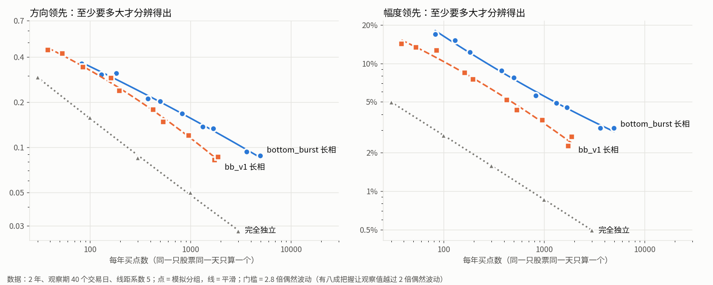

# 这份数据能分辨多大的选股优势

研究票：[这份数据能分辨多大的选股优势](../issues/02-resolution.md)。日期 2026-10-06。

## 先说人话

**做了什么。** 拿普通买入拼出成千上万个「假 pattern」：它们的买点长得和现役的 bottom_burst、bb_v1 一模一样——哪几天出手、一只股票命中几回、每回连着买几天、偏爱哪种波动水平的股票，全部照抄——只是把每只股票整体换成另一只无关的、波动水平相近的股票。这样的假 pattern 毫无选股能力，它对同日普通买入对照（`path2/CONTEXT.md:155`）的领先本该是零；实际算出来的领先忽高忽低，这个摆动幅度就是「偶然波动」。再把买点按比例删稀、改变年数和观察期长度，看偶然波动怎么变，反推「真实优势至少要多大才分辨得出」。

**说明什么。**

- 决定偶然波动的主要不是买点有多少，而是**命中了多少只不同的股票**。同一只股票相邻几天的买点，结果几乎一样（隔一天相关 0.86）；照现役 pattern 的扎堆程度，一个买点只顶完全独立时的 1/4 到 1/19，有效的独立样本大致等于命中过的股票数（0.5 到 1 倍左右，买点很密时可到 1.5 倍）。
- 按保守的长相（bottom_burst 那样扎堆）、观察期 40 个交易日、一次事先写好的检查算：**每年 1000 个买点用满 4 年，方向领先要 0.12 以上、幅度领先要 4 个百分点以上才分辨得出；只有 2 年时要 0.16 和 5.5 个百分点；只有 1 年时要 0.22 和 8 个百分点。** 像 bb_v1 那样分散一些的长相，门槛低 20%~40%。
- 过去见过的效果远在门槛之下：bottom_burst 现役对同日对照的方向领先约 +0.006，参数改动的效果约 0.03。新 pattern 要在这份数据上「看得出来」，优势得比这些大一个数量级，或者买点要分散到更多不同的股票上。
- 观察期越短，偶然波动越小（相邻买点的观察窗重叠少）；但观察期缩短时，首次穿越（`path2/CONTEXT.md:148`）的上下线也得跟着收窄，否则 5 个交易日里只有 4% 的买点碰得到线。
- tune-gates-v3 自带的偶然波动估计（按整只股票重抽）大体可信，但通常偏小 10%~20%，买点只有几百个以下时常偏小 15%~25%。

**不说明什么。**

- 不说明任何现有 pattern 好不好：全程没读任何 pattern 的成绩，只借用了它们买点的位置。
- 门槛针对「一个事先写好的候选、检查一次」。如果先试很多方向或很多组参数再挑最好的，门槛还要往上加，本研究没算这部分。
- 数据只含仍在交易的股票（无退市股），偶然波动是在这个股票池上量的；幸存者偏差会不会抬高成绩是另一张票的事。
- 偶然波动之外还有一种「系统性白得的领先」：只要偏好某种波动水平，什么都不会也能领先或落后一截（见第 6 节）。它不随样本变大而消失，门槛表管不了它。

## 1. 偶然波动有多大

图里每条线是一种买点长相，纵轴是「至少要这么大的真实领先才分辨得出」（= 2.8 倍偶然波动，含义见文末「口径」）。三条线的差距就是「买点不独立」的代价：同样每年 1000 个买点，完全独立时方向门槛约 0.05，照抄 bottom_burst 的扎堆程度就要 0.16。

下表是 1 倍偶然波动（观察期 40 个交易日、线距系数 5；括号里是这么多买点大约分布在几只股票上；带 \* 的格子超出了模拟覆盖的范围，是按曲线外推的）。

**方向领先的偶然波动**（单位是方向成绩：（先上 − 先下）/ 全部买点）

| 每年买点数 | bottom_burst 长相：1 年 | 2 年 | 4 年 | bb_v1 长相：1 年 | 2 年 | 4 年 | 完全独立：1 年 | 2 年 | 4 年 |
|---|---|---|---|---|---|---|---|---|---|
| 30 | 0.30\*（7 只） | 0.18\* | 0.14\* | 0.25（10 只） | 0.18\* | 0.15\* | 0.14 | 0.10 | 0.08 |
| 100 | 0.19（22 只） | 0.12 | 0.10 | 0.15（32 只） | 0.12 | 0.09 | 0.07 | 0.06 | 0.05 |
| 300 | 0.12（55 只） | 0.09 | 0.07 | 0.10（90 只） | 0.07 | 0.06 | 0.04 | 0.03 | 0.03 |
| 1000 | 0.08（120 只） | 0.06（232 只） | 0.04（430 只） | 0.06（273 只） | 0.04（510 只） | 0.03（911 只） | 0.022 | 0.017 | 0.014 |
| 3000 | 0.05（205 只） | 0.04（369 只） | 0.03（632 只） | 0.04\* | 0.02\* | 0.02\* | 0.012 | 0.010 | 0.008 |

**幅度领先的偶然波动**（单位是前瞻收益（`path2/CONTEXT.md:141`）中位数之差，0.01 = 1 个百分点）

| 每年买点数 | bottom_burst 长相：1 年 | 2 年 | 4 年 | bb_v1 长相：1 年 | 2 年 | 4 年 | 完全独立：1 年 | 2 年 | 4 年 |
|---|---|---|---|---|---|---|---|---|---|
| 30 | 0.168\* | 0.109\* | 0.061\* | 0.143 | 0.060\* | 0.048\* | 0.025 | 0.018 | 0.012 |
| 100 | 0.087 | 0.058 | 0.038 | 0.059 | 0.037 | 0.028 | 0.014 | 0.010 | 0.007 |
| 300 | 0.050 | 0.034 | 0.024 | 0.031 | 0.022 | 0.016 | 0.008 | 0.006 | 0.004 |
| 1000 | 0.029 | 0.020 | 0.015 | 0.018 | 0.012 | 0.009 | 0.004 | 0.003 | 0.002 |
| 3000 | 0.019 | 0.013 | 0.009 | 0.012\* | 0.007\* | 0.005\* | 0.003 | 0.002 | 0.001 |

读法举例：bottom_burst 长相、每年 1000 个买点、2 年，一个毫无选股能力的 pattern，对同日对照的方向领先有三分之一的机会落在 ±0.06 之外，幅度领先有三分之一的机会落在 ±2 个百分点之外。

数字的大小感：观察期 40 日时，全市场普通买入有 56% 在 40 天内碰到线，其中先碰上线的约占一半（27% 先上、29% 先下）。方向领先 0.1 大约相当于「碰到线的买点里先涨的比例」从 48% 提到 57%。全市场普通买入 40 日前瞻收益的中位数约 10.6%，bb 系偏爱的高波动股票同日对照约 18%；幅度领先 4 个百分点就是把 18% 提到 22%。

「每年买点数」换成每日名单：每年 1000 个买点 ≈ 平均每个交易日名单上 4 只（同一只票连续出现几天就算几次）。

## 2. 要分辨出多大的优势、需要什么

**最小可分辨领先 = 2.8 × 偶然波动**（左 / 中 / 右 = bottom_burst 长相 / bb_v1 长相 / 完全独立；观察期 40 日）

| 每年买点数 | 方向：1 年 | 方向：2 年 | 方向：4 年 | 幅度：1 年 | 幅度：2 年 | 幅度：4 年 |
|---|---|---|---|---|---|---|
| 30 | 0.84\* / 0.70 / 0.40 | 0.51\* / 0.50\* / 0.29 | 0.40\* / 0.42\* / 0.23 | 47%\* / 40% / 7% | 31%\* / 17%\* / 5% | 17%\* / 13%\* / 3.5% |
| 100 | 0.53 / 0.43 / 0.21 | 0.35 / 0.33 / 0.16 | 0.28 / 0.26 / 0.13 | 24% / 17% / 3.8% | 16% / 10% / 2.7% | 11% / 7.7% / 1.9% |
| 300 | 0.35 / 0.27 / 0.12 | 0.24 / 0.21 / 0.09 | 0.19 / 0.16 / 0.07 | 14% / 8.5% / 2.2% | 9.5% / 6.3% / 1.6% | 6.8% / 4.6% / 1.1% |
| 1000 | 0.22 / 0.16 / 0.06 | 0.16 / 0.12 / 0.05 | 0.12 / 0.09 / 0.04 | 8.1% / 4.9% / 1.2% | 5.5% / 3.4% / 0.9% | 4.1% / 2.5% / 0.6% |
| 3000 | 0.15 / 0.10\* / 0.03 | 0.10 / 0.06\* / 0.03 | 0.08 / 0.06\* / 0.02 | 5.2% / 3.4%\* / 0.7% | 3.5% / 1.8%\* / 0.5% | 2.5% / 1.4%\* / 0.4% |

（幅度一栏的百分数是「前瞻收益中位数之差」的百分点。）

**反过来查：要分辨出某个领先，最少要多少买点、覆盖多少只股票**（观察期 40 日；「做不到」= 需要的买点数超过这种长相能模拟到的最大值的 1.5 倍——再往上加买点，长相本身就变了，曲线不可信）

| 想分辨的领先 | 长相 | 1 年 | 2 年 | 4 年 |
|---|---|---|---|---|
| 方向 0.05 | bottom_burst / bb_v1 | 做不到 / 做不到 | 做不到 / 做不到 | 做不到 / 做不到 |
| 方向 0.05 | 完全独立 | 每年 1500，约 1200 只 | 每年 930，约 1500 只 | 每年 640，约 1900 只 |
| 方向 0.08 | bottom_burst / bb_v1 | 做不到 / 做不到 | 每年 5900\*，440 只 / 每年 2000\*，900 只 | 每年 2700，620 只 / 每年 1400，1160 只 |
| 方向 0.12 | bottom_burst / bb_v1 | 每年 5700\*，260 只 / 每年 2000，500 只 | 每年 2100，320 只 / 每年 930，480 只 | 每年 1000，430 只 / 每年 570，590 只 |
| 幅度 2% | bottom_burst / bb_v1 | 做不到 / 做不到 | 做不到 / 每年 2600\*，1100 只 | 每年 4700\*，690 只 / 每年 1600，1300 只 |
| 幅度 2% | 完全独立 | 每年 380 | 每年 190 | 每年 90 |
| 幅度 3% | bottom_burst / bb_v1 | 做不到 / 做不到 | 每年 4700，420 只 / 每年 1300，620 只 | 每年 2000，560 只 / 每年 710，690 只 |
| 幅度 5% | bottom_burst / bb_v1 | 每年 3300，210 只 / 每年 950，260 只 | 每年 1300，260 只 / 每年 480，270 只 | 每年 630，340 只 / 每年 250，290 只 |

几件从表里读出来的事：

- **方向领先 0.05 以下，照 bb 系的扎堆程度在这份数据上分辨不出来，无论买点多密。** bottom_burst 现在每年约 4000 个买点，用满 4 年偶然波动约 0.025，门槛约 0.07；bb_v1 每年约 1600 个，4 年门槛也约 0.07。买点多了一倍多，门槛几乎不动——多出来的买点大多落在已经命中过的股票、已经在买的那几天上。
- **能压低门槛的是「分散」，不是「频繁」。** 同样每年 1000 个买点、4 年，完全独立时方向门槛 0.04，bb_v1 长相 0.09，bottom_burst 长相 0.12。要靠近独立那条线，买点得分到上千只不同的股票、每次只买一两天。
- **年数的作用被 v3 的近期加权打了折。** v3 给一年前的成绩只算一半权重，4 年数据大约只顶 2.6 年等权的证据；4 年时 v3 口径的偶然波动比「全部买点等权合并」大 15%~30%。
- **每年几十个买点的 pattern，分辨不出任何合理大小的优势**（方向门槛 0.3 以上）。名单要短，就得接受只有大得惊人的优势才能被看见。
- **「两证都要赢」让门槛再高约一成。** 同一个假 pattern 的方向领先和幅度领先，偶然部分相关约 0.5（同涨同跌）。两个都要越过 2 倍偶然波动时，毫无能力的 pattern 蒙混过关的机会从约 2% 降到约 0.4%；但两个真实优势都刚好在上表门槛上时，同时被看出的机会只有约三分之二。要八成把握同时看出，两个优势各自要到约 3.2 倍偶然波动，即上表的数再乘 1.15。

## 3. 买点不独立的折扣有多大，从哪来

**折扣大小**（观察期 40 日；数字 = 同样买点数下，偶然波动的平方是完全独立时的几倍；括号里 = 有效独立样本 ÷ 命中股票数）

| 长相 | 年数 | 每年 100 | 每年 300 | 每年 1000 | 每年 3000 |
|---|---|---|---|---|---|
| bottom_burst | 1 | 6.5（0.69） | 9.0（0.60） | 13.2（0.63） | 19.0（0.77） |
| bottom_burst | 2 | 4.9（0.99） | 7.3（0.76） | 10.6（0.81） | 13.8（1.18） |
| bottom_burst | 4 | 4.5（1.08） | 6.6（0.88） | 9.2（1.01） | 11.9（1.60） |
| bb_v1 | 1 | 4.3（0.71） | 5.6（0.59） | 7.0（0.52） | 8.3\* |
| bb_v1 | 2 | 4.4（0.71） | 5.4（0.62） | 5.7（0.68） | 5.2\* |
| bb_v1 | 4 | 4.0（0.81） | 4.7（0.76） | 5.5（0.80） | 6.1\* |
| 每段连买 5 天、股票随机 | 1~4 | 5.0~6.0 | 5.5~7.2 | 6.2~7.8 | 6.3~7.3 |

以上是方向领先。幅度领先的折扣大得多（bottom_burst 长相 32~52 倍，bb_v1 长相 14~23 倍），但大头不是扎堆：bb 系偏爱高波动股票，这些股票本身涨幅就分散得多。把同样的长相换成「不管波动水平随机换股」，幅度偶然波动缩到一半以下（bottom_burst 长相 1 年：0.018 → 0.008），剩下的扎堆折扣约 9 倍（bottom_burst）和 4 倍（bb_v1），与方向相当。

**折扣从哪来**——三个来源，大小依次：

1. **同一只股票相邻几天连买。** 相邻买点的观察窗大部分重叠，结果高度相关：方向结果隔 1 天相关 0.86、隔 5 天 0.67、隔 10 天 0.51、隔 20 天 0.28，隔满一个观察期（40 天）才降到约 0.01。bb 系的买点常在一个企稳段（`path2/CONTEXT.md:30`）里连买好几天：bottom_burst 每段平均 4.6 天，但按买点算，一个买点所在的段平均长 12.7 天；bb_v1 分别是 3.2 天和 6.4 天。
2. **同一只股票反复命中。** bottom_burst 的 17,325 个买点只落在 735 只股票上，平均每只 5 段、23 个买点；bb_v1 的 7,504 个买点落在 1,463 只上，平均每只 1.6 段、5 个买点。隔得远的两段之间相关很弱（方向约 0.01~0.02、幅度约 0.03），但段数一多也会累积。
3. **相似的股票在同一段时间里一起被选中。** bb 系同一段时间里选中的不同股票，走势相似度平均 0.03，比随便两只股票（0.001）高——主要是因为它们都是高波动股票，高波动股票彼此更同步。这部分已经包含在模拟里：按波动水平换股后，买点之间的相似度仍是 0.029，几乎没变。单独估算，它给偶然波动的平方加了约 1/6~1/4。

所以对一个新 pattern，最好用的估算是：**有效独立样本 ≈ 命中过的不同股票数（0.5~1 倍）**；方向领先的 1 倍偶然波动 ≈ 0.7 ÷ √(有效样本)，再按 v3 的近期加权乘 1.1~1.3。

## 4. 观察期长度的影响

（2 年；每年 300 / 1000 个买点；括号外 bottom_burst 长相、括号内 bb_v1 长相）

| 观察期（交易日） | 线距系数 | 碰到线的比例 | 方向偶然波动：每年 300 | 每年 1000 | 幅度偶然波动：每年 300 | 每年 1000 | 同日对照中位前瞻收益 | 每年 1000 时幅度波动占对照中位的比例 |
|---|---|---|---|---|---|---|---|---|
| 5 | 5（默认） | 4% | 0.019（0.016） | 0.010（0.009） | 0.006（0.004） | 0.003（0.002） | 6.1% | 5% |
| 5 | 1.77（随窗口缩放） | 37% | 0.047（0.043） | 0.026（0.023） | 同上 | 同上 | 同上 | 同上 |
| 20 | 5（默认） | 29% | 0.061（0.051） | 0.037（0.029） | 0.018（0.013） | 0.011（0.007） | 12.6% | 9% |
| 20 | 3.54（随窗口缩放） | 50% | 0.074（0.065） | 0.045（0.036） | 同上 | 同上 | 同上 | 同上 |
| 40 | 5（默认） | 57% | 0.086（0.074） | 0.056（0.041） | 0.034（0.022） | 0.020（0.012） | 18.2% | 11% |
| 120 | 5（默认） | 92% | 0.117（0.094） | 0.078（0.054） | 0.075（0.046） | 0.046（0.026） | 33.0% | 14% |
| 120 | 8.66（随窗口缩放） | 66% | 0.110（0.086） | 0.074（0.050） | 同上 | 同上 | 同上 | 同上 |

- 观察期越短，偶然波动越小：相邻买点的观察窗重叠少，连买几天带来的相关就弱（观察期 5 日时隔 5 天的相关已经是 0，40 日时隔 30 天还有 0.11）。幅度按对照中位数折算后，5 日比 120 日精细约 3 倍。
- 但方向的数值不能跨观察期直接比：碰到线的比例不同，方向成绩能达到的范围也不同。线距用默认 5 时，5 日观察期只有 4% 的买点碰到线，方向成绩几乎恒为 0——偶然波动小只是因为没东西可量。短观察期要用方向，就得把线距按 √(观察期/40) 一起缩小（表中「随窗口缩放」那几行），这时 5 日观察期的方向偶然波动约是 40 日的一半。
- 较短观察期分辨得更细，前提是 pattern 的优势在短期里也同样大；这一点本研究量不到，只是说明尺子本身在短期更精细。

## 5. 与已知量级的核对

| 已知量级（来源口径） | 本研究对应的数 | 对得上吗 |
|---|---|---|
| bottom_burst 全池训练段（2024-07-01..2025-10-31）方向领先偶然波动 ±0.040（v3 按整只股票重抽，用的是真实买点与真实成绩） | 同一时段、照抄 bottom_burst 长相的假 pattern：真实偶然波动 0.035，对它们跑 v3 的同一重抽算法平均 0.035 | 对得上。剩下的差距可能是真实买点的股票比「同波动档随机换的股票」更集中 |
| 同一只股票内首次穿越结果的组内相关约 0.87 | 同股隔 1 天的方向结果相关 0.86（观察期 40 日） | 对得上，说的是连买几天这一层 |
| 设计效应 2.8 到 7~10（不同研究口径） | bb_v1 长相 4~8，连买 5 天 5~8，bottom_burst 长相 4.5~19（买点越密越大） | bb_v1 落在已知范围；bottom_burst 更扎堆，超出范围的上沿 |
| bb_v1 两年约一千个事件只分辨得出 3.5~4.8 个百分点 | bb_v1 长相 2 年满频率：方向门槛 0.09（2.8 倍）/ 0.064（2 倍），折成「先涨比例」约 8 / 5.7 个百分点 | 量级相同但本研究的更大，口径不同所致：那份研究比的是两组相近参数之间的差，两边大部分买点共享、偶然部分相互抵消；这里比的是 pattern 对同日对照 |

另外核对了 v3 自带的偶然波动估计准不准：在 96 组「照抄长相」的配置上（4 档观察期 × 2 种长相 × 12 组频率与年数），v3 的按整只股票重抽给出的数，中位是真实偶然波动的 0.83~0.89 倍；买点只有几百个以下时多在 0.73~0.86 倍。可能的原因：重抽把不同股票当成互不相关，漏掉第 3 节的第三个来源；买点少时重抽本身也偏小。用 v3 报的偶然波动做判断时，宜乘 1.2 左右（买点很少时 1.3；待验证）。

## 6. 副产品：偏好某种波动水平，能白得一截领先

同日普通买入对照按当天的波动尺度 M 切五档来配对，本意是把「挑高波动股」的影响扣掉。但每档内部的波动水平仍有差别，档的两头尤其明显。一个什么都不会、只是偏爱某种波动水平的 pattern，会稳定地领先或落后一截。这不是偶然波动——样本再大也不消失，第 1~2 节的门槛管不了它。以下只用买点当天及以前就知道的信息挑股票（观察期 40 日、线距 5；方向用全部买点等权合并的领先，幅度用中位数之差）：

| 只挑这类股票日 | 方向领先：同日五档 / 十档 / 二十档对照 | 幅度领先：五档 / 十档 / 二十档 |
|---|---|---|
| 当天波动排在全市场最低 2% | +0.24 / +0.21 / +0.15 | −2.5 / −1.3 / −0.6 个百分点 |
| 当天波动排在全市场最高 2% | −0.08 / −0.05 / −0.03 | +8.4 / +4.7 / +2.2 个百分点 |
| 平时最疯的一成股票（过去 250 天波动中位数排第 10 档） | −0.04 / −0.04 / −0.03 | +4.5 / +3.3 / +3.0 个百分点 |
| 平时排第 9 档 | −0.00 / −0.00 / −0.00 | +1.0 / +0.9 / +0.8 个百分点 |
| 平时排第 8 档 | +0.03 / +0.03 / +0.03 | +1.1 / +0.9 / +0.9 个百分点 |
| 平时排第 6 档（中间） | −0.00 / −0.00 / −0.00 | +0.3 / +0.2 / +0.2 个百分点 |
| 平时最安静的一成（第 1 档） | −0.00 / −0.02 / −0.03 | −1.2 / −0.3 / −0.2 个百分点 |

（两年、每次 2000 个买点、40 次平均；表中平均值的抽样误差方向约 0.003、幅度约 0.3 个百分点以内。第 8 档方向 +0.03 而第 9、10 档不是，原因没查。）

- **最低波动的那 2% 股票日，方向白赚约 +0.29**（不抽样、全部股票日计；2021~2026 每年都为正，+0.12 到 +0.41）。查了是谁：这些股票日一半来自约 150 只交易所挂牌的债券、票据、优先股一类证券（例如 OXLCZ、SAY、GJS），价格向面值靠拢、日波幅只有 0.2% 左右，几乎总是先碰上线。也就是说，**现在的股票池里混着一批不是普通股的证券**，偏爱「极度安静」的 pattern 会被它们抬高方向成绩。
- **最高波动的那 2%，幅度白赚约 8 个百分点**（全部股票日计，幅度按「超出所在档中位数的部分」取中位数；每年 +5 到 +11 个百分点），方向则白亏（2022~2026 每年为负）。
- **把当天波动切得更细，管用但不彻底**：二十档对照把两头的白得砍掉四成到四分之三，但对「平时就很疯的股票」几乎没用（幅度仍白赚 3 个百分点）——平时就疯的股票和平时安静、只是这几天波动大的股票，落在同一档里，走法却不同。
- 对 bb 系的影响：按整段时期的波动分十档，bottom_burst 的买点约九成、bb_v1 约八成落在第 7~10 档的股票上。照它们长相随机换股的假 pattern，平均白得方向 −0.018、幅度 +1.6 个百分点（bottom_burst 长相），−0.006 和 +1.0 个百分点（bb_v1 长相）。这两个数用的是整段时期的波动分档，含少量买点之后的信息，只作量级参考。
- 高波动这头，方向和幅度往相反方向偏（幅度白赢、方向白输），所以**「两证都要赢」恰好能挡住靠偏爱高波动股混出来的领先**；但低波动那头是方向白赢、幅度白输，只看方向会被骗。

## 待验证的默认值

| 默认 | 取值 | 为什么这么取 | 若改了会怎样 |
|---|---|---|---|
| 「分辨得出」的门槛 | 真实领先 ≥ 2.8 倍偶然波动 | 观察值要越过 2 倍偶然波动才算数（单次检查误报约 2%），2.8 倍时有八成把握越过 | 改成 2 倍：门槛降约 30%，但真实优势正好在门槛上时只有一半机会被看出 |
| 观察期几档 | 5 / 20 / 40 / 120 个交易日 | 覆盖几天、一个月、v3 默认、半年；名单规格未定 | 结论的方向（越短越细）不变 |
| 短/长观察期的线距 | 默认 5；另给按 √(观察期/40) 缩放的版本 | 默认 5 在 5 日观察期几乎碰不到线 | 名单规格定了观察期后再定线距 |
| 幅度领先的对照口径 | 买点前瞻收益中位数 − 同日同档普通买入混合后的中位数（每档按买点个数配比） | v3 只给方向的同日对照，幅度对照为空；这是方向对照配比的直接推广 | 另算的检查口径（各买点超出所在档中位数的部分取中位数）偶然波动相近 |
| 用什么「长相」当保守情形 | bottom_burst 的长相 | 两个现役 pattern 里它最扎堆，门槛宁高勿低 | 新 pattern 若明显更分散，按 bb_v1 或「有效样本 ≈ 股票数」估算 |
| 稀疏 pattern 的长相 | 随机删掉现役 pattern 的整段买点 | 假定更严格的 pattern 每段的样子不变、只是段更少 | 若更严格的 pattern 段更短、更分散，实际门槛会更低 |
| 换股时的波动配对 | 按整段时期 M 中位数分十档，同档换 | 保住 bb 系偏爱高波动股这一特征 | 整段时期的波动含少量买点之后的信息，会让幅度的偶然波动略偏大（偏保守） |

## 口径

- **数据与时段**：`datasets/pkls/` 全部 5778 只（2021-10-08 至 2026-10-05，全是仍在交易的股票）。普通买入 = 每只股票每个交易日买一次。可用买点日期：观察期 5 日 2021-11-04..2026-09-28，20 日 ..2026-09-04，40 日 ..2026-08-07，120 日 ..2026-04-14（前端要 20 天算波动尺度，后端要留满观察期）。每次重复在这个范围里随机放一段 1 / 2 / 4 年的时段；与 bottom_burst 训练段核对时固定在 2024-07-01..2025-10-31。本研究只读普通买入，不读任何 pattern 成绩，不受留着没碰过的数据的限制。
- **现役 pattern 的长相**：bottom_burst、bb_v1 用现役参数在全部股票的整段数据上跑检测，只记买点落在哪只股票、哪一天（买点取法与 v3 相同：去掉确认根之前和首部缓冲不足的，同股同日去重），不算买点之后的任何涨跌。
- **标签**：直接调用 tune-gates-v3 的收盘首次穿越：买点收盘价为起点，上下线 = 收盘价 ×(1+k×M) 与 ÷(1+k×M)，M 是最近 20 天真实波幅占收盘价比例的中位数；之后按收盘价判先上 / 先下 / 观察期内都没碰到。前瞻收益 = 观察期内最高价 ÷ 买点收盘价 − 1。
- **同日普通买入对照**：照 v3，每个交易日按 M 切至多五档，档内全部普通买入的方向均值；方向领先照 v3 的窗口算法（21 个交易日一个窗口、窗口间按一年半衰的近期权重平均）。本研究的向量化实现与 v3 原代码逐位一致（三组抽查差异 ≤ 3e-17）。
- **偶然波动** = 同一种长相重复 400 次，领先减去该长相的平均值后的均方根。减平均值是因为换股时保留了「偏爱高波动」，平均值里有第 6 节说的系统偏移，那不是偶然波动。真实长相的假 pattern 每次的买点数随所放时段变化，所以按买点数分组，再在对数坐标上用平滑曲线连起来。
- **门槛倍数 2.8**：观察到的领先要超过 2 倍偶然波动才算分辨出来；真实领先为 2.8 倍偶然波动时，有约八成机会做到。

## 复现

脚本都在 `.scratch/selection-pattern/scripts/`，按顺序 `uv run python` 运行（大体积中间数据写在会话临时目录，脚本可重新生成）：

1. `02-labels.py` —— 全部股票逐日普通买入标签（观察期 5/20/40/120；另跑线距缩放版：`02-labels.py 5 --k 1.7678` 等）。
2. `02-structure.py bottom_burst`、`02-structure.py bb_v1` —— 现役 pattern 买点位置；`02-structure-stats.py` 出长相统计（`02-structure-stats.txt`）。
3. `02-validate.py` —— 与 v3 原代码逐位核对（`02-validate.out`）。
4. `02-diag.py`（同股相关，`02-diag-acf.csv`）、`02-diag-cross.py`（跨股相关，`02-diag-cross.txt`）、`02-groups.py`（`02-groups.txt`）。
5. `02-sim.py <观察期> [--k 线距]` —— 主模拟，逐次结果 `02-sim-H*_k*.csv.gz`。
6. `02-report.py` —— 汇总表 `02-report-tables.txt` 与本文的图。
7. `02-voltilt-past.py`（第 6 节的表，只用当天已知的波动）、`02-voltilt-extreme.py`（最低 / 最高 2% 的逐年数与证券构成）；`02-voltilt.py` 是按整段时期波动分档的早期版本（含未来信息），只留作对照。
