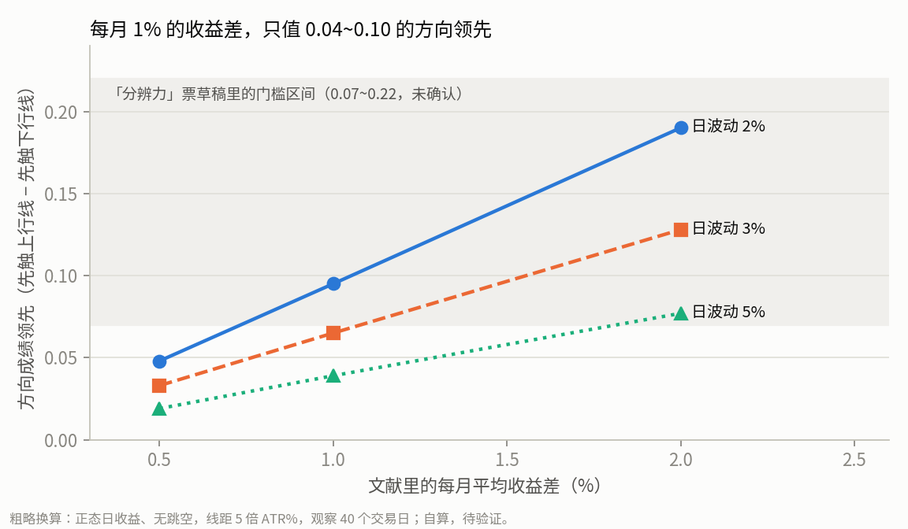
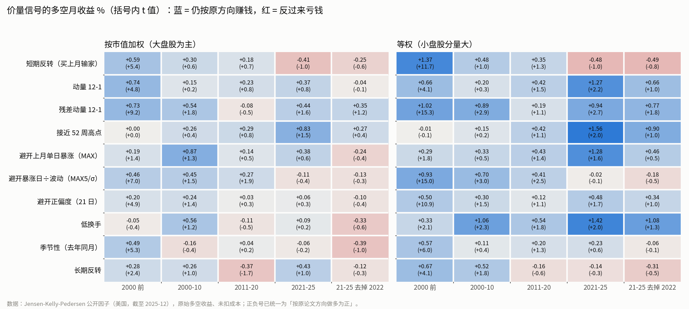

# 文献里哪些量价规律扣掉波动率和大盘后仍能选股

本文件所有项目内路径均相对 repo root。

## 先说结论

**做了什么。** 查了近百篇论文，多数读到原文或作者公开的版本，少数只读到摘要（逐条标明）。收录标准是：只用个股日线的开高低收和成交量就能定义，并且在同一天、同一波动水平的股票之间比较时，对后续收益仍有预测力。按「单日暴涨与彩票股」「成交量」「趋势、反转与新高」「图形形态与机器读图」四组，逐条记下定义、方向、大小、持有期，以及发表后还在不在。实务界流传的形态也收进来，并单独标出它们有没有经过严肃检验。

另外做了两件事。一是用三套公开的复现数据（Jensen-Kelly-Pedersen、Chen-Zimmermann、Ken French），把常见价量信号按时段切开，重点看 2021 年以后还剩多少，因为本项目的数据正好是 2021-10 到 2026-10。二是粗算了一笔账：文献里「每月多赚 1%」这种效果，换到本项目「先涨还是先跌」那把尺子上大约值多少。

**结论是什么。**

1. **文献里的平均效果，放到本项目的尺子上普遍太小。** 每月 1% 的平均收益差，大约只值 0.04～0.10 的方向领先（见图 1）。而「这份数据能分辨多大的选股优势」那张票目前写下的门槛是 0.07～0.22，那张票还没经你确认。何况文献报的多是「最好一档减最差一档」，一个 pattern 对同日对照能拿到的大约只有其中一半。只有「事件型、效果集中在少数买点上」的现象才有希望越过门槛。
2. **2010 年以后，这些效果大多减半或消失。** 2021–2025 年按大盘股权重算，没有一个价量信号站得住。按等权算还剩几个，主要靠 2022 年一年撑着（见图 2）。还剩下的效果，大多出在「该避开谁」那一侧，比如过去的输家、离一年高点很远的股票、单日暴涨的彩票股，而不是「该买谁」那一侧。对一个只出买入名单的 pattern 来说，文献更多是在告诉你哪些买点该删。
3. **和 bb 主线语义直接相关的几条，多数方向相反：**
   - **底部加单日暴涨，正是文献里表现最差的那一格。** 这类股票的持有人整体还在亏钱，单日暴涨让它像一张彩票。
   - **离一年高点很远的股票会继续弱。**
   - **靠少数几根大阳线堆出来的涨幅不延续，几年后还会回吐。**
   - **散户扎堆追涨之后，20 天里约三分之二收跌。**
   - **买近期跌下来的股票这件事本身，2010 年后已经不带优势。**
4. **站在 bb 这边、或值得另起走势的几条：**
   - 成交量相对自己的历史突然放大、但当天涨幅不极端，之后一两个月偏涨；
   - 上个月涨且换手高的股票，下个月继续涨，文献明确检验过这不是波动率造成的；
   - 靠很多小阳线稳步涨上来的会延续；
   - 刚创出、并且接近一年新高的股票更好；
   - 回踩没跌破突破价的，比跌破的后续涨得多。最后这条只有实务统计。
5. **实务形态普遍缺少严肃检验。** 杯柄、旗形、VCP、Darvas 箱体、波动收缩后突破、突破回踩，都没找到带对照组的严肃检验。被检验过的几种形态（头肩、K 线组合、区间突破），结论要么是「之后的涨跌分布形状不同，但不给可赚的方向」，要么是「1987 年后失效」。

**不说明什么。**

- 没有一篇文献用本项目的尺子，即同一天、同一波动档、先触哪条线。文献报的是月度平均收益，多半是两个极端分组之间的差。平均数和中位数常常不同向。
- 所有对 bb 语义的推断都只是推断，本研究没有在本项目数据上读过任何 pattern 的成绩。
- 文献样本包含退市股，本项目数据不含。凡是「底部、彩票、困境」类的负面结论，在本项目数据上很可能被冲淡。这件事归「幸存者偏差会把哪类 pattern 的成绩抬多高」那张票。

---

## 怎么读这份文件

**词表对照。** 文中提到的走势与度量用 `path2/CONTEXT.md` 的词：

| 词 | 出处 |
|---|---|
| 突破 | `path2/CONTEXT.md:11` |
| pk | `path2/CONTEXT.md:15` |
| burst（一串密集突破） | `path2/CONTEXT.md:24` |
| 回踩 | `path2/CONTEXT.md:27` |
| 企稳段 | `path2/CONTEXT.md:30` |
| 走势区段 | `path2/CONTEXT.md:36` |
| 平台段 | `path2/CONTEXT.md:39` |
| 派发 | `path2/CONTEXT.md:42` |
| where | `path2/CONTEXT.md:102` |
| 前瞻收益 | `path2/CONTEXT.md:141` |
| 首次穿越 | `path2/CONTEXT.md:148` |
| 同日普通买入对照 | `path2/CONTEXT.md:155` |

**证据分级：**

- **强**：多个独立团队复现过，在大规模复现研究里仍显著，发表后或海外仍成立。
- **中**：顶刊发表、稳健性检验较全，但复现有限，或发表后明显衰减，或有相反证据。
- **弱**：只有单篇、复现失败、实务流传，或从未被严肃检验。

另外，凡是 2010 年后在公开数据里已经消失的，即使原文很强，也降一档。

**「改方向」还是「改幅度」怎么判。** 这是我按文献报告的分布信息推的，规则如下：

- 整体平移：之后的平均数和中位数一起变，或报告了「上涨概率」的变化。这种两把尺子都会动，记作「方向 + 幅度」。
- 只靠右尾：平均数靠少数暴涨撑着、中位数反向或不动。这种主要改幅度，方向可能反而变差，记作「幅度（方向可能反向）」。
- 只改变之后的波动：比如突破之后波动变大。这种只会抬高前瞻收益，方向不动。记作「只抬幅度」。这正是 bb 过去「好成绩大多在读波动率」的一种来源。

**图 1：文献的月收益差换算成方向领先（粗算，自算，待验证）**

假设如下：日收益正态、没有跳空，上下线距用 5 倍 ATR%，观察 40 个交易日，与 `path2/eval.py` 的默认值一致。方向成绩是「先触上行线的比例减先触下行线的比例」，没触线的也算进分母。

读法：每月 1% 的收益差，在日波动 2% 的股票上值约 0.10，在日波动 5% 的小盘股上只值约 0.04。

脚本与输出：`.scratch/selection-pattern/scripts/03-drift_to_fp.py`、`03-drift_to_fp_out.txt`。

**图 2：常见价量信号在各时段的多空月收益（JKP 公开数据）**

- 蓝色表示仍按原论文方向赚钱，红色表示反过来亏钱；格子里写的是月收益 %，括号里是 t 值。
- 左边按市值加权，以大盘股为主；右边等权，小盘股分量大。
- 最右一列去掉了 2022 年。2022 年那一年对 2021–2025 的结果影响极大。
- 完整表格在 `.scratch/selection-pattern/scripts/03-factor_recent_output.csv`。同一文件还有 Chen-Zimmermann 和 French 的交叉核对，以及每段扣掉大盘后的超额。

---

## 总表

| 编号 | 现象（白话） | 方向、大小、持有期（原文口径） | 2010 年后 | 小盘 | 改方向还是幅度 | 能对应的走势 | 证据 | 对 bb |
|---|---|---|---|---|---|---|---|---|
| A1 | 上个月有过单日暴涨（MAX） | 看跌。最高一档减最低一档每月 −1.03%（市值加权），下月中位数 −2.5% 对 +0.35%；持有约 1 月 | 市值加权、按大盘股分界不显著；只剩微小盘 | 微小盘更强 | 方向（幅度可能反向：右尾更肥） | burst 内最大单日涨幅 | 中 | **相反** |
| A2 | 暴涨日按自身波动打折后仍偏大（SMAX / MAX5÷波动） | 看跌。在同一波动五分档内每月 −0.3%～−1.3%，波动越高越强；只在第 1 个月 | 2021–25 两种加权都归零 | 小盘更强 | 方向 | 同上，除以波动 | 中（近年弱） | 相反，但已弱 |
| A3 | **持有人整体浮亏时的彩票股** | 看跌。浮亏区里高 MAX 减低 MAX 每月 −1.38%，同一波动十分档内仍有 −0.74%～−1.52%；浮盈区反而 +0.54%；1 月 | 样本到 2014，没有后续复现 | 低价股极强（−3.0%） | 方向 | burst 加「浮盈浮亏」新字段 | 中 | **最直接的反面** |
| A4 | 扣掉大盘和行业后剩下的日波动大（特质波动率） | 看跌。每月 −1.06%；与总波动相关 >0.98 | 只剩微小盘 | 微小盘集中 | 已被同波动档配对扣掉 | 无需 | 中 | 尺子已中和 |
| A5 | 日收益偏度大（右偏） | 短窗口用日数据时正负号随加权方式翻转 | 2011 后只剩极小盘 | 极小盘 | 不清 | 无 | 弱 | 无 |
| A6 | 低价、高波动、高偏度的彩票型股票 | 看跌，但每月只有 −0.11% | 未查 | 本身就是小盘 | 方向（小） | 价格水平字段 | 中（效应小） | 弱相反 |
| A7 | 上个月某几天的涨幅特别「显眼」（显著性） | 看跌。等权每月 −1.9%，控制短期反转后 −0.6% | 没有大规模复现 | 等权强 | 方向 | burst 内日收益 | 中偏弱 | 弱相反 |
| A8 | **散户扎堆追涨 / 带社交热度的暴涨** | 看跌。之后 20 天累计 −4.7%，约 65% 收跌；前 5～10 天跌完就停 | 样本 2018–2022，正是近年 | 只出现在市值小于 10 亿美元的股票 | **方向**（事件型、效果大） | burst 的极端暴涨日 | 中 | 相反；但等回踩恰好躲开了 |
| A9 | 大幅价格冲击有没有消息 | 无消息反转约 8～11%（20 天），有消息延续 | 未查 | 大小盘都成立 | 方向 | K 线看不出有没有消息 | 中 | 只用 K 线判断不了 |
| A10 | 隔夜涨得多（开盘价 ÷ 昨收） | 隔夜继续涨、日内吐回，收盘对收盘几乎为 0 | 未查 | 小盘、难估值股更强 | 收盘口径下几乎没有 | 开盘跳空字段 | 中 | 买在开盘会吃亏 |
| A11 | 浮盈浮亏（按成交量加权的持仓成本） | 线性版：浮盈越大越好，但复现弱；另有 V 形版：大浮盈、大浮亏都偏好 | 弱 | — | 方向 | 新字段：成本线 | 中，且互相矛盾 | 矛盾 |
| B1 | **成交量相对自己过去 50 天突然放大**（高成交量溢价） | 看涨。20 天累计：小盘 +0.94%，大盘 +0.50%；当天涨跌不极端时更强；到 100 天不回吐；成交量偏低的一侧偏跌 | 美国 2000 年后没有可核的数字；41 国成立，中国相反 | 小盘、中盘更强 | 方向 + 幅度（整个分布占优） | 突破的量比 | 中 | **支持放量**；但缩量回踩可能是负信号 |
| B2 | **上个月涨、换手又高 → 下个月继续涨**（短期动量） | 看涨。最高换手十分档每月 +1.37%，最低档 −1.41%；换成波动率排序就消失；持续约 12 个月 | 1991–2018 更强；2019 年后没有数据；中国不成立 | **大盘更强**，微盘反而反转 | 方向 + 幅度 | burst 加月度换手 | 中 | 支持放量突破的延续 |
| B3 | 成交量与动量（高换手的赢家短期更强，2～5 年后反转） | 看涨。高量组赢家减输家每月 1.46%，低量组 0.54% | 公开数据等权仍有 | 大盘也成立 | 方向 | 同上 | 中偏强 | 支持；长期反转不在窗口内 |
| B4 | 成交量决定日 / 周尺度的延续或反转 | 周以内高量偏反转，月度高量偏延续；小盘高信息不对称时放量延续 | — | 视尺度和市值 | 方向 | 突破的量比 | 中（方向互相矛盾） | 不给统一答案 |
| B5 | 放量穿越一年高点或低点 | 穿越时成交量明显放大，之后收益「可靠为正」 | 没有复现 | 小公司更强 | 未知 | 突破，且 pk 是 252 日最高 | 弱到中（幅度未核） | 支持「高位突破」，不支持底部 |
| B6 | 换手、成交额、换手波动、非流动性这类「水平」变量 | 原文显著 | 发表后基本失效，2021 后部分反向 | 原本靠小盘 | — | — | 弱 | 别用 |
| B7 | 过去 5 年成交量越来越大 → 之后偏弱（成交量趋势） | 看跌。发表后等权每月 0.69%（t 5.1），2021–24 仍有 t 3.0 | **少数仍活着的** | 等权强、市值加权弱 | 方向 | 慢变量，不是形态 | 中 | 无直接关系；副产品候选 |
| C1 | 过去 12 个月涨得多（动量） | 看涨，每月 1%～1.5%（1965–89）；崩盘发生在熊市反弹时 | 2000 年后市值加权不显著；只剩避开输家这一侧 | 各市值都有 | 方向 | 走势区段 | 强（但近年弱） | 底部 = 输家，相反 |
| C2 | 扣掉大盘与风格后自身的涨幅，按自身波动标准化（残差动量） | 看涨。波动只有普通动量一半，夏普约翻倍 | 2010 后市值加权归零；等权 2021–25 t 2.7，但靠 2022 | 等权更强 | 方向 | 走势区段 | 中 | 中性 |
| C3 | **离一年高点的距离** | 离高点近看涨；**离得最远那档每月 −0.48%，扣风险后 −0.9%**，不反转 | 作为因子发表后不显著；最远那档的弱势在两篇里都核到 | — | 方向 | 新字段：收盘 ÷ 252 日最高 | 中 | **相反**（底部） |
| C4 | 刚创出一年新高（越近越好）；接近高点时波动下降、突破后波动上升 | 最近创新高减很久前创新高，每月 +0.70% | 未查 | — | 方向；突破后只抬幅度 | 突破的 pk 是否为 252 日最高 | 中偏弱（仅摘要） | 支持高位突破；提醒幅度会被抬高 |
| C5 | **涨幅是很多小阳线累积，还是少数大阳线堆出来的**（信息离散度） | 稳步型 6 个月 +5.94%，跳涨型 −2.07%；3 年后跳涨型 −8.5% | 美国发表后没数据；海外 1993–2020 仍显著 | 小盘、少人关注更强 | 方向 | 走势区段 / burst 内涨日占比 | 中偏强 | **burst 若由大阳线构成则相反** |
| C6 | 买近期跌下来的股票（短期反转） | 原文每月 2%～2.5%；扣掉行业后更强（1.57%） | 2010 后归零，2021 后为负；扣成本后亏 | 微盘撑着 | 方向 | 回踩 | 强（但已死） | 回踩本身不带优势 |
| C7 | 3～5 年的大输家（长期反转） | 原文 36 个月 +24.6% | 2000 后归零；均值靠右尾 | 小盘 | 幅度（中位数为负） | 底部 | 弱（已死） | 底部不带优势 |
| C8 | 短均线 ÷ 长均线（21/200 日），多条均线的趋势信号 | 看涨。均线距离等权每月 1.09%；趋势因子原文 1.63% | 趋势因子发表后归零；均线距离只有作者自己的数据 | 等权强 | 方向 | 走势区段 | 中偏弱 | 支持「站上长均线」 |
| C9 | 同一日历月的季节性 | 原文每月 1.2% | 2000 后归零 | — | — | — | 弱（已死） | 无 |
| C10 | 困境股：低价、高波动、过去大跌、小市值 | 风险最高 1% 年化 −17% | 未查 | 小盘强 3 倍 | 方向（个股收益右偏） | 底部 + 价格水平 | 中 | **相反**（底部） |
| D1 | 区间突破、均线规则（指数或单股择时） | 1986 年前有效；1987 年后失效；单股约 3% 显著，等于运气 | 失效 | 小盘略好 | — | 突破 | 强（反面证据） | 突破本身不带方向 |
| D2 | 核回归识别的头肩、三角、矩形等 | 形态后的分布形状不同，但不给方向；头肩顶在 Russell 2000 做空年化约 5% | 未查 | 小盘更显著 | 幅度 / 形状 | — | 弱到中 | 无 |
| D3 | K 线组合（三白兵、晨星等） | 一篇说有效，另一篇严格检验后无价值 | — | — | — | — | 弱 | 无 |
| D4 | 杯柄、CAN SLIM、Darvas 箱体、VCP、牛旗 | **没找到严肃检验** | — | — | — | — | 弱 / 未检验 | — |
| D5 | 波动收缩之后的突破（窄幅、布林收口、NR7） | 只预测之后波动变大，不预测方向；横截面学术研究没找到 | — | — | 只抬幅度 | 平台段 | 弱 / 未检验 | 平台段只能抬幅度 |
| D6 | 支撑阻力 | 外汇：在公布价位处反弹 60.8%，随机价位 56.2%；个股只有日内证据 | — | — | 方向（小） | pk 价 | 弱到中 | 微弱支持 |
| D7 | 突破后回踩（throwback） | 回踩守住突破价的后续涨 40%，跌破的 29%；完全回撤的 26.7%，部分回撤的 41.3% | — | — | 不清 | 回踩是否跌破 pk 价 | 弱（实务，无对照） | **支持加一道 where** |
| D8 | 机器读 K 线图（卷积网络） | 下月方向准确率约 53%；等权夏普约 2.4，市值加权 0.5；学到的近似规律是**收盘落在近期高低区间的低端时后续偏涨**，近期放量偏涨 | 测试期到 2019 | 等权远强 | 方向 | 企稳段买入日的收盘位置 | 中 | 支持「回踩企稳日收在低位」 |
| D9 | 机器读一年价格路径 | 每月 1.08%，最大 500 只股票上仍有 0.72% | 2015–22 仍有 1.20% | 大盘也成立 | 方向 | — | 中（全部未核） | 无 |
| E1 | 熊市里大盘反弹时，过去的输家集体暴涨（动量崩溃） | 2009 年 3–5 月输家 +163%，赢家 +8% | — | — | 择时 | — | 强（时间序列） | 底部买点的成绩会被这种月份抬高 |

---

## 逐条说明

下面每条给出：K 线口径、方向与大小、持有期、近年情况、小盘、改方向还是幅度、能对应的走势、证据，以及出处。

「核」表示数字在打开的原文里看到；「摘要」表示只读了摘要；「二手」表示来自别人的转述或记忆。

### A 组：单日暴涨与彩票股

#### A1 上个月有过单日暴涨（最大日收益效应，MAX）

- **K 线口径**：过去约 21 个交易日里，收盘对收盘的最大单日涨幅；另一版本是前 5 大涨幅的平均。每月按它分十档，持有 1 个月。
- **方向与大小**：看跌。1962–2005 年，最高档减最低档：
  - 市值加权：每月 −1.03%（t −2.83）；扣掉常见风险因子后 −1.18%（t −4.71）。
  - 等权：每月 −0.65%（t −1.83）。
  - 效果集中在最高的三档，前七档大体持平。
  - 核。
- **控制了什么**：
  - 先按扣掉大盘后剩下的日波动（特质波动率）分档，再在档内按 MAX 排，仍有每月 −0.35%（市值加权）、−0.90%（等权）。
  - 反过来，先按 MAX 分档后，特质波动率的负效应消失，等权甚至转正。
  - 也就是说，在「同样波动」的股票里，暴涨日本身还带额外信息。核。
- **分布**：下个月的中位数，高 MAX 组 −2.50%，低 MAX 组 +0.35%；但高 MAX 组的第 95 百分位是 46%，低 MAX 组只有 18%。一句话：高 MAX 组「典型结果更差，右尾更肥」。核。
- **近年**：
  - Hou-Xue-Zhang 用大盘股分界、市值加权复算：每月 −0.34%（t −1.14），不显著。
  - Chen-Zimmermann 发表后：0.34%（t 0.64）。
  - JKP：按市值分组看，2011–2025 年只剩微盘（−1.22%）和极小盘（−1.91%）显著。
  - 新研究（Bali、Hirshleifer 等，2025 修订）：2010–2022 年 MAX 的预测力全部集中在暴涨前社交媒体讨论热烈的那些事件上。
- **小盘**：微小盘更强。
- **方向还是幅度**：**主要改方向**，看跌。幅度尺子可能反而偏好它，因为右尾肥。所以「方向和幅度两证都要赢」这条规则会把它挡住。
- **对应走势**：burst（`path2/CONTEXT.md:24`）里的最大单日涨幅。burst 现在带的是「最大量比」，没有这个量，需要新加字段。
- **证据**：中。
- **出处**：
  - Bali, Cakici, Whitelaw 2011 JFE，NBER 版 https://www.nber.org/papers/w14804.pdf （核）
  - Hou-Xue-Zhang 复现 https://www.nber.org/system/files/working_papers/w23394/w23394.pdf （核）
  - 反例：Yuan, Rieger, Caliskan 2020 用 1990–2017 年美国样本，多空 −0.35%（t −0.72），https://www.uni-trier.de/fileadmin/fb4/prof/BWL/FIN/Files/Maxing_out.pdf （核）
  - 社交热度版：Bali 等，NBER w29543 https://www.nber.org/papers/w29543 （核）

#### A2 暴涨日按自身波动打折后仍偏大（SMAX，即 MAX5 ÷ 波动）

- **K 线口径**：过去一个月前 5 大日涨幅的平均，除以该股自身的日波动。这是最接近「同一波动档里比」的版本。
- **方向与大小**：看跌。先按过去一个月的日波动分五档，档内再按 SMAX 排，高减低每月扣风险后的超额（美国 1929–2015，市值加权）：
  - 波动最低档 −0.3%（t −3.4），往上依次到最高档 −1.3%（t −6.2）。
  - 波动越高，效果越强。核。
- **持有期**：只在第 1 个月，之后累计超额走平。核。
- **近年**：JKP 的同类信号（rmax5_rvol_21d）：
  - 等权：1963–2005 年每月 1.02%（t 12.9），2011–2025 年 0.27%（t 1.7），**2021–2025 年 −0.02%**。
  - 市值加权：2021–2025 年 −0.11%。
  - 自算。
- **小盘**：2011 年后只剩小盘、微盘、极小盘还有 −0.3%～−0.7%。
- **方向还是幅度**：方向。
- **对应走势**：burst 加一个「最大单日涨幅 ÷ 波动」的字段。
- **证据**：中，近年弱。
- **出处**：Asness, Frazzini, Gormsen, Pedersen 2020 JFE，https://ideas.repec.org/a/eee/jfinec/v135y2020i3p629-652.html （摘要）；工作稿 https://yiqianlu.org/wp-content/uploads/2017/02/betting-against-correlation.pdf （核）。

#### A3 持有人整体浮亏时的彩票股（参照点依赖下的彩票异象）

- **K 线口径**：两个量组合起来。
  - 「浮盈浮亏」：当前价相对一条估计出来的「持有人平均成本线」。成本线是过去 260 周价格的加权平均，越近、换手越大的周权重越高（Grinblatt-Han 的做法）。
  - 「彩票特征」：MAX、预期偏度等 5 种度量。
  - 注意：换手 = 成交量 ÷ 流通股本。本项目数据只有成交量，需要股本数据或近似，**待验证**。
- **方向与大小**：1965–2014 年，股价高于 5 美元，市值加权，高 MAX 减低 MAX：

  | | 浮亏组 | 浮盈组 | 两者之差 |
  |---|---|---|---|
  | 每月原始收益差 | **−1.38%**（t −5.35） | **+0.54%**（t 2.30） | 1.92%（t 7.50） |
  | 扣风险后 | −1.76%（t −8.36） | — | — |

  - 全部股票混在一起只有 −0.24%（t −1.07），也就是说，彩票异象几乎全部出在浮亏股身上。
  - **先按波动分十档、档内再排**：浮亏组仍有 −0.74%（t −5.1）或 −1.52%（t −10.5）。原文表头与表注对哪个对应哪种波动的写法不一致，两个都显著。
  - 核。
- **相关的一篇**（Wang, Yan, Yu 2017）：在浮亏股里，高特质波动减低特质波动每月 −1.92%（t −6.0）；在浮盈股里 +0.32%。在最高波动那一档，浮亏股每月 −0.38%，浮盈股 +1.18%。核。
- **持有期**：1 个月。
- **近年**：样本到 2014 年，**没找到任何后续复现**。
- **小盘**：最低价那 25% 的股票里，浮亏组 −3.0%（t −9.5）；最高价那 25% 里 −0.46%。机构持股少、投资者情绪高涨之后更强。核。
- **方向还是幅度**：方向。
- **对应走势**：burst，加一个新字段「当前价相对成本线」。
- **对 bb 意味着什么**：
  - bb 的买点正好落在这一格：底部意味着持有人整体浮亏，burst 带来高 MAX。文献预测它会输给同波动档的同日普通买入。
  - 有两个保留：
    - burst 的放量会把按换手加权的成本线往近期价格拉，所以 burst 之后是否仍算「浮亏」要实际算，不能假设。
    - 这个效应集中在暴涨之后的第一个月。bb 若在 burst 之后几周才买，已经错过一部分。
  - 反过来看，「浮盈区里的暴涨」没有这种惩罚，甚至略好。这可以作为另起一条走势的线索：放量把价格推到持有人平均成本线之上。
- **证据**：中。设计干净、控制了波动，但没有样本外检验。
- **出处**：
  - An, Wang, Wang, Yu 2020 Management Science，https://eng.pbcsf.tsinghua.edu.cn/__local/3/D8/52/E7EDB8A02EE72623E31D8F8A57A_32BA2BB7_F0EC4.pdf?e=.pdf （核；摘要我本人另行核对过）
  - Wang, Yan, Yu 2017 JFE，https://www.pbcsf.tsinghua.edu.cn/__local/9/08/79/DAC6460A5597513BE0C72991D32_F2904059_C0A4B.pdf?e=.pdf （核）

#### A4 扣掉大盘和行业后剩下的日波动大（特质波动率之谜）

- **K 线口径**：过去一个月日收益对大盘等三个因子回归后，残差的标准差。
- **方向与大小**：看跌。1963–2000 年，市值加权，最高五分档减最低每月 −1.06%（t −3.10）；23 个发达市场 −1.31%。核。
- **关键事实**：
  - 同一个月日数据算出的特质波动与总波动，相关系数大于 0.98。
  - 用大盘股分界、市值加权复算只剩 −0.51%（t −1.62）。
  - Bali & Cakici 2008 结论是「没有稳健显著的关系」。
  - 它的大部分可以被上月收益的反转（Huang 等 2010）或彩票特征（MAX）解释。
- **近年**：2011–2025 年只剩微盘、极小盘显著（自算）。
- **对本项目**：同日、同波动档的配对已经把它扣掉了，**不需要也不应该再做**。
- **证据**：中。
- **出处**：
  - Ang, Hodrick, Xing, Zhang 2006，NBER w10852 https://www.nber.org/papers/w10852 （核）
  - Bali & Cakici 2008 https://ideas.repec.org/a/cup/jfinqa/v43y2008i01p29-58_00.html （摘要）
  - Huang 等工作稿 https://www.cirje.e.u-tokyo.ac.jp/research/workshops/macro/documents/macrobbl1010paper.pdf （核）
  - Stambaugh, Yu, Yuan 2015，NBER w18560 https://www.nber.org/papers/w18560 （核）
  - 驳 Fu 2009 的 Park, Wei, Zhang 2020 https://cfr.ivo-welch.info/published/papers/park2020fu.pdf （核）

#### A5 日收益偏度

- **说了什么**：
  - Boyer-Mitton-Vorkink 2010 用模型预测的偏度：低偏度减高偏度每月 1.00%。只读了摘要，而且该预测要用到换手。
  - 日数据、短窗口的偏度：Amaya 等 2015 的工作稿显示，**符号与彩票故事相反**（每周 +26～+29 个基点）。他们用日内数据算的偏度才是彩票方向（每周 19 个基点）。
  - Hou-Xue-Zhang 用市值加权复算，正负号也翻了。
- **近年**：2011 年后只剩极小盘（自算）。
- **证据**：弱。
- **出处**：Amaya 等工作稿 https://repec.econ.au.dk/repec/creates/rp/13/rp13_41.pdf （核）。

#### A6 彩票型股票（Kumar 2009）

- **K 线口径**：同时满足三个条件：价格处于低的一档，特质波动高，特质偏度高。
- **效果**：回归里彩票股虚拟变量每月 −0.11%（t −3.97），约每年 1.4%。效应小；原始收益甚至可能高于大盘。核（工作稿与网上附录）。
- **证据**：中，但效应小。
- **出处**：https://www.anderson.ucla.edu/documents/areas/fac/finance/kumarwhogambles.pdf

#### A7 上个月某几天的涨幅特别显眼（显著性理论）

- **K 线口径**：
  - 先算每天的「显眼度」：该股当天收益与全市场当天平均收益之差的绝对值，除以两者绝对值之和加 0.1。
  - 按显眼度给每天加权，加权平均收益减去普通平均收益，就是信号。
  - 用到的「全市场平均」可以从本项目全体股票算出来。
- **效果**：看跌。1931–2015 年，最高十分档减最低：
  - 等权每月 −1.91%（t −13.1），市值加权 −0.80%。
  - **控制短期反转后，等权只剩 −0.61%**，这是缩水最大的一项。
  - 核（工作稿）。期刊版摘要称不能被反转解释，两个版本有出入。
- **近年**：没有大规模复现。
- **证据**：中偏弱。
- **出处**：Cosemans & Frehen 2021 JFE https://ideas.repec.org/a/eee/jfinec/v140y2021i2p460-483.html （摘要）；工作稿 https://www.aaii.com/files/pdf/SalientStocks_FMA.pdf （核）。

#### A8 散户扎堆追涨之后（Robinhood），带社交热度的暴涨

- **定义**：Robinhood 持有人数单日增幅位于当天最高的 0.5%，2018-05 至 2020-08。只用 K 线时最接近的近似是：小市值股票、当天全市场涨幅前列、同时放量。这个近似本身**待验证**。
- **效果**：
  - 事件当天平均超额 +14%。
  - 之后累计：第 1 天 −1.2%，第 5 天 −3.6%，第 10 天 −4.2%，第 20 天 −4.7%（期刊版摘要核到这个数）。
  - **到第 20 天只有约 35% 的事件为正**，也就是约 65% 收跌（初稿核）。
  - 极端扎堆组 20 天约 −9%。
  - 前 5 天跌得最多，第 10 天以后基本不再跌，也不反弹。
- **小盘**：只出现在市值小于 10 亿美元的股票；疫情之后更明显。
- **方向还是幅度**：**方向**，而且是事件型、效果集中的那种。按「约 35% 收涨、65% 收跌」粗估，方向成绩可能在 −0.2～−0.3 一带，足以越过分辨门槛；这是按 20 天累计涨跌比例推的，不是按先触哪条线算的，待验证。
- **对 bb 意味着什么**：
  - burst 的暴涨日若同时是全市场涨幅榜上的小盘股，之后 5～10 天大概率回吐。
  - bb 等回踩、企稳再买，在时间上恰好躲开了这段回吐。这一点对 bb 是**有利**的解释。
  - 但若企稳段很早就开始，比如 burst 后两三天，就会落在回吐期里。
- **新研究**：Bali 等（NBER w29543）发现，2010–2022 年 MAX 的预测力全部集中在「暴涨前社交媒体讨论多」的事件；没有热度的暴涨已不再预测。
- **证据**：中。顶刊，但样本只有约 2 年。
- **出处**：
  - Barber, Huang, Odean, Schwarz 2022 JF，初稿 https://www.smallake.kr/wp-content/uploads/2020/12/SSRN-id3715077.pdf （核）
  - 同一组作者的注意力行为证据：Barber & Odean 2008 https://www.smallake.kr/wp-content/uploads/2020/12/allthatglitters_rfs_2008.pdf （核）。散户是放量、极端涨跌日股票的净买方。

#### A9 大幅价格冲击有没有伴随消息

- **效果**：
  - Savor 2012：单日超额涨跌超过 10% 的事件里，没有分析师报告的，20 天内回吐约 11%；有报告的不回吐，并沿原方向漂移。控制有无消息后，成交量不再起作用。核。
  - Chan 2003：有新闻漂移、无新闻反转，主要来自输家（二手）。
  - Tetlock 2010：无新闻日的收益回吐 10.2%，有新闻日 6.4%（核）。
- **对本项目**：只用 K 线看不出有没有消息，**这条用不上**。它只说明一件事：「有没有信息」比「放没放量」更能决定暴涨之后是延续还是回吐。
- **证据**：中。
- **出处**：
  - Savor https://repository.upenn.edu/server/api/core/bitstreams/ec856c2f-d70f-48e7-92bc-8ce6393b2c8a/content （核）
  - Tetlock https://drupalgsb-test.paas.cc.columbia.edu/sites/default/files-efs/pubfiles/4150/Tetlock%2004%2010%20News%20and%20Asymmetric%20Information-1.pdf （核）

#### A10 隔夜涨幅与开盘追高

- **K 线口径**：
  - 隔夜收益 = 开盘价 ÷ 昨日收盘 − 1。
  - 日内收益 = 收盘 ÷ 开盘 − 1。
- **效果**：
  - 按上月隔夜收益排序，赢家减输家：下月隔夜 +3.47%，日内 −3.24%，两者大体抵消（Lou-Polk-Skouras 2019，核）。
  - 引人注意的股票隔夜涨 13 个基点、日内跌 13 个基点；**收盘对收盘在任何子样本都不显著**（Berkman 等 2012，核）。
  - 隔夜收益高的股票，下周收盘对收盘只有 +0.26%（Aboody 等 2018，核）。
- **对本项目**：按收盘价计收益的尺子几乎拿不到这部分。它只提醒一件事：**若实际在次日开盘买入，引人注意的股票会被买贵**。
- **证据**：中。
- **出处**：
  - https://personal.lse.ac.uk/polk/research/TugOfWar.pdf
  - https://kuscholarworks.ku.edu/server/api/core/bitstreams/53222608-03a0-4c87-9709-c25513b4241b/content
  - https://anderson-review.ucla.edu/wp-content/uploads/2021/03/Aboody-et-al_overnight_returns_and_firmspecific_investor_sentiment_JFQA2018.pdf

#### A11 浮盈浮亏本身（持仓成本线）

- **说了什么**：
  - Grinblatt-Han 2005：浮盈越大，后续越好；加入它之后，12 个月动量不再显著。但 1 月份方向相反。核。
  - 复现很弱：1965–2014 年，股价高于 5 美元，市值加权，最高五分档减最低每月 0.18%（t 1.0）。
  - An 2016（只读了摘要）：大浮盈和大浮亏的股票**都**跑赢，呈 V 形。这和「离高点远就弱」方向相反。
- **证据**：中，且彼此矛盾。
- **对本项目**：它作为单独的选股条件不可靠，但作为 A3 的分组变量是关键。
- **出处**：
  - Grinblatt-Han https://www-2.rotman.utoronto.ca/facbios/file/momentum_JFE.pdf （核）
  - An 2016 https://eng.pbcsf.tsinghua.edu.cn/info/1075/1547.htm （摘要）

#### A12 前景理论值（Barberis, Mukherjee, Wang 2016）

- **K 线口径**：用过去 60 个**月**的收益分布算一个值，这是慢变量，不是形态。
- **效果**：低值减高值，等权每月 1.35%，市值加权 0.68%。46 个市场里多数成立。控制 MAX 等之后缩小到原来的约 40%。核。
- **对本项目**：和日线形态关系不大，列在这里只为完整。
- **出处**：https://www.runi.ac.il/media/x1nfgc3h/prospect-theory-and-stock-returns-an-empirical-test.pdf

### B 组：成交量

#### B1 成交量相对自己的历史突然放大（高成交量溢价）

- **K 线口径**：
  - 把每只股票的时间切成 50 个交易日一段，用最后 1 天（或最后 1 周）的美元成交额，与本段前 49 天比排名。
  - 排在本段前 10% 算「放量」，后 10% 算「缩量」。
  - 只和**自己**过去比，不跨股票比。剔除股价低于 5 美元的股票。
- **方向与大小**：看涨。放量减缩量，20 天累计：
  - 日版：小盘 +0.94%（t 3.0），中盘 +1.07%（t 5.8），大盘 +0.50%（t 3.1）。
  - 周版：小盘 +1.36%。
  - 剔掉形成日当天涨跌极端的样本后，溢价**反而更大**：中盘 20 天 +1.25%，周版小盘 +2.02%。
  - 到 100 天仍显著，不回吐。
  - 周版的收益主要来自缩量一侧跑输。
  - 核（1998 工作稿；期刊版数字可能有改动）。
- **控制**：
  - 按市值分组。
  - 扣掉同一市值组的平均。这已经接近「同日对照」，只是没有按波动分档。
  - 剔除分红、财报公告前后的样本，结果不变。
  - **没有直接控制波动率。**
- **分布**：组合层面，20 天收益的整个分布都优于随机组合，说明是整体平移，不是只靠右尾。核。
- **近年**：
  - 41 个国家成立（Kaniel 等 2012，摘要）。
  - 中国不成立，投机股里甚至反过来（2017，摘要）。
  - **美国 2000 年以后没找到可核的数字**，几个主要复现库都没收录。
- **方向还是幅度**：方向 + 幅度。
- **对应走势**：突破（`path2/CONTEXT.md:11`）当天的量比。burst 已带「最大量比」。新增的条件是「量比高但当天涨幅不极端」。
- **对 bb 意味着什么**：
  - 放量本身是利好，而且**放量但涨得不夸张**比放量暴涨更好，这和 A8 吻合。
  - 反面：回踩期间成交量相对自己 50 天偏低，落在「缩量」那一侧，平均是**负**信号。这和实务里「缩量回踩是好事」的直觉相冲突。这是我的推断，文献没有直接检验「突破后缩量回踩」。B4 里 Cooper 1999 的大盘股周频结果则支持缩量回踩，两者矛盾。
- **证据**：中。
- **出处**：
  - Gervais, Kaniel, Mingelgrin 2001 JF，工作稿 https://rodneywhitecenter.wharton.upenn.edu/wp-content/uploads/2014/04/9901.pdf （核）
  - 海外 https://ideas.repec.org/a/eee/jfinec/v103y2012i2p255-279.html （摘要）
  - 中国 https://ideas.repec.org/a/eee/pacfin/v46y2017ipbp323-336.html （摘要）

#### B2 上个月涨、换手又高 → 下个月继续涨（短期动量）

- **K 线口径**：
  - 上月收益，与上月换手（成交量 ÷ 流通股本）双重排序，按大盘股定分组界线，市值加权。
  - 本项目没有股本数据，用「上月成交量 ÷ 过去一年的平均成交量」近似。这个近似**待验证**，它和原文的「换手水平」不是一回事。
- **方向与大小**：最高换手十分档里，上月赢家减输家：
  - 每月 **+1.37%**（t 4.74），扣风险后 1.37%；扣交易成本后 1.00%。
  - 最低换手档 −1.41%，强反转。
  - 收益全部来自买入赢家那一侧。核（接收稿）。
- **控制**：
  - 用与波动率无关的「残差换手」排序，结果不变。
  - **直接把排序变量换成上月波动率，高波动档没有任何延续**。
  - 剔除财报公告、行业动量后都不受影响。核。
  - 这是本组里唯一明确经过「换成波动率就消失」检验的效应。
- **持有期**：
  - 美国持续约 12 个月，海外 24 个月。
  - **周频和只看最近 3 天的版本为负**：越短的尺度越偏反转。
- **近年**：
  - 1991–2018 年每月 2.03%，比早年更强。
  - 22 个发达国家全部为正。
  - 中国不成立（2023，摘要）。
  - 2019 年以后的美国数据没有。
- **小盘**：**大盘更强**。最大 500 只股票每月 0.42%（t 4.9），微盘不显著；而低换手的反转主要在微盘。
- **方向还是幅度**：方向 + 幅度。
- **对应走势**：burst 所在月份的净涨幅加月度相对放量。时间尺度是月，比 bb 现在的日级形态粗。
- **对 bb 意味着什么**：支持「放量突破之后会延续」，但在月度尺度上。三天之内的尺度则偏反转，与 A8 吻合。
- **证据**：中。
- **出处**：
  - Medhat & Schmeling 2022 RFS，接收稿 https://openaccess.city.ac.uk/id/eprint/31278/1/MS_short_term_mom_v27.pdf （核）
  - 中国 https://ideas.repec.org/a/eee/pacfin/v77y2023ics0927538x22002153.html （摘要）

#### B3 成交量与动量（Lee & Swaminathan 2000）

- **K 线口径**：过去 3～12 个月的收益排序，再按同期平均日换手分三档。
- **效果**：
  - 6 个月排序、持有 6 个月，赢家减输家每月：高量档 1.46%，低量档 0.54%，差 0.91%。只用最大 50% 的股票也成立。
  - 但「高量赢家」在第 2～5 年反转；「低量赢家、高量输家」的组合则不反转。核。
- **近年**：Chen-Zimmermann 的「高换手股里的动量」：发表后等权每月 1.14%（t 1.85），2015–2024 年 2.49%（t 2.75）。
  - 自算。注意 2021–24 年空头腿只有十几只股票，近年数字不可信。
- **证据**：中偏强。
- **出处**：https://www.johnhcochrane.com/s/lee_swaminathan_returns_volume_JF.pdf （核；pdftotext 把正负号抽成了别的字符，正负号按上下文还原）。

#### B4 成交量决定日、周尺度的延续还是反转

- **说了什么**：
  - Campbell-Grossman-Wang 1993（指数和大盘股，日频）：高量日的涨跌更容易反转。摘要。
  - Conrad-Hameed-Niden 1994（Nasdaq，周频）：交易笔数多的反转，少的延续。摘要。
  - Cooper 1999（大盘股，周频）：**缩量的输家反转更强**，放量的反转弱。摘要。
  - Llorente 等 2002（日频）：信息不对称高（小盘、价差大）的股票，放量之后延续；大盘股接近零。核。
  - Avramov-Chordia-Goyal 2006：周频是高换手的反转更强；月频是低换手的反转更强；扣交易成本后不赚钱。核。
- **结论**：用成交量判断延续还是反转，答案取决于时间尺度和市值，**没有统一的 K 线规则**。
- **证据**：中，结论互相矛盾。
- **出处**：
  - https://archive.nyu.edu/jspui/bitstream/2451/26698/1/FIN-00-032.pdf
  - https://users.nber.org/~confer/2004/mmsu04/goyal.pdf
  - https://ideas.repec.org/a/oup/rfinst/v12y1999i4p901-35.html
  - https://ideas.repec.org/a/bla/jfinan/v49y1994i4p1305-29.html

#### B5 放量穿越一年高点或低点（Huddart, Lang, Yetman 2009）

- **K 线口径**：价格穿越过去 52 周的最高价或最低价。
- **效果**：
  - 穿越时成交量明显放大，然后逐渐回落。距离上次极值越久、公司越小、散户关注越多，放量越明显。
  - **两种穿越之后收益都「可靠为正」**（摘要，我本人另行核对过摘要）。
  - 二手转述的数字：最小四分之一的股票跌破一年低点后一周约 +5%，创一年新高后一周约 +0.6%。**未核，期限与对照都不清楚。**
- **对应走势**：突破，且被突破的 pk（`path2/CONTEXT.md:15`）恰好是 252 日最高。
- **对 bb 意味着什么**：
  - 它支持的是「高位突破」，而不是「底部之后的突破」。
  - 它和 bb 最直接相关，但全文没打开。**这是本文最该补核的一篇。**
- **证据**：弱到中。
- **出处**：
  - https://ideas.repec.org/a/inm/ormnsc/v55y2009i1p16-31.html
  - https://pure.psu.edu/en/publications/volume-and-price-patterns-around-a-stocks-52-week-highs-and-lows-/

#### B6 换手、成交额、换手波动、非流动性这类「水平」变量

- **说了什么**：低换手溢价、换手波动越大越差、成交额越小越好、Amihud 非流动性越高越好，原文都显著。
- **近年**：
  - Hou-Xue-Zhang 用市值加权全部不显著（核）。
  - Chen-Zimmermann 发表后接近 0。
  - 2021 年后部分反向，比如成交额和非流动性（自算）。
- **证据**：弱，不建议用作选股条件。
- **出处**：Hou-Xue-Zhang 工作稿；Chen-Zimmermann 数据（见 F 节）。

#### B7 过去 5 年成交量越来越大 → 之后偏弱（成交量趋势）

- **K 线口径**：过去 60 个月的月成交量对时间做回归，取斜率，再除以 60 个月平均成交量。值越大，之后越差。
- **近年**：Chen-Zimmermann 等权口径（自算）：
  - 发表后每月 0.69%（t 5.1）。
  - 2011–2020 年 0.29%（t 2.5）。
  - 2021–2024 年 0.99%（t 3.0），去掉 2022 年仍有 t 1.9。
  - 市值加权弱得多（2021–24 年 t 1.1）。
  - 这是本次核对里少数在各时段方向一致、发表后仍显著的价量信号。
- **对本项目**：它是慢变量，不是形态，但可以作为 where（`path2/CONTEXT.md:102`）的候选，挂在任何买点上。原论文 Haugen & Baker 1996 没打开。
- **证据**：中。

### C 组：趋势、反转与新高

#### C1 过去 12 个月涨得多（中期动量）

- **K 线口径**：过去 12 个月到 2 个月前的累计收益，跳过最近 1 个月。
- **效果**：
  - 1965–89 年，12 个月排序、持有 3 个月，每月 1.31%～1.49%（核）。
  - 第 4～5 年回吐（核）。
  - Novy-Marx 2012 称主要来自 12 到 7 个月前那段；但 37 个海外市场找不到这个现象（摘要）。
- **近年**（自算）：
  - French 十分档市值加权：2000–09 年每月 0.25%，2010–26 年 0.57%，都不显著。
  - **拆开两头看，2000 年后只剩「输家继续输」**：等权时输家组减中间组每月 −0.49%（中位数 −1.35%）；赢家组减中间组 0.00%。
- **对 bb 意味着什么**：底部的股票就是过去的输家，文献说它在横截面上偏弱。bb 若有优势，只能来自 burst 和回踩的形态本身，不能来自「底部」这个标签。
- **证据**：强，但近年弱。
- **出处**：
  - Jegadeesh & Titman 2001，NBER https://www.nber.org/system/files/working_papers/w7159/w7159.pdf （核）
  - 1993 年原文（公开存档扫描件，核）

#### C2 扣掉大盘与风格后自身的涨幅（残差动量）

- **K 线口径**：
  - 每只股票用过去 36 个月，把月收益对大盘等三个因子回归，取残差。
  - 12 到 2 个月前的累计残差，**除以同期残差的波动**，相当于先按自身波动标准化。这个口径天然契合本项目的尺子。
  - 本项目只有个股 K 线，大盘可以用全体股票的平均近似。
- **效果**：
  - 与普通动量相比，收益多约 1 个百分点/年，波动只有一半（12.5% 对 22.7%），夏普约翻倍。
  - 2000–2009 年普通动量年化 −8.5%，残差动量 +4.7%。核。
- **近年**：
  - JKP 市值加权 2010 年后归零。
  - 等权 2021–2025 年每月 0.94%（t 2.7），去掉 2022 年 0.77%（t 1.8）（自算）。
- **证据**：中。
- **出处**：Blitz, Huij, Martens 2011 https://repub.eur.nl/pub/22252/ResidualMomentum-2011.pdf （核）。

#### C3 离一年高点的距离（52 周高点）

- **K 线口径**：上月末收盘 ÷ 过去 12 个月日收盘价的最高值。后一篇明确用收盘；原文没写清是收盘还是最高价。
- **效果**：
  - George-Hwang 2004（1963–2001，等权，持有 6 个月）：
    - 离高点近的减离得远的，每月 0.45%；非 1 月 1.23%。
    - 与普通动量同时放进回归，它占主导。
    - **利润主要来自「离高点远的继续弱」**：输家一侧每月 −0.48%（t −4.07），非 1 月 −0.79%。
    - 不反转。核。
  - George-Hwang-Li 2018（1972–2014，市值加权十分档）：
    - 离高点最远那档每月超额只有 0.02%；**扣风险后 −0.90%（t −5.41）**。
    - 价差几乎全部集中在最低的两三档。核。
    - **不跳过月份、只持有 1 个月时不显著**，因为被第一个月的短期反转抵消了。
- **近年**：
  - 作为因子：Hou-Xue-Zhang 持有 1 个月 0.14%（t 0.43）；Chen-Zimmermann 发表后 0.20%（t 0.64）；海外扣成本后多数不显著。
  - JKP 2021–2025 年市值加权 0.83%（t 1.5），等权 1.56%（t 2.0），但去掉 2022 后都不显著。
- **方向还是幅度**：方向。
- **对应走势**：新字段「收盘 ÷ 252 日最高」，挂在突破或 burst 上。
- **对 bb 意味着什么**：「底部」那一端在文献里一贯偏弱且不反转，只有 1 月份和大盘暴力反弹时例外（见 E1）。如果 bb 的买点仍然离一年高点很远，文献预期它输给同日对照。
- **证据**：中。
- **出处**：
  - https://bauer.uh.edu/tgeorge/papers/gh4-paper.pdf （核）
  - https://bauer.uh.edu/tgeorge/papers/GHL-52WHQ.pdf （核）

#### C4 刚创出一年新高；突破前后的波动变化

- **Bhootra & Hur 2013**：最近才创出 52 周新高的股票，比很久以前创新高的股票每月多赚 0.70%；在新高较近的股票里，52 周高点策略的收益约翻倍。摘要，定义细节未核。
- **Driessen, Lin, Van Hemert 2013**：
  - 股价接近 52 周高点或低点时，波动和跟随大盘的程度**下降**；**突破之后波动上升**。摘要。
  - 对本项目的含义：
    - 突破当天或之后，股票会跳进更高的波动档。
    - 幅度尺子（前瞻收益，`path2/CONTEXT.md:141`）会被未来波动的上升抬高，方向尺子不会。
    - 这是「bb 读波动率」的文献版解释。
- **证据**：中偏弱，只读了摘要。

#### C5 涨幅是很多小阳线累积，还是少数大阳线堆出来的（信息离散度，frog-in-the-pan）

- **K 线口径**：
  - 窗口：12 到 2 个月前，约 230 个交易日。
  - 离散度 = 过去收益的正负号 ×（下跌日占比 − 上涨日占比）。
  - **只数涨跌天数，不看幅度**。值越低说明是「慢慢走出来的」。
  - 先按过去收益分五组，组内再按离散度分五组。剔除股价低于 5 美元的股票。
- **效果**：1927–2007 年，持有 6 个月累计：
  - 连续型（稳步）的动量 **+5.94%**（t 4.6），离散型（跳涨）**−2.07%**，差 8.01%（t 8.5）。
  - 1980 年后差 6.74%。
  - 输家一侧同样成立：慢慢阴跌下来的输家会继续跌。
  - 核。
- **控制**：回归里控制了特质波动、换手、分析师覆盖等。剥掉波动的影响后，高低波动组的动量几乎一样。**不是波动率在起作用**。核。
- **持有期**：
  - 连续组的动量延续约 8 个月；离散组第 3 个月就不显著。
  - 3 年后，连续组 +5.4%，离散组 **−8.5%**，会反转。
- **近年**：美国发表后的数据没找到；海外 1993–2020 年仍显著（核）。
- **小盘**：小盘、少人关注的更强。
- **方向还是幅度**：方向。
- **对应走势**：
  - 走势区段（`path2/CONTEXT.md:36`）的上涨段里涨日占比。
  - 或 burst 内「涨幅有多少来自前一两根大阳线」。
  - 两者都是新字段，在 detector 内部就能算。
- **对 bb 意味着什么**：
  - 「一串密集突破」如果主要是一两根大阳线跳上去的，属于离散型，不延续、远期还会回吐。
  - 由许多中等阳线逐步推上去的则相反。
  - 底部之前若是慢慢阴跌下来的，属于更弱的那一类输家。
- **证据**：中偏强。
- **出处**：Da, Gurun, Warachka 2014 RFS https://www3.nd.edu/~zda/Frog.pdf （核）。

#### C6 买近期跌下来的股票（短期反转）

- **原文效果**：
  - 月度：Jegadeesh 1990 约 2.5%（摘要）。
  - 周度：Lehmann 1990 每周 1.79%，93% 的周为正（核）。
  - 扣掉行业和现金流消息之后的残差反转：每月 1.57%（t 9.5，1982–2009，核）。
  - 反转强度随市场恐慌度上升（Nagel 2012，时间序列）。
- **近年**：
  - French 因子：2000 年后每月 0.14%，2010 年后约 0，2021 年后 −0.45%（自算）。
  - Hou-Xue-Zhang 用市值加权：−0.26%，复现失败。
  - 扣交易成本后每月 −1.28%，在各类异象里最差（Novy-Marx-Velikov，核）。
- **对 bb 意味着什么**：
  - 回踩（`path2/CONTEXT.md:27`）在横截面上就是「近期输家」。买回踩这件事本身，在现代、中大盘的口径下**不带任何优势**。
  - 若有优势，必须来自「回踩发生在什么结构里」，比如前面放量突破、回踩不破突破价（D7）、企稳日收在低位（D8），而不是回踩本身。
- **证据**：原文强，现已失效。

#### C7 3～5 年的大输家（长期反转）

- **原文效果**：De Bondt-Thaler 1985，36 个月后输家减赢家 +24.6%，集中在 1 月和小盘。核。
- **近年**：2000 年后归零。French 因子月收益中位数 −0.03%、偏度 2.8，**均值完全靠右尾撑着**（自算）。
- **对 bb 意味着什么**：「长期跌深」这个标签在现代没有横截面优势，按中位数看还偏负。
- **证据**：弱，已失效。

#### C8 短均线 ÷ 长均线，多条均线的趋势信号

- **均线距离**（Avramov, Kaplanski, Subrahmanyam）：
  - 21 日均线 ÷ 200 日均线。1977–2015 年，股价高于 5 美元，等权十分档每月 1.09%（t 3.6）。
  - 约 6 个月时最强，不反转。
  - 价差主要来自最高那档：短均线远高于长均线的股票多赚约 0.7%。
  - 2001–2015 年仍有 t 2.8。
  - 只有作者自己的数据。核（2018 工作稿）。
- **趋势因子**（Han-Zhou-Zhu 2016）：3 日到 1000 日共 11 条均线回归合成，原文每月 1.63%（二手）；发表后每月 0.18%（t 0.5），已消失（自算）。
- **对应走势**：走势区段本来就是按均线切的，可以加一个 where「21 日 ÷ 200 日均线」。
- **证据**：中偏弱。

#### C9 同一日历月的季节性

- **效果**：按去年同月收益排序，原文每月约 1.2%。
- **近年**：2000 年后归零；「去年同月」版本在 Chen-Zimmermann 发表后为 0.12%（自算）。
- **证据**：弱，已失效。和形态无关，列出只为完整。

#### C10 困境股：低价、高波动、过去大跌、小市值

- **K 线口径**：Campbell-Hilscher-Szilagyi 2008 的破产预测里，「过去超额收益低、3 个月波动高、股价低、市值小」这几项只用 K 线就能算；其余是会计变量。
- **效果**：
  - 1981–2003 年，风险最高的 1% 年化超额 **−17%**。
  - 最安全一成减最危险一成，扣风险后年化 22.7%（t 6.1）。
  - 小盘里强 3 倍。
  - 个股收益右偏，均值和中位数不同向。
  - 核（工作稿）。
- **对 bb 意味着什么**：深跌、高波动、低价的「底部」股票，正是这类组合的典型成员。同时，本项目数据没有退市股，这类股票最坏的结局正好被删掉了。
- **证据**：中（原模型含会计变量）。

#### C11 一周极端涨跌之后先反转、再延续（Gutierrez & Kelley 2008）

- 一周极端涨跌之后先短暂反转，随后出现持续一年的延续，足以压过之前的反转。
- 只读了摘要，数字未核。
- 和 A8 的「先回吐」、B2 的「月度延续」吻合。

### D 组：图形形态与机器读图

#### D1 区间突破与均线规则

- **说了什么**：
  - Brock, Lakonishok, LeBaron 1992：用道指 1897–1986 的数据，「突破过去 50/150/200 日最高点就买」和均线规则的买入信号之后收益更高、波动更小。摘要。
  - Sullivan, Timmermann, White 1999 把「从近 8000 种规则里挑最好的」这件事本身纳入校正：1986 年前选出的最佳规则，在 1987–1996 年只有每年 2.8%，已经不显著。核。
  - Marshall, Qian, Young 2009 把这些规则逐只用在 1065 只美国个股上，只有约 3% 的股票显著，等于运气。核。
- **都是什么口径**：时间序列择时，或逐只股票自己和自己比。
- **对 bb 意味着什么**：「价格突破过去高点」本身不带方向信息。bb 要赢，靠的必须是突破的结构（谁、在哪、怎么突破），而不是突破这个动作。
- **证据**：强，但是反面证据。
- **出处**：
  - https://www.fmg.ac.uk/sites/default/files/2020-11/dp303.pdf
  - https://x-trader.net/foro/download/file.php?id=7433
  - https://ideas.repec.org/a/bla/jfinan/v47y1992i5p1731-64.html

#### D2 计算机识别的经典形态（头肩、三角、矩形、双顶双底）

- **Lo, Mamaysky, Wang 2000**：
  - 用平滑后的价格自动识别 10 种形态，比较形态之后第 3 天的收益分布与全部日子的分布。
  - 结果：Nasdaq 10 种全部不同，NYSE 有 7 种不同。
  - 但他们比较的是按个股波动标准化之后的分布**形状**，主要是偏度、尾部；作者明确说这不必然意味着能赚钱。
  - 加上成交量趋势后，增量很少。核。
- **Savin, Weller, Zvingelis 2007**：头肩顶在 Russell 2000 成分股上，做空 60 天，扣风险后年化约 5%～7%，样本只有 1990–1999 年。核。
- **Bender, Osler, Simon 2013**：形态出现时成交量异常，但按形态交易不赚钱，两周内影响消失。核。
- **证据**：「分布不同」为中；「能赚方向」为弱。
- **出处**：
  - https://www.nber.org/system/files/working_papers/w7613/w7613.pdf
  - https://www.biz.uiowa.edu/faculty/gsavin/papers/HSrevision_paw_10%2019%2006.pdf
  - https://www.newyorkfed.org/medialibrary/media/research/staff_reports/sr42.pdf

#### D3 K 线组合

- **Caginalp & Laurent 1998**：
  - 下跌趋势中出现三白兵、晨星等三日反转组合后，「未来 3 天均价高于当日收盘」的比例从 45% 升到 71%。样本是 1992–1996 年的 S&P 500 成分股。核。
  - 没控制「跌多了本来就会反弹」，也没扣大盘。
- **Marshall, Young, Rose 2006**：道指成分股 1992–2002 年，用能生成开高低收的随机模拟作对照，结论是「K 线组合没有价值」。摘要。
- **证据**：弱。
- **出处**：
  - https://c.mql5.com/forextsd/forum/210/The%20Predictive%20Power%20of%20Price%20Patterns.pdf
  - https://mro.massey.ac.nz/bitstreams/7afc8049-23a1-4fe9-ac3a-792d6403ef1c/download

#### D4 杯柄、CAN SLIM、Darvas 箱体、VCP、牛旗

- **没找到严肃检验**。找过的地方：
  - 网页与学术搜索：「volatility contraction pattern / Minervini academic」「Darvas box empirical」「cup with handle / CAN SLIM academic」。
  - 结果只有交易社区和教程。
- **能找到的最接近的研究**：
  - CAN SLIM：2014–2017 年模拟盘只持 5 只股票，跑赢指数，但没做风险调整、样本极小。Lutey & Rayome 2022，核。
  - 一篇 1998 年的研究称，投资者商业日报（IBD）选出的股票相对 S&P 500 每月超额 1.8%，部分来自动量。二手。
  - 牛旗：只有一篇对 NYSE 综合指数的模板匹配研究，是指数择时，没有横截面。Leigh 等 2002，记忆，未核。
- **证据**：弱，或从未被严肃检验。
- **出处**：https://articlegateway.com/index.php/JAF/article/download/5134/4892

#### D5 波动收缩之后的突破（窄幅、布林收口、NR7、平台整理）

- **没找到横截面的学术检验。**
- **能找到的相邻证据**：
  - 实务（Crabel 1990）：窄幅之后跟着幅度扩张，但方向要看先破哪一边。也就是说它预测幅度，不预测方向。二手。
  - 布林带规则在 14 个国际指数上，2001 年后利润进一步下降。只读了转述页。
  - 接近一年高点时波动下降、突破后上升（C4）。
- **对本项目**：
  - 平台段（`path2/CONTEXT.md:39`）之后的突破，按文献只能期待它抬高幅度，不能期待它改方向。
  - 「波动水平低」在横截面上的效应，已经被同波动档配对扣掉。
  - 「相对自身历史收缩」这一项没有研究。
- **证据**：弱，或未检验。
- **出处**：https://www.tias.edu/en/item/popularity-versus-profitability （转述页）

#### D6 支撑阻力

- **Osler 2000**（外汇，日内）：在机构公布的支撑阻力价位处反弹的比例 60.8%，随机价位 56.2%。预测力至少维持 5 个工作日。核。
- **Kavajecz & Odders-White 2004**：支撑阻力位与挂单最厚的价位重合。言下之意，它反映的是流动性在哪，而不是方向。摘要。
- **Garzarelli 等 2014**（伦敦个股日内）：之前反弹次数越多，再次反弹的概率越高。核，只有定性结论。
- **证据**：弱到中，没有美股日线横截面证据。
- **出处**：
  - https://resources.newyorkfed.org/medialibrary/media/research/epr/00v06n2/0007osle.pdf
  - https://arxiv.org/abs/1110.5197

#### D7 突破后回踩（throwback），只有实务统计

- **Bulkowski 的统计**：
  - 定义：突破后 30 个日历日内回到突破价附近。
  - 2000 年以后，58% 的向上突破出现回踩；放量突破时 70% 出现回踩。
  - 回踩时**守住突破价**的，之后平均涨 40%（400 个）；**跌破**的 29%（2767 个）。时期 1991–2005。
  - 另一版本（1991–2008）：部分回撤的 41.3%（1717 个），完全回撤的 26.7%（3311 个）。
  - 网页核。
- **方法缺陷**：
  - 涨幅量到「事后的最高点」，定义是「下跌 20% 之前的最高价」，要等事后才知道，等于偷看未来。
  - 没有对照组，没扣大盘，也没交代幸存者偏差。
  - 所以只能看组内相对高低，不能看绝对数。
- **对应走势**：给回踩或企稳段（`path2/CONTEXT.md:30`）加一道 where：「回踩最低价不跌破被突破的 pk 价」。
- **证据**：弱。实务统计，**没有任何学术检验**。
- **出处**：
  - https://thepatternsite.com/throwbacks.html
  - https://thepatternsite.com/ThrowPull.html

#### D8 机器读 K 线图（Jiang, Kelly, Xiu 2023 JF）

- **做法**：
  - 把过去 5、20、60 天的开高低收柱、均线和成交量画成黑白图，每张图按自身窗口内的最高最低价缩放。
  - 用卷积网络预测之后 5、20、60 天收益的正负。
  - 只用 1993–2000 年训练，2001–2019 年是测试期。
- **效果**：
  - 下月方向准确率约 53%。
  - 20 天持有、十分档多空：等权夏普约 2.4，**市值加权只有 0.5**。
  - 换手约每月 175%。
  - 美国训练的模型直接用到 26 个海外市场也有效。
  - 控制动量、反转、波动率、52 周高点、流动性等十余个已知特征后，网络信号的系数几乎不变。
  - 核。
- **学到了什么**：
  - 用线性近似看，信号约等于前一天的「(最高 + 最低)/2 − 收盘」。也就是说，**收盘落在近期高低区间的低端时，之后收益偏高**。
  - 近期放量也预示上涨。
  - 已知特征里与它相关最强的是周反转（−26%～−34%）。
  - 线性近似只能解释网络信号的不到一半。
  - 这一段我本人另行核对过原文。
- **对应走势**：企稳段买入日，收盘在当日或近几日高低区间里的位置，可作为新 where。
- **对 bb 意味着什么**：
  - 与「收盘强势才是好」的实务直觉相反。
  - 它支持的是：在回踩企稳那几天买入时，收在低位的反而更好。
  - 这一效应主要在等权，也就是小盘里。
- **证据**：中。
- **出处**：https://www.aidf.nus.edu.sg/wp-content/uploads/2022/02/Xiu-Re-Imagining-Price-Trends.pdf （核）

#### D9 机器读一年价格路径（Murray, Xia, Xiao 2024 JFE）；机器学习里的价量特征

- **Murray 等**：
  - 只用过去 12 个月的累计收益曲线。1963–2022 年多空每月 1.08%，最大 500 只股票上 0.72%，2015–2022 年 1.20%。
  - 作者称与动量、反转不同。
  - **全部二手，原文没打开。**
- **Gu, Kelly, Xiu 2020**：
  - 各类模型一致认为，最重要的预测变量是价格趋势类：月反转、12 个月动量、动量变化、行业动量、上月最大日收益。
  - 但「重要」不等于「扣成本、按市值加权后还能赚」。核。
- **出处**：https://www.nber.org/papers/w25398.pdf

### E 组：时间序列与市场状态（放在后面）

这一组讲的是「什么时候买」，不是「同一天买谁」，本项目的同日对照会把它们扣掉。列出来，是因为它们会扭曲成绩在不同时期的表现。

- **E1 动量崩溃**（Daniel & Moskowitz 2016）：
  - 熊市定义为过去 24 个月大盘为负。熊市里大盘一反弹，过去的输家就集体暴涨：2009 年 3–5 月输家 +163%，赢家 +8%。核。
  - **含义**：
    - 「底部」买点的成绩会被这类月份大幅抬高。
    - 同日对照扣掉了大盘，但扣不掉「高弹性的输家在这类日子里跑赢同波动档的其他股票」。原因是跟随大盘的程度不等于波动率。
    - 所以评估 bb 时，应把熊市反弹段单独拆出来看。
- **E2** 反转强度随市场恐慌度上升（Nagel 2012）。核。
- **E3** 大盘接近 52 周高点时，未来大盘收益更高；接近历史最高点时更低（Li & Yu 2012）。摘要。
- **E4** 把股票按波动分十档组合后做均线择时（Han, Yang, Zhou 2013），以及期货的时间序列动量（Moskowitz, Ooi, Pedersen 2012）。都是组合或资产层面的择时，不适用于本项目。

### F 组：复现与衰减的总体证据，以及 2021 年后的公开数据核对

- **McLean & Pontiff 2016**：
  - 97 个预测变量，原样本期结束后平均降 26%，发表后降 58%。
  - 只用价格和成交量的「市场类」变量，样本内收益更高，发表后降得也更多。
  - 核：https://www.gwern.net/doc/economics/2016-mclean.pdf
- **Hou, Xue, Zhang 2020**：
  - 按大盘股定分组界线、市值加权后，452 个异象中 65% 达不到通常的显著标准；「交易摩擦」类（多为价量信号）有 96% 达不到。
  - 点名结果：月反转 −0.26%，MAX −0.34%，特质波动 −0.51%，52 周高点（1 个月）0.14%，都不显著。
  - 核（工作稿）。
- **Chen & Zimmermann 2022**：
  - 原文明确显著的 161 个信号里 98% 能复现，价格类 41 个里 40 个能复现。
  - 加一道流动性过滤后，平均收益降约三分之一。
  - 核：https://cfr.ivo-welch.info/published/papers/chen2021open.pdf
- **Jensen, Kelly, Pedersen 2023**：
  - 换成他们的口径（扣大盘后的超额、按非微盘股分档）后复现率 82%；样本外平均降 47%，83% 仍为正。
  - 按主题：动量、低风险约 100%，短期反转约 75%，季节性约 60%。这几个比例是从图上读的，**近似值**。
  - 核：https://research-api.cbs.dk/ws/portalfiles/portal/95651880/theis_ingerslev_jensen_et_al_is_there_a_replication_crisis_in_finance_publishersversion.pdf
- **扣交易成本**：
  - Chen & Velikov：120 个异象扣成本后，发表后且 2005 年后平均只剩每月 8 个基点。核：https://www.federalreserve.gov/econres/feds/files/2020039pap.pdf
  - Novy-Marx & Velikov：月反转扣成本后每月 −1.28%，单边月换手超过 50% 的策略很少还能显著。核：https://www.nber.org/papers/w20721.pdf
  - 本项目只出名单、不算成本，这一条对判优不直接适用。但它说明短周期价格信号的「纸面收益」最脆弱。
- **Fama & French 2008**：动量在微盘、小盘、大盘都存在。核：https://www.johnhcochrane.com/s/fama_french_dissecting_anomalies_JF.pdf

**2021 年以后的公开数据核对**（自算；数据 JKP 截至 2025-12，Chen-Zimmermann 截至 2024-12，French 截至 2026-08）：

- **市值加权：2021–2025 年没有一个价量信号站得住。** 唯一 t>2 的是换手波动，它全样本本来就不赚钱。
- **等权：2021–2025 年动量、残差动量、离 52 周高点、低换手、低 MAX、低波动看似显著，几乎全靠 2022 年。** 2022 年是投机股集体暴跌的一年，这些组合当年月均常有 +3%～+4.5%；其他年份多在 +0.5% 上下。
- **已经消失或反向的，三家数据一致：**
  - 短期反转（2021 年后约 −0.45%）
  - MAX5 ÷ 波动（2021 年后归零）
  - 季节性
  - 非流动性、低价股、小成交额（反向）
  - 价格滞后（显著为负）
  - 趋势因子（2011 年后消失）
- **少数各时段方向一致的**：成交量趋势（B7，等权）。
- **短样本的警告**：
  - 60 个月里，一个典型多空组合月均值的估计误差约 0.4%～0.5%。月均不到约 1% 的效应本来就测不出。
  - 约 35 个信号 × 2 种加权，纯运气也会冒出 3 个左右 t>2。
- 数据与脚本：`.scratch/selection-pattern/scripts/03-factor_recent.py`（主脚本）、`03-dl_cz.py`（Chen-Zimmermann 下载）、`03-factor_recent_output*.csv`（全量、紧凑、逐年三份）、`03-downloads/`（原始下载，约 9 MB，可再生）。

---

## 与 bb 语义相反的几条，以及对 bb 意味着什么

bb 的语义是：底部之后出现 burst，随后回踩、在企稳段买入。下面按「相反程度」排列。

1. **底部 + 单日暴涨 = 浮亏区的彩票股（A3，辅以 A1、A2、C10）。** 文献里这一格在同一波动档内仍每月输约 0.7%～1.5%，低价股输得更多。
   - 对 bb：「底部」与「burst 的暴涨日」叠在一起，正好是文献最看空的组合。
   - 若要保留 bb，至少要量一下买点在「持有人成本线」的哪一侧，看浮亏和浮盈两侧的成绩是否分化。
   - 若分化，这就是一道现成的 where，但它会把 bb 从「底部」推向「突破套牢区」的语义。
2. **离一年高点很远的股票继续弱（C3、C1、C10）。** 最远那档扣风险后每月约 −0.9%，不反转，只在 1 月和熊市反弹时例外（E1）。
   - 对 bb：「底部」标签本身在横截面上是负分。bb 的优势只能来自形态结构。
   - 另一面：本项目数据是 2021–2026 年、没有退市股，包含 2022 年熊市和之后的反弹。「底部」买点的成绩可能被 E1 那类月份抬高，同时被幸存者偏差美化。
3. **少数大阳线堆出来的涨幅不延续（C5）。**
   - 对 bb：burst 如果主要靠一两根大阳线，就属于「跳涨型」，文献预期不延续、远期回吐。
   - 由多根中等阳线逐步推上去的 burst 则相反。这两种 burst 的成绩值得拆开看。
4. **散户扎堆的极端暴涨后 5～10 天回吐，约三分之二收跌（A8，辅以 A10、B2 的「3 天尺度偏反转」）。**
   - 对 bb：这一条反而解释了「等回踩」的合理性：回吐集中在前 5～10 天，之后不再跌。
   - 风险在于：若企稳段在 burst 后很快就开，就会落进回吐期。
5. **买回踩本身不带优势（C6）。**
   - 对 bb：回踩在横截面上是「近期输家」，而短期反转 2010 年后已死。回踩只能当作「等待更好价格的时机」，不能当作选股理由。
6. **缩量回踩可能是负信号（B1 的缩量一侧）。**
   - 这与实务直觉「缩量回踩好」相冲突。
   - 文献内部也有矛盾：大盘股周频是缩量输家反转更强。
   - 若 bb 有「回踩要缩量」之类的条件，值得单独量一次。
7. **突破之后波动变大，幅度尺子会被白白抬高（C4、B1）。**
   - 这不是「相反」，而是一个陷阱：bb 若主要在幅度上赢、方向上平，文献给出的解释是「突破把股票带进了更高的波动状态」，而不是选股能力。
   - 「方向和幅度两证都要赢」这条规则正好挡住它。

## 最值得翻译成走势的几条

挑选标准：同一波动档里仍成立，有方向效应，能用日线量价定义，2010 年后没有已知的失效证据，事件型的优先。下面所有窗口与阈值都是照搬文献的初值，**全部待验证**。

1. **稳步上涨、而非跳涨（C5 信息离散度）。**
   - 形式：在走势区段的上涨段，或 burst 上加字段「窗口内上涨日占比减下跌日占比」，或「涨幅里前两大阳线所占份额」。
   - 文献窗口约 230 个交易日；落到形态上需要缩短，窗口**待验证**。
   - 可以作为 bb 的 where，也可以作为另起的「稳步上行」走势。
   - 证据中偏强，控制过波动。缺口是美国发表后没有数据。
2. **放量、但当天涨幅不极端（B1），并避开「涨幅榜式的暴涨」（A8、A1）。**
   - 形式：突破当天量比高（文献用「本段 50 天里前 10%」），同时当天涨幅不在全市场最极端那一档。
   - burst 已有最大量比，只需补一个「最大单日涨幅 ÷ 波动」字段。
   - 证据中。缺口是美国 2000 年后的独立数字。
3. **浮盈区的放量突破，避开浮亏区的暴涨（A3 的两侧）。**
   - 形式：新算一条「持有人成本线」，即按成交量加权的长期均价。没有股本数据时，用相对成交量近似，**待验证**。
   - 突破或 burst 把收盘推到成本线之上的，文献不惩罚甚至略好；仍在成本线之下的暴涨，文献最看空。
   - 这条同时可以检验 bb 现有买点是不是落在了最差那一格。
4. **高换手的上月赢家延续（B2，辅以 B3）。**
   - 形式：burst 所在的近一个月净涨幅为正，同时近一个月成交量相对过去一年偏高。
   - 这是唯一明确检验过「换成波动率就消失」的价量效应。
   - 但它在大盘股上最强、时间尺度是月。对本项目以小盘居多的全市场名单，效果可能打折。
5. **刚创出、并接近一年新高的放量突破（C3、C4、B5）。**
   - 形式：突破的 pk 是 252 日最高，或收盘 ÷ 252 日最高接近 1，且距离上次创新高不久。
   - 这是和 bb「底部」相反的另一条路，适合「走哪条路：在 bb 主线上改，还是另起新走势」那张票参考。
   - 证据中偏弱：作为因子发表后衰减，事件层面的 Huddart 等人的数字未核。
6. **小改动候选（证据弱，但几乎不改结构）：**
   - 回踩不跌破被突破的 pk 价（D7，实务统计）。
   - 企稳日收盘落在近期高低区间的低端（D8，机器读图的近似规律）。

**和分辨力一起看。** 按图 1 粗估，1～4 条若照搬文献的平均效果，方向领先大多只有 0.02～0.05，低于目前的门槛草稿。

能越过门槛的希望来自两处：

- 一是把它们做成事件，让效果集中，例如只在最极端的那一档出手。
- 二是把相反的几条当排除条件，删掉 bb 里最差的那一格。

这一点决定了「挑方向」时应偏向事件型、极端格子型的方向。

## 证据薄弱、或没找到严肃检验的

- **从未被严肃检验**：
  - 杯柄、VCP（波动收缩形态）、Darvas 箱体：只有实务；CAN SLIM 只有极小样本的模拟盘。
  - 牛旗：只有一篇指数研究，记忆未核。
  - 波动收缩之后的突破：横截面研究没找到；实务认为它只预测幅度。
  - 突破后回踩：只有 Bulkowski 的统计，口径偷看未来、无对照。
- **检验过但结论是「不给方向」或「已失效」**：
  - K 线组合（D3）
  - 计算机识别的经典形态（D2）
  - 区间突破与均线规则（D1）
  - 季节性（C9）
  - 长期反转（C7）
  - 短期反转（C6）
  - 趋势因子（C8）
  - 换手、成交额、非流动性的水平（B6）
  - 日收益偏度（A5）
- **单篇或只读到摘要、数字未核**：
  - 放量穿越一年高点（B5，最该补核）
  - 刚创新高（C4）
  - V 形浮盈浮亏（A11）
  - 机器读一年路径（D9）
  - 显著性的期刊版（A7）

## 最容易误读的地方

1. **「控制了波动率」不等于「在同一波动档里配对」。** 文献的控制方式是回归里加一项，或先按波动分档再排序。它们和本项目「同日、按当日波动分档配对」的尺子并不等价，结论只能当先验。
2. **文献的数字多是「最好一档减最差一档」。** 一个 pattern 对同日对照，相当于「一档对平均」，大约只有一半。
3. **平均数不是中位数。** 彩票股、长期输家、困境股的平均数靠右尾撑着，中位数常常更差。本项目的幅度尺子看中位数，方向尺子看先触哪条线，因此这些「均值不差」的东西在本项目尺子上可能更难看。
4. **2021–2025 年公开数据里「仍显著」的东西大多是 2022 年一年的产物。** 本项目的数据期正好覆盖这一年，任何 pattern 的成绩都应同时看「去掉 2022」的版本。
5. **幸存者偏差方向。** 文献的负面结论（彩票、困境、离高点远）有一部分来自后来退市的股票；本项目数据没有退市股。所以在本项目上量出来「底部 + 暴涨还不错」，不能直接推翻文献，要先过「幸存者偏差会把哪类 pattern 的成绩抬多高」那张票。
6. **图 1 是粗算。** 它假设收益正态、没有跳空、整段平移。真实的事件型效应集中在前几天、带跳空和肥尾，换算出来的数会不同。

## 不放心的地方

- 几篇关键论文读的是工作稿，期刊版数字可能有出入：高成交量溢价（B1）、短期动量（B2）、Hou-Xue-Zhang、显著性（A7）、Robinhood（A8，除 −4.7% 外）、Chen-Velikov。
- 浮亏区彩票股（A3）的「同一波动档内」数字有两种（−0.74% 和 −1.52%），原文对哪个对应哪种波动的写法自相矛盾。两者都显著，但幅度不确定。
- 持有人成本线需要股本数据，本项目只有成交量。用相对成交量近似会改变权重，这个近似能否保住文献效果**没有任何证据**。
- Lee-Swaminathan、Grinblatt-Han 的部分正负号是从 PDF 抽出的文字里按上下文还原的。
- JKP 的「按市值分组」正负号约定，文档没写清，是从数字推出来的。所有自算都是原始多空收益、普通 t 值，没做风险调整。
- 几个「没找到」（杯柄、VCP、波动收缩横截面研究、回踩的学术检验）是在有限的搜索预算内没找到，不能等同于「不存在」。
