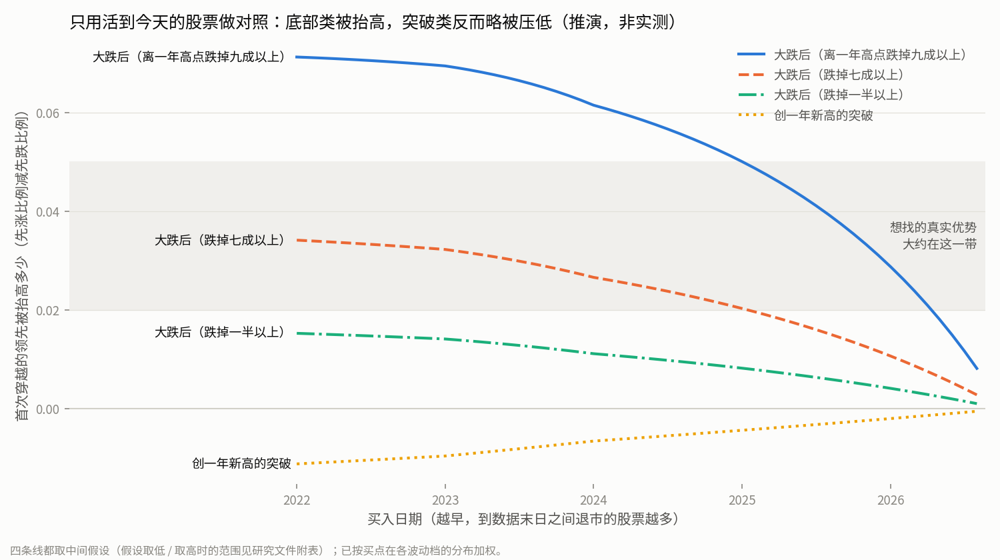

# 幸存者偏差会把哪类 pattern 的成绩抬多高：研究发现

日期 2026-10-06。本文件里的项目内路径都相对 repo root。脚本与原始输出在 `.scratch/selection-pattern/scripts/04-*`。

## 先读这里

**做了什么**：查了这五年美股有多少股票被摘牌、哪类股票容易被摘牌、被摘牌前后跌了多少；在本地 5778 只股票上数了「大跌后」和「暴涨 / 突破」两类时点落在什么样的股票上，只用了买入当天和以前的数据，没读任何 pattern 的成绩；最后用一个写明假设的小模拟估了偏差有多大。

**结论落在「要限定股票池」这一档，但两类走势差得很远**：

- **底部类（买在大跌之后）会被明显抬高**。买点在 2022–2024 年时，「离一年高点跌掉七成以上才买」的首次穿越领先，大约白得 0.03（假设往两头取是 0.01–0.07）；「跌掉九成以上才买」的大约白得 0.06–0.07（0.02–0.14）。我们想找的真实优势也就几个百分点，所以偏差和它一样大，甚至更大。买点越靠近数据末日，偏差越小：2026 年下半年的买点基本可以不管，跌得特别深的到 2026 年初仍有约 0.03。
- **暴涨 / 突破类基本可以忽略**。买在创一年新高、离高点不远的暴涨上，偏差很小，方向还是反的（略被压低）。例外是暴涨里有三成多其实是「大跌之后的反弹暴涨」，这部分要按底部类看。
- **低成本缓解**有两步：一是按成交额限定股票池，pattern 和同日普通买入对照一起限定；二是让最后检查用最近的数据。但如果最后选的方向是「跌得很深的小票」，限定股票池会把这类样本砍掉九成，那时只有补退市数据才判得了。

**不说明什么**：

- 手里没有退市股数据，没真正量过偏差。所有偏差数字都是推演：量级可信，具体数值不可信。
- 限定股票池到底能消掉多少偏差，同样是推演，没实测。
- 没回答任何 pattern 好不好。

图里四条线都取中间假设。假设往两头取的范围见第 4 节的表。

---

## 1. 同日对照为什么挡不住这种偏差

判优用的是同日普通买入对照（`path2/CONTEXT.md:155`）：每个买点和同一天、同一波动档的全部普通买入比，方向看首次穿越（`path2/CONTEXT.md:148`），幅度看前瞻收益（`path2/CONTEXT.md:141`）。现在两边的股票都只来自活到今天的那 5778 只。

所以「数据里少了死掉的股票」本身不一定造成偏差。只有两边少得不一样多时才会出问题：pattern 专挑的那类股票，如果比同档普通股更容易在之后被摘牌，pattern 这边被删掉的输家就更多，它看上去就更好。

偏差大小由三件事决定：

1. **买入日之后到数据末日（2026-10-05）有多少股票被摘牌**。买入日越早，缺的越多。
2. **pattern 挑中的股票，比同日同档的普通股「更像要被摘牌的股票」多少**。
3. **要被摘牌的股票，买入后 40 个交易日里比活下来的股票更容易先跌多少**。尺子是收盘价先碰上线还是先碰下线，上下线按当天波动定。最高波动档的上线约 +43%，下线约 −30%。

> 附注（公式）：偏差 ≈（pattern 买点里本该有却缺掉的比例 − 同档对照里缺掉的比例）×（缺掉的股票比幸存股方向得分低多少）。三个量的取值见第 4 节。

---

## 2. 外部事实：退市有多少、谁会被摘牌、摘牌前后跌多少

### 2.1 这五年的「坏退市」量

- **2022–2023 年是因故退市的高峰**。Doidge、Karolyi、Shen、Stulz（NBER w33556，2025）用 CRSP 美国普通股统计（SPAC 不算上市公司）。因故退市指业绩不达标、破产等，不含并购。这个比例 2020–2021 年极低；2022 年约 2.5–2.8%，2023 年约 4.5%（数字是读图读出来的，±0.2 个百分点），2023 年还超过了并购退市。原文："shoots up in 2022 and 2023 as many new lists from 2020 and 2021 perform poorly"。[NBER w33556 第 7 页、图 4](https://www.nber.org/system/files/working_papers/w33556/w33556.pdf)
- **2024–2026 年按原因分的权威年度数没查到**。二手的 stockanalysis.com 退市清单显示 2024 年 411 家、2025 年 373 家，但混了并购、SPAC 清算、场外代码和重复代码，只能看量级。[stockanalysis 2024](https://stockanalysis.com/actions/delisted/2024/)。推演里假设这几年每年 3%。
- **低于 1 美元的上市股**：2021 年初不到 12 只，2023 年 12 月 557 只，绝大多数在纳斯达克。[Virtu 致 SEC 请愿书 petn4-830](https://sec.gov/files/rules/petitions/2024/petn4-830.pdf)
- **纳斯达克不达标名单**：2024-09-03 共 491 家，其中 314 家是因为股价连续 30 个交易日低于 1 美元。[OTC Markets 致 SEC 的信](https://www.sec.gov/comments/sr-nasdaq-2024-045/srnasdaq2024045-521515-1498242.pdf)
- **SPAC 合并上市的公司**：2021 年合并的 198 家，持有 1 年平均 −64.2%，持有 3 年 −72.6%；2022 年合并的 102 家分别是 −63.8% 和 −64.0%。中途退市的算到退市日。[Ritter IPO 统计表 15c](https://site.warrington.ufl.edu/ritter/files/IPO-Statistics.pdf)
- **粗略旁证**：数据商 Tiingo 的公开代码表里，2021-10-08 在三大交易所挂牌、像普通股的代码约 6,030 个，到 2026-09 停止更新的约 1,560 个（26%），停更最多的年份是 2022 和 2023。这里分不出原因，并购、改代码、SPAC 清算都算在里面，只能当量级参考。[Tiingo 代码表](https://apimedia.tiingo.com/docs/tiingo/daily/supported_tickers.zip)，下载件当作不可信数据处理。

### 2.2 哪类股票容易被摘牌

- **市值小**。SEC 自己用 CRSP 做过统计，口径是 2006–2025 年 Nasdaq 和 NYSE American，只算交易所主动摘牌，排除并购、清算和换交易所：[SEC Release 34-105971，表 1、表 2](https://public-inspection.federalregister.gov/2026-15060.pdf)
  - 这段时间交易所摘牌共 1,990 起，其中 1,670 起（84%）之前曾连续 30 个交易日市值低于 5,000 万美元。
  - 曾跌破 5,000 万的 4,342 家里，38% 后来被摘牌。跌破 1,000 万的是 49%。跌破 500 万的 983 家里 486 家被摘牌（49%），摘牌发生在跌破后中位 259 天、四分之三分位 638 天。
- **股价低**。纳斯达克规则（Rule 5810(c)(3)(A)）：收盘买价连续 30 个营业日低于 1 美元就算不达标，给 180 天补救。2025 年 1 月起，一年内做过反向拆股、之后又不达标的，直接进摘牌程序。[SEC 34-102245](https://www.sec.gov/files/rules/sro/nasdaq/2025/34-102245.pdf)。纽交所同期也收紧了：[SEC 34-102201](https://www.sec.gov/files/rules/sro/nyse/2025/34-102201.pdf)。另外，做过多次反向拆股的公司，65% 最终清算或退市，这是旧样本。[Crutchley & Swidler 2015](https://ideas.repec.org/a/spr/jecfin/v39y2015i2p357-369.html)
- **之前跌得多、波动大**。Campbell、Hilscher、Szilagyi 发现，市值更小、之前收益更低、波动更大、股价更低的公司，更容易破产、退市或被评 D 级；陷入困境的股票之后的收益也异常低。[NBER w12362 摘要](https://www.nber.org/papers/w12362)；期刊版 [JF 2008](https://ideas.repec.org/a/bla/jfinan/v63y2008i6p2899-2939.html)
- **新上市**：见上面 NBER 那句，2022–2023 年的高峰主要来自 2020–2021 年的新上市公司。

### 2.3 摘牌前后跌多少

- Shumway（1997）：因负面原因退市通常事先没有预兆；CRSP 大多缺这些股票的退市收益，用场外价格补上后，缺掉的那一截跌幅很大。[JF 52(1)](https://ideas.repec.org/a/bla/jfinan/v52y1997i1p327-40.html)
- Shumway & Warther（1999）：纳斯达克因业绩退市的股票，缺失的退市收益用 −55% 补上，偏差就消除了；补上之后，纳斯达克的小盘股效应也不见了。[JF 54(6)](https://ideas.repec.org/a/bla/jfinan/v54y1999i6p2361-2379.html)
- 对本项目的含义：我们的尺子要求买点之后 40 个交易日都有行情，不全的窗口直接跳过。所以就算补了退市数据，买入后 40 天内就退市的那一笔仍然会被跳过。补数据时要另加一条规则：窗口内退市按先跌处理（见第 5.3 节）。

### 2.4 一个和「暴涨」有关的真实效应

- Bali、Cakici、Whitelaw（2011）：过去一个月里最大单日涨幅越大的股票，下个月收益越低。控制规模、动量后依然成立，最高组和最低组每月差 1% 以上。[JFE 99(2)](https://ideas.repec.org/a/eee/jfinec/v99y2011i2p427-446.html)
- 这是暴涨之后会变差的真实效应，主要集中在像彩票的小票上。幸存者数据会把其中暴涨后归零、被摘牌的那部分藏起来。

---

## 3. 本地事实

只用买入当天和以前的数据，不读任何买点之后的涨跌。脚本：

- `04-universe_facts.py`，输出 `04-universe_facts_out.txt`
- `04-spike_crosstab.py`，输出 `04-spike_crosstab_out.txt`
- `04-depth_share.py`，输出 `04-depth_share_out.txt`
- `04-subdollar_check.py`，输出 `04-subdollar_check_out.txt`

### 3.1 数据本身就是一份幸存者名单

- 股票清单来自当前上市名单。下载时 Yahoo 拉不到的代码（退市股就是这种）和不足 252 根 K 线的代码都被跳过，旧文件也一并删掉（`scripts/data/data_download.py` 的 `download_stock`）。Yahoo 拉不到已退市代码的历史：项目下载脚本的注释是这么写的，第三方文章也这么说（[r-bloggers 2021](https://www.r-bloggers.com/2021/08/when-yahoo-finance-doesnt-have-de-listed-tickers-needed/)），没找到 Yahoo 的官方说明。
- 5778 只里，4631 只从数据起点（2021-10-08）就有数据；1147 只是后来才出现的（新上市、SPAC 合并后换代码等）。按出现年份数：2021 年 10 月后 111、2022 年 178、2023 年 179、2024 年 304、2025 年 375。末尾截在 2025-10-03，因为不足一年的被跳过了。
  - 2024–2025 年出现的反而比 2022–2023 年多。原因有二：早几批新股被摘牌摘得多；2024–2025 年外国小盘股上市也多（Ritter 提到了这一点）。
- 只有 10 只的末个交易日早于 2026-10-05，而且只早几天到一个月。
- **越往前看，股票越少**。抽样日上有数据的股票，2022 年平均 4,760 只，2026 年 5,669 只。真实市场是反过来的：上市公司数在 2021–2022 年见顶，2025 年底只剩 3,657 家本土运营公司加 1,515 家外国公司。[Ritter 上市公司数](https://site.warrington.ufl.edu/ritter/files/number-of-listed-firms-on-US-exchanges.pdf)
- **一个具体对照**：2023-12-08 全美有 557 只上市股低于 1 美元，本地数据当天复权价低于 1 美元的只有 86 只。复权价会被之后的反向拆股抬高，所以 86 是下限；但差距大到说明这批最濒危的股票里，有相当一部分不在数据里。
- **当时成交很活跃、后来破产或被接管的股票，本地一只都没有**：SIVB、SBNY、FRC（2023 年银行倒闭）、BBBY、RIDE、WE、RAD、PTRA、FSR、GOEV、NKLA。这些公司的结局是公开报道，未逐一附出处；「不在数据里」是本地核对过的。同样暴跌过、后来活下来的 CVNA、UPST、AFRM、LCID、AMC、GME、OPEN 都在数据里。**底部类 pattern 在本地数据里买到的，只会是后一种。**
- 幸存股里，有 1,020 只（17.7%）曾经比一年内最高点跌掉九成以上。它们的「死去的同伴」都不在。
- 有 81 个代码像是 SPAC 的单位（unit）或认股权证，不是普通股，例如 AFJKU、BBLGW。

### 3.2 「大跌后」状态落在什么样的股票上

波动档的分法与判优尺子相同：每天按「真实波幅 / 收盘」的 20 日中位数切成五档。

| 最高波动档里 | 占本档股票日 | 其中 20 日成交额中位 < 100 万美元 |
|---|---|---|
| 离一年高点跌掉一半以上 | 66% | 72% |
| 跌掉七成以上 | 40% | 77% |
| 跌掉八成以上 | 26% | 80% |
| 跌掉九成以上 | 13% | 83% |
| 本档全部 | 100% | 66% |

- 「跌掉七成以上」的股票日，75% 落在最高波动档，20% 在次高档。
- **同档对照本身就以跌过的股票为主**：最高档里四成股票日处在跌掉七成以上的状态。所以在幸存股里，大跌后的股票只比同档普通股稍微更像濒危股：在最高档里，低于 1 美元的占 9.2%，同档是 6.4%；成交额低于 100 万美元的占 78%，同档是 68%。
- 但真正缺掉的那批股票几乎都在深跌状态里。所以补全之后，大跌后股票和同档普通股的差距会比幸存股里看到的大。跌得越深，这个差距越大：跌掉九成以上的状态，在幸存股的最高档里只占 13%，在要被摘牌的股票里假设占三到六成（见第 4 节）。

### 3.3 「暴涨 / 突破」状态落在什么样的股票上

- **近 20 日涨五成以上**的股票日，85% 在最高波动档。
  - 其中 35% 仍然离一年高点跌了一半以上，是反弹型暴涨。它们的濒危特征和最高档平均差不多：低于 1 美元 5.6%，成交额低于 100 万美元 64%。
  - 另外 65% 是高位暴涨，濒危特征明显低于同档：低于 1 美元 1.9%，成交额低于 100 万美元 43%。
- **创一年新高**的股票日，四成多在最低波动档。在每个档里，它们的低价、低成交额比例都低于同档。

### 3.4 今天的股票池（最新一天价格不受以后拆股影响）

- 收盘价低于 1 美元的 6.8%，低于 5 美元的 27.6%。
- 20 日成交额中位低于 100 万美元的 35.4%，低于 500 万美元的 50.7%。

---

## 4. 数值推演

脚本：`04-bias_sim.py`（输出 `04-bias_sim_out.txt`）和 `04-bias_chart.py`（输出 `04-bias_chart_out.txt` 与上面那张图）。纯模拟加本地静态比例，不读任何真实股票的未来涨跌。

### 4.1 要被摘牌的股票，40 天里多容易先跌

- 用随机游走模拟。日波动按本地最高档实测换算：日标准差约为波动尺度的 0.69 倍，最高档约 6%。
- 设活下来的股票没有趋势，要被摘牌的股票每年往下漂一段：

| 要被摘牌的股票每年往下漂（对数） | 最高档：首次穿越得分比幸存股低多少 | 窗口内最大涨幅中位：幸存股 24.6% 时它是 |
|---|---|---|
| −0.5 | 0.13 | 19.8% |
| −1.0 | 0.26 | 15.8% |
| −1.5 | 0.38 | 12.6% |

- 换成重尾分布，结果几乎不变。
- **取 −1.0 / 年（得分低 0.25）作中间值，区间 0.15–0.40**。依据是 SPAC 合并上市公司第一年平均跌 64%，要被摘牌的股票只会更差。这里假设幸存股没有趋势；如果幸存股本身偏涨，差距会更大。

### 4.2 推演用到的假设

| 量 | 取值 | 依据 |
|---|---|---|
| 每年因故摘牌比例 | 2022 年 2.6%，2023 年 4.5%，2024–2026 年各 3% | 前两年来自 NBER 图读数；后三年是假设，没查到权威数 |
| 要被摘牌的股票在买入日落在最高 / 次高波动档的比例 | 中 0.60 / 0.25（低 0.50 / 0.30，高 0.70 / 0.20） | 本地幸存股里低于 1 美元的股票日约三分之二在最高档；为假设 |
| 要被摘牌的股票处在大跌后状态的比例 | 最高档里：跌掉一半以上 0.90、七成以上 0.75、九成以上 0.45（各有低 / 高两档，见脚本） | 假设；幸存股实测分别是 0.66、0.40、0.13 |
| 要被摘牌的股票处在创新高状态的比例 | 幸存股比例的 0.3 倍（0.1–0.6） | 假设 |

### 4.3 结果：首次穿越的领先被白送多少

下表按买点在各波动档的实际分布加权。格式是「假设取低 / 中间 / 取高」。

| 买入日 | 买入日之后因故摘牌的比例 | 跌掉九成以上 | 跌掉七成以上 | 跌掉一半以上 | 创一年新高 |
|---|---|---|---|---|---|
| 2022-01 | 14.5% | +0.028 / **+0.071** / +0.136 | +0.013 / **+0.034** / +0.071 | +0.006 / **+0.015** / +0.028 | −0.011 / **−0.011** / −0.008 |
| 2023-01 | 12.2% | +0.027 / **+0.070** / +0.136 | +0.012 / **+0.032** / +0.068 | +0.005 / **+0.014** / +0.027 | −0.009 / **−0.010** / −0.007 |
| 2024-01 | 8.1% | +0.022 / **+0.062** / +0.127 | +0.009 / **+0.027** / +0.059 | +0.004 / **+0.011** / +0.022 | −0.006 / **−0.007** / −0.005 |
| 2025-01 | 5.2% | +0.017 / **+0.050** / +0.110 | +0.007 / **+0.020** / +0.047 | +0.003 / **+0.008** / +0.016 | −0.004 / **−0.004** / −0.003 |
| 2026-01 | 2.3% | +0.009 / **+0.029** / +0.069 | +0.003 / **+0.011** / +0.026 | +0.001 / **+0.004** / +0.009 | −0.002 / **−0.002** / −0.002 |
| 2026-07 | 0.8% | +0.003 / **+0.012** / +0.030 | +0.001 / **+0.004** / +0.010 | +0.001 / **+0.002** / +0.003 | −0.001 / **−0.001** / −0.001 |

**拿什么比**：

- 我们想找的真实优势也就几个百分点（0.02–0.05）。
- 地图（map.md）Notes 里「过往研究给的背景」写着，bottom_burst 现在这套参数对同日对照的方向领先约 +0.006，偶然波动约 ±0.04。

所以在 2022–2024 年的数据上，「跌掉七成以上」的底部 pattern 光靠幸存者偏差就能白得一个像样的领先；「跌掉九成以上」的，白得的比任何合理的真实优势都大。

**幅度（前瞻收益中位）受的影响小一些**（`04-bias_sim_out.txt` 第 E 节）。最高档里，2022–2023 年的买点对跌掉七成以上的状态大约白得 1 个百分点左右的最大涨幅中位（随年份 0.4–1.4 个百分点），基数约 25%；跌掉九成以上的大约 2.5 个百分点。原因是要被摘牌的股票波动照样很大，窗口里也常有反弹，所以「最大涨幅」差得不多，「先涨还是先跌」差得多。

### 4.4 最要紧的一个后果：调参会主动往偏差最大的地方钻

- 调参时搜索的是「比同日普通买入多出的部分」。偏差在越深的跌幅、越小的成交额、越早的年份里越大，所以搜索会自然偏向「跌得更深、票更小」的参数。
- 这样偏差就不只是一个固定的加分，它会决定选出哪套参数。
- 这也是把它判为「要限定股票池」而不是「可以忽略」的主要理由之一。

---

## 5. 缓解办法

### 5.1 限定股票池

- **pattern 和同日普通买入对照要用同一个股票池**，否则对照里仍然混着濒危股，比出来的差会失真。
- **按成交额限，不按复权价限**。成交额等于复权价乘复权量，拆股前后不变，历史上当天真实是多少就是多少。复权价则不同：后来做过反向拆股的幸存股，早年的复权价会被抬高。比如当年实际 0.5 美元、后来 1:20 合股，数据里显示 10 美元。用「价格 ≥ 5 美元」去筛，恰好会把这批濒危幸存股放进来。除非拿到当时的真实价格，否则价格筛选不可靠。
- **限了之后还剩多少样本**（股票日占比，2022-01 到 2026-10 抽样）：

| 股票池 | 全部股票日 | 跌掉七成以上 | 跌掉一半以上 | 近 20 日暴涨五成以上 | 创一年新高 |
|---|---|---|---|---|---|
| 不限 | 100% | 100% | 100% | 100% | 100% |
| 20 日成交额中位 ≥ 100 万美元 | 62% | 25% | 36% | 50% | 70% |
| ≥ 500 万美元 | 45% | 11% | 20% | 28% | 54% |

- **能消掉多少偏差：没法实测，推演是大半，不是全部**（待验证）。
  - 消得掉的部分：交易所摘牌的 84% 事先都在市值 5,000 万美元以下待过（SEC 表 2）。每天成交几百万美元以上的股票，当时一般远大于这个规模，所以「一两年内就要被摘牌」的那批大多被挡在池外。
  - 消不掉的部分：2023 年倒闭的几家银行、BBBY、NKLA、FSR 这类当时成交极活跃、后来破产的票，限定股票池挡不住。而且对照档里剩下的股票缺得少了，pattern 和对照之间的差也会跟着缩小，但不会到零。
- **代价**：底部类的样本会被砍掉一大半，买点变少，能分辨出的最小优势随之变大（这是「这份数据能分辨多大的选股优势」那张票管的事）。暴涨 / 突破类砍得少。
- **顺手要做的**：去掉 81 个 unit 或认股权证代码。
- **按「上市满一年」筛新股，效果有限**：最高档里大跌后状态的新股占比（9.4%）和同档（8.4%）差不多；数据起点之前上市的股票也算不出上市多久。

### 5.2 让最后检查用最近的数据

- 偏差只来自「买入日之后到数据末日之间」被摘牌的股票，所以越靠近数据末日的买点越干净（见图）。买在 2026 年的，跌掉七成以上的偏差中间值约 0.004–0.011，跌掉九成以上的约 0.01–0.03。
- 这对「最后检查用哪段留着没碰过的数据」那张票有直接含义。如果最后检查用最近一段，那么即使训练期的成绩被抬高了，最后检查也基本不受影响，能把「全靠幸存者偏差」的候选刷下来。
- 反过来，bb_v1 预留的那段 2022-08..2023-11 恰好在偏差最大的年份。拿它做底部类的最后检查，抬高的幅度和训练期一样大。

### 5.3 补退市数据：只列事实

各家都声称包含退市股日线的来源如下。价格是 2026-10-06 官网显示的。Sharadar 我自己核对过官网；其余各行由辅助代理从各家官网整理，我没有逐一核对，都没实测拉数据。

| 来源 | 含退市股日线 | 覆盖 | 退市原因 / 退市当期收益 | 个人可买、价格（美元） | 接入 |
|---|---|---|---|---|---|
| [Sharadar](https://www.sharadar.com/prices)（[价格](https://www.sharadar.com/pricing)） | 是，官网原话 "includes active and delisted securities" | 1997-12 起 | 有退市日期和退市原因（公司行动表）；退市收益未查到 | 可以。价格表：5 年 $9/月或 $99/年，全历史 $39/月或 $299/年 | API、批量 CSV（也在 Nasdaq Data Link 上） |
| [EODHD](https://eodhd.com/financial-apis/delisted-stock-companies-data-2) | 是 | 美股最早到 1972 | 只有退市代码清单 | 可以，$19.99/月起 | REST，有官方 Python 库 |
| [Massive（原 Polygon）](https://massive.com/pricing) | 是 | 2003 起；Starter 档只给 5 年 | 只有最后交易日 | 可以，$29/月起 | REST 加批量文件 |
| [Norgate](https://norgatedata.com/stockmarketpackages.php) | 是（Platinum 档以上） | 1990 或 1950 起 | 未查到 | 可以，$630/年起 | Python 包，但只支持 Windows |
| [QuantConnect](https://www.quantconnect.com/data/algoseek-us-equities) | 是 | 1998 起 | 有退市事件 | 在它的云平台里免费用；下载到本地要付费 | LEAN 格式 |
| [CRSP（经 WRDS）](https://indexes.morningstar.com/research-data-products/crsp-us-stock-databases) | 是 | 近百年 | 退市原因和退市收益都有，是唯一两样都有的 | 不行，只卖机构 | WRDS |

- 钱不贵：Sharadar 的 5 年档正好从 2021-10 覆盖到现在，一年 99 美元，还带退市原因。
- 真正的成本在别处：
  - 要新写一套下载和复权流程，做代码映射，跟现有 Yahoo 数据对齐。
  - 尺子要加一条规则，让「窗口内退市」按先跌计，否则补了数据也照样跳过这些买点（见 2.3）。
  - 地图（map.md）的 Out of scope 写明「换数据源」需要重新划终点。
- 另外有一个折中用法：不换数据源，只买一次数据，把本文件的推演换成实测，量出偏差究竟有多大。

---

## 6. 不确定、没查到的

- **2024–2026 年按原因分的因故退市率没查到**，推演里假设每年 3%。如果实际更高（2025 年交易所规则收紧，摘牌更快），训练期的偏差还要更大。
- **NBER 的退市率是从图上读的**（±0.2 个百分点）。它的「因故」按 CRSP 代码 400 以上算，SPAC 按作者定义不算上市公司，但我没逐条核实 SPAC 清算有没有混进去。
- **两个最关键的假设没法核**：一是要被摘牌的股票有多大比例处在深跌状态（第 4.2 节第三行），二是它们往下漂多快（第 4.1 节）。偏差数字对这两个最敏感，所以表里给了取低和取高。
- **成交额只是市值的替身**。本地没有股本数据，「成交额 ≥ 500 万美元 ≈ 远离摘牌区」是推断。
- **暴涨类的推演只做了「创一年新高」这一种**。「近 20 日暴涨五成以上」没单独推演，只按它的构成（三成多是反弹型）定性归类。
- **完全没读任何 pattern 的成绩**，也没读任何买点之后的涨跌，所以「同日对照本身在早年被抬高了多少」也没有实测。

## 附：脚本与原始输出

全部在 `.scratch/selection-pattern/scripts/`：

| 脚本 | 输出 | 内容 |
|---|---|---|
| `04-universe_facts.py` | `04-universe_facts_out.txt`、`04-universe_states.csv` | 首末日、价格与成交额分布、各档状态占比、限池保留率、濒死幸存股 |
| `04-spike_crosstab.py` | `04-spike_crosstab_out.txt` | 暴涨的构成：反弹型还是高位 |
| `04-depth_share.py` | `04-depth_share_out.txt` | 最高两档里不同跌幅深度的占比 |
| `04-subdollar_check.py` | `04-subdollar_check_out.txt` | 2023-12-08 低于 1 美元的幸存股数 |
| `04-bias_sim.py` | `04-bias_sim_out.txt` | 第 4.1 节和幅度的模拟 |
| `04-bias_chart.py` | `04-bias_chart_out.txt`、`research/04-survivorship-bias.png` | 第 4.3 节的表和图 |

外部下载件（论文、SEC 文件、Tiingo 代码表）放在会话 scratchpad 的 `04-*-dl/` 目录，当作不可信数据，没入库。
