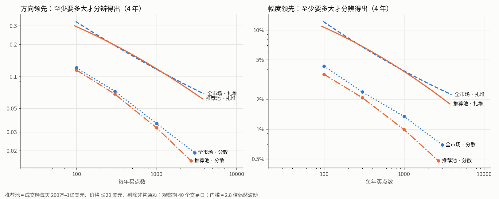
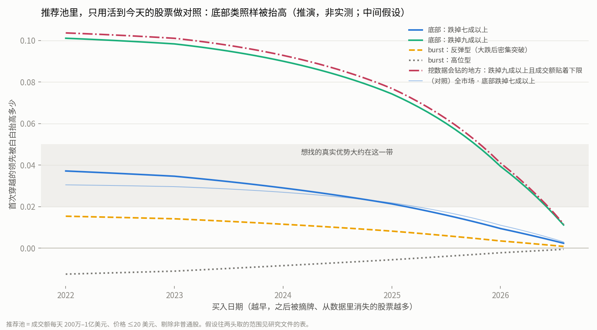

# 目标池里的分辨力和幸存者偏差有多大

研究票：[目标池里的分辨力和幸存者偏差有多大](../issues/09-target-pool-resolution.md)。日期 2026-10-07。本文件里的项目内路径都相对 repo root；脚本与原始输出在 `.scratch/selection-pattern/scripts/09-*`。

## 先说人话

**做了什么。**

- 按「当天就知道的条件」划了几种候选池子：剔除非普通股；20 日成交额（每天成交的美元数，取最近 20 天的中位数）设下限 100 万 / 200 万 / 500 万美元、上限 1 亿美元；价格上限 20 / 10 美元。数了每个池子各年有多少只股票、多少个股票日。
- 在每个池子里重做「这份数据能分辨多大的选股优势」的模拟。用普通买入拼出没有任何选股能力的假 pattern，同日普通买入对照（`path2/CONTEXT.md:155`）也只从同一个池子里抽，看领先偶然能偏多远。假 pattern 有两种长相：一种照抄 bottom_burst 的扎堆长相，另一种是「每段行情只买一次、命中很多不同股票」的分散长相。
- 在池子里重做「幸存者偏差会把哪类 pattern 的成绩抬多高」的推演。多算了一步：以后会被摘牌的股票，有多少还进得了池子。另外补查了 2024–2026 年的摘牌量。
- 价格上限本该按当时价格设，但拆合股记录没拿到：Yahoo 在当前出口连不上，我没有切节点。价格上限暂时用复权价近似，并估了这样会错多少。
- 全程没读任何 pattern 的成绩，也没读任何特征之后的涨跌。

**说明什么。**

1. **池子够大，不拖累分辨力。** 推荐的池子每天约 760–1030 只股票，每年出现 1400–1850 只不同股票。同样的长相、同样多的买点，池子里能分辨的最小领先和全市场几乎一样。每年 1000 个买点（名单平均每天 4 只）时：
   - 扎堆长相：2 年要方向领先约 0.15，4 年约 0.12；
   - 分散长相：2 年约 0.043，4 年约 0.033。
   决定门槛的仍是 pattern 的长相，也就是互相独立的买点有多少（扎堆时约等于命中了多少只不同股票），不是池子。
2. **池子挡不住底部类的幸存者偏差。** 成交额下限把以后会被摘牌的股票挡掉了大半，但同样跌得很深的幸存股也被挡掉了差不多的比例。于是池子里剩下的深跌买点照样「可疑」，同档对照反而被清得更干净。推演结果，买在 2022–2024 年时：
   - 离一年高点跌掉七成以上的买点，在推荐池里方向领先白得约 0.03–0.04，和全市场（约 0.03）一样大；
   - 跌掉九成以上的约 0.09–0.10，比全市场（约 0.06）还大。
   这修正了「幸存者偏差会把哪类 pattern 的成绩抬多高」里「限定股票池能消掉大半」的说法。
3. **三种情形的档位（推荐池）**：
   - 底部类落在「要限定股票池」，贴着「要补数据」的边；跌掉九成以上的单独落在「要补数据」。
   - burst（`path2/CONTEXT.md:24`）分两种：高位的「可以忽略」；大跌后的反弹型按底部类对待，落在「要限定股票池」。
   - 挖数据会往「跌得极深、成交额又贴着下限」的地方钻。用这种简单条件能白得约 0.1，超过分散长相的分辨门槛，落在「严重到要补数据」。
   - 三种情形都一样：最后检查只要用最近一段数据，偏差就小得多。买在 2026 年下半年的，跌掉七成以上的只剩约 0.004。
4. **推荐的默认池子（待验证）**：
   - 普通股；
   - 当时价格不超过 20 美元；
   - 20 日成交额中位每天 200 万–1 亿美元。

**不说明什么。**

- 偏差全是推演，没有退市股数据可以实测，量级可信，具体数不可信。最不确定的一个数是：跌得一样深时，以后会被摘牌的股票成交额比幸存股小多少。池子能帮多少忙全看它（第 4.3 节）。
- 门槛针对「事先写好一个候选、检查一次」，没算「试很多个再挑最好的」要多付的代价。
- 价格上限用的是复权价。按当时价格划的池子，要等拿到拆合股记录再核（第 2 节）。这不影响本文的分辨力结论，因为池子大小只差几个百分点；但具体哪些股票在池子里会变。
- 没回答池子里哪个 pattern 好：没读任何成绩。

---

## 1. 候选池子有多大

### 1.1 非普通股怎么剔（默认规则，待验证）

以前只知道股票池里混着约 150 只挂牌债券、票据、优先股，还有 81 个 SPAC 单位和认股权证代码。这次按证券全名分类。全名来自 Nasdaq 网站股票筛选器的下载件，含三个交易所当前挂牌的全部证券。证券的类别不随时间变（票据一直是票据），所以用当前名单不构成前视。

**规则**：

1. 名称里写明是下面这些的，整只剔除：
   - 票据或债券：Notes、Debentures、Baby Bond；
   - 优先股：Preferred、Perpetual、Preference Shares；
   - 结构化信托：STRATS、Trust Certificates、PPLUS 等；
   - 认股权证：Warrant；
   - 单位：Unit；
   - 权利：Rights、Contingent Value。
2. 名称里是封闭式基金的（Fund、Municipal、Income Trust 等），以及尚未完成合并的 SPAC 壳（Acquisition Corp 等），也剔除。这一条是本票加的，理由见下，待验证。
3. 美国存托凭证（ADR）和有限合伙的普通单位（名称里有 L.P.、Common Units）保留，算普通股。
4. 当前名单里查不到名称的代码：
   - 5 位、以 U / W / R 结尾的，按单位、认股权证、权利剔除；
   - 人工核过 5 个信托证券和优先股（GJP、GJR、GJT、NHPBP、DDT），剔除；
   - 其余 22 个按普通股处理，多是改名或转板的普通股，例如 QRVO、WBD。

**分类结果**（本地 5778 只）：

| 类别 | 只数 | 处理 |
|---|---|---|
| 普通股 | 4716 | 保留 |
| ADR | 292 | 保留 |
| 有限合伙普通单位 | 34 | 保留 |
| 名单里查不到名称、按普通股处理 | 22 | 保留 |
| 票据、债券 | 130 | 剔除（用户点名） |
| 优先股 | 113 | 剔除（用户点名） |
| 结构化信托 | 8 | 剔除（用户点名） |
| SPAC 单位 | 71 | 剔除（用户点名） |
| 认股权证 | 14 | 剔除（用户点名） |
| 权利 | 1 | 剔除（用户点名） |
| 封闭式基金 | 292 | 剔除（本票加，待验证） |
| SPAC 壳 | 85 | 剔除（本票加，待验证） |

- **为什么加上封闭式基金和 SPAC 壳**：
  - 它们不是经营公司的股票。封闭式基金跟着一篮子债券或股票走；SPAC 壳在合并前基本就是一笔存在信托里的现金，价格贴着 10 美元。
  - 它们的「平时波动」都很低，正是「这份数据能分辨多大的选股优势」发现的、会让方向成绩白白变好的那一类。
  - 用户点名的票据和优先股，成交额大多很小，在成交额 100 万以上的池子里只占不到 1% 的股票日；封闭式基金却占了 5%–8%，是池子里最大的一块非普通股。
  - 规则会把少数名字里带 Fund 的商业发展公司也划进基金，例如 BXSL、MSDL，影响很小。
- **「平时波动极低」能不能代替名称规则**：不能单独用。平时波动（过去 250 天当天波动尺度的中位数）低于 1% 时：
  - 只认出六成四的非普通股（含基金和 SPAC 壳）；
  - 还误伤 64 只普通股、ADR 和有限合伙。
  名称规则做主，平时波动只作旁证。

### 1.2 成交额能不能当市值的替身

数据里没有市值。Nasdaq 筛选器下载件里有当前市值，可以在最新一天（2026-10-05）的横截面上核对一次：

- 20 日成交额中位和市值的排名相关 0.89，能当替身用。
- 各市值档的成交额中位数：

| 市值档 | 成交额中位数（每天） |
|---|---|
| 5000 万以下 | 9 万 |
| 5000 万–3 亿 | 62 万 |
| 3 亿–20 亿（小盘） | 650 万 |
| 20 亿–100 亿（中盘） | 4500 万 |
| 100 亿以上（大盘） | 2.3 亿 |

- 2026-10-05 当天，价格不超过 20 美元、成交额落在 200 万–1 亿美元的股票里：小盘约六成，中盘约两成，市值 5000 万–3 亿的约一成半，大盘和市值 5000 万以下的各占几个百分点。这和「中小盘」的意思对得上。
- 1 亿美元的上限挡掉的，主要是价格低的大盘股。最新一天被挡掉 77 只，例如 F、AAL、CLF、GRAB、DKNG。

### 1.3 各池子各年的股票数

每格是「每天平均只数 / 当年出现过的不同股票数」。2021 年只从 10 月起有数据，2026 年截到 10-05。成交额上限都是 1 亿美元，都剔除了非普通股。

| 池子 | 2021 | 2022 | 2023 | 2024 | 2025 | 2026 |
|---|---|---|---|---|---|---|
| 全市场（只剔非普通股，不设成交额上下限） | 2846 / 4253 | 4308 / 4435 | 4459 / 4597 | 4667 / 4814 | 4941 / 5064 | 5050 / 5064 |
| 成交额 ≥100 万，不限价 | 1681 / 2775 | 2312 / 3116 | 2297 / 3009 | 2387 / 3268 | 2523 / 3565 | 2599 / 3441 |
| 成交额 ≥200 万，不限价 | 1462 / 2466 | 2023 / 2750 | 2007 / 2692 | 2096 / 2873 | 2206 / 3179 | 2295 / 3066 |
| 成交额 ≥100 万，≤20 美元 | 590 / 1088 | 946 / 1627 | 992 / 1624 | 1052 / 1799 | 1222 / 2182 | 1271 / 2117 |
| **成交额 ≥200 万，≤20 美元（推荐）** | 468 / 903 | 763 / 1383 | 792 / 1391 | 853 / 1492 | 987 / 1845 | 1030 / 1757 |
| 成交额 ≥500 万，≤20 美元 | 307 / 604 | 507 / 1024 | 509 / 996 | 550 / 1088 | 651 / 1380 | 697 / 1293 |
| 成交额 ≥100 万，≤10 美元 | 286 / 569 | 488 / 1029 | 537 / 1015 | 566 / 1137 | 702 / 1495 | 757 / 1522 |
| 成交额 ≥200 万，≤10 美元 | 214 / 446 | 376 / 849 | 402 / 843 | 435 / 902 | 535 / 1219 | 576 / 1207 |

- 推荐池的股票日：2022 年 19.1 万、2023 年 19.8 万、2024 年 21.5 万、2025 年 24.7 万，2026 年截到 10-05 为 19.6 万。
- 去掉成交额上限，股票数多 4%–8%；上限改成 5000 万，少 6%–8%。完整数表见 `09-pools_out.txt`。
- 池子越往后越大：推荐池从 2022 年每天 763 只涨到 2026 年 1030 只。这一半是幸存者偏差的指纹（早年死掉的股票不在数据里），一半是这几年低价股变多了。
- 价格条件这里用的是复权价，见第 2 节。

---

## 2. 当时价格：拆合股记录这次没拿到

**发生了什么**：

- 用临时脚本向 Yahoo 发了 6 个请求，finance.yahoo.com、query1、query2 三个地址都在建立加密连接时被切断；同一出口上 guce.yahoo.com 和 Google 都通。这和以前记下的「当前节点被 Yahoo 拦」是同一个症状，不是临时限速。我没有再试，也没有碰代理设置、没有切节点。
- 查过的替代来源都不行：
  - Nasdaq 网站的历史行情本身就是复权过的。NVDA 2024-06-07 显示 120.9 美元，看不到拆股前的 1200 多美元。
  - Nasdaq 网站的拆合股日历只给最近半年（2026-04 至今）。
  - stockanalysis 的年度拆合股清单不付费只显示 50 行，2024 年全年共 525 次。

**用复权价设价格上限会错多少**（拿最近半年的拆合股记录当样本估）：

- 那份日历里，落在本地股票、生效日不晚于 2026-10-05 的拆合股有 310 次。其中 293 次是合股（几股并一股），合股比例中位数约 1 并 11。
- 只这半年的拆合股，就让推荐池（成交额 ≥200 万、20 美元上限）的历史判错了 1.4% 的股票日，涉及 149 只股票：
  - 错挡在外的 14,045 个股票日：后来做了合股的股票，早年当时价格其实低于 20 美元，复权价却被抬到 20 美元以上；
  - 错放进来的 2,316 个股票日：后来拆股的股票，当时其实更贵。
  - 价格上限设 10 美元时，判错比例约 2.7%。
- 外推到 5 年里的全部拆合股，粗算约是这个数的 5 倍，即推荐池里约 7% 的股票日被判错。这只是量级，没实测。依据是拆合股大致均匀发生在 5 年里，每次只影响它之前的历史。
- **错的方向**：判错的大多是「后来做了合股」的股票被挡在池外。合股通常发生在股价继续下滑、快跌破 1 美元的时候，所以这等于用未来的信息把一批之后还会跌的股票挪出了池子。对底部类 pattern，这和幸存者偏差同向，会再白送一点领先。这与「幸存者偏差会把哪类 pattern 的成绩抬多高」提醒的方向正好相反：那里说的是价格下限会把这批股票放进来，这里的价格上限会把它们挡出去，两种都是前视。

**分红复权**：

- 复权价还按分红往下调过：越早的价格，被调低得越多。
- 不分红的小盘股不受影响。NVDA 这类分红很少的，差 0.3% 左右。
- 高息证券（封闭式基金、商业发展公司、部分房地产信托，年息 8%–10%）早年的复权价可能比当时价格低三成，会把少数本该超过 20 美元的放进来；成交额也会少算同样的比例。这些证券大多已被第 1.1 节的规则剔除，这里忽略，只记一句。

**建议**：拿一次拆合股记录，大约 5800 个请求，限速慢慢取，几十分钟以内。这需要用户自己把出口换到 Yahoo 能连上的节点（以前是香港节点）。在那之前，按价格划的池子都标「暂用复权价」。

---

## 3. 池子里的分辨力

做法与「这份数据能分辨多大的选股优势」相同：

- 假 pattern 没有真本事，它对同日对照的领先本该是零；
- 重复 200 次，看领先偶然能偏多远（偶然波动），乘 2.8 就是「至少要这么大的真实领先才分辨得出」，下文简称门槛；
- 方向看首次穿越（`path2/CONTEXT.md:148`），幅度看前瞻收益（`path2/CONTEXT.md:141`）中位数；
- 同日对照每天在池内按当天波动切五档。

两种长相：

- **扎堆**：照抄 bottom_burst 的买点结构，即哪几天出手、一只股票命中几段、每段连买几天。每只来源股整体换成一只池内平时波动同档、而且在这些日子大多在池内的股票。这是保守情形，和前票一样。
- **分散**：每段行情只买一次（同一只股票 40 个交易日内不重复买），命中很多不同股票。出手日期照 bottom_burst 各月的疏密抽，保留「同一段时间扎堆出手」；股票照 bottom_burst 偏爱的波动档加权抽，保留「偏爱高波动」。

### 3.1 门槛

图里是 4 年、观察期 40 个交易日。橙线是推荐池，蓝线是全市场（剔除非普通股后），两种颜色几乎重合。

**每年 1000 个买点（名单平均每天 4 只）时的门槛。** 括号里是命中的不同股票数；幅度的单位是前瞻收益中位数之差，以百分点计。

| 池子 | 扎堆 1 年 | 扎堆 2 年 | 扎堆 4 年 | 分散 1 年 | 分散 2 年 | 分散 4 年 |
|---|---|---|---|---|---|---|
| 全市场（剔非普通股）方向 | 0.21（124） | 0.15（232） | 0.12（440） | 0.071（855） | 0.047（1412） | 0.036（2110） |
| **推荐池** 方向 | 0.20（127） | 0.15（232） | 0.12（434） | 0.065（625） | 0.043（922） | 0.033（1379） |
| 成交额 ≥100 万、≤20 美元 方向 | 0.20 | 0.15 | 0.11 | 0.074 | 0.050 | 0.035 |
| 成交额 ≥500 万、≤20 美元 方向 | 0.20 | 0.14 | 0.12 | 0.065 | 0.040 | 0.029 |
| 成交额 ≥200 万、≤10 美元 方向 | 0.19 | 0.14 | 0.12 | 0.070 | 0.044 | 0.028 |
| 全市场 幅度 | 8.1 | 5.3 | 3.9 | 2.5 | 1.7 | 1.3 |
| **推荐池** 幅度 | 7.5 | 4.6 | 3.8 | 1.9 | 1.4 | 1.0 |

**推荐池，其他买点频率**：

| 每年买点数（名单每天约几只） | 扎堆 1 / 2 / 4 年 | 分散 1 / 2 / 4 年 |
|---|---|---|
| 300（1.2 只） | 方向 0.32 / 0.23 / 0.20；幅度 12.9 / 8.1 / 6.8 | 方向 0.13 / 0.086 / 0.068；幅度 4.5 / 2.7 / 2.1 |
| 3000（12 只） | 方向 0.14 / 0.094 / 0.069；幅度 4.5 / 2.9 / 2.1 | 方向 0.031 / 0.022 / 0.016；幅度 0.9 / 0.6 / 0.5 |

全部池子、全部频率见 `09-report-tables.txt` 表 B。从这些表里读出来的几件事：

- **池子缩小没有抬高门槛。** 同样的长相、同样多的买点，推荐池、更紧的池（≥500 万或 ≤10 美元）和全市场的门槛都在彼此的偶然误差之内，差别在一成以内。原因是这些池子都足够大：推荐池每天 760–1030 只，每年出现 1400–1850 只不同股票，每年 1000 个买点远用不完。
  - 只有在买点很多、又要分散时，小池子才开始吃紧。每年 3000 个买点的分散长相，在 10 美元上限的池子里只能命中 1000 来只不同股票，比推荐池少三成。
- **决定门槛的是长相。** 扎堆的门槛是分散的 3–4 倍。分散长相、2 年、每年 1000 个买点，方向门槛约 0.043，正好落在想找的真实优势（0.02–0.05）的上沿。扎堆长相要 0.15，比任何合理的优势都大。
- **最好用的尺度是「互相独立的买点有多少」。** 粗算：方向门槛 ≈ 2 ÷ √（独立买点数）。
  - 分散长相里，同一只股票隔 40 天以上才再买，独立买点数约等于买点数。
  - 扎堆长相里，独立买点数只有命中的不同股票数的 0.6–1 倍；连着几天买同一只，几乎只算一次。
  - 例：推荐池里，扎堆长相 4 年命中 614 只股票时门槛 0.069，分散长相 4 年 1200 个买点（命中 741 只）时 0.068。
  - 要分辨方向领先 0.05，约需 1500 个独立买点；0.08 约 600 个；0.12 约 300 个。
- **最后检查只有 1 年时**，门槛约是 4 年的 1.7–2 倍。分散长相每年 1000 个买点约 0.065，扎堆长相约 0.20。
- 「两证都要赢」时，两个门槛各自再乘约 1.15，与前票相同。

### 3.2 名单每天几只、要命中多少只不同股票

- 每年 1000 个买点 ≈ 名单平均每天 4 只（同一只票连续出现几天算几次）。
- 每年 1000 个买点时，推荐池里命中的不同股票：
  - 扎堆长相：每年约 125 只，2 年约 230 只，4 年约 430 只；
  - 分散长相：每年约 625 只，2 年约 920 只，4 年约 1380 只。
- 照上面的粗算，想在 2 年里看出约 0.05 的方向领先，需要约 1500 个独立买点：
  - 分散长相就是 2 年约 1500 个买点（名单平均每天 3 只），命中约 800 只不同股票；
  - 扎堆长相要命中 1500–2500 只不同股票，而推荐池 2 年里一共只出现 1700–2100 只，等于做不到。

### 3.3 观察期

推荐池，2 年、每年 1000 个买点。线距随观察期缩放：5 日用 1.77，20 日用 3.54，40 日用 5，120 日用 8.66。

| 观察期（交易日） | 碰到线的比例 | 方向门槛：扎堆 / 分散 | 幅度门槛（百分点）：扎堆 / 分散 | 同日对照前瞻收益中位 |
|---|---|---|---|---|
| 5 | 39% | 0.068 / 0.039 | 0.8 / 0.4 | 5.5% |
| 20 | 53% | 0.127 / 0.045 | 2.7 / 0.9 | 11.6% |
| 40 | 59% | 0.147 / 0.043 | 4.6 / 1.4 | 16.8% |
| 120 | 68% | 0.197 / 0.045 | 12.2 / 2.6 | 30.0% |

- 扎堆长相的观察期越短，门槛越低，和前票一样：相邻买点的观察窗重叠得少。
- 分散长相各观察期的方向门槛都在 0.04–0.045，因为它的买点本来就隔得开。
- 幅度门槛折成「占同日对照中位数的比例」，各观察期都在 8%–9%（分散长相）。
- 成交额 ≥100 万、≤20 美元的池子结果几乎相同，见表 D。

### 3.4 顺带看到的系统偏移

假 pattern 平均起来并不是零领先。它偏爱的那种波动水平本身，就能稳定地多赢或多输一截。这不是偶然波动，样本再大也不消失。这件事在前票里已有记录（FC-016），池子里更明显：

| 池子 | 扎堆（bottom_burst 的偏爱）方向 | 扎堆 幅度 | 分散（同样偏爱）方向 | 分散 幅度 |
|---|---|---|---|---|
| 全市场 | −0.020（随年份 ±0.020） | +1.2 个百分点 | −0.017（±0.005） | +1.0 |
| 推荐池 | −0.041（±0.035） | +0.7 | −0.012（±0.010） | +0.5 |

- 推荐池里，照抄 bottom_burst 偏爱高波动的假 pattern，方向白输约 0.04，是全市场的两倍。按年份看：2022 年 −0.078，2023 年 −0.071，2024 年 −0.031，2025 年 −0.002。
- 也就是说，一个偏爱高波动的 pattern，在池子里拿 2022–2023 年的数据比，一开始就背着 0.07 左右的方向劣势；拿 2025 年比就几乎没有。
- 这会直接影响「同日对照怎么配对才挡得住白得的领先」：那张票的判据是白得领先要远小于偶然波动，而这里的偏移和分散长相的门槛（0.043）同一量级。
- 分散长相的偏移小得多（−0.012），因为它挑的股票没有 bottom_burst 那么集中在最高波动档。

---

## 4. 池子里的幸存者偏差

### 4.1 推演怎么改

沿用「幸存者偏差会把哪类 pattern 的成绩抬多高」的推演。偏差从哪来：pattern 爱挑的那类股票，比同档对照更容易在之后被摘牌、从数据里整只消失，pattern 就被白白抬高。池子里改了三处：

1. **同档对照只在池内分档**。池内各类买点的分布实测，只用买入当天及以前的数据。
2. **以后会被摘牌的股票，有多少进得了池子**：
   - 把最高波动档按「离一年高点跌了多深」分成五个细状态。以后会被摘牌的股票在这五个状态上的分布，沿用前票的假设：中间取跌掉九成以上 45%、七成以上 75%、一半以上 90%，另加跌掉九成五以上 30%。
   - 在同一个细状态里，它们过成交额下限的比例 = 同状态幸存股的实测比例 × 一个折扣。折扣的意思是「跌得一样深时，以后会被摘牌的股票成交额更小」，中间取 0.6，低取 0.4，高取 1.0。
   - 折扣的锚：2026-10-05 当天，最高波动档里跌掉七成以上的幸存股，过 100 万成交额关的有 16%；其中市值 5000 万以下的只有 8%。前票引的 SEC 统计说，交易所摘牌的 84% 事先都在市值 5000 万以下待过。
   - 过价格关的比例假设 0.95（0.9–1.0）。
3. **摘牌率**：2024–2026 年由前票的每年 3% 改为中间 4.5% / 5.0% / 4.0%，依据见第 4.4 节。前票的 3% 留作「低」那一套。

其余假设不变：以后会被摘牌的股票落在各波动档的比例；它们 40 天里比幸存股更容易先跌多少（中间：方向得分低 0.25）。低 / 中 / 高三套假设整体捆绑，给的是范围，不是置信区间。

### 4.2 结果

**推荐池里方向领先白得多少**。每格是「中间（低–高）」，按买入日期排；跌掉七成以上那行附全市场的同口径数作对比。

| 买点的样子 | 池内每年股票日 | 2022-01 买入 | 2024-01 买入 | 2026-01 买入 | 2026-07 买入 |
|---|---|---|---|---|---|
| 底部：离一年高点跌掉一半以上 | 5.1 万 | +0.013（0.003–0.033） | +0.010（0.002–0.028） | +0.003 | +0.001 |
| 底部：跌掉七成以上 | 1.7 万 | +0.037（0.008–0.097） | +0.029（0.005–0.090） | +0.009 | +0.004 |
| 　全市场同口径（对比） | — | +0.031（0.009–0.065） | +0.027（0.007–0.063） | +0.011 | +0.004 |
| 底部：跌掉九成以上 | 2100 | +0.101（0.030–0.189） | +0.090（0.020–0.197） | +0.039 | +0.016 |
| 　全市场同口径（对比） | — | +0.064（0.023–0.121） | +0.061（0.017–0.125） | +0.030 | +0.013 |
| burst 反弹型（跌掉一半以上时，20 天里至少 3 天收盘创 60 日新高） | 3300 | +0.015（0.000–0.093） | +0.012（0.000–0.086） | +0.003 | +0.001 |
| burst 高位型（离一年高点不到一半时密集创新高） | 4.2 万 | −0.012（−0.006～−0.014） | −0.008 | −0.002 | −0.001 |
| 创一年新高 | 6000 | −0.011 | −0.007 | −0.003 | −0.001 |
| 挖数据：跌掉九成以上，且成交额在下限的 1–2 倍之间 | 960 | +0.104（0.031–0.192） | +0.093（0.020–0.202） | +0.041 | +0.017 |
| 挖数据：跌掉九成五以上、成交额贴着下限、价格 ≤2 美元 | 90 | +0.159（0.048–0.242） | +0.161（0.034–0.271） | +0.109 | +0.057 |

- **幅度（前瞻收益中位）**：只算最高波动档、中间假设，跌掉七成以上的白得约 1.3–1.6 个百分点，跌掉九成以上的约 3.5–3.7 个百分点，反弹型 burst 约 0.5–0.7 个百分点。推荐池的幅度门槛是：分散长相 2 年 1.4，扎堆长相 2 年 4.6。
- **其他池子**（中间假设，2022-01 买入，跌掉七成以上 / 九成以上）：

| 池子 | 跌掉七成以上 | 跌掉九成以上 |
|---|---|---|
| 成交额 ≥100 万、≤20 美元 | +0.037 | +0.097 |
| 成交额 ≥500 万、≤20 美元 | +0.036 | +0.104 |
| 成交额 ≥200 万、≤10 美元 | +0.030 | +0.087 |
| 成交额 ≥200 万、不限价 | +0.042 | +0.099 |

成交额下限从 100 万提到 500 万，几乎不改变底部类的偏差。完整数表见 `09-bias_out.txt`。

### 4.3 为什么池子挡不住

- 成交额下限确实挡掉了大部分以后会被摘牌的股票：中间假设下，进得了推荐池的只有 8.5%。
- 但它同样挡掉了大部分跌得很深的幸存股。在全市场最高波动档里，跌掉九成以上的幸存股只有 9% 过得了 200 万的关；跌掉七成到九成的有 16%；没跌到一半的有 29%。
- 结果是两件事同时发生：
  - 池子里剩下的深跌买点，相对同档其他股票照样可疑。以后被摘牌的那批和幸存的那批，按「跌得深」来比，比例没怎么变。
  - 同档对照被清得更干净：没跌深的股票本来就容易过关，而它们里面以后被摘牌的本来就少。
  两边的差因此不缩小，跌得最深的那档甚至变大。
- **池子能帮多少忙，全看折扣**。其余假设取中间，只改折扣，推荐池里跌掉七成以上、2022-01 买入的白得领先：

| 折扣 | 0.2 | 0.3 | 0.4 | 0.6 | 1.0 |
|---|---|---|---|---|---|
| 推荐池 | +0.019 | +0.025 | +0.030 | +0.037 | +0.044 |

  全市场同口径是 +0.031。只有在以后被摘牌的股票过关率不到同样跌深幸存股的四成时，池子才比全市场干净；即使折扣低到 0.2，也只消掉约四成。跌掉九成以上的，折扣取多低都不比全市场（+0.064）干净（0.2 时 +0.069）。结果在 `09-bias_kappa_out.txt`。
- 所以「幸存者偏差会把哪类 pattern 的成绩抬多高」里「限定股票池推演能消掉大半」不成立；那里的推演没有算「池子也挡掉了深跌的幸存股」这一层。前票给的另一条缓解办法仍然成立：**最后检查用最近的数据**。偏差只来自买入日之后被摘牌的股票，买得越晚越干净（见上图）。

### 4.4 摘牌率补查

前票没查到 2024–2026 年按原因分的摘牌率。这次用 SEC 的全文检索，数了交易所报送的摘牌表里 Nasdaq 写明「不再符合挂牌条件」的书面决定：

| 申报年 | 2022 | 2023 | 2024 | 2025 | 2026（到 10-07） |
|---|---|---|---|---|---|
| Nasdaq 书面摘牌决定 | 30 | 115 | 141 | 176 | 61 |
| 其中 SPAC 到期没完成合并 | 3 | 0 | 20 | 44 | 4 |
| 去掉 SPAC | 27 | 115 | 121 | 132 | 57 |

- 只数得到附件正文里有这些字样的表。2022 年以前这类正文很少，早年的数偏低，不能当趋势读；2026 年可能有索引延迟，2025 年起的规则也让一部分摘牌不再走书面决定。
- 能读出的是：**2024、2025 年的数不低于 2023 年**。2023 年全市场因故摘牌率约 4.5%（前票引的 NBER 读数），所以 2024–2025 年取 4.5%–5% 比前票的 3% 更合理。2026 年不确定，取 4%。
- 换成这套摘牌率后，买在 2024 年初的偏差比前票略大，买在 2022–2023 年的基本不变。
- 来源：EDGAR 全文检索（efts.sec.gov），按申报年计数，检索日 2026-10-07。脚本与原始输出见 `09-edgar_counts.py` 和 `09-edgar_counts_out.txt`。

### 4.5 三种情形的档位

档位按中间假设、买点在 2022–2024 年的白得方向领先来判：

- 低于 0.01 算「可以忽略」；
- 0.01–0.05 算「要限定股票池」，即在池子之外还得靠最近数据做最后检查来兜底；
- 超过 0.05、或已经超过分散长相的分辨门槛，算「严重到要补数据」。

| 情形 | 推荐池里白得的方向领先（中间，2022–2024 买入） | 档位 |
|---|---|---|
| 底部类（跌掉一半到七成以上） | 0.010–0.037 | **要限定股票池**，跌掉七成以上的贴着「要补数据」的边 |
| 　底部类里跌掉九成以上的 | 0.09–0.10 | **要补数据** |
| burst 高位型 / 创新高 | −0.007～−0.012（略被压低） | **可以忽略** |
| burst 反弹型（大跌后的 burst，bottom_burst 那一类） | 0.012–0.015，往高取可到 0.09 | **要限定股票池**，按底部类对待 |
| 挖数据：简单条件能白得的最大领先 | 「跌掉九成以上 + 成交额贴着下限」约 0.10；再加「价格 ≤2 美元」约 0.16，但池内每年只有约 90 个股票日 | **严重到要补数据** |

- **挖数据为什么最严重**：
  - 「跌掉九成以上 + 成交额贴着下限」这一个两条件的组合，推荐池里每年有近千个股票日，够挖；白得的约 0.10，是分散长相 2 年门槛（0.043）的两倍多。
  - 也就是说，什么本事都没有、只靠幸存者偏差，挖数据就能挖出一条「分辨得出」的领先。
  - 前票说的「搜索会主动往偏差最大的地方钻」，在池子里照样成立。
- **限住它的两个办法，都不需要新数据**：
  - 挖之前把「跌得极深、成交额贴着下限」划成禁区，或要求候选在不碰这块时也成立；
  - 最后检查只认最近一段数据。
  补退市数据仍是唯一能实测的办法，前票已列出来源与成本。

---

## 5. 推荐的默认池子（待验证）

| 条件 | 默认 | 为什么 |
|---|---|---|
| 证券类别 | 只要普通股（含 ADR、有限合伙普通单位）；剔除规则见第 1.1 节 | 用户点名的那几类加上封闭式基金和 SPAC 壳 |
| 价格上限 | 当时价格 ≤ 20 美元 | 用户的方向；10 美元会把池子砍掉一半，统计上不更好，见下 |
| 成交额下限 | 20 日成交额中位 ≥ 每天 200 万美元 | 挡掉买卖困难的微型股；统计上 100 万到 500 万几乎没差别，200 万在可交易和池子大小之间取中 |
| 成交额上限 | ≤ 每天 1 亿美元 | 去掉价格低的大盘股（F、AAL 这类），只少 4%–8% 的股票日 |
| 规模 | 每天约 760–1030 只，每年出现 1400–1850 只不同股票 | — |

**权衡**：

- 「池子越小、越便宜，分辨力越差、偏差越重」只对了一小半。
  - 分辨力：每年 1000 个买点以内，从全市场一直收到「≥200 万、≤10 美元」（每天 400–580 只），门槛几乎不变。只有买点多又要分散时，小池子才因为不同股票不够而吃亏。
  - 幸存者偏差：在推演里，成交额下限提高、价格上限压低，都没让底部类的偏差明显变大或变小（第 4.2 节表）。价格上限压到 10 美元时，进池的以后被摘牌的股票相对更多，但池里幸存股跌得深的也更多，两头抵消。
- 真正的代价在「池子以外」：
  - 收得越紧，名单里的股票越少，用户能挑的越少。
  - 放得越松（例如 100 万下限），越多买卖价差大的股票。前瞻收益按收盘价算，不扣价差，这部分成本不进成绩。
- 所以默认值的取舍主要看「买得进卖得出」和用户的目标，而不是统计。
- **对「照这份数据的分辨力，判优标准和终点要不要调」的含义**：
  - 目标池不比全市场更难分辨，门槛就是「这份数据能分辨多大的选股优势」给的那套，看长相取：扎堆长相方向 0.12–0.20、幅度 4–8 个百分点；分散长相方向 0.03–0.07、幅度 1–2 个百分点。
  - 池子里多出来的麻烦是两种系统性的白得领先：幸存者偏差（底部类和挖数据）和偏爱高波动的偏移（第 3.4 节）。它们都和分散长相的门槛同一量级，门槛管不了，要靠配对方式和最后检查的选段来挡。

---

## 6. 副产品

下面几条都没有事先定好的及格线，也都不是能单独验证的特征。按前票的做法，列出来交给相关的票或规格，不登记到 `docs/feature_candidates.md`，除非用户另有决定。

1. **目标池里，偏爱高波动的假 pattern 白输的方向领先是全市场的两倍，而且随年份大变**（补 FC-016）。
   - 口径：照抄 bottom_burst 的买点结构，股票换成同一平时波动档的池内股票；方向领先 = 21 日窗口、近期加权的同日对照之差；同日对照每天在池内按当天波动切五档；观察期 40 日，线距 5。
   - 结果：推荐池 −0.041，全市场 −0.020。按年份为 −0.078、−0.071、−0.031、−0.002（2022–2025）；2026 年样本只有 6 次，+0.003。幅度 +0.7 个百分点。
   - 没过「逐年同号」：2025、2026 年接近零。
   - 交给「同日对照怎么配对才挡得住白得的领先」。
2. **按复权价设价格上限，会把后来做了合股的股票挡在池外**（补前票「按复权价设的价格闸有前视」，方向相反）。
   - 只最近半年的拆合股就判错了推荐池 1.4% 的股票日，5 年全部粗算约 7%。
   - 对底部类与幸存者偏差同向。
   - 进规格：价格上限必须按当时价格。
3. **成交额下限不能替代补数据或最近数据的最后检查**（修正前票「限定股票池推演能消掉大半」）。
   - 推演显示，池子对底部类偏差几乎没有缓解；只有在「以后被摘牌的股票成交额远小于同样跌深的幸存股」时才有帮助，最多也只消掉约四成。
   - 进规格里「幸存者偏差」那条实施阶段验证项。
4. **封闭式基金约 290 只，占成交额池子 5%–8% 的股票日**，是池子里最大的一块非普通股（补 FC-015）。
   - 没单独量它们白得多少领先，只知道它们平时波动低（中位约 1.1%）。
   - 进规格的剔除规则。

---

## 待验证的默认值

| 默认 | 取值 | 为什么这么取 | 若改了会怎样 |
|---|---|---|---|
| 非普通股规则 | 按证券全名剔票据、优先股、结构化信托、认股权证、单位、权利，外加封闭式基金和 SPAC 壳；查不到名称的按代码后缀 | 名称是唯一可靠的来源；平时波动只认得出六成 | 保留基金和 SPAC 壳：池子大约 5%–8%，低波动一端的对照混进非经营公司 |
| 价格上限 | 当时价格 ≤20 美元，暂用复权价 | 用户方向 | 改 10 美元：池子减半，门槛几乎不变 |
| 成交额下限 | 每天 200 万美元（20 日中位） | 可交易性与池子大小取中 | 100 万：池子大约 25%，统计结论不变；500 万：池子小约三分之一 |
| 成交额上限 | 每天 1 亿美元 | 去掉低价大盘股 | 改 5000 万：再少 6%–8% |
| 「分辨得出」 | 2.8 倍偶然波动 | 与前票相同 | — |
| 偶然波动的算法 | 同一时段里换一批股票的摆动；不同年份间平均值的差别算系统偏移，单列 | 一次检查的时段是固定的 | 把年份差别也算进去：不限价的池子 1–2 年的门槛高一到两成 |
| 分散长相 | 同股 40 个交易日内不重复买；日期照 bottom_burst 各月疏密；股票照它偏爱的波动档 | 「每段行情只买一次」的最简单写法 | 不偏爱高波动、日期均匀：门槛基本不变 |
| 幸存者偏差推演的折扣 | 0.6（0.4–1.0） | 2026-10-05 市值 5000 万以下的深跌股过关率约为同状态全部幸存股的一半 | 见第 4.3 节表 |
| 2024–2026 摘牌率 | 4.5% / 5.0% / 4.0%（低：3%；高：5.5% / 6.0% / 5.0%） | EDGAR 书面摘牌决定数不低于 2023 年 | 改回 3%：2024 年后买点的偏差小约两成 |
| 档位线 | 0.01 / 0.05，或超过分散长相门槛 | 想找的优势 0.02–0.05 | — |

## 口径

- **数据与时段**：`datasets/pkls/` 全部 5778 只，2021-10-08 至 2026-10-05，全是仍在交易的股票。
  - 池子条件全部只用当天及以前的数据：20 日成交额中位 = 复权收盘 × 复权量的 20 日中位数（对拆合股不变）；价格 = 复权收盘。
  - 分辨力模拟用观察期 40 日的普通买入，买点日期 2021-11-04..2026-08-07；其他观察期的范围同前票。
  - 幸存者偏差推演用 2022-01-03 起每 5 个交易日一个横截面。
- **标签与同日对照**：与前票相同，直接复用前票缓存的普通买入标签（tune-gates-v3 的收盘首次穿越、前瞻收益与当天波动尺度）。只是每天的五档在池内重新切，对照只用池内的普通买入。
- **偶然波动**：每种配置重复 200 次，每次在可用范围里随机放一段 1 / 2 / 4 年的时段。按时段起点分 8 段，各减本段平均后取均方根。分段平均之间的差别是「偏爱某种波动水平」在不同年份白得多少不一样，在第 3.4 节单列。
  - 扎堆长相每次的买点数随时段与稀疏度变化，按买点数分组，用前票的平滑曲线读出指定买点数处的值。
  - 推荐池里，「不分段」与「分段」两种算法差别不到一成；不限价的池子在 1–2 年时差一到两成，因为偏移随年份变得更多。
- **幸存者偏差推演**：公式与前票相同。池内改动见第 4.1 节，全部假设写在 `09-bias.py` 的头注里。

## 复现

脚本都在 `.scratch/selection-pattern/scripts/`，按顺序 `uv run python` 运行。大体积中间数据写在会话临时目录的 `09/` 下，可重新生成。前票的标签缓存（`02-labels.py`）和 bottom_burst 买点位置（`02-structure.py bottom_burst`）要先在。

1. `09-securities.py`：证券类别，读 Nasdaq 筛选器下载件；输出 `09-securities_out.txt`、`09-securities.csv`。下载件放在临时目录 `09/dl-nq/`，当作不可信数据，只解析字段。
2. `09-panel.py`：每只股票每天当天就知道的特征。
3. `09-pools.py`：池子划分与计数；输出 `09-pools_out.txt`、`09-pools_counts.csv`。
4. `09-split_sample.py`：用最近半年的拆合股样本估复权价上限的错判；输出 `09-split_sample_out.txt`。
5. `09-sim.py <池子> <观察期> [--k 线距]`：池内假 pattern 模拟，逐次结果 `09-sim-*.csv.gz`、日志 `09-sim-*.log`。
6. `09-edgar_counts.py`：摘牌表计数；输出 `09-edgar_counts_out.txt`。
7. `09-bias.py`：池内幸存者偏差推演；输出 `09-bias_out.txt`。`09-bias_kappa.py`：折扣敏感度；输出 `09-bias_kappa_out.txt`。
8. `09-report.py`：表 `09-report-tables.txt`，图 `research/09-resolution-pool.png`、`research/09-survivorship-pool.png`（幸存者偏差的图读第 7 步的结果）。
