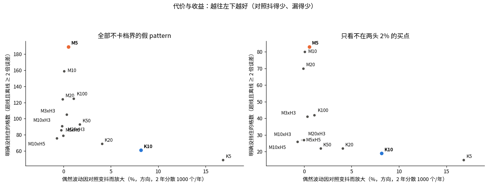
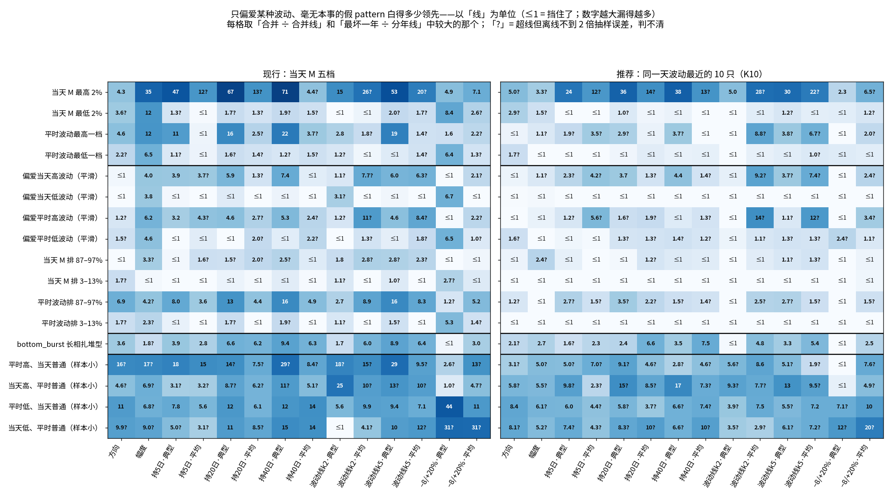
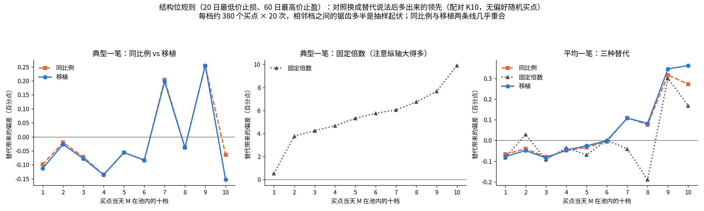

# 同日对照怎么配对才挡得住白得的领先

研究票：[同日对照怎么配对才挡得住白得的领先](../issues/11-control-matching.md)。日期 2026-10-18，主机 upc。本文件里的项目内路径都相对 repo root；脚本与原始输出在 `.scratch/selection-pattern/scripts/11-*`，量之前定下的判据见 `11-prereg.txt`。

## 先说人话

**做了什么。**

- 在默认目标池里（普通股、复权价不超过 20 美元、日成交额 200 万–1 亿美元），用截到 2025-12-31 的数据副本，造了一批「只偏爱某种波动、没有任何本事」的假 pattern：比如只买当天最疯的 2% 股票、只买平时最安静的一成、或者照 bottom_burst 的买点长相扎堆买平时很疯的股票，一共 30 多种。
- 拿它们和同日普通买入对照（`path2/CONTEXT.md:155`）比，看在每种配对方式下能「白得」多少领先。比了 13 种配对：现行的「每天按当天波动切五档」、切得更细的、再加一维「平时波动」的二维分档，以及「同一天找波动最接近的 K 只股票」。
- 尺子有三类：方向（首次穿越，`path2/CONTEXT.md:148`）、幅度（前瞻收益，`path2/CONTEXT.md:141`），和主尺子——按 6 条通用买卖规则（持有 5 / 20 / 40 日，按自身波动止损止盈两档，固定 −8% / +20%）算出的每笔交易收益，典型的一笔和平均的一笔各看一次。
- 量了代价：对照越细，对照本身越抖，判优时的偶然波动会放大多少。
- 另外检验了「规则里引用 pattern 自身结构」时，对照能怎么套用。
- 全程没读任何 pattern 的成绩，2026 年起的数据一行没碰。

**说明什么。**

1. **现行配对漏得厉害。** 偏爱某种波动的假 pattern，在 812 个检查格（假 pattern × 尺子 × 合并 / 分年两条线）里，现行配对有 189 格明确超线；偏爱平时很疯的股票，方向白输 0.02–0.04、持有 40 日的典型一笔白输 2–3 个百分点，2022 年最严重。
2. **推荐：对照改成「同一天、同一池子里，当天波动和平时波动都最接近的 10 只股票」（待验证）。** 明确超线的格子降到 61 格；只看不在波动最两头的买点时，从 83 格降到 19 格。代价是判优时的偶然波动放大约 8%（每个买点只有 10 只对照，对照本身更抖）。
3. **挡不住的主要在两头。** 当天波动排在池子最高 2% 的票，任何配对都挡不住：典型的一笔白输 1–6 个百分点（看持有多久），折算到每月约 3–5 个百分点，和「大优势」的默认线（每月多赚 3 个百分点）同一量级。方向是让偏爱这类票的 pattern 看起来更差，不是更好；幅度和「按波动止损止盈」的平均一笔则有反过来白赚的迹象（约 +0.6 到 +1.3 个百分点，多数离线不到 2 倍抽样误差，判不清）。另外四类「一维高、一维普通」的组合样本太少，判不清。
4. **规则里引用 pattern 自身结构的部分（例如「跌破平台低点就卖」），对照这样套**：每笔对照继承它配对的那个买点的「结构距离 ÷ 买点波动」，再乘对照自己的波动（「移植」）。按同样百分比距离套，效果几乎一样。两种的偏差都小：无偏好的买点上全期合并在 ±0.06 个百分点以内，单年最多约 0.4 个百分点（偏爱高波动的买点单年可到 0.6），有的年份偏正、有的偏负。**不能**给所有对照用同一个固定倍数：那样典型的一笔会白赚 3.5 个百分点，波动越高白赚越多，最多约 10 个百分点。
5. **顺带发现：池子里价格最低的一档（复权价约 1.3–3.2 美元）白得方向 +0.06，平均一笔白赚约 4.6 个百分点，每年都为正，任何按波动的配对都挡不住。** 多半是复权价带来的偷看未来，见第 6 节。

**不说明什么。**

- **没有哪种配对能把假 pattern 全部压到事先定的线以下**（线是「2 年偶然波动的三分之一」和「1 年偶然波动」）。推荐的是漏得最少、代价能接受的那种，不是「挡住了」。
- **推荐的配对和事先定的挑选规则挑出来的不一样。** 照事先的规则数失败格，挑出来的是「当天波动切十档、每档再按平时波动切三档」。我改推「最近 10 只」，因为事先那组假 pattern 里有两类恰好卡在「当天波动十档」的档界上，十档系的配对在其中一类上全过，比最近 10 只少失败 21 格，这是白拿的；换成不卡档界的一组，「最近 10 只」漏得更少，对照也更稳（第 1.3 节）。这一步是看过结果后做的判断，请按这个分量看待。
- 平均一笔这把尺子，在偏爱高波动的假 pattern 上，这份数据本身就量不准：估计值的抽样误差约 1 个百分点，比线大好几倍。热力图里打「?」的格子多半是这种。
- 只有幸存股、只到 2025 年底；结论只在这个池子上成立。池子口径以后改了（「候选名单的规格」），要在新池子上复核。
- 没回答哪个 pattern 好。

---

## 1. 推荐的配对方式（待验证）

### 1.1 怎么配

| 项 | 默认（待验证） |
|---|---|
| 对照是谁 | 买点同一天、同一池子里的普通买入，取「当天波动」和「平时波动」都最接近的 10 只，不含买点自己 |
| 当天波动 | M = 最近 20 日真实波幅 ÷ 收盘的中位数（与首次穿越的线距同一个 M） |
| 平时波动 | 过去 250 个交易日（含当天）M 的中位数，至少 120 个；不足 120 日时用已有的全部（上市不久的票、2021 年的全部和 2022 年约三成的股票日走这条退路）；低于 0.1% 的按 0.1% 算 |
| 远近怎么量 | 在（ln M，ln 平时波动）平面上的直线距离，两维等权 |
| 方向、平均一笔的对照值 | 10 只的平均 |
| 幅度、典型一笔的对照值 | 每个买点的 10 只各占 1/10 权重，全体买点的对照合在一起取中位数（与现行看图对照页的「混合中位数」同一做法，只是格子换成 10 只近邻） |
| 偶然波动 | 照旧按整只股票重抽买点；对照抖动不另加（见第 3 节，约 +8%） |

更严一档的备选是最近 5 只：两头的白得领先再小约两成，偶然波动放大约 17%。

**为什么是这个形状（第一性原理）。**

- 让读数失真的是买点之后的实际波动：波动大的票，40 日的典型一笔天然更差（涨跌幅一样大时，跌一半要涨一倍才回来），平均一笔和最高涨幅天然更好。实际波动事先不知道，能预测它的是当天 M 和平时波动。两者各管一段：当天 M 管最近一个月的「热度」，平时波动管这只票一贯有多疯。只按当天 M 配对，「平时很疯、这几天安静」的票会和「平时安静、这几天突然动」的票落在一档里，走法却不同。
- 格子有硬边：一档里还有偏低的一半和偏高的一半，只买其中一半就白得或白丢（第 2 节图里的锯齿）。按距离找最近的几只没有档界，每个买点的对照都围着它自己。
- 只按波动配：近期涨跌这类东西本身可能就是本事，按它配会连本事一起扣掉；成交额、价格不默认进配对，只做检查（第 2.4 节）。

### 1.2 比了哪些配对

| 配对 | 事先那组假 pattern：没挡住 / 明确没挡住 | 不卡档界那组 | 剔掉两头 2% 后 | 偶然波动放大（方向） |
|---|---|---|---|---|
| 现行：当天 M 五档 | 479 / 172（共 588 格） | 550 / 189（共 812） | 256 / 83（共 532） | +0.5% |
| 当天 M 十档 | 426 / 133 | 514 / 159 | 244 / 80 | +0.1% |
| 当天 M 二十档 | 397 / 108 | 467 / 124 | 227 / 70 | −0.1% |
| M 三档 × 平时波动三档 | 430 / 112 | 487 / 105 | 221 / 41 | +0.3% |
| M 五档 × 平时波动五档 | 408 / 92 | 433 / 86 | 184 / 27 | −0.2% |
| M 十档 × 平时波动三档 | 377 / 90 | 427 / 91 | 198 / 27 | −0.2% |
| M 十档 × 平时波动五档 | 352 / 77 | 407 / 76 | 177 / 26 | −0.7%（对照抖动超约束） |
| M 二十档 × 平时波动三档 | 363 / 81 | 403 / 79 | 171 / 27 | −0.0%（对照抖动超约束） |
| 最近 100 只 | 467 / 126 | 551 / 125 | 221 / 42 | +1.1% |
| 最近 50 只 | 437 / 98 | 501 / 93 | 183 / 22 | +1.7% |
| 最近 20 只 | 398 / 71 | 438 / 69 | 149 / 22 | +4.1% |
| **最近 10 只（推荐）** | **389 / 63** | **421 / 61** | **136 / 19** | **+8.2%** |
| 最近 5 只（看过结果后加的） | — | 398 / 49 | 121 / 15 | +16.8% |

- 「明确没挡住」= 超线，且离线超过 2 倍抽样误差。只算超线的总数里，混着大量「判不清」的格子（主要是平均一笔、和四类样本小的组合类）。
- 「不卡档界那组」和「剔掉两头 2%」两组是看过第一轮结果后加的，单独计数，没改第一轮的判定。剔掉两头后，「当天 M 最高 2%」「最低 2%」两类整个被剔空，所以格数少了。
- 偶然波动放大是格子方式的负数，是因为格子里包含买点自己，会把买点那一侧的起伏抵掉一点（同时也把真本事打了一点折，见第 3 节）。

### 1.3 为什么没照事先的挑选规则选

- 事先的规则是：先数失败格，少者优先；对照本身的抖动不得超过买点那一侧偶然波动的一半。按它，「M 十档 × 平时波动五档」（352）和「M 二十档 × 平时波动三档」（363）失败最少，但对照抖动分别是 0.56 和 0.63 倍，超约束；剩下最少的是「M 十档 × 平时波动三档」（377）。最近 10 只是 389。
- 差的这 12 格，主要来自一类假 pattern：「当天 M 排最高 10%」。它的边正好是十档配对的档界，十档系的配对在它身上全过（0 格失败），最近 10 只失败 21 格。真 pattern 的偏好不会恰好卡在档界上。
- 换成不卡档界的一组（平滑地偏爱高或低波动、错开档界的窗口），最近 10 只在三组里都比「M 十档 × 平时波动三档」漏得少（明确没挡住 61 对 91，剔两头后 19 对 27），对照抖动也更小（0.33 对 0.46 倍）。
- 实现上，近邻和格子一样简单：每天对池内每只股票找 10 个近邻即可，看图对照页（`chart_workflow/control.py`）、调参（tune-gates-v3 的 `WindowPlan` 里给每行算「同组均值」那一步）和最后检查都能共用同一个函数。

---

## 2. 挡不住的白得领先有多大

### 2.1 一眼看全貌

每格是「合并 ÷ 合并线」和「最坏一年 ÷ 分年线」里较大的那个；≤1 就是挡住了。线是：合并不超过 2 年偶然波动的三分之一，单年不超过 1 年偶然波动（都待验证，见第 5 节）。

- 现行五档：偏爱平时高波动的几类（「平时波动最高一档」「平时波动排 87–97%」「平滑偏爱平时高波动」）几乎每把尺子都漏，幅度和典型一笔漏到线的 3 到 20 多倍。
- 最近 10 只：这几类大都压到线附近或线内，剩下的多是「?」（判不清）。还亮着的是第一行「当天 M 最高 2%」、底部四类样本小的组合，和扎堆型。

### 2.2 关键几类的数（合并，括号里是最坏的一年）

方向为方向值，其余为每笔收益的百分点；「→」左边现行五档，右边最近 10 只。

| 假 pattern | 方向 | 幅度 | 持 5 日·典型 | 持 40 日·典型 | 持 40 日·平均 |
|---|---|---|---|---|---|
| 线：合并 / 单年 | 0.005 / 0.023 | 0.17 / 0.68 | 0.05 / 0.20 | 0.14 / 0.59 | 0.21 / 0.85 |
| 平滑偏爱平时高波动 | +0.000（−0.027）→ +0.001（+0.010） | +1.03（+1.50）→ +0.12（+0.25） | −0.15（−0.31）→ −0.06（−0.16） | −0.77（−1.70）→ −0.14（−0.44） | +0.49（+0.77）→ +0.17（+1.11） |
| 平滑偏爱当天高波动 | −0.003（−0.012）→ −0.003（−0.006） | +0.66（+0.76）→ +0.18（+0.20） | −0.18（−0.28）→ −0.11（−0.12） | −1.07（−1.58）→ −0.64（−0.81） | +0.08（+0.76）→ −0.28（−0.81） |
| 平时波动最高一档 | −0.023（−0.080）→ −0.003（−0.014） | +2.06（+3.46）→ +0.18（+0.57） | −0.49（−0.84）→ −0.09（−0.18） | −3.13（−5.67）→ −0.53（−1.09） | −0.30（−3.14）→ −0.09（−0.23） |
| 平时波动排 87–97% | −0.035（−0.081）→ −0.006（−0.022） | +0.70（+2.31）→ −0.07（−0.27） | −0.37（−0.60）→ −0.13（−0.15） | −2.30（−4.68）→ −0.22（−0.73） | −0.73（−4.19）→ −0.17（−1.20） |
| 当天 M 最高 2% | −0.021（−0.090）→ −0.025（−0.048） | +5.91（+8.25）→ +0.56（+0.88） | −2.19（−4.23）→ −1.15（−1.34） | −10.27（−18.38）→ −5.55（−6.31） | −0.60（−3.76）→ −2.73（−5.27） |
| bottom_burst 长相扎堆型 | −0.018（−0.022）→ −0.010（+0.034） | +0.30（+0.75）→ −0.46（−0.96） | −0.18（−0.27）→ −0.07（−0.13） | −1.36（−2.27）→ −0.50（−1.43） | −1.33（−2.36）→ −1.58（−3.19） |

全部 14 把尺子、全部假 pattern 见 `11-report-tables.txt` 的 T3；分年和去掉 2022 年见 T4。几条读法：

- **最坏的一年多是 2022 年**（现行五档下尤其明显：平时波动最高一档，方向 2022 年 −0.080，其余年份 −0.024 到 +0.005）。**去掉 2022 年**，现行五档的偏差小一截，但仍超线（同一类，方向 −0.011，持 40 日典型 −2.59）；最近 10 只去掉 2022 年后是 −0.001 和 −0.39。
- **典型的一笔是最难配平的尺子。** 波动越大，固定持有的典型一笔越差，而且越到高波动端掉得越快。一档里只要波动还有一点高低，就会漏出来。平均一笔反过来：高波动端的平均被少数暴涨的票拉高。
- **扎堆型的残余基本挡不住，但它自己的偶然波动大得多。** 照 bottom_burst 长相扎堆买的 pattern，2 年的偶然波动约 0.054（「目标池里的分辨力和幸存者偏差有多大」第 3.1 节），比剩下的 −0.010 大五倍；它逐年忽正忽负（2022 年 +0.034，2025 年 −0.030），更像它自己的起伏，不像系统偏差。

### 2.3 两头为什么挡不住，怎么办

- 当天波动最高 2% 的票每天只有十几只，M 从 12% 到 50% 以上拉得很开。最疯的那几只，最近的 10 只全在它下面。任何按距离或分档的配对，在尾巴上都只能拿「没它那么疯」的票当对照。最近 5 只能把典型一笔的白输再砍掉两成（持 40 日 −5.5 → −4.5），砍不掉大头。
- 试过在近邻上再做一次「按斜率修正」（把每个对照的结果平移到买点自己的波动位置），有的类变好、有的类变坏，无偏好的随机买点在两种止损止盈规则的典型一笔上反而冒出 0.2–0.7 个百分点的假领先，弃用（`11-ll-proto.py`）。
- 折算到每月（领先 × 21 ÷ 平均持有天数），当天 M 最高 2% 在最近 10 只下的典型一笔：持 5 日 −4.8、持 20 日 −3.8、持 40 日 −2.9、按波动止损止盈 −3.8 个百分点。和「大优势」的默认线（每月多赚 3 个百分点）同一量级，所以不能放着不管。
- **建议（待验证）**：判优时报一下命中有多少落在当天波动或平时波动的池内两头 2%；占比不小（例如超过一成）时，把落在两头的命中单独算一份成绩，主成绩只用剔掉两头的那部分。剔掉两头后，最近 10 只明确没挡住的只剩 19 格，多在四类样本小的组合和扎堆型的平均一笔上。另外两条路：名单直接不出两头 2% 的票（简单，但用户可能恰好想要这类「涨得猛」的票）；或者接受、只在成绩旁标注。这是方向层面的选择，见收尾说明。

### 2.4 检查：成交额、价格

不按它们配对，只看偏爱它们的假 pattern 能白得多少。整类全算、合并（最坏一年），最近 10 只：

| 假 pattern | 方向 | 幅度 | 持 40 日·典型 | 持 40 日·平均 | 方向逐年（2021–2025） |
|---|---|---|---|---|---|
| 成交额最低一档 | +0.010（+0.029） | +0.02 | −0.10 | +0.15 | +0.022 / −0.000 / +0.029 / +0.028 / −0.019 |
| 成交额最高一档 | +0.010（+0.049） | +0.28 | +0.29 | +0.71 | +0.033 / +0.006 / +0.001 / −0.018 / +0.049 |
| **价格最低一档** | **+0.056（+0.097）** | **+1.56** | **+1.74** | **+4.57** | **+0.180 / +0.045 / +0.025 / +0.040 / +0.097** |
| 价格最高一档 | −0.005（−0.031） | −0.12 | −0.17 | −0.87 | −0.008 / −0.002 / +0.014 / −0.002 / −0.031 |

- 现行五档下几乎一样（价格最低一档方向 +0.059），说明这些领先和波动无关，任何波动配对都挡不住。
- 价格最低一档是唯一大的：逐年为正，超线十倍以上。它和用户「偏好低价」的方向正对着：一个只会挑池子里最便宜那批票的 pattern，就能白拿方向 +0.06。登记为副产品（第 6 节）。
- 成交额两头各白得约 +0.01 的方向，逐年正负不一，量级在合并线的两倍左右。

---

## 3. 代价：对照本身抖多少

做法：无偏好的随机买点，分散长相（同一只票 40 个交易日内不重复买），每年 1000 个、2 年，随机放 40 次。买点那一侧的偶然波动按整只股票重抽买点算；对照那一侧，买点不动，把每个对照成员随机加重或减轻（每个成员乘一个平均为 1 的随机次数），看领先抖多少。

| 配对 | 对照抖动 ÷ 买点侧（方向 / 各尺子最大） | 偶然波动合计放大（方向 / 持 40 日典型） | 每个买点的对照个数 |
|---|---|---|---|
| 现行 M 五档 | 0.10 / 0.23 | +0.5% / +0.6% | 中位 165 只 |
| M 十档 × 平时波动三档 | 0.21 / 0.46 | −0.2% / +0.2% | 中位 28 只；<20 只的占 0.02% |
| M 十档 × 平时波动五档 | 0.27 / 0.56 | −0.7% / +0.3% | 中位 17 只；<20 只的占 88% |
| 最近 20 只 | 0.23 / 0.26 | +4.1% / +5.0% | 20 只 |
| **最近 10 只** | **0.31 / 0.33** | **+8.2% / +9.3%** | **10 只（<10 只：0%；<20 只：100%）** |
| 最近 5 只 | 0.42 / 0.46 | +16.8% / +18.5% | 5 只 |

- 池子每天大约 600–1100 只（中位：2021 年 703、2022 年 756、2023 年 790、2024 年 841、2025 年 972），找 10 个近邻不缺人。
- **最近 10 只的代价：判优的偶然波动大约放大 8%**，相当于同样的把握要多约 17% 的买点。这部分是真实存在的抖动，按「宁可抖一点也不留偏差」的方向，量出来交给偶然波动去算即可：判优时按整只股票重抽买点，同时对对照成员做同样的随机加减重，两者一起算。
- 格子方式的「放大」接近零甚至为负，原因是格子里包含买点自己。它同时把真本事打了折：格子里有 n 只票时，领先缩小约 1/n（现行五档约 0.6%，十档 × 三档约 3.5%）。近邻不含自己，没有这个折扣。

---

## 4. 规则里引用 pattern 自身结构的部分，对照怎么套

### 4.1 怎么检验的

- 拿一个任何股票都算得出的结构位当规则：止损位 = 过去 20 日最低价，止盈位 = 过去 60 日最高价（都含决策日），次日开盘买入，收盘触线当日收盘卖，40 日到期卖。
- 基准：对照也用它自己的结构位。对无偏好的随机买点，这时领先应约为 0（实测全期 −0.02 / +0.00 个百分点，典型 / 平均）。
- 三种替代说法：
  - **同比例**：对照继承它所配对买点的止损、止盈到买入价的距离（按比例）；
  - **固定倍数**：所有对照用同一个「距离 ÷ 自身 M」，取这批买点的中位数，乘对照自己的 M；
  - **移植**：每笔对照继承它所配对买点自己的「距离 ÷ 买点 M」，乘对照自己的 M；持有上限也照买点（这里都是 40 日）。
- 替代带来的偏差 = 换成替代说法后的领先 − 基准下的领先。买点用无偏好随机、当天 M 最高 / 最低一档、平时波动最高 / 最低一档，分散长相、每年 1000 个、20 次平均；配对用推荐的最近 10 只。

### 4.2 结果

最近 10 只配对下（百分点，典型 / 平均）：

| 买点 | 范围 | 同比例 | 固定倍数 | 移植 |
|---|---|---|---|---|
| 无偏好随机 | 全期 | −0.03 / +0.05 | **+3.52** / −0.01 | −0.03 / +0.06 |
| 无偏好随机 | 2022 | −0.18 / −0.12 | +3.24 / −0.17 | −0.18 / −0.12 |
| 无偏好随机 | 2025 | +0.25 / +0.33 | +3.81 / +0.07 | +0.25 / +0.37 |
| 无偏好随机 | 去掉 2022 | +0.02 / +0.11 | +3.54 / +0.05 | +0.03 / +0.12 |
| 当天 M 最高一档 | 全期 | +0.15 / +0.11 | **+9.90** / +0.04 | +0.10 / +0.25 |
| 平时波动最高一档 | 全期 | +0.08 / −0.11 | +7.79 / +0.00 | +0.06 / −0.02 |
| 当天 M 最低一档 | 全期 | +0.12 / −0.08 | +2.13 / −0.12 | +0.12 / −0.08 |
| 平时波动最低一档 | 全期 | +0.04 / +0.01 | +1.22 / −0.01 | +0.08 / +0.01 |

- **固定倍数不能用。** 典型的一笔白赚 3.5 个百分点（偏向 pattern，是假的「赢」），波动越高越多，最高一档约 10 个百分点。原因：买点的规则松紧各不相同（有的止损贴得很近，有的很远），所有对照却按同一个中间值执行；一堆不同规则混在一起的典型一笔，不等于中间那条规则的典型一笔。平均一笔几乎不受影响。
- **同比例和移植几乎一样**，因为最近 10 只的波动本来就和买点很接近。两者偏差都小：无偏好的买点上全期在 ±0.06 个百分点以内，比同类规则（40 日到期的止损止盈，第 5 节）的合并线 0.10–0.20 小；单年在 −0.2 到 +0.4 之间，2022 年偏负、2025 年偏正，都在同类规则的分年线（0.45–0.87）以内。当天波动最高一档的买点上，单年可到 +0.6（2024、2025 年的典型一笔），平均一笔全期偏正 +0.1（同比例）到 +0.25（移植）。
- **剩下的这点偏差是替代本身带来的，去不掉。** 一只股票的结构位和它自己之后的走势是连着的（比如正贴着 20 日低点的票，之后的走法和随便一只不同）；换成任何借来的距离，这层联系就断了。它逐年变号，不会稳定地偏向一边。
- **推荐（待验证）：移植**。配对准时它和同比例等价；配对不准时（波动差得多，例如尾巴上或者还在用五档的旧工具里）它把距离换算成对照自己的波动单位，松紧程度不变。在现行五档下，平时波动最高一档的典型一笔：同比例 +0.43，移植 +0.29。持有上限、「几天内没涨就卖」这类按时间的条件，同样直接继承买点的。

---

## 5. 判据的分母：各把尺子的偶然波动

方向、幅度沿用「目标池里的分辨力和幸存者偏差有多大」的数（事先定的）；主尺子 6 条规则是这次量的：分散长相、每年 1000 个买点、无偏好随机，按整只股票有放回重抽 200 次，对照不动，现行五档，40 次放置的均方根。

| 尺子 | 1 年偶然波动 | 2 年 | 合并线（2 年 ÷ 3） | 分年线（1 年） |
|---|---|---|---|---|
| 方向（方向值） | 0.023 | 0.015 | 0.005 | 0.023 |
| 幅度（百分点） | 0.68 | 0.50 | 0.17 | 0.68 |
| 持 5 日：典型 / 平均 | 0.20 / 0.26 | 0.14 / 0.18 | 0.05 / 0.06 | 0.20 / 0.26 |
| 持 20 日：典型 / 平均 | 0.42 / 0.56 | 0.30 / 0.39 | 0.10 / 0.13 | 0.42 / 0.56 |
| 持 40 日：典型 / 平均 | 0.59 / 0.85 | 0.43 / 0.63 | 0.14 / 0.21 | 0.59 / 0.85 |
| 按波动止损止盈 2 倍：典型 / 平均 | 2.07 / 0.40 | 1.63 / 0.27 | 0.54 / 0.09 | 2.07 / 0.40 |
| 按波动止损止盈 5 倍：典型 / 平均 | 0.81 / 0.64 | 0.59 / 0.56 | 0.20 / 0.19 | 0.81 / 0.64 |
| 固定 −8% / +20%：典型 / 平均 | 0.87 / 0.45 | 0.39 / 0.31 | 0.13 / 0.10 | 0.87 / 0.45 |

- 同法量方向，1 年 0.022、2 年 0.016，和 09 的 0.023 / 0.015 对得上；幅度量出来是 0.50 / 0.36，比 09 的 0.68 / 0.50 小约三成（起点从买点收盘改成了次日开盘），所以幅度的线偏松。
- **两条止损止盈规则的「典型一笔」几乎不能用**：结果堆在止损和止盈两处，中位数要么落在止损那堆、要么在两堆之间跳。固定 −8% / +20% 的规则，全池典型一笔就是 −8.2%（一大半交易止损出场），中位数几乎不动，重抽时又偶尔整段跳开（1 年 0.87、2 年 0.39，不随样本平滑缩小）。按波动 2 倍止损止盈的典型一笔偶然波动约 2 个百分点。这两把只看平均一笔更有意义，留给「配套买卖规则怎么设计」参考。

---

## 6. 副产品候选

都没写进 `docs/feature_candidates.md`。及格线就是本票事先定的判据（合并超过 2 年偶然波动的三分之一、单年超过 1 年偶然波动），外加有同日对照、逐年同号。状态都是 exploratory。

1. **池内价格（复权价）最低一档，白得方向和平均一笔**
   - 口径：池内股票日（默认池），按当天复权收盘价在池内排位，取最低 10%（价格约 1.3–3.2 美元，中位 2.28）。方向值、前瞻收益、6 条规则的每笔收益同第 5 节；对照 = 同一天池内当天波动和平时波动最近的 10 只（现行五档同时报）。
   - 方向：正（白赚）。
   - 效应量：方向 +0.056（现行五档 +0.059），逐年 +0.180 / +0.045 / +0.025 / +0.040 / +0.097（2021–2025，2021 只有 11–12 月），去掉 2022 年 +0.059；幅度 +1.56 个百分点；持 40 日典型一笔 +1.74、平均一笔 +4.57 个百分点（逐年都为正）；按整只股票重抽的抽样误差，方向约 0.011。过的线：合并超线 11 倍，五年每年都超分年线（2023 年 0.025 刚过 0.023），逐年同号；13 种波动配对全都挡不住（+0.053 到 +0.059）。
   - 发现样本：决策日 2021-11-04..2025-11-03，截断副本，池内 82,850 个股票日、584 只股票；查询次数：4 类检查用假 pattern × 13 种配对 × 2 种形式。
   - 原本为什么量它：用户要求成交额、价格只做检查，看偏爱它们的假 pattern 有没有白得的领先。
   - 已知纠缠：⚠ 多半是复权价的偷看未来：以后做了合股的票，早年的复权价被抬高，挪出了低价档甚至池子（「目标池里的分辨力和幸存者偏差有多大」第 2 节）；加上幸存者偏差（还挂牌的极低价票必然熬过了 1 美元退市线）。没有拆合股记录，无法实测。⚠ 镜像：价格最高一档方向 −0.005、平均一笔 −0.87，五年中四年为负。⚠ 和用户「偏好低价」正对着：挖数据或看图偏向池内最便宜的票，会白拿这份领先。修法在池子口径（按当时价格），不在配对。
2. **池内成交额最高一档，白得一点方向和平均一笔**（较弱）
   - 口径同上，按 20 日成交额中位数在池内排位，取最高 10%。
   - 效应量：方向 +0.010（现行 +0.015），逐年 +0.033 / +0.006 / +0.001 / −0.018 / +0.049，**不同号**；平均一笔 +0.71、典型一笔 +0.29 个百分点；分散长相（同股 40 日不重复买）下方向五年都为正（+0.018 到 +0.066）。过的线：合并超线两倍；没过逐年同号。
   - 发现样本、原本为什么量它：同第 1 条。
   - 已知纠缠：⚠ 整类全算和分散长相结论不一致；⚠ 成交额上限 1 亿美元就在这一档的边上。

---

## 7. 口径、比了几种、妥协

**数据与池子。**

- 主机 upc；数据 `datasets/pkls_until_20251231/`，`SNAPSHOT.json` 的 cutoff 2025-12-31、created_at 2026-10-17T02:44:27。全程没读 `datasets/pkls/`，没读 `outputs/` 下任何文件。
- 池子照 `chart_workflow/config.py` 的默认池：证券类别 ∈ 普通股 / ADR / 有限合伙普通单位；复权收盘 ≤ 20 美元；20 日成交额中位 200 万–1 亿美元；M ≥ 0.01；次日开盘 > 0；40 日观察期走完（因此最后一个决策日是 2025-11-03）。
- 证券分类：分类函数用 `chart_workflow.securities.classify`，证券全名取自 `.scratch/selection-pattern/scripts/09-securities.csv`（不联网，没读看图工作流的分类缓存）。和 09 那份文件里自带的分类一致率 99.6%，差的 22 只是名单里查不到名字的代码，两边都按普通股处理。
- 面板：832,990 个池内股票日、2371 只股票、1003 个决策日（2021-11-04..2025-11-03）。每年：2021 年 27,386（只有 11–12 月）、2022 年 191,080、2023 年 197,384、2024 年 213,535、2025 年 203,605。
- 决策日覆盖调试段（`path2/CONTEXT.md:173`）、预检段（`:170`）和训练段（`:167`）；这里只用来定对照，不挑、不调、不比任何候选。2021 年的决策日从 11-04 开始，因为 M 要 20 个交易日。
- 自检：无偏好的随机买点在各种配对下领先都约为 0（最近 10 只、整池全算：方向 −0.001，持 40 日典型一笔 −0.05 个百分点；分散长相 40 次平均：方向 +0.003，40 次之间的误差约 0.002）。
- 标签口径直接调用 `chart_workflow.labels.compute_labels`（次日开盘买入、k=5、观察期 40 日、收盘首次穿越；前瞻收益 = 观察期最高价 ÷ 买入价 − 1）。「按波动止损止盈 5 倍」规则的出场方向与首次穿越逐行一致（自检 100%）。

**比了几种。**

- 配对 13 种：事先列的 12 种（当天 M 五 / 十 / 二十档；先按 M 再按平时波动的 3×3、5×5、10×3、10×5、20×3；最近 10 / 20 / 50 / 100 只）+ 看过结果后加的最近 5 只。另有 2 种试过又放弃（最近 20 / 50 只加斜率修正，原型）。事先的文件里写成「13 种」是数错，已在当时更正为 12。
- 买卖规则：主尺子 6 条 + 结构位规则 1 条（4 种对照套法）。
- 假 pattern：事先列的 15 类（判优用 10 类 + 扎堆型 + 无偏好随机 + 检查用 4 类），整类全算与分散长相两种形式；两组十档逐档全算（只画图）；看过结果后加的 12 类（平滑偏好 8 个、错开档界的窗口 4 个）；以及「剔掉两头 2%」的版本。

**妥协与近似。**

- 平时波动要 120 日历史：2021 年全部、2022 年约 31%、之后约 1–2% 的股票日在配对里用退路版（已有历史的中位数）。以平时波动为条件的假 pattern 只用严格版，所以从 2022 年 4 月左右才有。
- 价格上限暂用复权价（与看图工作流一致），第 6 节第 1 条的偏差就是它的后果之一。
- 判据只判点估计；离线不到 2 倍抽样误差的标「判不清」。抽样误差只在现行五档下按整只股票重抽 100 次算（买点那一侧，各配对差不多）。
- 分散长相每年 1000 个买点的配额，小的类凑不满（当天 M 最高 2% 每年约 300 个，四类组合每年几十个）。
- 扎堆型：bottom_burst 买点位置在截断副本上用现役参数重跑（只取位置，14,326 个买点日、621 只股票，落在决策日范围内且有平时波动的 13,592 个）。每段连买换成当天池内平时波动同档的股票，同一来源股尽量沿用同一只替身，替身当天不在池内才换；只用当天及以前的信息，不像 09 那样要求替身之后大多在池内（那会偷看未来）。
- 平滑偏好最初用标准化的 log 值加权，权重被极少数极端行独占（一行权重上万），改成按池内排位的正态分数（有界），β = ±0.5、±1。
- 结构位检验：60 日最高价要 60 日历史，所以 2021 年几乎没有样本；对照里缺结构位的成员不进比较。这组的误差是 20 次之间的误差，低估了数据本身的误差。
- 现行格子方式包含买点自己，近邻不含，两者口径差在第 3 节说明。
- 幅度的偶然波动沿用 09 的数，比这次实测大约三成，幅度的线因此偏松。

**试过又放弃的。**

- 近邻 + 斜率修正（第 2.3 节）。
- 平滑偏好用标准化 log 值加权（上一条）。

## 复现

脚本都在 `.scratch/selection-pattern/scripts/`，按顺序 `uv run python` 运行；大体积中间数据写在会话临时目录的 `11/` 下，可重新生成。

1. `11-bbpos.py`：bottom_burst 买点位置（截断副本）。
2. `11-panel.py`：池内股票日面板（输出 `11-panel_out.txt`）。
3. `11-build.py`：各尺子的逐笔结果、格子、近邻（`11-build_out.txt`）。
4. `11-noise.py`：偶然波动与对照抖动（`11-noise.csv.gz`、`11-noise_out.txt`）；`11-noise.py K5 K10` 补最近 5 只（`11-noise-K5-K10.*`）。
5. `11-bias.py`：事先列的假 pattern（`11-bias.csv.gz`）；`11-bias.py K5` 补最近 5 只（`11-bias-K5.*`）。
6. `11-bias2.py`：看过结果后加的假 pattern 与剔两头版本（`11-bias2.csv.gz`）。
7. `11-struct.py`：结构位替代（`11-struct.*`）；`11-struct.py K10` 推荐配对下重跑（`11-struct-K10.*`）。
8. `11-judge.py`：按事先判据逐格判定（`11-judge_out.txt`）。
9. `11-report.py`：数表 `11-report-tables.txt` 与本文四张图。
10. `11-ll-proto.py`：放弃的斜率修正原型（`11-ll-proto_out.txt`）。
