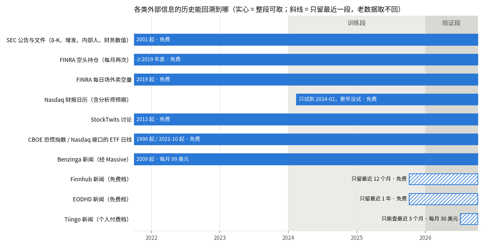

# 能接哪些外部信息：调查结果

调查日 2026-10-07。方向（与用户确认）：免费优先，付费的只列价格；重点查免费、能按信息公开那一刻取到、覆盖小盘股的来源。

## 先说结论

**做了什么。** 把能和个股日线配合用的外部信息按七类盘了一遍：公司公告与 SEC 文件、内部人交易、财报日期与业绩、做空数据、新闻、社交讨论、大盘与板块。能实际连的都从本机小量连了一次：从目标池里随机抽了约 170 只股票，取它们 2024 年以来在 SEC 的全部申报清单、10 只的财务数值，再取了 FINRA 的空头持仓与每日卖空量、SEC 的内部人交易与交割失败数据、Nasdaq 的财报日历，对照目标池当天的名单数覆盖率，并核对了每类数据的日期到底是哪一刻。付费新闻接口只查了官网价格。另外把项目以前三轮外部信息研究的结论汇总在第四节。

**说明什么。**

- 免费、整段历史都在、时间戳精确到秒的来源确实有，而且就在一个地方：**SEC 的申报库**。增发、摘牌警告、反向拆股、业绩发布时刻、内部人买卖、大股东持股、财务数值，全从这里来，2001 年起都在，按公司编号存，不受股票改代码影响。缺口也清楚：目标池里约四分之一是外国公司，它们不交这些结构化的公告。
- **FINRA 的空头持仓和每日卖空量**免费、不用注册，2019 年起，目标池覆盖 95%～100%。用的时候要按发布日对齐，不能按结算日。
- **新闻是最难的一类。** 免费新闻接口都只留最近几个月到一年，取不回训练段。能取回 2024 年的，最便宜的是经 Massive 买的 Benzinga 新闻，每月 99 美元，但它对小盘股覆盖多少没验证过。
- 大盘和板块的状态很容易拿，但照现在的判优尺子，它单独造不出优势，只能当「什么时候用」的条件。

**不说明什么。** 这次一个涨跌都没读，所以哪类信息真能帮上选股，这里一条都没有判。第三节「已有证据」只列以前实测过的事实和机制，标了强弱。覆盖率是 2～4 个日期、一两百只股票的抽样，只能说明量级。

## 一、逐类清单

目标池用「目标池里的分辨力和幸存者偏差有多大」推荐的默认池：普通股（剔票据、优先股、权证、单位、封闭式基金、SPAC 壳），20 日成交额中位 200 万～1 亿美元，收盘不高于 20 美元。2024-01-02 起曾在池的股票共 2371 只，每天在池 830～1070 只。

### 1. 公司公告与 SEC 文件

| 项 | 情况 |
|---|---|
| 来源 | SEC EDGAR：每家公司一份申报清单（每条带表格类型、8-K 的事项编号、接收时刻），全文检索，另有每晚更新的批量包（申报清单 1.57 GB、财务数值 1.41 GB）。**免费**，不用注册，只要求请求里带联系方式、每秒不超过 10 次。 |
| 能不能连上 | 能。走代理和直连都通（以前有一轮走代理被 SEC 封过，这次没遇到）。 |
| 历史 | 2001 年起。样本里每只股票的清单都完整覆盖了 2024-01 至今，不用翻页。 |
| 会不会偷看未来 | **能按公开那一刻取。** 每条记录有三个日期：事件日、申报日、接收时刻。只有接收时刻是公开的那一刻，精确到秒，是 UTC（已拿申报索引页核对：清单里 20:38:39Z 就是美东 16:38:39）。事件日比公开早：8-K 中位当天，90% 在 3 个工作日内，最多约 5 天。申报文件发出后不会被改，更正是另发一份新的。 |
| 目标池覆盖 | 随机抽 144 只曾在池股票，143 只在 SEC 有编号。其中 **106 只（74%）是美国本土申报人**，交 8-K 和季报年报；**36 只（25%）是外国申报人**，不交 8-K，只交没有事项编号的 6-K 和一年一次的年报；1 只窗口内没有定期报告。 |
| 数量（本土 106 只，2024-01 至 2026-10 约 2.75 年） | 8-K 每只中位 29 份（约每年 10 份）。其中：业绩发布 102 只都有；**摘牌警告（不符合挂牌标准）23 只（22%）有过**；未登记发股 37 只；章程修订（反向拆股常走这一项）60 只；增发相关的注册书和招股书 79 只（外国公司 36 只里 21 只）；大股东持股申报 105 只。 |
| 时刻分布 | 普查样本 2.8 万条申报：开盘前 13%、盘中 15%、收盘到 17:30 有 36%、17:30～22:00 有 32%、22:00 以后 5%。**三分之二在收盘之后才到**，所以「名单几点生成」直接决定当天能用到多少。约 4% 的申报日期晚于实际接收日（傍晚以后到的记到下一个工作日），按申报日期用不会偷看，只是偏晚。 |
| 接入难度 | 低。一个公司编号对照表把代码换成编号，之后全按编号取。全池约 2400 只按每秒 6～7 次取一遍约 6 分钟；或者直接下批量包。 |

### 2. 内部人交易

| 项 | 情况 |
|---|---|
| 来源 | SEC：每份 Form 4 在申报清单里；另有**季度结构化数据包**（每季一个约 14 MB 的压缩包，逐笔交易已拆成表，含交易代码、股数、价格、是否预设交易计划）。免费。 |
| 历史 | 申报清单 2001 年起；季度包至少覆盖 2024 年（试了 2024 年一季度）。 |
| 会不会偷看未来 | 能按公开那一刻取，但要用申报的接收时刻，不能用交易日：交易日到公开中位 2 个工作日，90% 在 3 天内，1% 拖到 50 天以上（补报）。 |
| 目标池覆盖 | 本土公司全部有 Form 4（每只中位 82 份/2.75 年），外国公司基本没有（多数不受这条规定管）。**2024 年一季度，池内 1112 只里有 189 只（17%）出现过内部人在公开市场买入，395 只（36%）出现过公开市场卖出。** 其余大多是授予、行权、代扣税，不代表看多看空。 |
| 接入难度 | 低（季度包直接是表）。季度包里的代码是申报当时的代码，改过代码的要靠公司编号对上。 |

### 3. 财报日期与业绩

| 项 | 情况 |
|---|---|
| 业绩发布时刻 | 本土公司发业绩时交一份 8-K（业绩发布事项），接收时刻就是公开时刻。样本 1117 次业绩发布：**盘前 29%、盘中 9%、盘后 61%**。外国公司的业绩混在 6-K 里，没有事项编号，要读标题或正文才认得出。 |
| 财务数值 | SEC 的 XBRL 财务事实，每个数值都带申报日和申报编号（10 只样本 100% 都带）。**事后修订不覆盖原值**：同一指标同一报告期如果后来改了，新旧两个值都留着、各带各的申报日（10 只样本每只有 23～1105 组这样的新旧并存）。所以能还原「当时知道的值」——取申报日不晚于当天的、最早报出的那个。报告期末到公开要很久：季报中位 27 个工作日，年报 42 个，外国公司年报 80 个，**拿报告期末当公开日会偷看一到四个月**。 |
| 流通股数 | 每份季报年报封面都报一次流通股数，带申报日（10 只里 8 只 2024 年后有，约每季一次）。可以算当时市值和股本扩张速度（增发稀释）。 |
| 分析师预期与超预期 | Nasdaq 网站的财报日历接口，免费、不用注册，按日期查，历史日期也能查（试到 2024-02）。拿 SEC 业绩发布当真值核对 4 个业绩高峰日：**73 次发布里日历列了 69 次（95%）**，漏的是改过代码的和个别大公司；列出的里面 **80% 有分析师预期**。缺点：历史日期的发布时段一律「未提供」（要用 SEC 的接收时刻补）；历史上「当时预告的下次财报日」取不到，所以「离财报还有几天」这类特征拿历史回测会偷看，只能用过去的财报间隔去估。日历上的预期值是不是发布当时的值、事后会不会被改，没核实。 |
| 接入难度 | 财务数值：低到中（营收要用几个标签轮流找，以前实测过单用一个标签会漏，连 AAPL 的「Revenues」都停在 2018 年）。日历：低。 |

### 4. 做空数据

| 来源 | 价格 / 连通 | 历史 | 会不会偷看未来 | 目标池覆盖 | 接入难度 |
|---|---|---|---|---|---|
| **FINRA 空头持仓**（每月两次，按结算日统计各券商报上来的空头仓位） | 免费，**不用 key**，公开查询接口能通 | 至少 2019 年底起 | 只带结算日，没有发布日。发布比结算晚：2026-09-30 结算的到 10-07 还没发布，**按结算日用会偷看一周多**，要按 FINRA 公布的发布日程对齐。修订极少（约 2 万行里 2～17 行带修订标记）。 | 2024-01-12：95.5%；2026-09-15：100% | 低。每个结算日约 2 万行，分 4～5 页取完。 |
| **FINRA 每日场外卖空量** | 免费，直接下文件 | 2019 年起（以前实测） | 官方说当天傍晚发布（没实测几点），不修订。 | 2024-01-02：95.2%；2025-12-31：96.8%；2026-10：100% | 低。每天一个 0.3～0.5 MB 文件。**注意它不是空头持仓**：分母只是报给 FINRA 的场外成交（暗池、券商内部撮合），不是全市场成交量。池内这个比值中位数在 0.46～0.56，大部分是做市商对冲，信息含量存疑。 |
| SEC 交割失败 | 免费 | 多年（试了 2024-01） | 按半个月打包事后发布，要按发布日对齐（具体滞后没核实）。 | 2024-01-02 池内 38% 的股票当天有交割失败记录（只列有失败的） | 低 |
| 借券费率 / 可借券量 | iBorrowDesk 连不上；盈透的可借清单只有当天快照，没有历史 | — | — | — | 不可行（当前网络） |

覆盖不到 100% 的那几只，查了 2024-01-02 漏掉的 40 只：是**改过代码**的（例如 DJT 当时叫 DWAC）。行情文件按现在的代码命名，按代码取的外部数据在早期会对不上，越往前漏得越多。

### 5. 新闻标题与情绪

| 来源 | 价格 | 历史 | 小盘覆盖 | 备注 |
|---|---|---|---|---|
| Finnhub 免费档 | 免费，要注册 | **只留最近约 12 个月**（以前实测），今天只能回到 2025-10 | 以前实测：小盘股买点前 7 天有新闻的 57%，有新闻的中位 2 条 | 取不回训练段；本机现在没有它的 key |
| Finnhub 付费 | 约每月 50 美元起（第三方转述，官网价格页没抓到） | 未查 | 未查 | — |
| Alpha Vantage | 免费每天 25 次；付费每月 49.99～249.99 美元 | 以前实测至少 36 个月 | 以前抽 3 只命中 1 只 | 免费额度太紧 |
| EODHD | 免费档只给最近 1 年；付费每月 19.99～99.99 美元，各档都含新闻 | 官网没写新闻能回溯多久 | 官网没写 | 每次请求按 5 次额度计 |
| Marketaux | 免费每天 100 次（每次 3 篇）；付费每月 29～199 美元 | 官网没写 | 官网没写 | — |
| Tiingo | 个人每月 30 美元（含新闻接口） | **只能查最近 3 个月**；商用要更长需另谈 | 未查 | 取不回训练段 |
| **Benzinga（经 Massive）** | **每月 99 美元**（单独一个数据集；Massive 的行情套餐不含新闻） | **2009-04 起** | **没验证** | 每条带发布时间和股票代码。能取回训练段的最便宜选择。 |
| GDELT | 免费 | 文档接口只查近期；要回溯得下原始文件自己建索引 | 按公司名匹配，小盘撞名严重 | 本机能连上，但限每 5 秒一次（这次被 429 拦了一次） |
| **SEC 8-K/6-K 附带的新闻稿** | 免费 | 2001 年起 | 只有公司自己认为重要、正式交给 SEC 的那部分（本土公司每年约 10 份 8-K，外国公司每年约 20 份 6-K） | 时间戳精确；不需要别的新闻源也能回答「这天有没有正式公告」 |

会不会偷看未来：新闻接口都带发布时间，但文章事后会被编辑、撤下，回溯拿到的是「现在还在的」而不是「当时看得到的」，这一点各家都没承诺。

### 6. 社交讨论（StockTwits）

免费、不用注册，本机能连；以前实测历史回到 2013 年，小盘股和大盘股一样深，每条带用户自己标的看多/看空。**最大的问题是事后删帖**：拉高出货的帖子删得最多，而这类帖子恰好和暴涨相关，回溯时暴涨前的热度会被系统性低估，偏向制造「冷门之后暴涨」这种假规律。退市股的整个代码会被删。以前实测密度中位每天不到半条。

### 7. 大盘和板块状态

| 来源 | 情况 |
|---|---|
| 恐慌指数 | CBOE 官网 CSV，免费，1990 年至今，能连。 |
| 指数与板块 ETF 日线 | 行情库里没有 SPY、IWM、板块 ETF。Nasdaq 网站接口能取（试了 IWM，2021-10 至今），免费。Stooq 要过浏览器验证，FRED 连不上。 |
| 行业归属 | SEC 申报清单里每家公司带行业码（样本 143 只里 139 只有），免费；是当前值，不是历史值，但公司很少改行业。 |
| 自己算 | 用行情库里 5778 只股票自己算市场宽度、目标池整体涨跌、按行业码分组的板块强弱。免费、不偷看；但库里只有活到今天的股票，越往前越偏乐观。 |

**一条结构性的事实**：判优用的是同日普通买入对照（`path2/CONTEXT.md:155`），候选和对照是同一天、同一池子里买的，那天大盘涨跌两边一起扣掉。所以大盘状态本身造不出领先，只能当条件——「这个 pattern 在什么市况下才用」。板块状态不一样，同一天不同股票的板块不同，可以直接区分候选。

## 二、会不会偷看未来：几条硬规矩

1. **一律用接收时刻，不用事件日、报告期、结算日。** 拿错日期会偷看：8-K 最多约 5 个工作日，内部人交易一般 2～3 天、补报的上月，季报一个多月，年报两个月，外国公司年报四个月，空头持仓一周多。
2. **财务数值取「当时最早报出的值」**，不取今天看到的最新值；两者都在数据里。
3. **时间换成美东。** SEC 的接收时刻是 UTC。
4. **名单生成时刻决定能用到什么。** 三分之二的申报和六成的业绩发布在收盘后到。名单生成越晚，能用的越多，但用户也得在那之后才看图。
5. **外国公司没有 8-K 不等于没事发生**，只是不报。基于 SEC 公告的特征要么只在本土公司上定义，要么把「外国公司」单独当一类；否则「没有公告」会变成「是不是外国公司」的替身。
6. **按代码取的数据要处理改代码。** SEC 按公司编号存，不受影响；FINRA、新闻、财报日历按当时的代码存，2024 年初约 4%～5% 的池内股票对不上。

## 三、已有证据：有没有理由相信它能帮上选股

只列事实，标强弱。「本项目实测」比「文献」可信得多（用户不信任文献）。

| 信息 | 事实 | 强弱 |
|---|---|---|
| 每股营收增速（财务数值） | 本项目全市场实测（2026-08）：每股营收同比增速排最高三分之一的财报，40 个交易日内先涨到上沿的比例（首次穿越 `path2/CONTEXT.md:148`）比最低三分之一高约 6.3 个百分点，六年每年都是正的，2024 年后更强，小票最强；**但涨多少（前瞻收益 `path2/CONTEXT.md:141` 的中位数）几乎没差别**。按公司总营收算只有约 2.5 个百分点，差出来的是「靠增发撑起来的营收增长」。 | **强**（本项目实测），但方向领先约 0.06，**不到「大优势」默认要求的 0.15**；且那轮的分年数据已经包含 2026 年（见第六节） |
| 增发、摘牌警告、反向拆股 | 机制上直接作用于低价小盘股：增发直接增加流通股、通常折价发；价格长期低于 1 美元会收到摘牌警告，之后常靠反向拆股保住挂牌。池内本土公司 22% 在 2.75 年里收到过摘牌警告，75% 有过增发相关申报，作用面不小。以前在 bb 买点上测过「有没有稀释类 8-K」：方向反了且不稳，当时的解释是它更像「公司活跃度」的标记而不是坏消息。 | **机制直接、对新 pattern 未测**；bb 上的结果只适用于 bb |
| 大幅涨跌当天有没有公告 | 文献：单日大涨大跌后，没有消息的倾向回吐，有消息的倾向沿原方向走（「文献里哪些量价规律扣掉波动率和大盘后仍能选股」A9 条）。那张票当时写的是「只用 K 线看不出有没有消息，用不上」；**有了 SEC 接收时刻，「这天有没有正式公告」第一次可以免费测**。 | 弱（文献），但现在可测 |
| 新闻情绪 | 本项目在 bb 买点上实测（2026-08，2025 年数据）：小盘股新闻多是公司自己发的通稿，情绪结构性偏正（负面只占 4.5%），加在 bb 上没有增量，方向反了。 | 只适用于 bb；对新 pattern 未测 |
| 空头持仓、内部人买入 | 只有文献。 | 弱 |
| 社交热度 | 以前的结论：热度和成交量、波动是同一件事（公司活跃度）的投影，难拿到独立的读数；回溯数据有删帖偏差。 | 未测，且有已知偏差 |
| 大盘状态 | 同日对照下单独造不出领先（结构如此）；以前的研究看到各年的基础胜率差一倍多（2021–22 年先涨到上沿的只有 0.2 多，2023 年后 0.5–0.6），说明它适合当「什么时候用」的条件。 | 结构性事实 |

## 四、项目里以前的外部信息尝试（只汇总）

三轮，都在 bb 系上做，bb 已废弃，结论里只有「全市场」那部分能搬到新 pattern 上。

1. **新闻情绪与 8-K 稀释标记（2026-08-16，bb_v1 的 2025 年买点）**
   - Finnhub 免费档只留滚动 12 个月；小盘股买点前 7 天有新闻的只有 57%，中位 2 条。
   - 情绪要靠大模型逐条标，标出来结构性偏正，负面只有 4.5%，能拦的面太小；按情绪分组，方向反了。
   - 「买点前有稀释类 8-K」标记了 12.5% 的买点，但有标记的反而更好，三个窗口方向不稳。
   - 结论：在 bb 上不接。当时的解释是新闻条数、8-K 频率都是「公司活跃度」的投影，而活跃度本身就在驱动 bb 的价量。
2. **未被价格兑现的利好（2026-08-26）**
   - 在 bb 买点上，「利好还没被价格兑现」这个前提不成立：从最近一次财报算起，bb 买点中位已经涨了 75%。
   - 可行性：SEC 财务数值免费、全宇宙一次 2.5 小时；StockTwits 能回溯到 2013 年且小盘同深，但有删帖偏差；FINRA 卖空量 2019 年起免费。其余几个被拦的源当时都只走代理测过。
   - 关键的结构性认识：新闻条数、8-K 频率、讨论热度都是「公司活跃度」的投影，没法当独立于价格的尺子；会计数字没有这个问题。
3. **营收能不能当闸或当主角（2026-08-26）**
   - 规律在全市场成立（第三节第一行的数字）。
   - 加在 bb 上测不出来：同一只股票的多个买点结果高度一致，有效样本只有约 480 只股票，测不出这么小的效应；而且有理由相信 bb 的买点已经坐在这个效应耗尽的地方（财报后已经涨过的，营收效应只剩约 1 个百分点）。**这是「不确定下的不接」，不是「营收没用」。**
   - 让营收当主角，在 bb 的结构上做不到（放宽 K 线条件只会多出别的股票的买点，不会把同一只股票的买点提前）；纯按财报买是另一种策略。
   - bb 的票里 37.5% 结构上没有营收读数（还没收入的生物科技 27%、根本没有 XBRL 的 10.5%）。

## 五、推荐先接哪几类

**第一：SEC 申报事件**（8-K 各事项、增发注册与招股书、摘牌警告、章程修订与反向拆股、业绩发布时刻、内部人公开市场买卖、大股东持股）。
- 理由：免费、整段历史、时刻精确到秒、按公司编号存（不受改代码影响），一次接入拿到七八种事件。
- 正对低价小盘股特有的机制：增发稀释、摘牌风险、反向拆股，这些在 K 线上看不出来、但目标池里很常见。
- 让「大涨大跌当天有没有正式公告」第一次可测。
- 代价：只覆盖本土公司（约四分之三）；外国公司要么只用 6-K 有没有，要么单列。

**第二：SEC 财务数值**（每股营收增速、流通股数变化即稀释速度、当时市值）。
- 理由：和第一类同一个来源、同一套接入；是唯一在本项目全市场实测过、且在小票上更强的外部规律；修订不覆盖原值，能干净还原当时的值。
- 顺带用流通股数算出当时市值，目标池的「中小盘」就不必只拿成交额近似。
- 代价：单靠它方向领先约 0.06，到不了大优势，更适合当组合里的一个零件；而且这条规律的 2026 年表现以前已经看过（见第六节）。

**第三：FINRA 空头持仓**（加每日卖空量作补充）。
- 理由：免费、不用 key、2019 年起、覆盖 95%～100%；它反映的是市场参与者的仓位，和公司自己发布的信息不同源；外国公司一样覆盖，正好补第一、二类的缺口。
- 代价：证据只有文献；必须按发布日对齐（偷看一周多是最常见的坑）。

**暂不先接：**
- **新闻**：免费源都取不回训练段。如果「走哪条路」选中的方向确实要新闻，先花 99 美元买一个月 Benzinga，量一下它对目标池的覆盖再决定续不续。SEC 的正式公告已经能回答「有没有消息」的一半。
- **社交讨论**：删帖偏差正好朝假规律的方向。
- **大盘状态**：随时能加、几乎零成本，但只能当条件，不急。

这份推荐交给「在目标池里带纪律地挖：哪些量价特征胜过同日对照」和「走哪条路：选哪个方向进入设计」。

## 六、待验证的默认值

| 默认 | 取值 | 为什么这样取 / 怎么验证 |
|---|---|---|
| 名单截止时刻 | t 日美东 20:00 之前接收的信息进 t 日名单，次日开盘买 | 「盘后出名单」的直接翻译；三分之二的申报在收盘后到，截止点前移会丢掉大部分当天公告。等「候选名单的规格」定下名单实际几点生成后改。 |
| 空头持仓可用日 | 结算日后第 8 个工作日 | 实测：结算后 5 个工作日还没发布。要按 FINRA 公布的发布日程逐期核对。 |
| 每日卖空量可用日 | 次日名单才用 | 文件当天傍晚发布，取保守。 |
| 交割失败可用日 | 半月包期末后 15 天 | 发布滞后没核实，先取保守。 |
| 外国公司 | 基于 8-K 的特征只在本土公司上定义 | 防止「没有公告」变成「是外国公司」的替身。 |
| 改代码 | SEC 一律按公司编号；按代码取的源先接受早期约 4%～5% 的缺失，并标记缺失 | 以后有代码变更表再补。 |
| Benzinga 试用 | 只在选中方向需要新闻时才买，一个月 | 先量覆盖再续费。 |

## 七、副产品与给其他票的事实

**副产品候选**：没有。这次没读任何涨跌，没有变量过「有基线对照、且首次穿越（`path2/CONTEXT.md:148`）或前瞻收益（`path2/CONTEXT.md:141`）的差排除了偶然」这条线，不登记。

**给其他票的事实**（不是特征候选，供对应的票参考）：

1. **给「最后检查用哪段留着没碰过的数据」**：营收那轮研究的分年数据包含 2026 年（那一年高低组相差约 10.8 个百分点）。「营收增长好的股票更容易先涨」这条关系在 2026 年的表现已经被看过一次。选中的方向如果以营收为核心，验证段对它不算完全没碰过。
2. **给「候选名单的规格」**：SEC 季报年报封面的流通股数带申报日，能还原当时市值，「中小盘」可以直接按市值划，不必只拿成交额近似。反向拆股和摘牌警告也能从 SEC 公告查到，对还原「当时价格」有帮助，但拆股比例要从正文读，不是现成的字段。
3. **给「在目标池里带纪律地挖：哪些量价特征胜过同日对照」**：目标池约四分之一是外国申报人，SEC 类特征在它们身上是「没有读数」而不是「没有事件」。按代码取的外部数据在 2024 年初约有 4%～5% 的池内股票因改代码对不上，抽查到的几例是合并或更名（例如 DWAC 并入后改叫 DJT），所以缺失可能不随机（没系统查过）。

## 附：实测记录与出处

脚本和原始输出在 `.scratch/selection-pattern/scripts/`，下载件在 scratchpad 的 `13/dl-*/`：

| 内容 | 脚本 | 输出 |
|---|---|---|
| 目标池抽样 | `13-sample.py` | `13-sample_out.txt` |
| SEC 申报清单下载（及财务数值） | `13-edgar_fetch.py` | scratchpad `13/fetch_*.log` |
| 申报人类别、各类申报数量、接收时刻分布 | `13-edgar_analyze.py` | `13-edgar_analyze_out.txt` |
| 事件日到公开的滞后、业绩发布时段 | `13-edgar_lags.py` | `13-edgar_lags_out.txt` |
| 财务数值的申报日与修订 | `13-xbrl_check.py` | `13-xbrl_check_out.txt` |
| FINRA 每日卖空量覆盖 | `13-finra_cover.py` | `13-finra_cover_out.txt` |
| FINRA 空头持仓覆盖 | `13-finra_si_cover.py` | `13-finra_si_cover_out.txt` |
| 内部人交易季度包 | `13-insider_cover.py` | `13-insider_cover_out.txt` |
| Nasdaq 财报日历、交割失败、StockTwits、恐慌指数 | `13-misc_cover.py` | `13-misc_cover_out.txt` |
| Nasdaq 日历对 SEC 业绩发布的漏报 | `13-earn_match.py` | `13-earn_match_out.txt` |
| 连通性探测 | `13-probes.sh` | `13-probes_out.txt` |
| 配图 | `13-figure.py` | `research/13-history-coverage.png` |

抽样口径的一处更正：抽样时误用了不剔封闭式基金与 SPAC 壳的那版池子，下载的样本没换，所有统计只算落在默认池里的（默认池是那版的子集，子集里的随机样本仍然随机）；150 只里落在默认池的 144 只。

以前三轮研究的原文已从工作区删除，在提交 053b280 里：`docs/research/2026-08-16_news-sentiment-path2-integration.md`、`docs/research/2026-08-26_unpriced-catalyst-channels/final_report.md` 与 `channel_sentiment.md`、`docs/research/2026-08-26_fundamental-gate-vs-anchor/白话总结.md`。

价格出处（2026-10-07 查）：
- [Massive 价格页](https://massive.com/pricing)（行情套餐 0/29/79/199 美元；Benzinga 每数据集每月 99 美元）
- [Massive 的 Benzinga 新闻文档](https://massive.com/docs/rest/partners/benzinga/news)（记录回溯到 2009-04-27）
- [Tiingo 价格页](https://www.tiingo.com/about/pricing)（个人 30 美元/月，新闻只能查最近 3 个月）
- [EODHD 价格页](https://eodhd.com/pricing) 与 [新闻接口文档](https://eodhd.com/financial-apis/stock-market-financial-news-api)
- [Alpha Vantage 付费档](https://www.alphavantage.co/premium/)
- [Marketaux 价格页](https://www.marketaux.com/pricing)
- Finnhub 付费价格来自第三方转述 [apicostcalc](https://apicostcalc.com/finnhub.html)，官网价格页没抓到
- FINRA 空头持仓接口说明：[FINRA Equity Short Interest Data](https://www.finra.org/finra-data/browse-catalog/equity-short-interest/data)
