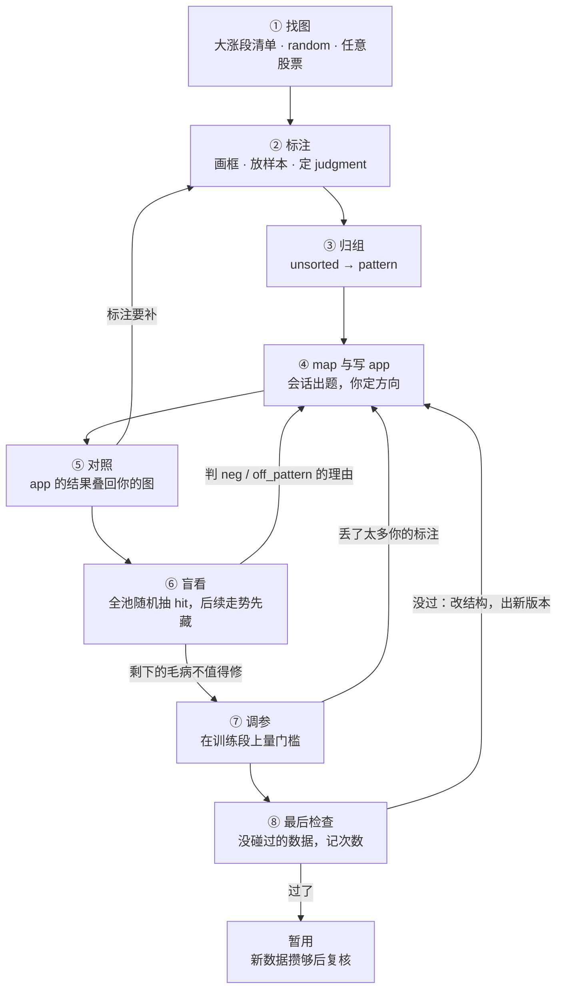

# 看图标注工具 · 用户说明书

> 读者：熟悉 path2（node、边、where、detector、dag 求解、事件三档）的你。标注一侧的新东西会讲清楚，path2 本身不再解释。
> 界面上的字照屏幕原样写在反引号里（界面固定文字是英文）；正文用中文。

---

## 一、这个工具帮你做什么

你脑子里有一种「这种走势后面常涨」的直觉。这个工具帮你把它做成一个 path2 pattern。终点只有一个标准：**在你从没碰过的数据（2026 年起）上，它比同一天随便买一只股票好。**

你做的事只有三类：**看图**、**在图上标出你看到的和你会怎么判断**、**在会话问你时定方向**。把你的标注翻成 node、where 和边，写 app 和 detector，把 app 的结果画回你的图上和你对照，量数字，守住没碰过的数据——这些都由会话（写 app 的 Claude Code 会话）和工具替你做。

它能替你做到三件事：

1. **翻译走样会被你看见。** 你不写描述，你画框。每个框是一段确定的日期，每个判断带着它的依据；app 跑出来的结果用和你的框同一套画法叠回同一张图上，差在哪一眼看得出，哪一层没对上（某一段、两段之间、整次买入）也分得清；觉得哪一行翻错了，点 ⚑ 钉在那一行上。
2. **训练段的水分进不了判决。** 训练段随便看，你难免会按结果挑图、看着 app 去标，工具不拦也不记。它守的是另一道关：「当天看不看得到」做进了界面——判断的依据不能伸到判断那天之后；盲看时后续走势先藏起来；2026 年起的数据你永远看不到，只在最后检查时用、每次记次数。训练段上的自欺可以有，但进不了最后的判决；判决本身有多大分量，见下面「尺子有多细」。
3. **数字只在该出现的地方出现。** 对照默认只给「认没认出」，不给门槛和实测值，不会把你拉去一张张放宽；门槛在整个训练段上量；输赢只由没碰过的数据判。

换句话说，工具保证的是：**翻译走样看得见、训练段的水分进不了判决、判决不被看过的数据骗。** 它不保证你的直觉有优势——直觉可能本来就不成立，工具的价值是让你照实看到这一点，而不是在训练段上把它凑得好看。

**尺子有多细。** 2026 年起的数据目前只有九个多月，只分辨得出比较大的优势：

- **「过了」**是在没碰过的数据上看到一次领先为正。它能可靠排除的是「明显变差」；排除不了「其实没有优势、这次碰巧为正」——一个毫无优势的 pattern 大约有一半机会过。所以过了只算暂用，等新数据攒够再复核一次。
- **「没过」**可能是没有优势，也可能是优势太小、这么点数据量不出来——它说明「还没证明有用」，不说明「没用」。但同一版再送一次不会多出任何证据，只会多记一次；要么等新数据攒够，要么改结构出新版本再送，每次都记次数。

数据会逐日变多，尺子会越来越细。

---

## 二、先认几个词

标注一侧的词是新的，每个都和 path2 一侧的某个词成对。规范名是英文，中文是别名。

| 词 | 在这个工具里指什么 | 出处 |
|---|---|---|
| pattern | 你起名、配一句定义的那种走势。它是抽象的；你的样本挂在它下面，app 改版不改归属 | `path2/GLOSSARY.md:73` |
| feature / 特征 | 你在图上认出来的一样东西，如横盘、缩量、放量突破；可以是一个框标的那一段，也可以是框上的一条属性 | `path2/GLOSSARY.md:133` |
| 特征名 | 特征的叫法，随时可改，改了处处跟着变 | `path2/GLOSSARY.md:137` |
| 定义 | 一句话说清这个特征什么算、什么不算；意思定下就不改 | `path2/GLOSSARY.md:141` |
| box / 框 | 你在图上拖出来的一段日期，标着一个特征（annotated feature） | `GLOSSARY-MAP.md:25` |
| 属性 | 挂在框上的另一个特征，三态：`true` 有、`false` 没有、`null` 没看过 | `path2/GLOSSARY.md:133` |
| sample / 样本 | 你在一张图上、相对某个 pattern 下的一次判断，连同依据（annotated pattern） | `path2/GLOSSARY.md:152` |
| judgment | 样本的判断：`pos` 正样本或 `neg` 负样本 | `path2/GLOSSARY.md:152` |
| positive sample / 正样本 | 这一天有这个 pattern 的样子，按它的逻辑当时会买 | `path2/GLOSSARY.md:157` |
| negative sample / 负样本 | 你专门挑的、像这个 pattern，但这一天就看得出不该买的那天 | `path2/GLOSSARY.md:162` |
| sample date / 样本日 | 样本下判断的那一天；图上正样本画实心 ▲、负样本画空心 △ | `path2/GLOSSARY.md:167` |
| member box / 成员框 | 样本收进的框，即判断的依据；必须在样本日当天或之前结束 | `path2/GLOSSARY.md:171` |
| unsorted / 未归类 | 样本还没指定 pattern 的过渡状态，不是一个 pattern | `path2/GLOSSARY.md:175` |
| map / mapping | 会话把你的特征对到 app 的某一部分，这个动作叫 map；写下的那张表叫 mapping，每个特征一行、带一级 | `path2/GLOSSARY.md:144` |
| app | 一个走势的完整声明，可以独立扫描与评估；每改一次升一版 | `path2/GLOSSARY.md:36` |
| event | app 一侧 detector 产出的事件（recognized feature），和你的框成对 | `path2/GLOSSARY.md:44` |
| hit | app 求解出的一次完整命中（recognized pattern），和你的样本成对 | `path2/GLOSSARY.md:95` |
| buy point / 买点 | hit 里真正买的那根 K 线。只用于 app 一侧；你的一侧叫样本日 | `path2/GLOSSARY.md:118` |
| match | 拿 hit 和样本比：app 有 hit 的买点落在样本日附近，样本就是 `matched`，否则 `unmatched` | `path2/GLOSSARY.md:183` |
| detected、qualified、in_hit | 一个 event 的三档，依次收窄：被检测出来、过了所在 node 的全部 where、进了某一次 hit | `path2_web/GLOSSARY.md:28` |
| tag | 界面上挂在某样东西旁、显示一个状态或结论的小方框；说时带种类：`match tag`、`diff tag`、`tier tag`、`link tag` | `path2_web/GLOSSARY.md:48` |
| bracket | 图上那条横带：app 每次 hit 的跨度，以及你每个样本的跨度（虚线） | `path2_web/GLOSSARY.md:45` |
| 训练段 | 你可以随便看、随便量的那段历史：2021-10-08～2025-12-31 | `path2/GLOSSARY.md:124` |
| 没碰过的数据 | 2026-01-01 起的数据，只给最后检查用 | — |
| 同日普通买入对照 | 每个买点的同一天、同一池子里的普通买入；比它多出的部分只剩「挑得好不好」 | `path2/GLOSSARY.md:114` |
| 随机日基线 | 随便哪天随便买一只；比它多出的部分含「挑得好」和「出手时机好」两样 | `path2/GLOSSARY.md:111` |
| 盲看 | 看 app 在全池随机抽出的 hit，后续走势先藏，判断「这是不是我的 pattern」 | — |
| feedback / 反馈 | 在 `compare` 里对 app 已经买了的地方挑刺：一个买点、一族或一段日期，写一句哪里不对，可以再点出问题落在哪几个 node 上 | `path2_web/GLOSSARY.md:71` |
| 最后检查 | 拿没碰过的数据跑一次冻结的 app，判输赢，每次记次数 | — |
| 暂用 | 过了最后检查之后的状态：可以继续用、继续观察，等新数据攒够再复核一次；不是「证明有效」 | — |
| 方向成绩、领先 | 方向成绩：买点之后先碰到上方目标线的比例，减去先碰到下方的；领先：它比同日普通买入多出的部分，单位相同（0.03 就是 3 个百分点） | `path2/GLOSSARY.md:107` |
| 偶然波动 | 换一批股票重抽，领先自己会晃动多少；判断「看不看得出」时，用「领先 ± 2 倍偶然波动」这条线 | — |

三组容易混的：

- **样本日 vs 买点**：样本日是你的判断落在哪天，买点是 app 按规则算出的那根 K 线。match 就是拿这两样比远近。
- **样本 vs hit**：样本是你说「这天是 / 不是」，hit 是 app 说「这天是」。两者都画在 `bracket` 轨上，你的是虚线。
- **hit vs match**：hit 是 app 的一次完整求解结果，是个东西；match 是拿 hit 和样本比远近这个比较，讨论里只有这一个意思。

---

## 三、为什么是这个流程

### 找 pattern 会在哪里出错

工具里的每个功能都对着下面某一条或几条。

**后见之明**

| | 会出的错 | 后果 |
|---|---|---|
| E1 后见之明 | 判断用了当天看不到的东西：知道后来涨了才标正样本；依据的框伸到判断那天之后；看到跌了才给负样本找理由 | pattern 用了当天看不到的信息，训练段上完美，真用时无效 |

**走样：app 偏离你的意思**

| | 会出的错 | 后果 |
|---|---|---|
| E2 说不清位置 | 话说得清意思、说不清位置：底部从哪天到哪天、「放量」指哪几天，写代码的只能猜 | 你以为在验证自己的想法，其实在验证别人的猜测 |
| E3 一词两义 | 一个词装两种意思，两个词说同一件事 | 证据被拆散或混在一起，detector 照着错的意思写 |
| E4 改动没例子 | 改动没有对应的例子：「底部应该再深一点」——哪个底部？深多少？ | 改完无法检验，以后被改坏也查不出 |
| E5 悄悄改意思 | 定级和调参悄悄改了意思：顺手框的背景被定成 `must`；调参把你的正样本大批调丢 | app 变严或变了样，你在训练段上看不出来 |

**挑图偏差**

| | 会出的错 | 后果 |
|---|---|---|
| E6 只看涨了的 | 只看涨了的：从大涨段里归纳共同点，没看长得一样却没涨的 | 归纳出的是「上涨行情的共同点」，不是「能把涨和不涨分开的东西」 |
| E7 几张图上拟合 | 在几张图上拟合：盯着没认出的那几张，一张张放宽门槛 | app 变成那几张图的记忆，换一批图就失效 |
| E8 少见分支和噪声特征 | 少见的样子只有一两张图撑着；并进来的特征其实不带信息，或和已有的说同一件事 | 那一支在新数据上没把握；pattern 变松、优势被冲淡 |

**自我欺骗**

| | 会出的错 | 后果 |
|---|---|---|
| E9 看着结果判断 | 看着结果判断「这是不是我的 pattern」，「是」会偏向涨了的 | app 被悄悄改成专挑训练段赢家的样子 |
| E10 忠实当有效 | 把「忠实」当「有效」：训练段上正样本都 `matched`、特征都认出，就以为 app 好用 | app 本来就是照这些图写的，这些数只说明它没走样，不说明它赚钱 |
| E11 按成绩挑结构 | 在训练段成绩上挑结构：每轮看成绩，留下让成绩变好的改动 | 训练段被当成了检查用的数据，优势是凑出来的 |

**检查不诚实**

| | 会出的错 | 后果 |
|---|---|---|
| E12 检查数据泄露 | 2026 年起的数据被看到，或被某次分析读到 | 唯一的裁判失效，而且撤不回 |
| E13 反复检查碰运气 | 反复检查挑出运气：同一个 pattern 改一版查一次；或者一个没过，改个样子、换个名字当新 pattern 再查 | 总有一次碰巧好看，「通过」不可信 |
| E14 选股择时混淆 | 选股和择时混在一起：pattern 赚钱，可能只是它恰好出现在大盘涨的日子 | 把大盘的功劳记到 pattern 头上 |

### 工具怎么应对

| 设计 | 防的错 |
|---|---|
| **结构化标注**：框标位置，样本标判断，判断的依据就是它收进的框；语言只做挂在图上的附注 | E2、E3、E4 |
| **「当天看不看得到」做进界面**：成员框必须在样本日当天或之前结束；选中样本时样本日之后的 K 线暗一档；盲看时后续走势先藏，理由在藏着时写 | E1、E9 |
| **app 的结果和你的标注用同一套画法叠在一起，只给状态、不给数字**；门槛只差一点的不逐张追，交给调参 | E2、E7 |
| **定级由会话问你，调参后报丢了哪几张** | E5 |
| **盲看**：从整个股票池随机抽 app 的 hit，后续走势先藏 | E6、E9，并给 E10 一个训练段之外的检验 |
| **按分支拆开报，并进的特征「放在要用的地方量」** | E8 |
| **训练段成绩平时不报**，只在三个时刻给你 | E11 |
| **数据墙**：所有读数据的入口只读截到 2025-12-31 的副本；最后检查只回数，不给图 | E12 |
| **最后检查记次数，只用「比同日普通买入多多少」判，及格线是写死的固定规则** | E13、E14 |

### 你会看到的三类数

整个流程里的数分三类，用途不能混：

| 类 | 是什么 | 什么时候看到 | 能说明什么 |
|---|---|---|---|
| 忠实度计数 | 几个正样本 `matched`、几个框被认出、两段连上几对、盲看随机部分里几张判 `off_pattern` | 每轮都看 | app 有没有把你的意思翻走样。**不说明它赚钱**（E10） |
| 训练段成绩 | 比同日普通买入多多少等四样；量特征「这一条并不并」的结论 | 按时给：你问时、准备调参时、送检前；量特征是唯一常驻的一项 | 参考。训练段你看过、改过，成绩分不清多少是凑出来的 |
| 最后检查的成绩 | 同样四样，算在没碰过的数据上 | 送检时 | **判输赢**，只用其中「比同日普通买入多多少」一样 |

对照里只有第一类，而且只给状态、不给实测值和门槛。

### 全景

④⑤⑥ 是主循环，转几圈都行。①②③ 随时可以插进来：循环中看到新东西，照样标。**只有 ⑧ 判输赢**，前面每一步都只决定「值不值得送检」。

### 三方分工

| 谁 | 做什么 | 不做什么 |
|---|---|---|
| 你 | 找图、画框、放样本、归组；在对话里答方向题；盲看时判断；拍板「剩下的毛病值不值得修」「要不要送最后检查」 | 不定阈值，不区分 node 和 where，不写代码 |
| 会话 | 读你的标注，map，写 app 和 detector，出题，把没认出的按原因分流，量特征，调参，做最后检查 | 不改你的标注文件；不凭一句脱离图的话改 pattern |
| 工具 | 画图，存标注，按 app 跑出 event 和 hit，算对照，出盲看清单，守数据墙，记检查次数 | 不替你下判断 |

分界线是：**方向归你，翻译归会话。** 「这天我会不会买」「这两组算不算一个 pattern」「这个毛病值不值得修」是你的；「这个词翻成 node 还是 where」「用现成 detector 还是新写」「门槛放多少」是会话的。

---

## 四、界面一览

**顶栏**

| 控件 | 作用 |
|---|---|
| `symbol` | 当前股票 |
| `mode` | 图上画哪几层：`app` 只画 app 跑出的结果（一个 node 一条轨，只读）；`annotate` 只画你的框（一个特征名一条轨）；`compare` 两样叠画，照样可以画框、改框、放样本。当前 pattern 还没有 app 时 `compare` 变灰 |
| `pattern` | 当前 pattern，新放的样本归它。下拉里有 `unsorted · n`（还有 n 个样本没归类）和 `+ new` |
| `tool` | 默认都不亮，图上拖动是平移。`box` 点亮后拖出一个框或改一次起止；`point` 点亮后点一根 K 线放样本；`feedback`（只在 `compare` 出现）点亮后拖一段日期，对这段里 app 的买点作答（见 ⑤「反馈」）。点亮一个只用一次，用完自动熄；再点一下、Esc 也熄；`Shift+B` 点亮 / 熄灭 `box`，`Shift+F` 点亮 / 熄灭 `feedback` |
| `tiers` | 原来管图上 app 灰条右端的 `tier tag`。现在副图不再画这些小字（档位改由格子的高低与深浅表达），这个开关没有作用对象了，拟删，等你确认。框旁的 `missing` 一直不受它管 |

**图**：主图是 K 线，下面是成交量；样本日画成三角。副图第一条是 `bracket` 轨，下面按 `mode` 分轨：标注时一个特征名一条轨，轨序就是这个 pattern 里各段的先后，被大框包住的框轨标题写成 `缩量 ⊂ 横盘`。别的 pattern 的样本、它们的 bracket，以及只被它们收进的框，都画得淡一些：同一张图上标了几个 pattern 时，你一眼分得出哪些是当前 pattern 的依据，不会把别的 pattern 的样本或依据当成这一个的。

**侧栏三页**：`selection`（选中的框或样本）、`features`（你的特征词表）、`pattern`（当前 pattern 的总览，是你每轮最常看的一页）；`compare` 下多一页 `feedback`（当前 pattern 的全部反馈，见 ⑤「反馈」）。会话出题时，对话里的链接会在 `selection` 的位置打开这道题要看的图，右上 `close` 收起。

**颜色分工**：图例 `user` 白底 / `session` 蓝底 / `app` 琥珀底——每个 tag 一眼看出是谁说的：你自己标的、会话写的（如 mapping 的级、`diff tag`）、app 算的（如 `match tag`、`tier tag`）。**朱红只用于一件事：app 的判断和你相反**（正样本 `unmatched`、负样本 `matched`）。没有朱红，就是 app 和你一致。

**tag 速查**：

| tag | 挂在哪 | 取值 | 谁说的 | 回答什么 |
|---|---|---|---|---|
| `match tag` | 样本三角下；samples 表 `match` 列；页头 `match` 行 | `matched` / `unmatched` | app | 这一天 app 买没买 |
| `diff tag` | 样本三角下（`=` 不画）；samples 表 `must / must_not` 列 | `−X` / `+Y` / `order` / `=` | 会话（按 mapping 比） | 这个样本的依据和 mapping 哪里不一样 |
| `tier tag` | `selection` 页：选中框时（图上不再挂小字，档位看格子的高低） | `in_hit` / `qualified` / `detected` / `missing` | app | 框终点那天 app 认到哪一档 |
| 框旁的级 | 你的框旁 | `missing`（琥珀）；`unmapped` / `excluded` / `optional` / `must_not`（会话蓝） | app / 会话 | 这个框在 app 里的处境 |
| `link tag` | `selection` 页成员链的箭头；features 区的 `↓` 行 | `connected` / `disconnected` / `not_qualified` | app | 相邻两段 app 连没连上 |

`tier tag` 现在只在 `selection` 页出现（图上的格子靠高低说档位，不挂小字）：说的是你选中的那个框，写框终点那天和它配上的那个 event 到了哪一档，那天一个都没有就是 `missing`。`not_qualified` 是两段里至少有一段没有够格的 event，连没连上无从谈起。

**数据**：工具里所有图都止于 2025-12-31。

---

## 五、八个步骤

每一步按同样的顺序讲：你在这一步要想清什么 → 看哪里、点什么 → 会话做什么 → 得到什么 → 它在整个流程里的意义（没有它，找 pattern 会在哪里出错）。

### ① 找图

**你要想清的**：心里那个样子在哪些图上出现过？

**怎么做**：三个入口。

- **大涨段清单**：训练段里涨幅大的段，按股票和日期列出；点一行，图打开在那段涨之前。
- **`random`**：从股票池 × 训练段里随机给一段。
- **按代码打开**任意一只股票。

进来默认是 `annotate`：只有 K 线、成交量和你自己的框。

**会话**：不参与。

**得到**：一张摆在面前的图。你看过什么、看了多久、看没看后面的走势，一律不记。

**意义**：

- 大涨段清单让你**从结果找方向**——训练段里这是允许的，直觉往往就是从「这些涨了的有什么共同点」开始。
- `random` 让你有机会看到**没涨的**。但只是有机会：大涨段清单天然全是涨了的；长得像却没涨的那一半（E6 只看涨了的），要靠 ⑥ 盲看系统地补。
- 默认干净 K 线：标注时不画任何现成 detector 的结果。现成的画法会把你的眼睛往已有种类上带，你看到的就不再是你自己的东西——翻译还没开始，意思就已经偏了（E2 说不清位置 的源头）。
- 长得像、当天你会买、后来却没涨的，照样标正样本——judgment 只看当天。只有找到当天就看得出的不买理由，才标负样本；看到没涨才去找的理由要照实说明（见 ②「负样本要特别小心」）。
- 不记账：训练段随便看。这条流程的诚实不靠「你没看过」，靠两样东西：盲看时藏起后续走势，以及最后检查只用没碰过的数据。后一样是硬的；前一样只是界面默认，挡不住你的记忆（见 ⑥）。所以你不必担心「看过就脏了」，但也要知道训练段上的一切只是参考。

### ② 标注

标注分两件事：**框**标「这里有什么」，**样本**标「这天我会不会买、凭什么」。

#### 画框

**你要想清的**：这一段是什么东西，用你自己的话叫它什么。

**怎么做**：

- 点亮 `tool` 的 `box`（或按 `Shift+B`），在图上拖一下就是一个框；按住框的左右边拖，改起止。在某个特征的轨上拖，新框直接带这个名字。`box` 用一次就熄，下一个框再点亮一次；画到一半不想画了按 Esc，选中的东西都还在。
- `box` 不亮时，图上拖动是左右平移，框也拖不动——防的是想平移时误画框、误改框。点一下是选中，亮不亮都一样。
- 起名：输入时，你的特征词表里相近的已有特征排在最前（加粗）；有就点选，没有就新起。新特征第一次用时，`selection` 页留一格请你写一句定义（可以先空着；空着的，会话定级时会为它多问一句）；以后选中这个特征的框，定义就显示在那一行。定义要说清什么算、什么不算，有几种样子时说清它们的关系，如「底部：W 形、V 形都算，有一个就行」。定义只说它是什么；它在某个 pattern 里重不重要（`must`、`optional`），写在那个 pattern 的定义里，因为同一个特征在两个 pattern 里的分量可能不同。
- 属性：框上可以挂属性，属性就是词表里的另一个词（如在「放量突破」框上挂「突破过好几个峰」）。每条三态 `true` / `false` / `null`；再点一下已按下的那个，回到 `null`。点特征名时，这个 pattern 里同名框用过的属性会列出来，默认 `null`（没看过），你逐条点。
- 子框：在大框里再画一个小框，小框默认属于大框（如 `缩量 ⊂ 横盘`）。推断错了可以摘掉；交叠但没完全包住的，也可以手动挂上。
- `features` 页管整张词表：✎ 改名（处处生效），`merge` 把一个词并进另一个（先预览会改多少个框，可拆回），每个词旁 `box×n · attr×m` 显示它用在多少处。

**意义**：

- **框给出位置**，会话不用猜底部从哪天到哪天（E2 说不清位置）。以后 app 的 event 落没落在你的框上，可以直接比。
- **框也是 detector 的考题**：会话写或改 detector 时，你框过的那些就是它必须认出来的例子。
- **词表跨图、跨 pattern 共用**：新图上一点就选中，不用每张图重写一遍「放量」。改特征名一处改，所有框跟着变；但定义的意思不能改，意思变了就另起一个特征（E3 一词两义）。用量计数让你在改名、合并之前知道会波及多少；只用过一两次的近义词也一眼看得出，是合并的候选。
- **定义里的那句关系**：「有一个就行」「几样凑够两样就行」「其实是两种东西」，在数据上看起来都是「同名框里各占一部分」，翻出来却是完全不同的 app（取其一、凑够几条、拆成两个 pattern）。只能靠你说。
- **属性的第三态「没看过」**：后来才想到的属性，在之前画的框上是「没看过」，不是「没有」。否则越晚发现的特征越吃亏，看起来像「只有少数图才有」。
- **框套框表达「属于」**，对应 path2 的复合事件和子事件，让「底部是 W 形或 V 形都行」这种说法有地方落。你也可以不画小框，只在大框上挂属性「W 形」——要指出在哪就套框，只说是什么样就挂属性，两种都对。
- **框不属于任何 pattern**：同一段横盘可以同时是两个 pattern 的依据，标一次就够。

#### 放样本

**你要想清的**：这一天，按我心里那个 pattern，当时会不会买？凭什么？

**怎么做**：

- 点亮 `tool` 的 `point`，点一根 K 线，放下一个样本（放完 `point` 就熄），归当前 pattern（可以是 `unsorted`），默认 `pos`。同一 pattern 同一天已有样本就是选中它。
- 在 `selection` 页：`pattern` 改归属，`judgment` 选 `pos` / `neg`，`note` 写一句，`delete` 删除。
- **成员框**：样本日之前、离它近的一串框自动收成它的成员框，`selection` 页的 `members` 一行按先后列出（成员链）。从样本这边或框这边（选中框时的 `member_of` 一行）都能点进点出。跨过样本日的框收不进：变灰，悬停写 `crosses sample date`。
- **框被挡在外面怎么办**：通常是你在一段还没走完的东西里放了样本，比如在回踩的第三天买，回踩框却画到了第五天。把框拖到样本日为止——那天你只看得到这么多；要是另一个更晚的样本需要它更长的那段，就为这个样本另画一个到样本日为止的框。一个框可能被好几个样本收着（选中框时 `member_of` 一行列出全部，含别的 pattern 的），改它就改了所有这些样本的依据。所以反过来，拖长一个框时，工具不让它越过收了它的任何一个样本的样本日——否则那个样本会悄悄丢掉一个成员，`diff tag` 跟着变，你却不知道为什么；要更长，就另画一个。成员链上的空槽如果是因为同名框太长、跨过了样本日才收不进，悬停会这样告诉你。
- 同一天对两个 pattern 都有判断，就各放一个样本（切换当前 pattern 再点），各算各的。
- 选中样本时，**样本日之后的 K 线暗一档**。
- 这个样本是「当前样本」期间，你新画的框自动并进它；选中框时，侧栏顶上仍显示当前样本的成员链，缺哪段一眼看到。换到别的样本时，原来那个的成员冻结，以后补画的框不会悄悄并进旧样本。

**辅助**：

- **画了没收**：样本前不远、名字在这个 pattern 里用过、却没进成员的框，在成员链里留一个空槽、图上框旁一个 `◂`，点一下收进。
- **空轨**：这个 pattern 里定为 `must` 的那几段，在新图上没画也各有一条轨。空着的轨，提醒你这张图缺了 `must` 的一段。
- **`dup`**：同一样本里顶层有两段同名（如两段回踩）时标出。是不是两种东西由你定（是就换个特征名）；哪段对应 app 的哪一段由会话定。
- **字母**：同一张图同一 pattern 有好几个样本时，三角按日期标 `a`、`b`、`c`，框旁的小字母说明它是哪几个样本的成员。

**意义**：

- **judgment 是当天的认定，不是后来涨没涨。** 涨没涨由系统按后续走势算，你不用标，也不该标（E1 后见之明）。你标的是「这天有那个样子」，系统量的是「有那个样子的日子后来怎样」——把两件事分开，才量得出这个样子有没有用。
- **成员框就是判断的依据**。会话靠它知道「你凭什么买」，所以它必须在样本日当天或之前结束（E1 后见之明）。样本日之后暗一档，是同一件事在你眼睛上的提醒。画了没收、空轨、`dup`、字母都是让你看清「依据到底是哪几个框」：成员是自动推断的，推错了，会话就会拿错的依据写 app。
- **成员冻结**：如果旧样本的成员会跟着后来画的框长，你为别的样本补的框会悄悄改掉一个早已定好的判断，而你看不出来。

#### 负样本要特别小心

负样本是你**专门挑的**：像这个 pattern，但当天就看得出不该买。

- **不买的理由要画出来**：画成一个框（如「派发」），或一条属性（如回踩框上「前一天放量长阴」）。`must_not` 只从负判断里来：你放的负样本，和盲看里判成 `neg` 的图（见 ⑥）。一时画不出来，先写进 `note`，会话会请你画成框或属性——只写在 `note` 里，app 分不出这个负样本和正样本差在哪。
- **理由只认当天看得出的**——正样本、负样本的判断和成员框上属性的 `true` / `false` 都一样，只按样本日及以前看得到的判（「突破后一直没跌破」这种属性，要等样本日之后才知道，不能当依据）。负样本是后见之明最容易混进来的地方：标注时样本日之后的走势看得见，人常常是看到跌了才回头找理由。成员框的规则挡得住框，挡不住「按结果挑哪天当负样本」。所以：
  - 如果你是看到后来跌了才注意到这个理由，在 `note` 里照实说；会话把它当新想法，放进 app 之前先「放在要用的地方量」（见 ⑤），并经盲看检验。
  - 即使理由当天看得出，由负样本推出来的 `must_not`，在负样本上「解释得通」也不算证据——它是照着这几张写的，当然解释得通。它要经盲看和量特征检验。
  - 你把一个样本从 `pos` 改成 `neg`（或反过来）而它收的框没变，会话会问「改判的理由那天看得见吗」。
- **没标的日子不是负样本**：你没标，不等于你认为不该买。所以**负样本上 app 买了几个，不能当 app 的误报率**——这些日子是你挑出来的，不是 app 真会遇到的。app 在真实图上抓得准不准，由 ⑥ 盲看回答。

**整步得到**：一份新的标注文件。每批一个新文件，文件名带机器名，只新增、不改旧文件，记下当时用的数据指纹。

**会话**：不参与。标注文件只由工具写。

### ③ 归组

**你要想清的**：哪些样本说的是同一个 pattern？

**怎么做**：

- `pattern` 下拉选 `unsorted`。`pattern` 页列出所有未归类的样本，按**骨架**分行——骨架是成员框里顶层特征名的先后（如 `长下跌 → 横盘 → 放量突破 → 回踩`），子框和属性不进骨架。骨架相同的排在一起。
- 一整行 `move` 进已有 pattern，或在 `move` 下拉里选 `+ new` 起新名。和某个已有 pattern 对得上的行，直接多一个 `move <pattern 名>` 按钮。
- 在 `pattern` 页写一句 `definition`：这个 pattern 想抓什么。
- 也可以对会话说「帮我归组」，它把骨架相同的列在一起给建议，由你决定。
- 还没有 app 时，`pattern` 页 features 区是平铺的：正样本里出现过的顶层特征按先后排，当过子框的挂在父框下面（`横盘 ⊃ 缩量`），各带计数；相邻两段只在样本里先后一致时才画 `↓`。
- 发现混进了别的东西：点开某个特征的计数，列出有它 / 没它的样本，整排 `move` 走。写第一个 app 之前清干净最好。

**会话**：可以在对话里给建议，不改你的标注文件。

**得到**：一个有名字、有定义、有一批样本的 pattern。

**意义**：

- **一个 pattern 对应一个 app。** 骨架相同、只是某一段长得不同（W 形底、V 形底）的，合成一个，差别放进那个 node 的 where（取其一，或凑够几条）；骨架不同的（底部反转 vs 突破回踩）分开。混在一起，app 会被两种东西拉扯，哪种都抓不好；不该分开的分开了，每个 pattern 样本太少，量不出东西。
- **两种节奏都支持**：还不知道自己信什么时，先看特征、样本挂 `unsorted` 攒着，眼睛不被框住，新规律能冒出来；有了想法要反复对图时，先选定当前 pattern 再标，每张图标得一致，直接进循环。循环中看到新东西照样标，挂 `unsorted` 或起新名，不打断当前循环。
- **pattern 的定义决定骨架的方向**：会话搭 node 和边时先读它。「W 形、V 形都算，有一个就行」这样一句，决定 app 写成取其一、凑够几条，还是拆成两个 pattern——这三种在数据上分不出来，只能靠你说。
- **负样本必须挂在它像的那个 pattern 下**：「像」必须有对象。挂在 `unsorted` 的负样本，`pattern` 一格显示待选，算没填完。

### ④ map 与写 app

**你要想清的**：只有方向题。这个特征是买的理由，还是顺手框上的背景？这个正样本缺了 `must` 的一段，是图上其实有、是它其实不算这个 pattern，还是这一段其实不该是 `must`？

**怎么开始**：在对话里说一句「**看看我的标注**」。

**会话做什么**（按顺序自动走，只在需要你定方向时停下来问）：

1. 读上次以来的变化：新样本、新框、改过的 judgment、你点的 ⚑、上一份盲看。
2. **定级**：给这个 pattern 用到的每个特征定一级——`must`、`optional`（挂在它依附的那一段下面）、`must_not`、`excluded`。怎么定见下面的表。
3. **`must` 的检查**：缺了 `must` 的一段、或收了 `must_not` 的那一样、或先后和 app 不同的正样本，逐个问你。
4. **judgment 改过的检查**：见 ②「负样本要特别小心」。
5. 把 2～4 要你定的写成题，在对话里一道道问。每题一个链接，点开在工具里显示这道题要看的图（如「收了『长下跌』的正样本 / 没收的」分两排）；题干、选项和会话的推荐都在对话里。
6. 写 mapping：你的每个特征由 app 的哪一部分来认——一个 node，某个 node 上的一条 where，一组子事件，或一条否定边。
7. 写或改 app：现成的 detector 先试；认不出你的框时，先排除判定口径的问题——detector 认一个事件时从哪天算起、到哪天为止，可能和你框的不一样（例如回踩事件只记企稳后能买的那一段，而你的框连前面的下跌一起框了），确实认不出才新写。改一个别的 app 也在用的 detector 前，先给你看一列小图。
8. 自查（每个特征都有一行；构造期校验通过；所有样本所在的图都跑得通），然后跑对照。

**定级怎么定**：

| 情况 | 会话怎么做 |
|---|---|
| 你在 pattern 定义里已经说清（如「横盘不是必须，有它更好」） | 照你说的定，不问。只认 pattern 定义：一个特征在这个 pattern 里是哪一级，换一个 pattern 可能就不同，而特征定义是跨 pattern 共用的，只管「它是什么」 |
| 顶层特征只出现在不到一半正样本里，且没在负判断里出现过 | 默认进 `excluded`，悬停写原因「出现太少」；你不同意就点 ⚑ |
| 在负判断里出现过、在正样本里少见或没有 | 一定问你，作为 `must_not` 的候选 |
| 出现在每个正样本里、又没写定义 | 问你，不给推荐 |
| 其余 | 问你一次，给推荐 |

子框和属性不按出现多少默认进 `excluded`：「W 形 6 张、V 形 3 张」正是要并进同一段的不同样子。

**各级在 app 里怎么落**（mapping 里叫「落法」）：`must` 落成那一段的 node，或相邻 node 上一条必过的 where；`must_not` 落成否定边，或一条反过来写的 where；`optional` 要多说一句——path2 的 where 是硬条件，一条 `optional` 写成 where 就成了 `must`。所以 `optional` 默认不进 app 的求解，落法写 `tracked`：app 照样把它算出来，对照里照样显示认没认出，也可以拿去量（「把它改成 `must`，买点会不会更好」）。另一种情况要分清：你在定义里说的是「W 形、V 形有一个就行」「这几样凑够两样就行」，那几样就一起落成「至少 k 条成立」（k = 1 就是取其一；k 事先定、每条一样重，不按成绩挑）——这其实是一种 `must`：单看每一样可有可无，整组至少要有 k 样。

**你在这一步做的**：

- 在对话里答题。可以一道道答，可以说「按推荐」再点出例外，也可以只答一部分说「先写」——没答的这轮按 `excluded` 写，下轮再问。
- 需要你在图上动手的（补画、收进、改 judgment），会话只提醒，由你在工具里改。
- 觉得 mapping 某一行 map 错了：在 `pattern` 页那一行点 ⚑。会话下一轮看；它改过这一行后，⚑ 弹起，旁边出现 `remapped`，悬停是你点 ⚑ 时那一行原来的写法。再点一次 ⚑ 撤销。

**得到**：mapping 和新版本的 app。会话的题目和你的回答记在会话那边，不写进你的标注文件。

**意义**：

- **翻译归会话，方向归你。** 同一个词翻成 node、where 还是边，用现成 detector 还是新写，要懂 path2、要跨好几张图看证据。这些判断不该落到你画某个框的那一刻（E2 说不清位置），你也不用为了标注去想 app 的结构。
- **为什么问一次，而不是让你标注时就分 `must` / `optional`**：一个特征必不必须，要看过好几张图才说得准。你照常画，会话等图攒够了一次问清。
- **题和图分开放**：题在对话里，因为它要讲理由、给选项、说代价；图在工具里，因为判断要看图。工具只负责「这道题要看哪几张图」。
- **不预填的题**：出现在每个正样本里、又没写定义的特征，会话不给推荐。那正是每张都顺手框上的背景，猜成 `must` 你很可能顺手同意，app 就悄悄变严，而训练段上没有任何地方会暴露（E5 悄悄改意思）。
- **在负判断里出现过的特征一定问**：按「出现在不到一半正样本里就进 `excluded`」的规矩，只出现在负样本（或盲看判 `neg` 的图）里的特征，在正样本里出现 0 次，会被悄悄丢掉——而它恰恰最可能是不买的理由。
- **你说的话要指到图上**：在对话里说「底部应该再深一点」，会话会反问「在哪几张图上看到的」，请你去标注或指出已有的样本（E4 改动没例子）。这样每一次改动都有例子：改完马上能查对不对，以后的改动把它改坏也查得出。你贴的 K 线截图也一样：会话认出是哪只股票、哪段日子，给你一个链接在工具里打开那张图，由你来标——标注文件只由工具写。只调参数取值不受此限，那是在数据上量出来的。
- **⚑ 把异议钉在 mapping 的一行上**：「这一行 map 得不对」比一段话说得准，会话知道该改哪一行；`remapped` 告诉你它已经回应了。

### ⑤ 对照

**你要想清的**：app 认没认出我标的？哪里没对上？是 app 的问题、翻译的问题，还是我标注本身要补？

**看哪里**：

**`pattern` 页（每轮最先看的地方）**

- **页头**：
  - `app`：实现这个 pattern 的 app 和版本（悬停写最近一次盲看用的版本、这个 pattern 送最后检查的次数）。
  - `samples`：`pos n · neg m`。
  - `match`：按 judgment 分两行，每行 `matched n · unmatched m`。和你一致的那段琥珀，相反的那段朱红（正样本 `unmatched`、负样本 `matched`）。
  - `next`：现在等谁（见第六节）。
- **features 区**，按 mapping 分层：
  - `must` 的各段按 app 里的先后，一段一块；块之间 `↓` 加 `link tag`（`connected` / `disconnected` / `not_qualified`，各几个，点开列出是哪几张）。
  - 每块：特征名、它由 app 的哪一部分来认（如 `node:burst`）、⚑、计数——多少个正样本、多少个负样本收了它；其中多少个的这一段被 app 认出（`qualified`）；块里的属性各判了几个 `true`、几个还 `null`。
  - `optional`、`must_not` 的，挂在它依附的那一段下面，写着落法（`where`、`negation`、`tracked` 等）。
  - 最下面：`excluded`（会话决定不进 app 的，悬停写原因）和 `unmapped`（上一轮之后新出现、会话还没 map 的）。
  - `⚠ chance_high`：这一块的 `qualified` 计数说明不了多少（见下）。
  - 一个特征有「取其一」的几个分支时（如底部 W 形、V 形），认出数按分支拆开写。
  - 任何一个计数点开，列出对应的那些样本。
- **samples 表**：一行一种组合——`judgment`、`diff tag`（列头 `must / must_not`）、`match tag`；所有列都相同的折成一行 `×n`。正样本在前，和 mapping 不一致的、和 app 相反的排最前；这一轮 app 改版后结论翻了的样本带标记。每行带缩略图，点一下跳到那张图、选中那个样本。

**图上（`mode` 切到 `compare`）**

- app 的部分就是 `app` 档那张图：K 线区上画的（画在价格区的 node 的记号，如 bo）和 `app` 档一样；副图里每个 node 一条 band，同一 node、同一起点的 event 折成一行，每个 event 一格立在它的终点那天；格子满高本色是进了 hit，中高深灰是过了这个 node 的全部 where，矮的浅灰是只被检测到。档位按钮和 `app` 档共用。自己没有 where 的子段（new_step 的 `old_plat`、`new_plat`）在 `qualified` 档照样全亮，那只说明它被切出来了，不说明这段够格；够不够格看它上面那条 plateau。
- 副图分上下两区，中间一道粗深线：线上是你的（特征轨在上，样本那一行 `user` 在这一区最后），线下是 app 的（和 `app` 档那张副图一样，`hits` 在第一行，band 在下）。你的样本和 app 的 hit 正好隔着这道线上下对着。
- map 了的特征轨标题在特征名后面写 `⇣ plateau` 这样的字，app 那边的 band 表头写你的特征名——这就是「你的这个特征由 app 的哪一部分来认」。选中一个框，它对的那组 band（那个 node 和它的子段）表头会加粗。没 map 的轨挂 `unmapped`（白底蓝边）。
- 框的左端不和 app 的条比：app 的复合事件往往从一个固定长度的回看窗口开始，和你凭印象画的起点不是一回事（悬停在框上写 `start not compared`）。比的是框终点那天、样本日那天 app 怎么看。
- `user` 行是你的样本（▲），`hits` 行是 app 的 hit（底线表示跨度、起点带竖头，终点一格，▼ 是买点日）；▲ 旁的字母后挂 `✓`（app 和你的判断一致）或朱红底的 `✗`（不一致）。
- 框终点那天 app 一个 event 都没有，框旁挂 `missing`（白底橙边）。`diff tag`、`link tag` 在第二段做。
- 点一个样本（进 `compare` 时会先自动聚焦一个）：一条竖线落在样本日，只有和这个样本配上的那次 hit 用到的格加粗框；←/→ 走到上一个 / 下一个样本。自动聚焦的那个不算选中，`selection` 页照样写出它的 `match` 和 `diagnose`，点 `select` 才选中它。聚焦不会改你的档位按钮（`app` 档也一样，档位只由你点）：和样本配上的 event 在当前档位下画不出来时，竖线照样落在那天，`diagnose` 那一行写 `hidden`，想看就自己调档位。
- `compare` 的副图默认放大到 2.0×（一行比 `app` 档高一倍），右上角的 −/+ 照样能调，和 `app` 档各记各的。
- 选中样本：`selection` 页成员链上相邻两段之间的箭头带 `link tag`，点一下在图上描出这两段和 app 用到的两个 event；收了 `must_not` 那一样的成员划一道。
- 选中框：`selection` 页写它被认到哪一档（`in_hit` / `qualified` / `detected` / `missing`，读框终点那天）、由 app 的哪一部分来认，以及框上属性和 app where 逐条对不上的（你标 `true` 而 app 判 `fail`，或反过来，朱红；第二段）。只列对不上的，不列实测值和门槛。
- 选中样本：`selection` 页多一块 `diagnose`：样本日那天 app 在场的 event 各一行，和样本配上的那行在最前，写档位和没过的条件名，名下是你定义里的原话（会话写在 mapping 的 `notes` 里）。这是「为什么没买」的答案。

**`mode` 切到 `app`**：只看 app 在这张图上跑出了什么，和主视图一样。你没放样本的日子 app 也可能买了，在这里看得到。

**会话做什么**：

- **没认出的按原因分流，不让你逐处拍板**：结构性的（没认出、没连上、一段被切成两段）会话直接修，修之前先排除判定口径的问题；只差门槛的不逐张追，留给 ⑦ 调参统一定；拿不准的出题问你。
- **每轮报翻了哪几张**：改完 app，会话拿新版本把你全部的样本和盲看标记重新对一遍，告诉你哪几张的结论翻了、是哪条改动造成的；samples 表上同样标出。只报，不拦。
- **量进出 app 的一条特征**：一条特征要进 app 时，会话「放在要用的地方量」它：app 带它、不带它各跑一遍，看两边的买点差在哪，和同日普通买入比。
  - 放宽的（给一段多认一种样子，如底部「W 形、V 形有一个就行」里再加一种「持续放量」）：看**因为它才多出来的**那些买点。比同日对照明显好——并；明显差——不并；和普通买入差不多（看得出没多大用）——默认不并，交你定，因为它只会冲淡 pattern；看不出——先留着，标待验证。
  - 收紧的（加一条 `must` 的 where、加一条 `must_not`、把一条 `optional` 改成 `must`）：看**因为它才去掉的**那些买点。去掉的明显比同日对照差——并，挡得对；明显好——不并，挡掉的是好的；看不出——先留着，标待验证。
  - 「看不出」时照你的标注来：你的意图是默认，数据要看得出才推翻它，最后由最后检查统一判。结论挂在 features 区那个特征上，带 app 版本；多出来或去掉的买点可以点开逐张看。「看不出」时同时告诉你涉及几个买点、落在几只股票上、这份数据最多分辨得出多大的差别。

**得到**：你知道下一步是补标注、答题，还是去盲看。

**意义**：

- **标注就是「你期望的显示」，`app` 档就是「app 实际的输出」。** 两者画法相同，叠在一起，差在哪一眼看得出（E2 说不清位置）。这就是「pattern 能直接对回标注」。
- **这一页的数只量忠实，不量有效**（E10 忠实当有效）。正样本全 `matched`、每段都认出，说明 app 没把你的意思翻走样；它不说明这个 pattern 赚钱——app 本来就是照这些图写的。而且看着 app 的结果去标是你的自由、工具不记录，这些数天然偏高。它们服务于两件事：会话定级（几个正样本有它），和你检查翻译。正样本 3/3 `matched` 不是送检的理由；送检看的是 ⑧ 的进门清单。
- **三层 tag 各管一件**：`tier tag` 管一元 where（这一段认没认出），`link tag` 管边（两段连没连上），`match tag` 管整次 hit（这一天 app 买没买）。哪一层断了，就知道是 node、边还是整体的问题，会话该改哪儿。
- **match 为什么有容差**：你的样本日是定性的认定，app 的买点是按规则算出的那根 K 线，差一两天是常态。正样本：hit 的买点在样本日前后 3 天内，或样本日落在那次 hit 里买点所在的那段事件中（比如买点 node 是回踩，就是那段回踩），就算 `matched`——「我会在回踩里买」和 app 在回踩起点买说的是同一件事。负样本收得更紧，前后 1 天：负样本说的是「这一天不该买」，app 几天后买可能已经是另一种局面，不该算到它头上。天数待验证。顺带一提，app 的买点不会早于它所依赖的事件的确认根，所以 hit 的收益是当时真买得到的。
- **`diff tag` 只摆事实，不说谁错**：它拿样本的成员框和 mapping 比——`−X` 是 mapping 里 X 定为 `must`、你的标注里没有；`+Y` 是你的标注里有 mapping 定为 `must_not` 的 Y；`order` 是先后不同；`=` 是一致。框上的属性同样参与比较（`must` 的属性你判了 `false`、`must_not` 的属性你判了 `true`，都算差）；`null`（没看过）不算差。可能是 mapping 错了，也可能是你漏标了、或者这个样本本来就不算这个 pattern——所以它是会话出题的依据，不是你的待办。
- **负样本上的 tag 怎么读**：负样本 `unmatched` 是好事——app 没在不该买的那天买；`diff tag` 显示 `+派发`，说明你画的不买理由被 mapping 接住了。负样本 `matched`（朱红）说明 app 在你说不该买的地方买了：不买的理由要么没画出来，要么没被 map，要么画了也 map 了、app 却没认出那个框（看那个框旁是不是 `missing`）。负样本的 `matched` 个数不是误报率。
- **只给状态，不给数字**：看到实测值和门槛，人会一张张放宽，app 变成拟合那几张图（E7 几张图上拟合）。门槛在 ⑦ 由整个训练段量。想看数字的话，主视图的诊断侧栏一直都在。
- **「认出」是什么意思**：看框终点那天 app 在这个特征对的那个 node 上有没有 event、到了哪一档（那天有几个时，取有 hit 的那个，否则取最深的、同档取最近一次的）。框的起点不看——它是你凭整体印象画的，app 按定义推不出它。框里关键的位置（比如阶跃在哪几根）要你画一个子框才核对：子框和 app 那一段的终点差 2 天以内算对上（天数待验证）；没画子框时不核对位置。
- **框旁的会话蓝 tag**：分开「app 没认出」（`missing`）和「app 本来就没被要求认它」（`excluded` 等）。没有它，框底下空着会被误读成 app 的错。
- **样本下的 tag 在图上**：你补框、改属性时，就在原地看到这个样本的结论变没变，不用切到 `pattern` 页。
- **`chance_high`：随手一框也认出的底**。有些东西铺满时间轴（如走势区段），框随便挪个位置也会被判「认出」，那一块的 `qualified` 计数就说明不了 app 真认得你的框。工具拿同样宽的框在随机位置上试，被判认出的比例过三成（待验证）就挂这个 tag。
- **计数正负样本都写**：正样本的计数回答「它是不是这个 pattern 的共同点」；负样本的计数回答「它是不是不买的理由」。只写一边，`must_not` 的那类会被看成「出现太少」。
- **按分支拆开**：合计「底部认出 9/10」时，可能 W 形 6/6、V 形 3/4，也可能 V 形只有一张图撑着。少见的那一支在新数据上没把握（E8 少见分支和噪声特征），合计数看不出来。盲看也会给少见的分支补抽。
- **samples 表的折叠**：你看的是「有几种对不上」，不是一张张翻；同一种问题折成一行，问题排前，几十个样本也一屏看完。
- **翻了哪几张只报不拦**：一次改动让两张旧样本翻了，可能是改错了，也可能是改对了、那两张本来就标得勉强。拦下来就逼你逐张辩护；报出来、在表上标出，由你决定接受还是退回。不报，退化就会被看漏。
- **量特征为什么不单独量**：有的特征只在和别的特征一起时才有用（「放量」单独看可能没用，出现在已经企稳的底部里才有用）；反过来，单独有用的特征并进来后可能和已有的说同一件事。只看「因为它才多出来（或去掉）的那些」，配合和重复都算在里面（E8 少见分支和噪声特征）。涉及的买点往往不多，这份数据只分辨得出较大的差别，所以结论常是「看不出」而不是「没用」——看不出就先留着，由最后检查统一判。
- **量特征是「训练段成绩平时不报」的一个有意留的窄例外**：它只回答「这一条并不并」，默认处理事先定好（看不出就留着、没多大用就不并），不拿成绩给几种结构排名、挑最好的那种。这样它进得了结构决定，又不会变成「每轮看成绩、留下让成绩变好的改动」（E11 按成绩挑结构）。它是训练段上的数，只当参考。

#### 反馈：对 app 已经买了的地方挑刺

**你要想清的**：app 在这里买了，我觉得不该买——哪里不对？用自己的话，从这只股票本身说一句。

**在哪做**：只在 `compare` 里。`app` 模式没有标注侧栏和工具，图还可能来自旧的扫描结果，所以不做反馈。

**怎么做**：

- **挑哪一块**，三种都行：
  - **一个买点**：点 `hits` 行的一个 ▼，或点 ▼ 下面同一列、那天有买点的琥珀格。只认日子，不认是哪个 hit。
  - **一族**：点 `hits` 行里的一族——起点相同、并成一串的那些 hit，new_step 里就是同一次阶跃之后的那一串。族底线那一整行高都能点，格与格之间的空白也算（原来点空白是清选中，现在弹这一族的面板）；new_step 的族底线从旧平台起点画起，所以能点到一族的地方比买点那段长。范围取这一族最早到最晚的买点日，另记这一族的起点。一个 ▼ 都没有的族点了不弹。
  - **自己拖一段**：点亮 `tool` 的 `feedback`（或按 `Shift+F`），在主图或副图上拖，范围取拖过的首尾两根 K 线的日期，拖动时有一条贯穿主副图的竖带。规矩和 `box` 一样：用一次就熄，Esc 熄，点一下不拖当普通点击、工具不熄；移动超过几个像素才算拖，所以在 `hits` 行上拖和点 ▼ 不冲突。拖的那段里一个 ▼ 都没有时不弹面板，松开处提示 `no buy in range`。
- **作答面板**浮在你点的地方（拖选时浮在松开处），页头写股票、日期范围和挑的是哪一种（`point` / `family` / `range`）。一打开就是完整的三行：
  - `issues`：当前 pattern 下你已经写过的 issue（别的股票上写的也在），最近用过的排前；一条都没有时不出这一行。同一个毛病又出现了，就点那一条：`note` 和 node 填成它的，这一处和它共享同一个 issue，按 Enter 保存。再点一次已选中的那条，就不再共享，填好的内容留着。
  - `nodes`：问题落在哪一块，可点可不点，可多选。按钮按 app 的结构列出（这些买点用到的 node 和它们的子 node，如 `plateau`、`old_plat`、`step`），按钮上显示 node 名，同时写你对到它的特征名，和 band 表头一样；悬停一个 node 按钮，它的 band 加亮，并显示你定义里的原话。说不出是哪一块，或者毛病在几块之间、在缺的东西上、整体不像，就一个都不点，在 `note` 里说。点过 node 按钮后光标自动进 `note`。
  - `note`：**必须写一句**——这里买有什么不对，从股票本身说，用你自己的话。写长了自动换行、输入框跟着长高；想自己换行按 Shift+Enter。
  - **不用分「app 认错了」还是「你的定义里缺一条」。** 会话对照你的定义自己判断，再给你一份处理清单（见下「会话做什么」）；你只管把哪里不对说清。
  - **改了内容才问**：这一处所属的 issue 还标在别处时，你动了 `note` 或 node 再保存，面板会让你选：`all` 是各处一起改（把同一个问题说得更准），`only this` 是只改这一处（这一处从此是另一个 issue）。没改内容不会问；只标了一处的 issue 改了也不问。
  - `save` 或 Enter 保存（焦点在按钮上时按 Enter 也是保存）；Esc、点图上别处、平移、缩放、换股都是关掉不存。Esc 第一下只关面板，不熄工具、不清选中。面板不抢键盘：同一天有几个 hit 时，←/→ 照样能挑。
  - 这只股票的 app 还在跑时存不进，面板里写 `app running`，等它跑完再存。
- **改已有的**：点图上的记号，或者挑了一块和某条已有反馈范围完全相同的，打开的都是原来那条（不会重复记），预填原值，页头多两个按钮：`delete` 删掉；`redraw` 把理由和点出的 node 带进下一次拖动，用新拖的范围替换原来的，所属的 issue 不变。想把这一处改指到另一个 issue，打开它，从列表里挑另一条；两个 issue 写重了也用这个办法并到一起。
- 范围里有你自己这个 pattern 的正样本时，面板和记号的悬停都提示 `pos sample inside`——只提醒，不拦。
- **不评 `pos`**：没反馈不等于认可，只是还没评。该买没买的（漏检）照旧用 `point` 放正样本。

**图上和侧栏**：

- `hits` 行最下面多一条反馈带，每条反馈一个记号，横跨它那段日期；几条交叠时错行，不叠压。记号上写点出的 node 名，放不下时只写第一个、后面加 `+n`，再放不下或没点 node 就只画记号；悬停写全：点出的 node、理由、状态、会话写的原因标签，和别处共享同一个 issue 时写共享几处。选中的那条记号加黑色粗边，并有一条贯穿主图和副图的竖带标出它那段日期；按 Esc 或点图上空白取消选中。
- 记号三种样子，每次按当前 app 现算：
  - **朱红**：那段日期里 app 还在买（单个买点只看那一天）。一族还看同一个起点的 hit：同一次阶跃里买点只是往后挪了，也算没改好。
  - **白底橙框 `lost`**：新一版连这一族的起点都认不出了。这不一定是改好了，也可能是认法变了（比如改了旧平台长度，全部起点平移），所以会话每版对每条 `lost` 交代一句是哪一种。
  - **常色**（白底深灰框）：那段里 app 不买了，算改好了。
- 侧栏 `feedback` 页（只在 `compare`）：当前 pattern 的全部反馈，跨股票，按 issue 分组：组头第一行写点出的 node（一个都没点写 `none`）、标了几处、其中几处 app 还在买，第二行是理由；组内每处一行，写股票、日期范围、状态（`matched` 是 app 还在买，即朱红；`unmatched` 是常色；`lost` 同上）。有朱红的组在前，有 `lost` 的其次，再按股票、日期排。app 改完后看组头就知道这个 issue 改干净没有。删除只删一处，最后一处删掉，issue 就没了。朱红和 `lost` 的旁边挂会话写的原因标签（白底蓝框）：`unhandled` 还没处理、`for_tuning` 留给调参、`not_worth` 量过不值得加、`invisible` 当天看不出、`accepted` 你说过接受、`redefined` 你改过 pattern 定义（挂了它的不再算朱红）。点一行，`compare` 打开那只股票，视窗移到那段日期，竖线停在范围起点，选中那条记号；行上 `edit` 同样跳过去并直接弹出面板让你改，`delete` 删掉。状态正在算时页头写 `loading`。
- 会话给的链接（如改版报告里每族一个）点开直接落在 `compare` 的那一天。
- **会话说改完 app 了，刷新页面再看**：后端会自动重启，但图不会自己重跑；刷新后记号和侧栏才按新一版 app 重算。

**会话做什么**：

- 读你的反馈（和标注一样经工具读）。每轮动手之前，把全部 issue 通盘看过，对照你的定义，先给你一份处理清单，分三段：
  1. **会话这一版直接改**：你的定义里已经有这句话，app 没查或查得松。不用你选，改完在改版报告里说。
  2. **要你定**：理由成立，但你的定义里没有这一条。会话逐个问你，选项三个——写进定义（这种以后不买：会话给出建议的措辞，你自己贴进页面上的 pattern 定义，app 这一版先加上这条条件）；不写（这种可以买，这几处挂 `accepted`）；先放着（下一轮再问）。这是你要做的选择题。
  3. **这一轮不改**：当天看不出（挂 `invisible`）、只差门槛（不当场拧，先红着、挂 `for_tuning`，留给 ⑦ 调参）、量过不值得加（挂 `not_worth`）。每条说一句理由，不同意就告诉会话。

  新条件的初始门槛按你那句话的字面意思取，不按反馈那几天的实测值取。
- 由反馈推出的不买理由，和负样本推出的一样，进 app 之前先「放在要用的地方量」，再过盲看（见本步「量进出 app 的一条特征」和 ⑥）。
- 每条还红着的反馈挂一个原因标签（见上）。`lost` 的要看会话在报告里怎么交代：说「认法变了」、原来的毛病还在的照样挂；说「改好了」的不挂。
- **每改一版 app，报一份改版报告**：
  1. 各条反馈的状态变化，每条 `lost` 交代一句是改好了还是认法变了；
  2. 你反馈范围里砍掉的买点，只给个数；
  3. 范围外砍掉的买点；
  4. 新长出来的买点；
  5. 结论翻了的样本，分开列「app 改动造成的」和「你改标注造成的」；后者点名你删掉的、app 原来认不出的正样本，和新放在 app 买点日上的正样本。

  第 3、4 项按族折叠（如「CRNC 2024-11-21 那次阶跃：11 天剩 6 天」），每族带一个落在 `compare` 那天的链接；一版细看以十几族为限，再多由会话挑代表、其余给个数。砍掉的里你觉得不该砍的那天，用 `point` 放一个正样本。

**几件拿不准时这样办**：

- **反馈还是负样本**：app 买了、你嫌它买错 → 反馈。你想教会话一个不买的理由、而且画得出来（一个框或一条属性）→ 负样本；负样本可以放在 app 没买的地方。
- **点不点 node**：说得出问题落在哪一块就点那个 node；说不出，或者毛病在几块之间、在缺的东西上，就不点，`note` 里写清。点错了也不要紧，会话按你那句话和你的定义判断。
- **只是后来跌了的不反馈**：样子对、当天也看不出毛病，这不是 app 的错，也改不了。反馈要的是当天看得出的理由。
- **系统性的毛病**（同一类毛病出现在很多地方）：写一次，在别处复用同一个 issue。不用处处都标，但多标几处有用：每一处都是一个检查点，app 改完后各自显示那里还买不买；例子多，会话也更容易找准共同点。没标到的、被这条改动砍掉的买点，会出现在改版报告的「范围外砍掉的」里，你在那里过目。
- **一族的后见之明不用分天说**：你看着整族说「这一串都不该买」时，不用分辨哪几天当天就看得出、哪几天要看了后面才知道。会话把那句话翻成当天看得到的条件，报告它挡得掉范围里哪几天；挡不掉的留红，挂 `invisible`。

**注意**：

- **两台机器都更新到含反馈的代码之后，再存第一条反馈。** 反馈是标注文件里新增的一种记录；没更新的那台读到它会整个读取失败（有意不跳过，免得悄悄漏读），升级即好。
- **删除可撤最近一次。** 删框、删样本、删反馈之后，顶部多一行 `deleted …`，点 `undo` 放回原样（编号不变，之后做的改动保留）。只撤最近一次：点 `ok` 收起就放弃，刷新页面后也撤不了。删样本时，如果有框只被它一个收着，会先问 `also delete n boxes only it uses?`：`yes` 连框一起删，`no` 只删样本、框留着，`cancel` 不删。
- **反馈不进任何比例，只给会话当线索、给每次改版当核对；反馈不过期。** 你说「这里不该买」不因 app 换版失效，每次按当前 app 现算，不会像盲看标记那样显示过期；你改了 pattern 定义时，受影响的旧反馈由会话另外挂 `redefined`。

**得到**：一组「一段日期 + 理由 + 点出的 node」的反馈记录（一族另记它的起点），存进你的标注文件——新增一种记录，原有的标注不受影响；和框、样本一样每批一个新文件、只新增。

**意义**：

- **在图上点，比在会话里说清「哪只股票、哪一段、哪里不对」省事**，而且说的是一段确定的日期，会话不用猜（E2 说不清位置）。
- **为什么不进任何比例**：作答时整张图都看得见，后续走势没藏，你嫌它买错难免掺了「后来没涨」（E9 看着结果判断）。所以它只当线索和核对；由它推出的不买理由要照负样本的规矩先量、再过盲看。你反馈过的股票，以后盲看也不抽。
- **为什么一族还看同一起点的 hit**：同一次阶跃里买点往后挪几天，说的还是同一件事；只看原来那几天，就会把「挪了一下」当成「改好了」。
- **为什么单列 `lost`**：起点都认不出了，可能是改好了，也可能只是认法变了。画成常色会把后者误报成改好，所以单独一种样子、要会话交代。
- **为什么报「范围外砍掉的」**：一句「这一类都不要」改的是 app 的规则，会砍掉你没点过的买点；列出来，你才看得见它到底砍了哪些。
- **为什么「你改标注造成的」单列**：改标注是反馈迭代的本职，页面不拦；但你删掉一个 app 认不出的正样本，`compare` 也会变绿。和 app 改好的分开报，你看得清变绿是怎么来的。

本节的 `lost`、`no buy in range`、`redraw`、`pos sample inside`、面板的 `issues` / `nodes` 与没点 node 时的 `none`，和六个原因标签 `unhandled` / `for_tuning` / `not_worth` / `invisible` / `accepted` / `redefined` 都是暂名：这些名字待你认，认了再进词表。

### ⑥ 盲看

**你要想清的**：app 在我没挑过的图上抓的，是不是我说的那个样子？

**什么时候**：`next` 显示 `blind`（app 改过，这一版还没盲看过）。点它打开盲看清单。

**怎么做**：

1. 一张一张看。每张图只显示到 app 这次 hit 的买点那天，买点标在图上，之后的走势藏着；app 认出的各段也先不画。
2. 你回答的是和放样本同一个问题——「这一天，按我的 pattern，我买不买」——三个按钮：
   - `pos`：这天是我的 pattern，我会买（和正样本同一个判断）；
   - `neg`：像我的 pattern，但当天就看得出不该买（和负样本同一个判断）；
   - `off_pattern`：这不是我说的样子。
   认得这张图、记得它后来怎样了，就点 `known`：这张跳过，不进比例，补抽一张。
   后两种在图上写一句理由，能指出位置就画个框（「突破那天量根本没放出来」）。理由只在走势藏着时写。
3. 点完，后续走势和 app 认出的各段才露出来。这时如果发现「`pos`，但 app 认错了地方」（比如它把另一段当成了回踩），一键改标。
4. 露出之后，你判 `pos` 的图里会有没涨的。可以盯着它们找：有没有当天就看得出、而涨了的那些没有的区别？找到了，就到那张图上照常放一个负样本、画出理由，`note` 里说明「是盲看揭开后看出来的」。它是按结果挑出来的，属于 ② 说的新想法：并进 app 前要「放在要用的地方量」，最终由最后检查判。盲看标记本身不会因为你看了结果而改。

**清单怎么来的**：

- 从整个股票池里随机抽这一版 app 的 hit，约 15 张；你放过样本的股票不抽，以前盲看里揭开过的 hit 也不再进随机部分。
- 混进这次改动**新增的** hit 和**去掉的** hit 各几张，不告诉你哪张是哪类。node 里有「取其一」的分支时，少见的分支补抽几张。
- 结果分开报：随机部分算比例（如「15 张里 3 张 `off_pattern`、1 张 `neg`」），改动增减单列。

**会话做什么**：把理由归类，每类拟一个改法并说代价——全池少抓多少、会不会丢掉你标过的正样本、哪几张旧结论会翻——然后回到 ④。`off_pattern` 多半是翻译走样，改结构或 where；`neg` 多半是缺了一条 `must_not`，它和你的负样本一样，是这类规则的来源。

**得到**：一组带 app 版本的盲看标记。它们自成一组，不混进你的样本计数；以后每一轮，会话都拿新版本把它们和你的样本一起重新对一遍。

**意义**：

- **对照只能检查你挑过的图**，盲看检查 app 在它真会遇到的图上是否忠实于你。涨的、不涨的按真实比例都会抽到，E6 只看涨了的 缺的那一半在这里补上。训练段上唯一能回答「app 抓得准不准」的，是这里随机部分的比例。
- **为什么先藏后续走势**：看着结果判断，`pos` 会偏向涨了的，app 会被改成专挑训练段赢家的样子（E9 看着结果判断）——训练段上看着更好，到最后检查才暴露，白白用掉一次。理由也在藏着时写，原因相同。藏只是界面行为，你中途想看也不记账；诚实靠的是这个默认，不是监视。它也挡不住记忆：你在 ① 里翻过、记得后来大涨的股票，照样可能被抽到，而工具不记你看过什么，自己认不出来。所以有 `known` 键，由你说「这张我认得」：它不进比例、补抽一张，比例里留下的都是你真不知道后来怎样的图。全池几千只股票、四年多的日子，这种情况通常不多；最终的兜底仍是最后检查。
- **为什么第一步不画 app 认出的结构**：你要回答的是「这一天我买不买」，和放样本是同一种判断，不需要 app 的结构。先画出来，问题就悄悄变成了「app 读得对不对」，还会把你往 `pos` 上带。结构点完再露，「`pos`，但认错了地方」就有了位置。
- **为什么分 `neg` 和 `off_pattern`**：两者要改的地方不同——前者是 app 少了一条否定条件，后者是 app 的翻译走了样。混成一个「不是」，会话只能从理由里猜。
- **为什么要「`pos`，但认错了地方」**：app 碰巧在对的那天买、认的却是另一段，等于蒙对了。不单独标出来，`pos` 的比例会高估 app 的忠实程度。
- **为什么不抽你放过样本的股票、不抽揭开过的 hit**：那些图你已经看过后来怎样了，藏不住。
- **为什么混进改动增减**：改一道 where 松紧一档，全池可能多出或少掉几百个 hit；均匀抽 15 张，这些很可能一张都抽不到，改动的效果就看不见。混着看、不告诉你，是为了不让你对「新增的」区别对待；只有随机部分算比例，因为混进来的那些不是 app 真实遇到的比例。
- **为什么盲看标记不混进样本**：它们全是 app 的 hit，混进样本计数，「负样本 `matched`」那一栏会被它们填满，你看不出 app 在你自己专门挑的那些「只差一点」的负样本上表现如何。
- **揭开之后能拿结果做什么**：盲看本身只检查忠实，不看涨跌；但揭开后的走势是找 `must_not` 的好材料——那些判 `pos` 却没涨的图，正是 app 真会遇到的、长得像却没涨的那一半（E6 只看涨了的）。只是从这里挑出来的负样本是按结果挑的，所以走新想法的路，不直接当结论；盲看标记已经在揭开前定了，也不许事后改，否则它就不再是盲的。
- **为什么不用比例自动判停**：15 张里 3 张 `off_pattern`，真实比例可能在 7%～45% 之间，分不开 10% 和 25%。所以停不停由你按「剩下的毛病值不值得修」定，会话告诉你每类毛病出现几次、修它要付什么代价。

### ⑦ 调参

**你要想清的**：调参之后丢掉的那几张标注，我能不能接受。

**什么时候**：你判断剩下的毛病不值得修，并且没有挂着的事——结构性的没认出都修了，被 app 买了的负样本都看过，翻了的都定过接受或退回。

**怎么做**：对会话说「调一下参数」。

**会话做什么**：

- 用 tune-gates-v3 在训练段上搜参数，排名看「比同日普通买入多出的部分」，证据少的领先打折。只调参数取值，不改结构。
- 调完，拿调过参的版本把你全部的样本对一遍，**列出丢了哪几张**（原来 `matched`、现在 `unmatched` 的正样本，原来 `unmatched`、现在 `matched` 的负样本），samples 表上同样标出。你在工具里看它们时，样本日之后的走势先藏。
- 调参增加、减少的 hit 各抽几张混进一份盲看。
- 给你看**训练段成绩**（四样，见 ⑧），按半年拆开，最近半年单列。

**你定**：接受，还是限定范围重调。

**意义**：

- **门槛从整个训练段量出来，不是对着几张图拟合**（E7 几张图上拟合）。这就是为什么 ⑤ 里只差门槛的不逐张追。
- **调参可能改掉 pattern 的意思**（E5 悄悄改意思）：调参只看成绩，可能把门槛动到你的正样本大批认不出——那时它已经不只是调松紧。所以要你回头看丢了哪几张。为什么不事先规定「至少保住八成标注」：标注是定性的，框的边是随手画的，拿它当硬边界，等于拿一个编出来的数当约束。先放开搜，再由你看后果定。
- **训练段成绩平时不主动给**（E11 按成绩挑结构）：循环里每轮都看成绩、留下让成绩变好的改动，就是在训练段上挑结构。所以它只在三处给你：你主动问时、准备调参时、送最后检查前。例外是成绩明显为负时，会话会主动提醒。即使给你，它也只当参考：训练段你看过、改过，成绩分不清多少是凑出来的。
- **按半年拆开**：优势只来自某一段旧行情，或在最近半年已经翻了号的 pattern，合并数上看不出来，要到最后检查才暴露。

### ⑧ 最后检查

**你要想清的**：送不送检。

**会话做什么**：

1. **进门清单**——都满足才建议送：
   - 版本和参数冻结；
   - 没有 `unmapped`，没有没答的题；
   - 最后一次结构改动之后盲看过；
   - 调参丢掉的标注你看过；
   - 训练段成绩你看过。
   清单没过你也可以坚持送，记在账上。
2. 告诉你**这个 pattern**（各版本累计）送检过几次。
3. 你点头后，用没碰过的数据跑一次，次数 +1。

**及格线是一条固定规则**：所有 pattern、每次检查都一样——领先（比同日普通买入多出的部分）大于 0。会话报出来的领先会按证据多少打个折，但打折只改大小、不改正负，所以过不过只看领先是不是正的。这条线写死在工具里，送检时不临时写，你和会话都改不了。线要不要更严是一种取舍：更严，碰巧过的少了，有小优势的也更难过。

**你只看到数，看不到图。** 最后检查只回下面四样数和次数，不给 2026 年的图、hit 清单或逐只股票的结果。

**报什么**（固定四样）：

| 报什么 | 回答的问题 | 用途 |
|---|---|---|
| 比同日普通买入多多少 | 同一天里，它挑的比随便挑的好多少（选股） | **判输赢** |
| 比随机日多多少 | 随便哪天随便买一只，它好多少（选股加择时） | 参考 |
| 两者之差，附出手日落在几段彼此独立的大盘涨跌里（大盘按一条固定的规则分段，所有 pattern 一样） | 择时贡献了多少 | 参考；行情段少时明说 |
| 绝对收益：买点之后观察期里的实际表现，不减任何对照 | 实际赚没赚钱 | 参考 |

「多多少」用的是方向成绩：买点之后先碰到上方目标线的比例减去先碰到下方的（首次穿越，`path2/GLOSSARY.md:107`）。

**结果**：过了——暂用，等新数据攒够再用同一规则复核一次（也记次数）；没过——回到 ④ 改结构出新版本，或等新数据攒够再查，每次都记。同一版等数据再查时，和复核一样只用上次检查之后新来的数据；否则前面那段被算了两次，等于「没过就等等再看，看到过为止」。

**意义**：

- **为什么只有它判输赢**：训练段随便看、随便改以后，训练段上的成绩分不清多少是凑出来的。只有没碰过的数据上的结果，不掺训练段的水分。前面每一步都只决定「值不值得送检」，不决定「好不好」。
- **为什么只给数、不给图**（E12 检查数据泄露）：只要你看过 2026 年里它抓了哪些、哪些涨了，下一版就是对着它改的，这段数据从此不再是没碰过的。四样数足够判输赢；图对判输赢没有用，只会把墙拆掉。
- **「过了」能说明多少**：这条线只要求领先大于 0。一个毫无优势的 pattern，碰巧为正的机会大约一半；九个月里小优势和零优势分不开。所以一次「过了」能可靠说明的，是它没有明显变差；过了只算暂用。复核再过一次，是两次独立观察都为正，仍不是定论。
- **为什么记次数**（E13 反复检查碰运气）：同一份数据查得越多，碰巧好看的机会越大。工具按 pattern 记，同一个 pattern 改一版查一次，次数都累计在它名下，送检前摆在你眼前，让你知道这次「过了」是第几次尝试里的一次。「改到过为止」只会发生在同一个 pattern 身上，所以单位是 pattern。一个 pattern 没过，你把它改个样子、换个名字替它上场，那仍是它的新版本，次数记在旧的名下；标注时另外看出来的规律才是新 pattern，单独起算。各个 pattern 是各自独立的判断，放量突破送检几次，不改变 V 字反转那次「过了」的分量，所以不跨 pattern 合起来数。每个 pattern 自己「毫无优势也约一半机会过」的问题，靠它到期的复核来补。工具不会替你自动把运气扣掉。没碰过的数据目前只有九个多月，只看得出很大的优势，次数要省着用；它会逐日变多。
- **为什么只用「比同日普通买入」判**（E14 选股择时混淆）：一个 pattern 赚的钱可以拆成三块——大盘本身、择时、选股。择时的有效样本太少：训练段里大盘真正的牛熊转换只有几次，一个 pattern 恰好多在一两段上涨里出手，和猜对一两次硬币分不开。绝对收益还会偏好看：数据只含至今仍在交易的股票，跌到退市的不在里面；同日对照两边都是幸存者，这层偏差大部分抵消。所以判输赢只用选股。
- **为什么择时那一块还要报**：有的 pattern 天然带择时（底部反转多出现在大跌之后），你要知道它赚的钱有多少来自这里。同日对照会把这份本事打成零，所以单独报，只当参考。胜过同日普通买入也不等于绝对收益为正：同一天普通股票都在跌时，胜过它可能只是少亏。
- **为什么及格线是固定的**：线如果每次可以写，就会被写在刚好能过的地方——哪怕是事先写，也可以按训练段成绩挑一条顺手的线。固定下来，连这份自由也不留。
- **「没过」怎么读**：可能是没有优势，也可能是优势比这九个多月能分辨的小。它不证明直觉错了，只说明还没证明对。同一版原样再送一次不会多出证据，只会多记一次、多一次碰运气；是改结构出新版本，还是等数据攒多再说，由你定。

---

## 六、贯穿全程的几样

**`next`：现在等谁。** `pattern` 页头一格，机械推出：

| 值 | 意思 | 你该做的 |
|---|---|---|
| `run_session` | 会话有事：有题要问、还没写 app、有 `unmapped`、有你点的 ⚑ | 对会话说「看看我的标注」 |
| `blind` | app 改过，这一版还没盲看 | 做盲看 |
| `you` | 轮到你 | 继续标、调参，或送最后检查 |
| `review` | 已过最后检查、暂用中，旁边写最早能复核的日期 | 等到那天，对会话说「复核一下」 |

几周后回来，看一眼就知道停在哪，不用回忆上次做到第几步。

**数据墙。** 看图、对照、盲看、调参、量特征都只读到 2025-12-31；只有最后检查读 2026 年起的数据，每次记次数。看图不记账、不限次数。墙只有这一道，又撤不回，所以它要尽量做成机械的：工具、调参、量特征、盲看清单，所有读数据的入口都只读一份截到 2025-12-31 的数据副本；完整数据只有最后检查的入口会读，而且每次记账、只回数不给图。会话临时写的分析也从这份副本取数——这一条靠会话守规矩，不是物理上读不到，所以它是每一次写 app、跑分析都要守的硬规矩（E12 检查数据泄露）。

**版本。** app 每改一次升一版。工具里的对照每次按当前版本现算，永远是新的；存下来的结论——盲看标记、量特征的结论、检查次数——带版本，app 改过以后旧的显示为过期，不会被当成现状。

**两台机器。** pc 和 upc 都能标注，两台用同一份训练段数据副本（以 pc 2026-11-02 做的那份为准），这份副本不跟着行情下载更新，要重做就两台一起换。标注文件放在 git 之外，两台之间用 Syncthing 同步；每批一个新文件、文件名带机器名、只新增不改旧文件，框、样本、特征的编号也带机器名，两台各自新建不会撞号，同步时不会冲突；改特征名也是新记一条。标注里记着当时用的是哪份训练段副本，打开时和本机的对不上，工具会明确报出来，不悄悄照用。完整行情（含 2026 年）两台各自下载、不同步；最后检查只在 pc 上做，检查次数记在 git 里。

**语言的位置。** 意思一律落到图上；语言只出现在四处，而且都挂在图上某样东西上：

1. 新特征第一次出现时的定义；
2. pattern 想抓什么的那句定义；
3. 盲看判 `neg`、`off_pattern` 的理由；
4. 框或样本上的 `note`：还画不出来的观察先写在这里，会话把它当线索，请你画成框或属性。它本身不进 app。

**参照层（只在一种情况下用）。** 有些概念本身是相对某个算出来的东西定义的，如「突破了前面好几个峰」——不看峰在哪，根本标不出来。这时可以按种类单开那一种参照层（如峰的水平线），默认关，换图自动关。其余时候标注图上不画任何系统算出来的东西。

---

## 七、关键设计的所以然

每条三层：它做什么 → 它防住什么 → 为什么不用更显然的做法。

**1. 用框，不用一句话描述 pattern。**
你画框、放样本，语言只做附注。防的是 E2 说不清位置、E4 改动没例子：一句话说不清位置，会话只能猜，detector 就对着猜的那一段调；改动没有例子，改完没法查。更显然的做法是「把想法写成一段描述交给会话」——快，但每一次往返都在猜，猜错了你也看不出，因为你手里没有可以对照的东西。框是可以和 app 的 event 直接叠在一起比的东西。

**2. 标注时不画系统事件，不给 app 的词当选项。**
`annotate` 只有 K 线、成交量和你的框；特征名只从你自己的词表里选。防的是被现成的东西带偏：看着现成的突破、回踩画法，你会只看见它们；从 app 的 where 名单里挑词，你看到的就成了 app 已经会的。更显然的做法是「让你点选系统事件来标，省得拖框」——但点选收下的框拿去对照，等于 app 自己考自己。

**3. 特征名随便改，定义的意思不能改。**
改名一处生效；意思变了就另起一个特征。防的是 E3 一词两义：一个特征装两种意思，前一半框和后一半框说的不是一件事，会话却把它们当同一样证据。更显然的做法是「定义也随便改」——但改一次定义，所有旧框的含义悄悄跟着变，而你画那些框时想的是旧意思。

**4. 属性有「没看过」第三态。**
后来新加的属性，在旧框上是 `null`。防的是越晚想到的特征越吃亏：只有「有 / 没有」两态的话，旧框只能算「没有」，这个特征看起来只出现在少数图上，定级时就被当成「出现太少」。会话需要它时，会把同名旧框列出来请你补点。

**5. 成员框必须在样本日当天或之前结束。**
跨过样本日的框收不进。防的是 E1 后见之明：判断的依据里混进当天还看不到的东西。更宽松的做法是「框和样本日交叠就算」——但「回踩在样本日后还持续了几天」这种信息，正是后见之明进来的门。

**6. judgment 不看后来涨没涨。**
你标「这天有那个样子、当时会买」，涨没涨由系统算。防的是 E1 后见之明，也是 pattern 能被检验的前提：如果你只把涨了的标成正样本，「有那个样子的日子后来涨没涨」就再也量不出来了——你已经替它答过了。

**7. 负样本要专门挑，不能当误报率，它推出的规则还要再检验。**
负样本是「像但当天就看得出不该买」的那天，理由画出来；`must_not` 只从这类负判断里来（你的负样本，和盲看里判 `neg` 的图）。更显然的做法是「没标的日子都当负样本」——但你没标，可能只是没看到、没想到，把它们当成你的判断，会让 app 去躲一堆你从没否定过的日子。也正因为负样本是挑出来的，它上面 app 买了几个，说明的是「你画的理由接住了几个」，不是 app 在真实图上错得多不多；后者由盲看回答。而 `must_not` 在负样本上总是解释得通——规则就是照它们写的——所以它要经盲看和量特征检验，不能因为解释得通就当真。

**8. match 有容差，正负样本不同。**
正样本前后 3 天或落在 hit 买点所在的那段事件里，负样本前后 1 天（天数待验证）。防的是把「差一两天」误读成「没认出」。正样本放宽，是因为你的「会买」常指一段（回踩里能买的那几天），app 只取其中一根；负样本收紧，是因为它说的是「这一天」，几天后的买入可能已经是另一种局面。更显然的做法是「必须同一天」——那几乎所有正样本都会被判没认出，tag 失去意义。

**9. 对照只给状态，不给数字。**
你看到的是 `qualified_only`、`disconnected`、`unmatched`，不是「量比 2.3、门槛 3」。防的是 E7 几张图上拟合。更显然的做法是「把数字都给你，信息越多越好」——但给了数字，你会对着没认出的那几张一个个放宽门槛，最后 app 记住的是那几张图。门槛由调参在整个训练段上统一量；诊断侧栏的数字在主视图里一直都在，只是不放进对照。

**10. 定级由会话问，不让你标注时区分 node / where、`must` / `optional`。**
你照常画，写 app 时会话问一次。防的是两件事：标注时就要想 app 的结构，你会按 app 的样子看图；必不必须要看过好几张图才说得准，标第一张时根本答不了。更显然的做法是「每个框都选一下角色」——每个框多一步，大半会选错，事后还要回头改。

**11. 脱离图的话不能直接改 pattern。**
会话会反问「在哪几张图上看到的」。防的是 E4 改动没例子：每次改动都有对应的例子，改完马上能查，以后被改坏也查得出；样本随改动越攒越多，检验 app 的东西越来越全。只调参数取值不受此限。

**12. 盲看藏后续走势、第一步不露结构、从全池随机抽、不抽标过的股票、混入改动增减。**
见 ⑥ 的意义。核心是：盲看要回答的是「app 是否忠实于你的意思」，不是「app 抓的涨没涨」；后者由系统量。看得到后续走势或 app 的结构，你回答的就悄悄变成了别的问题。

**13. 训练段随便看，不记账。**
记录「看过哪些」「露出过多少」要一整套账本和规矩，而且挡不住你记忆里的东西。这条流程把诚实压在两处地方——盲看时藏走势（界面默认，挡不住记忆），最后检查只用没碰过的数据（硬的那一道）——训练段因此可以放开用，包括看着 app 的结果标注。更严的做法是「训练段也分看过 / 没看过」——代价大，又保证不了什么。

**14. 看着 app 的结果标注也可以，代价由谁付。**
`compare` 随时可开，换图也不自动关；你看过 app 的输出，工具不记。防的是另一种代价：要守住「标注时没看过 app」，得记账、得分新老标注，规矩复杂到用不起来。代价是对照里的忠实度计数天然偏高——你可能是照着 app 的样子标的。这个代价由谁付已经安排好：如实检验不靠这些计数，靠盲看（你没挑过、也没对着标过的图）和最后检查（你根本看不到的数据）。更显然的做法是「标注时禁止看 app」——挡不住记忆，又让你在补框、核对时来回切换。

**15. 2026 年起的数据永远不给看。**
防的是 E12 检查数据泄露：只要你看过它，用它做的检查就不再诚实，而且没法撤回。它是整个流程唯一一道硬墙，所以尽量做成机械的：所有读数据的入口默认只读截断的副本，只有最后检查读完整数据、每次记次数、只回数。

**16. 训练段上的数只量忠实。**
认出几个、`matched` 几个、量特征的结论、训练段成绩，都是在你看过、改过的数据上算的。防的是 E10 忠实当有效、E11 按成绩挑结构：把「app 没走样」当成「app 有用」，或者按这些数挑结构。工具把它们放在该放的位置：对照里的数用来检查翻译，量特征的结论只决定先留着还是不并，训练段成绩平时不报。

**17. 只有最后检查判输赢、只给数不给图、按 pattern 记次数、只看「比同日普通买入」、及格线固定。**
见 ⑧ 的意义。

**18. 一条特征进出 app 要「放在要用的地方量」，看不出时照你的标注来。**
见 ⑤ 的意义。不单独量，是因为特征的价值取决于它和别的特征的配合；只看「因为它才多出来（或去掉）的那些」，配合和重复都算进去了。看不出时先留着，是因为你的意图是默认、数据要看得出才推翻它——这份数据只分辨得出大的差别，若「看不出就删」，你画出来的大部分东西都会被删掉，而那多半只是数据不够，不是它们没用。

---

## 八、一个完整的例子

下面的图和样本取自工具自带的演示数据；循环里的数字是举例。

**1. 找图、标注。** 你从大涨段清单点开 TVRD，图停在 2025 年 4 月那波涨之前。你看到：前面一段长下跌，然后横着走了一个多月、量越来越小，接着一根放量的阳线越过了前面好几个高点，回踩两三天后起涨。你：

- 拖出「长下跌」「横盘」两个框；在横盘里拖一个「缩量」，轨标题变成 `缩量 ⊂ 横盘`；
- 拖「放量突破」，挂上属性「放量」`true`、「突破过好几个峰」`true`；
- 拖「回踩」；
- 回踩框只画到你会买的那天为止；切 `point`，在那一天放样本，`pos`。成员链自动列出 `长下跌 → 横盘 → 放量突破 → 回踩`。

接着在 WHLRP 等几只上照样标了几个正样本——新图上点特征名就行，不用再写定义。

**2. 负样本。** 在 TVGN 上你看到同样的横盘和放量突破，但回踩之前先出了一段派发。你觉得当天就看得出这次不该买：画一个「派发」框，回踩框画到那天为止，在那天放样本，选 `neg`，`note` 写「回踩前出了派发」。

**3. 归组。** 这些样本一开始挂在 `unsorted`。切到 `unsorted`，骨架相同的几行排在一起；你在 `move` 下拉里选 `+ new`，起名「横盘突破回踩」，整行挪进去，写定义「横着走一段后放量越过前面好几个峰，回踩不破就买；横盘不是必须，有它更好」。TVGN 的负样本也挂到这个 pattern 下。

**4. 「看看我的标注」。** 会话在对话里问了几道题，例如：

- 「『长下跌』你在每个正样本里都框了，但没写定义。它是买的理由，还是顺手框的背景？」——这道它不给推荐。你答「背景」，它定为 `excluded`。
- 「TVRD 2024-12-24 这个正样本缺『回踩』：放量突破之后两根 K 线就买了。」——你点链接看图，觉得那其实是「突破当天追进」，不算这个 pattern，把它挪回 `unsorted`。
- 「『派发』只出现在负样本里，放成 `must_not` 吗？」——你同意。

还有一道：「横盘里的『缩量』只在 TVRD 一个正样本里画过，算 `optional`，还是无关？」——它是子框，不按出现多少默认进 `excluded`，所以要问。你答「无关」，它进 `excluded`。

会话写出 app v1：放量突破对到 `node:burst`，「放量」「突破过好几个峰」落成它的 where；回踩对到 `node:tb`；派发是回踩下面的一条否定边；横盘你在 pattern 定义里写了「不是必须，有它更好」，`optional` 默认不进 app 的求解，所以它不影响 app 买不买，只在对照里显示认没认出。

**5. 对照。** `pattern` 页：留下的正样本全部 `matched`；负样本 TVGN `unmatched`，`diff tag` `+派发`——你的不买理由被接住了。但你在 TVRD 2025-05-08 另放过一个负样本，`note` 写的是「回踩前一天放量长阴」，它是 `matched`，朱红，`diff tag` 是 `=`：理由只写在了 `note` 里，它收的框和正样本一模一样，app 分不出它为什么不买。你在它的回踩框上挂一条属性「前一天放量长阴」`true`。

这时你知道的是「app 忠实于我标的这几张」，不是「这个 pattern 好用」。

**6. 盲看。** `next` 变成 `blind`。15 张随机的 hit 里，你判了 3 张 `off_pattern`、1 张 `neg`。3 张 `off_pattern` 的理由都是「突破那天量根本没放出来」，你在那根 K 线上画了框。点完露出后续走势：其中两张后来涨了——涨不涨不改变你的判断，app 抓到的不是你说的东西。

**7. 下一轮。** 你再说「看看我的标注」。会话先问新属性「前一天放量长阴」：它只出现在负样本里，放成 `must_not` 吗？你同意。它提醒这条规则是照两个负判断写的，在它们身上当然解释得通；它量了一下「因为这条才去掉的」那些买点——只有十几个，看不出比同日普通买入差，先留着、标待验证。再把三张 `off_pattern` 归成一类：app 的「放量」看的是整串突破里量最大的那一根，这三张是串里早先的 K 线放量、越过前高的那根反而缩量。它提议改成看越过前高的那一根，代价是全池少抓约三成 hit，你标过的正样本一张不丢。你同意。v2 出来后，会话报「翻了 1 张：TVRD 2025-05-08 负样本变成 `unmatched`，因为新加的『前一天放量长阴』否定条件」，samples 表上这一行带着标记。再做一份盲看，`off_pattern` 只剩 1 张，理由和别的都不同。你判断剩下的不值得修。

**8. 调参、最后检查。** 你说「调一下参数」。会话报：调过的版本丢了 1 张正样本（WHLRP），你看了图——它的回踩比别的深，你接受。训练段四样成绩按半年拆开，最近半年没有翻号。进门清单全过；会话告诉你这个 pattern 送检过 0 次（另两个 pattern 各自的次数记在它们自己名下，和这一个无关）。你点头，跑一次。回来的是四样数：比同日普通买入多出的部分为正，暂用。会话同时提醒你：这一次能说明的是它没有明显变差，小优势和零优势在九个月里还分不开，等新数据攒够再复核。

---

## 九、工具不做什么

- **不许诺一定找得到好 pattern。** 它许诺的是一个不掺训练段水分的结论，并告诉你它有多大分量。
- **不给你看 2026 年起的数据。** 它只在最后检查时被读，每次记次数；连最后检查也只回数，不给图和清单。
- **不在对照里给实测值和门槛。** 门槛归调参；想看数字去主视图的诊断侧栏。
- **不把训练段上的数当证据**：认出几个、`matched` 几个、量特征的结论、训练段成绩，只量忠实或当参考。
- **不让你定阈值、不要你区分 node 和 where。**
- **不把负样本上的买入数当误报率**；app 在真实图上准不准，看盲看的随机部分。
- **不凭一句脱离图的话改 pattern。** 只调参数取值除外。
- **不记录你看过哪些图。**
- **不替你判「剩下的毛病值不值得修」**，也不拿盲看的比例自动判停；它给你每类毛病的次数和修它的代价。
- **不替你把多次送检的运气扣掉**；它把次数摆在你眼前。
- **不研究大盘择时**，只把择时那一块单独报给你当参考。今天该不该买任何股票，是另一个问题。
- **不管仓位和资金。**

---

## 附：默认数值（都待验证）

这些数先按默认用。第一批真实标注攒出来后，会话会列出每个数让哪些框或样本换了结论，请你过目方向，不请你定数。

| 用在哪 | 默认 |
|---|---|
| match 容差 | 正样本前后 3 天，或样本日落在那次 hit 买点所在的那段事件里；负样本前后 1 天 |
| app 的 event 和你的框算同一件事（「认出」） | 框终点那天 app 有这个 node 的 event；你画了子框时，子框和 app 那一段的终点差 2 天以内 |
| 自动收成员框 | 从样本日往前，前后两段之间空 20 根 K 线以内仍算连着 |
| 「画了没收」的检查范围 | 样本跨度起点往前 40 根以内 |
| `chance_high` | 同样宽的框随机挪位置，被判认出的比例超过三成 |
| 定级时「出现太少」 | 顶层特征出现在不到一半正样本里，且没在负判断（你的负样本、盲看判 `neg` 的图）里出现过；子框和属性不受此限 |
| 盲看清单 | 随机约 15 张；改动新增、去掉的各最多 5 张 |
| 量特征「看得出没多大用」 | 领先连同 ± 2 倍偶然波动整条落在 ±0.03（3 个百分点）以内 |
| 复核 | 新数据攒够一个观察期（买点之后看多少个交易日，默认 40）之后；会话在过检时告诉你最早哪天 |
