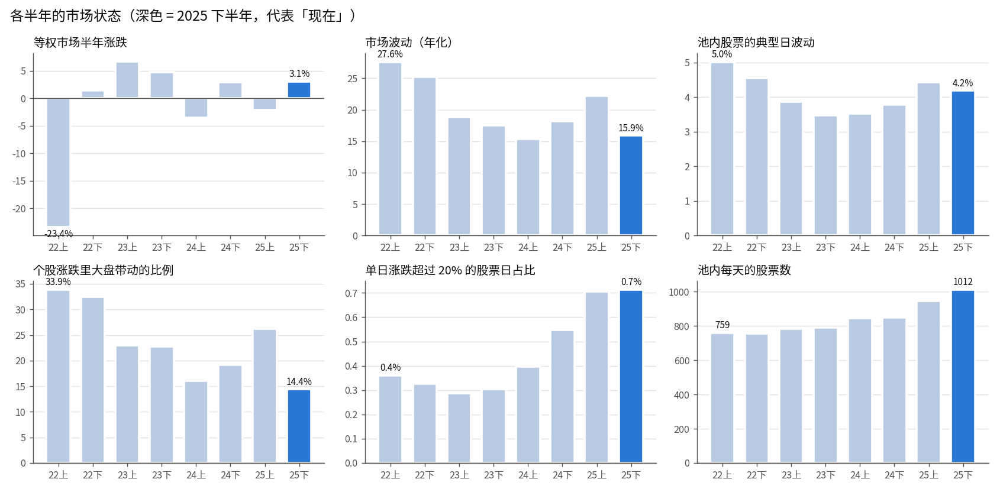
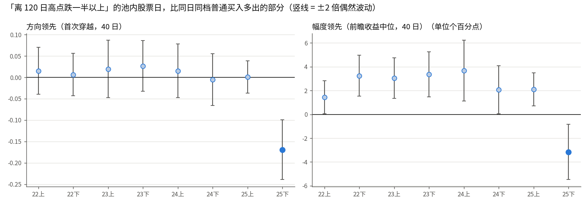
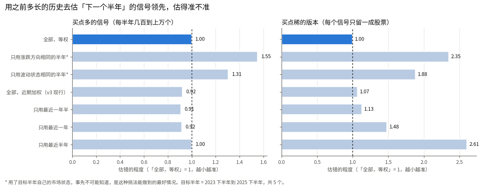

# 训练段用多长：样本多，还是和现在的市场像

研究票：[训练段用多长：样本多，还是和现在的市场像](../issues/02-training-range.md)。日期 2026-10-23。全程只读截到 2025-12-31 的副本 `datasets/pkls_until_20251231/`，没读任何 2026 年的数据（个股和市场整体都没有），没读面板缓存；后续涨跌都是在训练段里自己算的，观察期走不完的买点不算。「现在」只用 2025 年下半年代表。

## 先说人话

**做了什么。**

- 把 2022 到 2025 年切成 8 个半年，量每个半年的市场是什么样子：涨跌、波动、个股跟大盘一起动的程度、暴涨暴跌的多少、池子里有多少股票，看哪些半年和 2025 年下半年像。
- 拿 11 种常见的日线量价信号（放量大阳、大阴线、一周跌最多、创新高、横盘后突破、深跌、跳空高开、缩量等）当「替身 pattern」，在每个半年里量它们比同日普通买入对照（`path2/GLOSSARY.md:114`）多出多少，看这份「多出的部分」在不同半年之间差多少、差得是不是越来越远。
- 用这些信号做了一个直接的检验：站在每个半年的开头，只拿之前的数据去估这个半年里信号会多出多少，比较「之前全部」「只用最近一年」「只用和它市场状态相同的半年」等几种挑法，哪种估得准。
- 按前几张票的分辨力结论，算了训练段缩短时，「分辨得出」的门槛会抬高多少。
- 查了关于周期性和不可逆变化的文献（第 6 节）。

**说明什么。**

1. **默认用全部数据是对的。** 估「下一个半年」时，用之前全部的数据，和只用最近一年半差不多准，比只用最近半年准得多；买点稀的时候（更像用户真实会做的 pattern），用全部数据明显最准，任何截短都更差。
2. **按「和现在像不像」挑年份反而更差。** 只用市场波动状态相同、或涨跌方向相同的半年去估，估错的程度是用全部数据的 1.3–2.4 倍——这还是事先知道目标半年市场状态的理想情况。原因是同一种市场状态下，信号的成绩照样差得很远（2022 上半年和 2025 上半年都是高波动下跌期，信号的偏离反而方向相反）。
3. **时间上离得近的半年确实更像一点，但这份像只延续约一年半。** 相邻两个半年「偏离常态」的方向一致的程度明显超出偶然，隔两年以上就和偶然没有分别。tune-gates-v3 现行的「一年前的成绩只算一半」正好对应这个尺度，不用改。
4. **截短训练段的代价是实打实的。** 和用全部（决策日约 3.8 年）比，去掉 2022 年门槛抬高约 15%（v3 的近期加权下约 7%），只用 2024–2025 抬高约 45%（加权下约 25%），只用 2025 年翻一倍。
5. **「现在」最不像的一处在底部类：** 2025 下半年，离 120 日高点跌掉一半以上的股票，方向和幅度都明显跑输同日对照（方向 −0.17，偏离之前的常态约 5 倍偶然波动），之前 7 个半年都接近零。放量大阳、跳空高开在这半年也偏弱。这是对「底部类 pattern」最该知道的风险，但它不是切掉早年数据的理由：2022–2025 上半年都不像这半年，切掉哪一段都不会让训练段更像它。

**不说明什么。**

- 不说明 2026 年像哪一段：没读、也不能读 2026 年的数据。
- 11 种信号是替身，不是用户将来的 pattern；它们只说明「日线量价规律在这 4 年里随时间变化的幅度和方式」，具体某个 pattern 的成绩随年份怎么变，要在它自己身上看（见第 7 节的拆半年要求）。
- 4 年只有 8 个半年，分不清「慢慢变」和「换了一段行情」；这里的检验只有 5 个目标半年，结论是方向性的。
- 2025 下半年深跌股变差，是一段行情还是会延续，训练段里分不出来。

## 1. 各段和「现在」在哪些方面像、哪些方面不像

| 半年 | 等权市场涨跌 | 半年内最大回撤 | 市场波动（年化） | 池内股票典型日波动 | 大盘带动比例 | 单日涨跌超过 20% 的股票日 | 池内每天股票数 | 池内不同股票数 |
|---|---|---|---|---|---|---|---|---|
| 2022 上 | −23.4% | −26.3% | 27.6% | 5.0% | 34% | 0.36% | 759 | 1197 |
| 2022 下 | +1.5% | −18.1% | 25.3% | 4.6% | 32% | 0.33% | 757 | 1175 |
| 2023 上 | +6.7% | −13.7% | 18.8% | 3.9% | 23% | 0.29% | 784 | 1196 |
| 2023 下 | +4.8% | −17.6% | 17.5% | 3.5% | 23% | 0.30% | 792 | 1194 |
| 2024 上 | −3.6% | −7.9% | 15.4% | 3.5% | 16% | 0.40% | 844 | 1239 |
| 2024 下 | +3.0% | −9.3% | 18.2% | 3.8% | 19% | 0.55% | 849 | 1317 |
| 2025 上 | −2.1% | −20.7% | 22.2% | 4.4% | 26% | 0.71% | 947 | 1472 |
| **2025 下（现在）** | +3.1% | −9.3% | 15.9% | 4.2% | 14% | 0.71% | 1012 | 1587 |

读法：

- **周期性的一面**：市场涨跌、市场波动、个股跟大盘一起动的程度，三样一起摆动——2022 年高、2023–2024 年低、2025 上半年（4 月关税冲击）又高、2025 下半年回落。按这三样，2025 下半年最像 2024 年（低波动、个股各走各的）。
- **单向变化的一面**：单日暴涨暴跌（超过 20%）的股票日，2022–2024 上半年稳定在 0.3%–0.4%，2024 下半年起升到 0.55%、2025 年 0.71%，翻了一倍，2025 上下两个半年市场波动差很多它却没变，不像跟着行情摆动；池子里的股票数也一路增加（部分是幸存者偏差：越早的年份，后来退市的股票越多、本地数据里缺得越多，见「幸存者偏差会把哪类 pattern 的成绩抬多高」那张旧票）。
- **没有明显变化的**：隔夜跳空占日波动的比例（0.20–0.28，无趋势）、日收益和前一天的相关（多在 −0.05 ~ +0.02 之间摆动）。
- 普通买入本身的成绩（不减同日对照）随行情大起大落：2022 上半年方向 −0.19，2025 下半年 +0.04。这部分是择时，同日对照会把它减掉，所以它不直接决定 pattern 的「多出的部分」。

口径：等权市场 = 当天普通股中 20 日成交额中位 ≥100 万美元的全部股票收盘涨跌（两头各截 1%）的平均，每日再平衡，是本地数据算的替代品，不是官方指数；大盘带动比例 = 池内每只股票半年内日涨跌与等权市场相关系数的平方，取中位。

## 2. 这些不像，会不会改变日线量价信号「多出的部分」

11 种信号在 8 个半年里的成绩见 `scripts/02-signals-effects.csv`（方向 40 日 / 幅度 40 日 / 方向 10 日 / 收益 10 日 四种指标）。三件事：

**（1）多数信号在不同半年之间的差别，没有超出偶然波动太多；少数信号有真实的时段差别，而且多是某一段行情特有的。**

- 方向（首次穿越 `path2/GLOSSARY.md:107`，40 日）：11 个信号里 6 个「真实的时段差异」估出来是零或接近零，即各半年忽高忽低全可用偶然解释。
- 有真实时段差异的，典型例子：
  - 「60 日已涨五成」2022 上半年方向 +0.21（能源股那波），其余半年都在 −0.04 ~ +0.05；
  - 「缩量」2022–2023 年方向 −0.04 左右，2025 上半年翻成 +0.06；
  - 「离 120 日高点跌一半以上」只有 2025 下半年 −0.17，见第 3 节。
- 这种差别的量级（方向 0.03–0.07）和旧票算出的分辨门槛同一量级，所以「某个 pattern 只在某一段行情里有效」在这份数据上是真实存在的风险。

**（2）离得近的半年更像，离得远就不像了。**

把每个信号每个半年的成绩减去其余半年的平均，得到「偏离常态」，再看两个半年的偏离是否同向：

| 两个半年隔多远 | 实测的同向程度（相关） | 不含 2025 下半年 | 完全没有时段差异时的平均 | 完全没有时段差异时的 95% 上沿 |
|---|---|---|---|---|
| 半年（相邻） | 0.40 | 0.35 | 0.18 | 0.27 |
| 一年 | 0.29 | 0.26 | 0.18 | 0.28 |
| 一年半 | 0.34 | 0.35 | 0.19 | 0.30 |
| 两年 | 0.09 | 0.19 | 0.18 | 0.31 |
| 两年半 | 0.11 | 0.18 | 0.17 | 0.30 |
| 三年 | −0.20 | −0.36 | 0.15 | 0.33 |

（「完全没有时段差异」的基准是把每个半年的成绩换成全期平均加上按偶然波动抽的随机数，重复 300 次；因为偏离是对同一个「其余平均」算的，基准本身不是 0。）

一年半以内的半年之间，同向程度超出偶然；两年以上和偶然没有分别；隔三年的（2022 年对 2025 年）反而有点反着来。所以：**相似性随时间衰减、大约一年半就衰减完**，但它不是「越早越错」的单调漂移——两年以上的年份对估「现在」既没有额外帮助，也没有系统性的误导，主要贡献的是样本量。

**（3）同一种市场状态，不意味着信号表现像。** 2022 上半年和 2025 上半年都是高波动、下跌的半年，两者之间的偏离相关是负的（上表「三年」那一行里只剩这一对时为 −0.36）。用户担心的「几年前是熊市、今年也是熊市，所以那几年更有参考价值」，在这份数据上不成立。

## 3. 现在最不像的一处：深跌股在 2025 下半年明显跑输

「离 120 日高点跌一半以上」的池内股票日：

- 2022 上半年到 2025 上半年，方向领先在 −0.005 ~ +0.027，幅度领先 +1.4 ~ +3.7 个百分点（幅度为正是常见的波动读数，见副产品第 2 条）；
- 2025 下半年方向 −0.169 ± 0.035、幅度 −3.2 ± 1.2 个百分点，偏离之前常态约 5 倍偶然波动；按季看，2025 年三季度 −0.15、四季度 −0.24，越往后越弱。
- 不是假象的核对：
  - 不是停牌：有零成交日的股票只占 0.9%，去掉后不变；
  - 不是只算了一直趴在底部的那几只：只取当天首次跌进这一状态的买点，2025 下半年仍是 −0.16（其余半年 −0.07 ~ +0.12）；
  - 不主要是幸存者偏差：幸存者偏差让越早的买点被抬得越高，方向一致，但旧票推演的前后差只有约 0.01；更直接的反证是，2025 上半年和 2025 下半年离数据下载日只差半年，幸存者偏差几乎一样，两者却差 0.17，而离下载日差了三年的 2022 年和 2025 上半年反而没有差别。
  - 不只是新上市的小票：文献里 2024–2025 年超小盘新股上市后几周到几个月被拉高出货（第 6 节第 8 条），但把上市不满两年的股票分开看，2025 下半年老股票 −0.156（12,243 个股票日）、新股票 −0.272（1,350 个），老股票也一样差。
- 落后集中在连续多日处于深跌的股票（按股票等权平均，10 日方向反而是 +0.03），同一半年「深跌后放量阳线」「跳空高开」「放量大阳」也偏弱，像是 2025 下半年投机性强的小票整体走弱这一件事。

对训练段的含义：

- 这是「现在和以前不一样」最清楚的一条数据证据，而且正落在用户主线（bb 系底部类）上：一个在 2022–2025 上半年学出来的底部 pattern，如果 2026 年延续 2025 下半年的样子，会比训练段上难看得多。
- 但它不支持切掉早年：2024 年、2025 上半年和 2022 年一样「不像」2025 下半年；能像它的只有它自己，而只用 2025 下半年（约 4 个月有 40 日标签）门槛要抬高约 3 倍（第 5 节）。
- 该做的是让训练段上的成绩**拆开到每个半年给用户看**，最近一个半年单列（第 7 节），pattern 的优势只来自早年、或在最近半年翻了号，一眼看得见。

## 4. 用多长的历史估「下一个半年」最准

做法：对 11 个信号 × 4 种指标，以 2023 下半年到 2025 下半年这 5 个半年轮流当「目标」，只用目标之前的半年估目标半年里信号多出的部分，和目标半年的实测比，算估错的平方。目标半年实测本身的偶然误差对所有挑法是同一份，只影响绝对值，不影响挑法之间的比较。每种指标内按「之前全部、等权」归一后取四种指标的平均。

| 挑法 | 买点多的信号 | 不把 2025 下半年当目标 | 买点稀的版本（只留一成股票，抽 20 次） |
|---|---|---|---|
| 之前全部，等权 | 1.00 | 1.00 | **1.00** |
| 之前全部，近期加权（一年前减半，v3 现行） | 0.92 | 1.01 | 1.07 |
| 只用最近一年半 | **0.91** | 1.01 | 1.13 |
| 只用最近一年 | 0.92 | 1.10 | 1.48 |
| 只用最近半年 | 1.00 | 1.33 | 2.61 |
| 只用波动状态相同的半年（事先知道目标的状态） | 1.31 | 1.31 | 1.88 |
| 只用涨跌方向相同的半年（事先知道目标的状态） | 1.55 | 1.84 | 2.35 |

（数值 = 估错的程度 ÷「之前全部、等权」的估错程度，越小越准。「买点多的信号」每半年几十到两万个买点，多数几千；买点稀的版本每个信号只留一成股票，更接近一个真实 pattern 命中的股票数。要求目标半年之前至少有 5 个半年时（目标只剩 2024 下半年到 2025 下半年 3 个），结论相同：买点多时近期加权 0.90、只用最近一年半 0.89；买点稀时之前全部仍最准，只用最近 5 个半年（即只去掉最早的一两个半年）也差 6%。）

读法：

- **买点多的时候**，近一年半、近期加权、全部三者相差不到一成，略占优的那点几乎全来自 2025 下半年这个目标（不把它当目标时三者打平）。
- **买点稀的时候**，偶然误差占了大头，任何截短都更差，越短越差。用户用看图标注做出来的 pattern 买点通常不多、还扎堆在少数股票上，更接近这一列。
- **按市场状态挑年份在两种情况下都是最差的一类**，哪怕假定事先知道目标半年是什么状态。
- v3 的近期加权落在两种情况中间：买点多时略好、买点稀时略差，整体与全部等权打平，没有理由改。

## 5. 样本多带来的好处有多大

| 训练段（决策日） | 跨度 | 池内有 40 日标签的股票日 | 不同股票 | 门槛倍数：等权 | 门槛倍数：v3 近期加权 |
|---|---|---|---|---|---|
| 全部（2022-01 起，标签到 2025-11-03） | 3.8 年 | 803,287 | 2,325 | 1.00 | 1.00 |
| 去掉 2022（2023-01 起） | 2.8 年 | 613,024 | 2,170 | 1.14–1.16 | 1.07 |
| 只用 2024–2025 | 1.8 年 | 416,128 | 1,972 | 1.39–1.44 | 1.24 |
| 只用 2025 | 0.8 年 | 202,867 | 1,746 | 1.99–2.14 | 1.75 |
| 只用 2025 下半年 | 0.3 年 | 87,388 | 1,481 | 3.0–3.4 | 2.7 |

（门槛倍数 = 「分辨得出」的最小领先相对用全部时的倍数；等权按 1/√股票日 和 1/√年数 两种算法给范围；v3 近期加权按「一年前权重减半」折成有效年数：全部 3.8 年只顶 2.5 年，2.8 年顶 2.2 年，1.8 年顶 1.6 年。）

放回旧票的门槛表（「目标池里的分辨力和幸存者偏差有多大」，池内、每年 1000 个买点、观察期 40 日，方向领先要多大才分辨得出）：

| 买点长相 | 1 年 | 2 年 | 4 年 |
|---|---|---|---|
| 照 bottom_burst 那样扎堆 | 0.20 | 0.15 | 0.12 |
| 每段行情只买一次、分散到很多股票 | 0.065 | 0.043 | 0.033 |

旧票还算过：bottom_burst 现役对同日对照的方向领先约 +0.006，参数改动的效果约 0.03。即使用满全部数据，扎堆长相的门槛也在 0.12 上下，远高于这些量级。**这份数据本来就只看得出大的优势，再截短只会让「看不出」更常见**；第 2 节量到的真实时段差别（方向 0.03–0.07）比全部数据下的门槛还小，用截短去「躲」它，代价是门槛涨 15%–100%，换来的准头在第 4 节里是负的。

另一点：训练段里看图、标注、盲看也受益于年份多。2022 年是唯一完整的下跌年，2025 上半年是唯一的急跌急涨；有这些年份，用户能看到 pattern 在不同行情里长什么样、在哪种行情里失灵。

## 6. 文献：周期性与不可逆的变化

原始笔记（含原句、页码、链接）在 `scripts/02-literature-notes.md`，由检索子代理整理，只引用到 2025-12-31 为止的数据。下面只列和「切不切早年」有关的结论。

数据墙的两处擦边，如实记下：笔记第 2 节那张月度短期反转因子表，下载的官方文件本身含 2026 年的月份，子代理在解析时直接丢弃、没有查看；另有两条网页搜索摘要里出现过 2026 年的罗素 2000 和散户占比数字，子代理没有使用、也没写进笔记。本研究不引用那张表，其余结论都不依赖它们。

1. **量化 / 算法交易接管市场，主要发生在 1995–2010 年，比训练段早得多。**
   - 日线反转策略收益 1995–2007 年近乎单调下降，但最小市值档一直保留了大部分（Khandani & Lo 2007, Table 2：最小档 3.57%/日 → 0.57%/日，最大档已到零以下）。[PDF](https://web.mit.edu/~alo/www/Papers/august07.pdf)
   - 1993–2008 年交易量暴增后，价格更接近随机游走、横截面可预测性显著下降（Chordia, Roll & Subrahmanyam 2011, *JFE*）。[PDF](https://authors.library.caltech.edu/95155/2/SSRN-id1700191.pdf)
   - SEC 2020 年员工报告：上市股票里算法交易已「几乎无处不在」，没给占比数字。[PDF 第 67 页](https://www.sec.gov/files/algo_trading_report_2020.pdf)；2015–2025 年算法占比的一手连续数据没找到。
   - 训练段内部，SEC 按市值分档的交易所指标只在慢慢漂移：最小市值档的碎股成交占比 2015 年约 8%、2021 年约 35%、2025 年约 39%，撤单 / 成交比 2021–2025 大致持平（检索子代理从 SEC MIDAS 原始文件算的，[下载页](https://www.sec.gov/about/marketstructuredata-decile-quartile)）。大的跳变在 2016–2021 年，训练段里没有能画线的断点。
   - 规律衰减在小盘、流动性差的股票里慢得多（Khandani & Lo 同上；McLean & Pontiff 2016, *JF*：异常公开后收益平均降 58%，难套利的股票降得少）。我们的股票池正是这一类。
2. **短线规律的强弱随行情大起大落，年与年的差别远大于长期下滑。**
   - 日线反转收益随市场恐慌程度剧烈起落：2007 年前降到每天不到 0.2%，2008 年危机中暴涨，超过 1998 年的水平（Nagel 2012, *RFS*）。[PDF 第 5 页](https://www.nber.org/papers/w17653.pdf)
   - 动量在「大跌之后、波动高企时的反弹期」崩盘，主要是过去的输家暴涨（Daniel & Moskowitz 2016, *JFE*）。[PDF](https://business.columbia.edu/sites/default/files-efs/pubfiles/4607/mom11.pdf)
   - 这类差异属于「周期性」：哪种行情下一段会来，事先不知道。只留「像现在」的年份，等于只学一种行情。第 2、4 节的数据也说明，同一种行情下信号照样差得很远。
3. **散户：训练段整段都在零佣金（2019-10）之后，活跃度不是单调上升。**
   - 场外成交（散户活动的部分代理）占全部股数成交：2021 年 43.6%、2022 年 1–9 月 41.6%、2023 年 44.0%、2024 年 47.0%、2025 年 50.6%（检索子代理从 Cboe 历史成交文件算的）。2022–2025 年散户占比的一手数据没找到。
   - 散户买入对后续涨跌的方向随时代变：2010–2015 年散户净买入的股票下一周跑赢（Boehmer, Jones, Zhang & Zhang 2021, *JF*）；Robinhood 扎堆买入的股票之后 20 日平均跑输 4.7%（Barber, Huang, Odean & Schwarz 2022, *JF*，期刊摘要）。
4. **0DTE 期权 2022 年以后爆发，但证据只覆盖标普指数，多数说平均反而压低波动**（Amaya, Garcia-Ares, Pearson & Vasquez 2025：平均使波动降低约 0.2 个百分点，最多推高 3.3 个百分点）。[PDF](https://cdn.cboe.com/resources/education/research_publications/gammasqueezes.pdf) 没找到任何关于中小盘个股日线的研究。
5. **24 小时交易**：SEC 2024-11-27 批准 24X 交易所（Release 34-101777），但它 2025 年全年只占全部成交约 0.0076%，训练段内不构成断点。
6. **市场阶段**（FRED 的标普、纳指、VIX，截止 2025-12-31）：2022 年标普自 1-03 高点到 10-12 低点 −25.4%，全年 VIX 均值 25.6；2023、2024 年标普 +24.2%、+23.3%，VIX 均值 15–17；2025 年 2-19 到 4-08 关税冲击 −18.9%，VIX 收盘最高 52.3，之后到年底 +25.4%。罗素 2000 直到 2025-09 才收复 2021-11 的高点（二手）。切掉 2022 年，就丢掉了训练段里唯一一段持续的熊市。
7. **训练窗口长度的计量文献**：
   - 有结构变化时，信号越弱、变化越小、变化后的样本越短，越应该多用变化前的数据；变化小而难察觉时，把不同长度窗口的结果平均起来表现好（Pesaran & Timmermann 2007, *J. Econometrics*，[PDF 第 9 页与结论节](https://rady.ucsd.edu/_files/faculty-research/timmermann/estimation-window.pdf)）。
   - 参数缓慢变化时，最优做法近似「越旧的数据权重越低」（Pesaran, Pick & Pranovich 2013，摘要）。这正是 v3 现行的近期加权。
   - 试了很多窗口长度、只报告好看的那个，推断就是错的（Rossi & Inoue 2012, *JBES*，摘要）。所以窗口长度要在看成绩之前定。
8. **2024–2025 年中小盘暴涨暴跌变多，有一手材料支持是真实的供给增加：**
   - FINRA 2022-11 通告 22-25：一批募资不到 2500 万美元、多在中国运营的超小盘 IPO，上市后无消息暴涨、随即跌回发行价以下。[链接](https://www.finra.org/rules-guidance/notices/22-25)
   - FINRA 2025 年度监管报告：2024 年起，这类异常拉升「更多出现在上市后几周或几个月」，而不是上市当天。[链接](https://www.finra.org/rules-guidance/guidance/reports/2025-finra-annual-regulatory-oversight-report/manipulative-trading)
   - Nasdaq 自己在 SR-NASDAQ-2025-068 里说：2025-03 的上市规则改动后约五个月，Capital Market 新上市公司近四分之三走了公众持股门槛只要 500 万美元的那条标准，并称「低流通盘、低流动性的公司交易有问题」。[链接](https://public-inspection.federalregister.gov/2025-18143.pdf)
   - 收紧措施都在 2025 年 9 月以后才出台，有的到年底还没批（SEC 34-104450、34-104456；SEC 跨境专案组 2025-09-05 成立）。2025-01 起 Nasdaq 和 NYSE 加快把反复缩股的低价股退市（SEC 34-102245、34-102201）。
   - 检索子代理的推断（不是文献结论）：被炒过的股票事后多半跌破 1 美元、缩股、退市；2022–2023 年那批到取数时很多已不在数据里，2025 年那批还在。所以第 1 节「暴涨暴跌翻倍」可能有一部分是数据口径造成的。

文献合起来的指向：**训练段内部没有一个有文献支撑、又能说清怎样改变日线量价规律的断点**；能找到的变化要么早于训练段（算法化），要么只在指数层面（0DTE），要么是周期性的（反转、动量随行情），要么是 2024 年下半年起才出现、对早年数据来说是「早年没有」而不是「早年错了」（超小盘拉高出货）。文献对「怕漂移」开的方子是给旧数据打折，而不是整段扔掉。

## 7. 推荐与什么时候改

**默认训练段：截断副本里的全部数据，2021-10-08 到 2025-12-31。**

- 买点日期从每个 app 的回看缓冲满足后开始（20 日的量大约 2021-11 起，要一年回看的大约 2022-10 起），到观察期能在 2025-12-31 之前走完为止（观察期 40 日时是 2025-11-03）。不拿 2026 年的数据补。
- 看图找图、大涨段清单、盲看抽样、调参、「在要用的地方量一条特征」都用同一个训练段。
- tune-gates-v3 现行的「一年前的成绩只算一半」不改：它和数据里「相似性大约一年半衰减完」的尺度一致，在两种买点疏密下都和全部等权打平。

**理由（按分量）：**

1. 用之前全部的数据估「下一个半年」，在买点多时和最好的挑法差不到一成，在买点稀时就是最好的；用户靠看图做出来的 pattern 买点通常不多、还扎堆，更接近后者（第 4 节）。
2. 按行情像不像挑年份，哪怕事先知道目标半年的行情，估错的程度也是用全部的 1.3–2.4 倍（第 4 节）；同是高波动下跌期的 2022 上半年和 2025 上半年，信号的偏离方向相反（第 2 节）。
3. 截短的代价确定，好处不确定：去掉 2022 年门槛抬高 7%–16%，只用 2024–2025 抬高 24%–44%，而这份数据本来就只看得出大的优势（第 5 节）。
4. 训练段内部找不到有文献支撑、能说清怎样改变日线量价规律的断点；文献对漂移开的方子是给旧数据打折，不是扔掉（第 6 节）。
5. 2022 年是唯一一段持续熊市，2025 上半年是唯一一次急跌急涨；保留它们，用户看图和盲看时才能看到 pattern 在不同行情里的样子。

**什么时候改，什么时候不改：**

- **可以改**：拿得出数据或可靠文献，说清楚某个日期起什么变了、为什么会改变某类日线量价 pattern 的成绩；并且这个 pattern 自己拆半年的成绩，在那个日期前后的差别超出偶然、方向和说法对得上。两条都满足，也先考虑给变化前的数据打折，其次才是切掉。
- **不改**：
  - 因为某几年和「现在」或和对 2026 年的猜测行情像（熊市、高波动之类）——数据显示这样挑更差，而且 2026 年像什么在数据墙之内无从知道；
  - 因为截掉某几年后 pattern 在训练段上的成绩更好看——这是在窗口长度上过拟合；
  - 因为 2025 下半年深跌股变差（第 3 节）——早年各段都不像它，切哪段都不会更像，正确的应对是拆半年看成绩。
- **终点**：训练段的终点就是数据墙（2025-12-31），墙不动它就不动。

## 副产品

按 `.claude/rules/feature-candidates-capture.md` 的最低线（有同日对照，且幅度中位领先的 CI 不跨 0；方向只跑了 k=5，不够 k=4~6 三档）判，已登记到 `docs/feature_candidates.md`：

1. **FC-018**：离 120 日高点跌一半以上的股票日，2025 下半年方向和幅度都明显跑输同日对照（第 3 节）。
2. **FC-019**：8 种常见日线事件（放量大阳、大阴线、一周跌 / 涨最多、深跌、深跌后放量阳线、跳空高开、60 日已涨五成）全期合并后，幅度领先 +0.3 ~ +3.6 个百分点、CI 不跨 0，方向领先全部是零。是 FC-016 那种波动读数在事件型状态上的又一例：底部、burst 类 pattern 只看幅度会白赢。

全期合并后，没有任何一个信号的方向领先超过 1 倍偶然波动（`scripts/02-pooled.csv`）。

## 口径

- 数据：`datasets/pkls_until_20251231/` 里证券类别为普通股、ADR、有限合伙普通单位的 5059 只（经 `chart_workflow.loader` 读，读出后断言最后一天不晚于 2025-12-31）。2021 年 10–12 月只作回看缓冲，决策日从 2022-01-03 起。
- 池子：看图工作流默认池（复权收盘 ≤20 美元，20 日成交额中位 200 万–1 亿美元，M ≥0.01，次日开盘 >0，往前 120 个交易日无 SPAC 壳期）。M = 最近 20 日（真实波幅 ÷ 收盘价）的中位数。
- 尺子：次日开盘买入；方向 40 日用线距 k=5，方向 10 日用 k=2.5（按 √(10/40) 缩放）；幅度 = 观察期最高价 ÷ 买入价 − 1（`path2/GLOSSARY.md:103` 的前瞻收益）；收益 10 日 = 第 10 个观察日收盘 ÷ 买入价 − 1。
- 同日对照：每天按 M 把池内全部有标签的股票日切五档（tune-gates-v3 的切法），方向取档内均值、幅度取档内中位数；信号的领先 = 每行减去所在档的对照后，方向取均值、幅度取中位数。
- 偶然波动：方向按股票、按周两向聚类的标准误；幅度按股票整只重抽 200 次。
- 时段：按决策日分半年；40 日标签到 2025-11-03 为止，所以 2025 下半年的 40 日指标只含 7–10 月的决策日。

## 复现

都在 `.scratch/annotation-path2/scripts/`，按表中顺序跑。研究结束后删掉了可重算的大文件（`02-cache.parquet`、`02-signals-rows.parquet`、`02-pool-excess.parquet`、`02-window-errors-frac0.1.csv`），依次跑 `02-cache.py`（约 12 秒）、`02-signals.py`、`02-window.py 0.1 20` 即重建：

| 脚本 | 输出 | 内容 |
|---|---|---|
| `02-cache.py` | `02-cache.parquet` | 逐只股票的日线摘要与训练段内的后续涨跌 |
| `02-regime.py` | `02-regime-halfyear.csv`、`02-regime-quarter.csv`、`02-daily-market.parquet` | 第 1 节市场状态 |
| `02-signals.py` | `02-signals-effects.csv`、`02-signals-rows.parquet` | 第 2 节 11 种信号各半年的领先 |
| `02-lag.py` | `02-lag-tau.csv` | 第 2 节相隔不同时间的相似程度、真实时段差异 |
| `02-drill-deep.py`、`02-drill-deep2.py`、`02-drill-deep3.py` | 打印 | 第 3 节深跌股的拆分核对（按季 / 月、零成交、首次进入、新老股票） |
| `02-window.py`（参数 `0.1 20` 为买点稀的版本） | `02-window-errors*.csv` | 第 4 节窗口长度检验 |
| `02-samplesize.py` | `02-samplesize.csv` | 第 5 节样本量与门槛倍数 |
| `02-pooled.py` | `02-pooled.csv` | 副产品核对 |
| `02-figures.py` | `../research/02-*.png` | 三张图 |
| （检索子代理） | `02-literature-notes.md` | 第 6 节文献的原句、页码与链接 |
