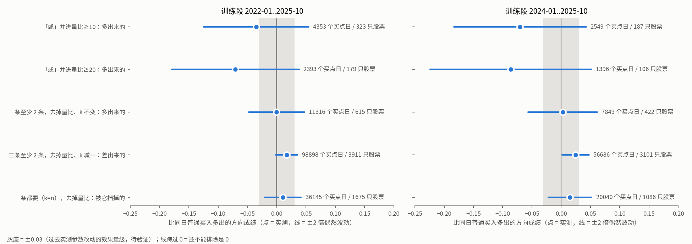

# 在要用的地方量一条特征：现有工具能不能直接做（研究记录）

本文项目内路径均相对 repo root。只用训练副本 `datasets/pkls_until_20251231`（截到 2025-12-31），没读 2026 年起的任何数据，没读面板缓存，没写任何账本。脚本与原始输出在 `.scratch/annotation-path2/scripts/05-*`。

## 先说结论

**做了什么。** 把三样现有工具（tune-gates-v3、feature-study、旧 tune-gates 里「去掉一道闸看该不该留」）逐一对着已定的量法看：app 跑两遍，一遍带这条特征、一遍不带；只因为这条特征才多出来的买点，和同日普通买入对照比。然后拿 bottom_burst 的现役参数真跑了一遍：把「爆发里有一天量很大」当成新并进来的特征，用 tune-gates-v3 里面现成的计算代码跑两遍、取差、和同日普通买入比，全股票池四年训练数据约一分钟出结果。

**说明什么。**

1. **能复用，但复用的是 tune-gates-v3 里的计算代码，不是它的调参命令。** 它读行情、算逐日涨跌标签、跑 app、和同日普通买入比、估偶然波动的那几块代码可以原样调用；它的调参命令不能用，因为它默认读含 2026 年的完整行情，而且一跑就在账本里预留留着没碰过的数据。feature-study 和旧 tune-gates 都做不了这件事：两者比的是 pattern 内部「过这道闸的和全部的」，不是「多出来的和同日普通买入」，前提和取数链路又都绑在旧版调参流程上。
2. **多出来的买点往往成千上万个买点日，但只落在一两百到六百只股票上，所以几乎总是「看不出」。** 这次几组多出来的部分，这份数据只分辨得出约 0.07～0.19 以上的方向成绩差别；过去实测参数改动的效果才约 0.03（待验证）。报结论时必须同时说「这份数据最多分辨得出多大的差别」，并且不能拿 v3 打折后的分去判：样本少时它会把正的领先压到 0，读起来就像「没用」。
3. **「至少 k 条成立」去掉一条时，k 不变。** k 不变时，多出来的正好是「这条特征是凑够 k 的那一票」的那些；k 跟着减一，带这条特征的版本反而是不带的版本的子集，多出来的为空，量到的变成「降门槛」的效果。实验里两种情形都照这个预期出现。

**不说明什么。** 不说明「量很大」这条特征本身有没有用，这里只拿它演示工具。不说明 v3 现在的同日对照配法是对的：已归档的旧 effort 判过它漏，推荐改成「波动最近的 10 只」，至今没改（第 6 节），这件事要在地图上定。±2 倍偶然波动的判法还没校准（第 4 节末）。

## 1. 量法落到代码上是什么

- **同一份数据、同一份标签，跑两遍 app。** 两遍必须用同一份行情快照和同一份逐日涨跌标签，差别只来自 app 本身。
- **按「股票 + 日期」取差。** 买点（`path2/GLOSSARY.md:118`）按「同股同日只算一次」去重（v3 的口径，`.claude/skills/tune-gates-v3/SKILL.md` 固定口径第 1 条）。带的版本有、不带的没有，叫「多出来的」；反过来，不带的有、带的反而没有，叫「丢掉的」。如果一个买点日在不带的版本里也被别的 match（`path2/GLOSSARY.md:95`）抓到，它不算多出来的：它不是只因为这条特征才进来的。
- **多出来的那批单独和同日普通买入对照（`path2/GLOSSARY.md:114`）比。** 用的成绩是 v3 的方向成绩：买点之后按收盘先碰上方目标线记 +1、先碰下方记 −1、都没碰记 0，按时段平均（首次穿越 `path2/GLOSSARY.md:107` 的收盘版，v3 `references/method.md`「逐日标签」「时段内与时段间」）。多出来的比同日普通买入高多少，就是这条特征带进来的东西好不好。

## 2. 三样现有工具逐一看

### 2.1 tune-gates-v3：计算代码能直接用，调参命令不能用

**能直接用的计算代码**（都在 `.claude/skills/tune-gates-v3/scripts/`）：

| 代码 | 做什么 | 这件事里怎么用 |
|---|---|---|
| `DailyEvaluator`（`daily.py:127`） | 固定一批股票、一段日期、一份行情快照，算一次逐日涨跌标签；之后对任意 app 版本只跑检测、查标签 | 建一次，带和不带两遍共用，天然满足「同一份数据、同一份标签」 |
| `DailyEvaluator.evaluate(params)`（`daily.py:275`） | 用同一个 app、改一部分参数跑一遍 | 这条特征能用参数关掉时（例如把它的阈值设成永远达不到）直接用 |
| `DailyEvaluator.evaluate_control(module, params)`（`daily.py:280`） | 用另一个 app 模块跑一遍，复用同一份标签 | 「不带」的版本是另一份声明时用；本次实验就是这么做的 |
| `WindowPlan`（`scoring.py:192`） | 冻结整个股票池的逐日标签，建同日普通买入对照 | 建一次 |
| `WindowPlan.summarize(rows)`（`scoring.py:317`） | 给任意一批买点日算方向成绩、同日普通买入对照、两者之差、打折后的分、覆盖多少股票和日期 | 直接喂「多出来的」那批 |
| `WindowPlan.stock_bootstrap(rows)`（`scoring.py:374`） | 按整只股票有放回重抽 200 次，估领先的偶然波动 | 直接喂「多出来的」那批，得到判「看得出 / 看不出」用的范围 |

读什么数据：`DailyEvaluator` 的行情目录是调用时传进去的，读入后先裁到「标签截止日」以前（`daily.py` 中 `_read`）。传 `datasets/pkls_until_20251231`、标签截止日不晚于 2025-12-31，就一行 2026 年的数据都碰不到。

**调参命令（`run.py search`）不能用**，原因有四：

1. 行情目录默认是含 2026 年的完整 `datasets/pkls`（`run.py:190`）。
2. 一启动就在账本 `docs/sample_usage/<app>.v3.jsonl` 里登记训练段使用、并为最后检查和复核预留两段留着没碰过的数据（`run.py:368`、`run.py:372`）。为一次训练段上的量法这样做，等于白白占用最后检查要用的数据；而训练段按方向文档第 2 节本来就不记账。
3. 它是参数搜索：要求声明搜索范围，比的是候选和现役两套参数的整体成绩，没有「带 / 不带一条」的模式，也不取差。
4. 它要求起点参数等于正式参数（`run.py:178`、`run.py:180`），而量特征时「带」的版本往往还没写进正式参数。

另外 `DailyEvaluator` 是单进程的。按股票分块、每块建一个评价器、再把逐日表拼起来建一个 `WindowPlan`，结果和单进程等价（标签按股独立算），本次实验 24 个进程跑六个版本用了 63 秒。

### 2.2 feature-study：判法可以借，这件事做不了

- **前提和取数都绑在旧版调参上。** 冻结清单前要求账本里有旧版 tune-gates 的「有没有底子」检查记录，没有就拒绝（`.claude/skills/feature-study/SKILL.md:74`）；数据从旧版调参的扫描结果取，或者从 path2_web 的扫描文件重放，每个 app 还要先写一份适配声明。
- **比的对象不对。** 它判的是 pattern 内部「过这道闸的那些」和「全部」相比好不好，用当天波动三档加时间窗来控制（同文件「电池」一节）；不是「多出来的那些」和「同日普通买入」比。
- **标签口径不同。** 它用盘中首次穿越、没碰线的不进分母；v3 用收盘、没碰线的留在分母里。方向文档要求「不另起一套口径」，跟调参和最后检查一致的是 v3。
- **能借的**：它把结论分成「确实有用 / 没用，删了也不亏 / 判不了（样本不够……）」三栏（同文件第 183～184 行），「判不了」明确附原因。这正是本票要的「看不出」和「没用」分开报的写法，第 4 节照它的思路来。

### 2.3 旧 tune-gates「去掉一道闸看该不该留」：不合适

- 它判的是「把这道闸关掉以后，整个 pattern 的首次穿越率最坏也只差几个点以内，删了不亏」（`.claude/skills/tune-gates/SKILL.md:117`）。比的是 pattern 改前改后的整体成绩，不是多出来的那批和同日普通买入比。
- 它只认扫描网格里的参数：一道闸要有「最松一档」才能关。「或」里的一个分支、一组子事件都不是这种参数。
- 要走完开局核对、有没有底子、定范围、扫描、一致性验证（至少比 500 只股票）、筛选整条流程才出得来。
- 行情目录默认读 `configs/path2_web.yaml` 的 `dataset_dir`，即含 2026 年的完整 `datasets/pkls`（`.claude/skills/tune-gates/tune.py:54`）；开局核对会按数据的实际覆盖划出两段留着没碰过的数据，落在 2026 年。
- 能借的：它给用户说话的译法表里有两条正好用在这里——差别还不能排除是 0 时就说「还不能排除是 0」，不说「在误差范围内」（会被读成「就是 0」）；讲分辨力时说「这份数据最多能分辨出几个点的差别」（同文件第 311、314 行）。

## 3. 实验：在 bottom_burst 上演示一遍

**设置。** 拓扑和现役参数照搬 bottom_burst（突破 → 爆发 → 回踩，买点是回踩里的企稳段，`path2/GLOSSARY.md:24`），只改爆发那个 node（`path2/GLOSSARY.md:76`）的 where（`path2/GLOSSARY.md:79`）。三条一元条件：爆发前沉寂 ≥ 40 天、突破过的不同峰 ≥ 3 个、爆发里单日最大量比 ≥ X。把「量比 ≥ X」当成新并进来的特征：

| 版本 | 爆发 node 的 where | 用途 |
|---|---|---|
| 不带 | 沉寂 且 不同峰 | 所有比较的「不带」一侧 |
| 「或」并进量比 ≥ 10 | 沉寂 且（不同峰 或 量比 ≥ 10） | 用「或」并进一条特征 |
| 「或」并进量比 ≥ 20 | 同上，门槛 20 | 让多出来的更少 |
| 三条至少 2 条 | 沉寂、不同峰、量比 ≥ 10 至少 2 条 | 「至少 k 条」，k=2、n=3 |
| 去掉量比、k 减一 | 沉寂、不同峰至少 1 条 | 对照：k 跟着变会量到什么 |
| 三条都要 | 沉寂 且 不同峰 且 量比 ≥ 10（即现役 bottom_burst） | k = n 的情形 |

「三条至少 2 条」去掉量比、k 不变，就是「剩下两条都要」，正好等于「不带」。数据：全部 5778 只股票，买点日期 2022-01-10～2025-10-30，标签看到 2025-12-31（观察 40 个交易日，上下线 5 倍当天波动）；另把 2024-01 起的一段单独算一遍，因为训练段用多长还没定（地图上另一张票）。

**结果（图）。** 点是多出来的那批比同日普通买入多出的方向成绩，线是 ±2 倍偶然波动，灰底是 ±0.03。



**怎么读。**

- **没有一组看得出好坏。** 五组的线全都跨过 0。「或」并进量比 ≥ 10，多出来 4353 个买点日，看着比同日普通买入差 0.035，但这份数据只分辨得出约 0.13 以上的差别，还不能排除是 0，也不能排除其实好 0.05 或差 0.12。
- **买点日多不等于证据多。** 4353 个买点日只落在 323 只股票上（bottom_burst 的买点是整段企稳段，一段就有好几天）。偶然波动看的是有多少只不同的股票，这和旧 effort「分辨力看命中多少只不同股票」的结论一致（`.scratch-archive/selection-pattern/map.md` Decisions so far 第 1 条）。
- **丢掉的一直是 0。** 只改 where 的版本，丢掉的那批在所有比较里都是空的。这和代码对得上：求解（`path2/GLOSSARY.md:92`）先用 where 筛候选，再枚举所有满足边的组合（`path2/dag/_solve.py:235`）；「下一个必须是第一个」和「区间里不能出现某事件」这两类检查读的是 detector 原始产出的事件流，不经 where（`path2/dag/_solve.py:139`、`:155`）。所以只放宽 where，买点只会多不会少。
- **整个 pattern 的成绩几乎不动。** 并进量比 ≥ 10 以后，整个 pattern 比同日普通买入的领先从 0.017 降到 0.011，差 0.005，远小于整个 pattern 自己的偶然波动（约 0.013）。这是第二个读数，对应「资金有限，买点数量本身不加分」时调参和最后检查看到的东西。

**主要数表（训练段 2022-01..2025-10）。** 「领先」= 方向成绩减同日普通买入对照；「打折后」= v3 排名分；「保留比例」= v3 统计折扣保留的比例。

| 比较 | 那批买点日 | 股票数 | 领先 | ±2 倍偶然波动 | 这份数据只分辨得出 | 打折后 | 保留比例 |
|---|---:|---:|---:|---|---:|---:|---:|
| 不带的版本本身 | 49729 | 2017 | +0.017 | −0.010～+0.043 | 0.037 | +0.017 | 0.99 |
| 「或」量比 ≥ 10：多出来的 | 4353 | 323 | −0.035 | −0.125～+0.055 | 0.126 | −0.035 | 0.86 |
| 「或」量比 ≥ 20：多出来的 | 2393 | 179 | −0.070 | −0.179～+0.038 | 0.152 | −0.070 | 0.69 |
| 至少 2 条，k 不变：多出来的 | 11316 | 615 | −0.000 | −0.047～+0.047 | 0.066 | −0.000 | 0.88 |
| 至少 2 条，k 减一：多出来的 | 0 | — | — | — | — | — | — |
| 至少 2 条，k 减一：差出来的 | 98898 | 3911 | +0.017 | −0.002～+0.036 | 0.026 | +0.017 | 0.98 |
| 三条都要，去掉量比：被它挡掉的 | 36145 | 1675 | +0.011 | −0.021～+0.042 | 0.044 | +0.010 | 0.98 |

2024-01..2025-10 那段同形，只是线更宽（「或」量比 ≥ 10 多出来 2549 个买点日、187 只股票，只分辨得出 0.158）；完整数表见 `.scratch/annotation-path2/scripts/05-with-without_out.json`。「这份数据只分辨得出」= 2.8 倍偶然波动，即真有这么大的差别时约八成能看出来。

## 4. 多出来的少时怎么报：「看不出」和「没用」分开

**现有工具这时给出什么。**

- v3 的打折后的分只给正的领先打折：证据越薄，正领先被压得越接近 0（`scoring.py:64` 起）。只有一个时段有买点之类误差估不出来的情形，正领先直接记 0（`scoring.py:103`）。所以一批很少的多出来的买点，哪怕实测领先是正的，打折后也可能显示 0，读起来就像「没用」。
- 打折保留的比例也不是「看不看得出」的信号：它是拿误差和一个事先定的尺度 0.1 比（`scoring.py:105`），本次实验里多出来的那几批保留了约 0.6～0.9，可 ±2 倍偶然波动宽达 ±0.05～±0.14。
- v3 的整只股票重抽给的偶然波动是这里该用的量，但 v3 只把它报成一句「偶然波动约 ±X」，没有给出「看得出 / 看不出」的判法。

**建议的报法：四选一，按「领先 ± 2 倍偶然波动」这条线落在哪判。**

| 结论（对用户说的话） | 条件 | 处理 |
|---|---|---|
| 看得出更好 | 线整条在 0 的右边 | 并进去 |
| 看得出更差 | 线整条在 0 的左边 | 不并 |
| 看得出没多大用 | 线整条落在 ±0.03 以内（0.03 待验证） | 默认不并，交用户定（多出来的只是普通买入，会冲淡 pattern）；照本次实验的宽度，要上千只不同股票才可能出现 |
| 看不出 | 其余 | 先留着，标「待验证」（方向文档第 3 节末） |

报「看不出」时必须同时说三件事，缺一件就容易被读成「没用」：多出来几个买点日、落在几只股票上；这份数据最多分辨得出多大的差别（2.8 倍偶然波动）；实测是多少、还不能排除是 0、也不能排除有多大的效果。例句：「量比这条多带进来 4353 个买点日，只落在 323 只股票上；这份数据只分辨得出 0.13 以上的差别。实测比同日普通买入差 0.035，还不能排除是 0，也不能排除其实好 0.05 或差 0.12。先留着，标待验证。」

另附第二个读数：整个 pattern 带和不带的领先差多少。它回答「并进来以后整个 pattern 的平均成绩变好还是变差」，调参和最后检查看到的就是它；多出来的那批比同日普通买入好、却比原有的买点差时，两者会给出相反的方向。

**这条判法还没校准。** 整只股票重抽不含「同一天全市场一起动」的冲击，v3 自己也说它是下限（`references/method.md:49`），所以 ±2 倍那条线偏窄，「看得出」会比名义上的 5% 更容易误报。换成「波动最近的 10 只」对照后，偶然波动还要再放大约 8%（第 6 节）。

## 5. 「至少 k 条成立」：去掉一条时 k 不变

**逻辑。** 记这条特征为 f，其余 n−1 条里成立的条数为 c。

- 带 f：c + [f 成立] ≥ k。
- 去掉 f、k 不变：c ≥ k。多出来的 = 「c 正好是 k−1、且 f 成立」，即 f 恰好是凑够 k 的那一票。这就是「只因为这一条才多进来的」。
- 去掉 f、k 跟着减一：c ≥ k−1。带 f 的版本每一个都满足它，所以多出来的为空；差出来的是「c 正好是 k−1、且 f 不成立」，量的是「门槛从 k 降到 k−1」带来的东西，和 f 无关。

**实验对得上。** k 不变时多出来 11316 个买点日、615 只股票；k 减一时多出来的为 0，差出来 98898 个（第 3 节数表）。

**两个边界。**

- **k = n（每条都要）就是「且」。** 去掉 f 是放宽：不带的版本更宽，比的是「被 f 挡掉的那些」，相当于问「这道闸该不该留」。照样两遍取差、照样和同日普通买入比，只是对用户说「这一条挡掉了 N 个买点日，它们比同日普通买入……」。实验里现役 bottom_burst 去掉量比，被挡掉的 36145 个买点日领先 +0.011，看不出。
- **去掉以后剩下的不够 k 条**（n−1 < k）：不带的版本一个都抓不到，比较退化成「整个 pattern 和同日普通买入比」，量不出 f 自己。要么这时按 k = n 的情形处理，要么报「这条单独量不了」。

**为什么不跟着变。** 方向文档第 7 节已定「权重和 k 事先定、每条一样重，不按成绩挑」。新并一条特征时如果同时改 k，两遍的差就混了「并进 f」和「改门槛」两件事，分不开。

## 6. 一处要在地图上定的口径冲突：同日对照怎么配、股票池用哪个

- **v3 现在的同日对照** = 同一天、按当天波动把全部股票切成五档，买点和自己所在那档的平均比，档里包含买点自己（`scoring.py:230`～`:236`）；股票池是数据目录下的全部股票。
- **已归档的旧 effort 判过它漏**：「同日对照怎么配对才挡得住白得的领先」（`.scratch-archive/selection-pattern/issues/11-control-matching.md` 的 Answer）在假 pattern 上测出，偏爱平时就很疯的股票，方向白输 0.02，最坏一年 0.08；推荐改成「同一天、同一池子里，当天波动和平时波动都最接近的 10 只，不含自己」，两头 2% 单列，并写明「看图、调参、挖数据、最后检查共用」，调参工具「接入时一并换」。登记簿 FC-016 记的就是这件事。旧 effort 归档前换对照页的那张任务票（`.scratch-archive/selection-pattern/issues/19-control-knn-contrast-page.md`）没做，v3 也没改。旧 effort 推荐的默认股票池（普通股、当时价格 ≤ 20 美元、日成交额 200 万～1 亿美元、排除 SPAC 壳期）v3 也没用。
- **和本票的关系。** 新地图的 Notes 写着「同日对照怎么配、股票池口径含 SPAC 排除沿用」，而本票已定的方向是「复用现有调参的同日对照，不另起一套口径」。两者现在指向不同的东西。本票的建议是：量特征只调用 v3 的对照代码、不自己实现，于是 v3 换掉对照的那一刻量法自动跟上；换不换、什么时候换，是 v3 本身的事，同时影响调参和最后检查，应在地图上定（最近的是「没碰过的数据上的检查：沿用 tune-gates-v3，跨次计数怎么补」那张，或另开一张）。
- **在换之前对量法有多大影响。** 专挑某种波动的特征（本次的「量很大」就是）会被白算好或白算差约 0.02，最坏一年 0.08。这比本次实验里「这份数据只分辨得出」的 0.07～0.19 小，一般翻不动「看不出」；但多出来的股票很多、线很窄时，可能造出一个假的「看得出」。

## 7. 还差什么、各补多少

| 缺口 | 为什么要补 | 量级 | 归哪里定 |
|---|---|---|---|
| 「不带这一条」的版本怎么产生 | 现在要么手改声明，要么给每条特征单独配一个开关参数。结果要回到标注界面按特征显示，就得按特征名找到它在 where 里的那一支 | 特征在 where 里有名字（和标注里的勾选同名）以后，量的时候按名字摘掉那一支：约 50～80 行，加测试 | 名字怎么起、「至少 k 条」组合子什么样，归「『至少 k 条成立』组合子和『底部』类复合事件的写法约定」那张票 |
| 子事件类特征也能只改 where 就去掉 | 复合事件（`path2/GLOSSARY.md:62`）本身要是因为这组子事件才产生、或边界跟着它变，去掉它就会改事件流，丢掉的那批不再为空，两边要一起报 | 写法约定的一条，不是代码量：复合事件不论有没有这组子事件都产出，子事件只经 where 起作用 | 同上 |
| 量法本体 | 两遍、取差（两个方向）、四选一判法、写结果记录 | 约 150 行加约 100 行测试；按股票分块并行约 20 行 | 入口挂在串循环的技能上（已定），计算代码按路径调 v3 的那几个类，不复制 |
| 结果回到标注界面 | 每条特征一条记录：特征名、app 版本、k 和这一组有哪几条、训练段范围、数据指纹、多出来 / 丢掉的买点日数和股票数、领先和范围、只分辨得出多大、四选一结论、整个 pattern 的变化、多出来的那些（股票、日期）清单 | 写记录约 30 行；界面上怎么显示另算 | 存在哪、界面怎么显示，归「结构化标注：存什么、界面和主视图怎么合」和「串起『图 → 代码』循环的技能」 |
| 四选一判法的校准 | 见第 4 节末 | 一次性检查，约 100 行 | 实施时做 |
| 同日对照换成「波动最近的 10 只」、股票池换成旧 effort 的默认池 | 见第 6 节 | 量级大（每天按两种波动找近邻、平时波动一列、两头单列、偶然波动把对照抖动算进去），约数百行；旧 effort 的实验脚本 `.scratch-archive/selection-pattern/scripts/11-core.py` 等可当参考 | v3 本身的事，地图上定 |

## 8. 顺手量到的东西

「三条至少 2 条」改成「去掉量比、至少 1 条」时差出来的那批（沉寂 ≥ 40 和不同峰 ≥ 3 恰好一条成立、量比不到 10），在 2024-01..2025-10 比同日普通买入多 +0.024，±2 倍偶然波动 +0.002～+0.047，刚好不跨 0；在 2022-01..2025-10 是 +0.017，−0.002～+0.036，跨 0。它是为了演示「k 跟着变会量到什么」而量的对照，±2 倍偶然波动不跨 0 这条线是跑之前写进脚本的。按登记规则（`.claude/rules/feature-candidates-capture.md`）它在一段上过了最低线，应登记为待验证；但它用的是第 6 节说的会漏的五档对照，只在一段过、而且刚过线，又和 FC-008（`first_drought_min=40` 在 2025 窗上做负功）可能是同一件事。登记簿不归本票直接改，待用户批准本票答案后再追加。

## 9. 局限

- 实验只用了一个 app、一种特征，用来看工具在真实样本量下给出什么，不代表别的 pattern 多出来的会有多少。
- 方向成绩用 v3 的收盘口径，和 feature-study、旧 tune-gates 的盘中口径不可直接比。
- 同日对照用的是 v3 现行的五档配法（第 6 节）。
- 训练段两种范围都只是演示，训练段用多长由另一张票定。

## 复现

```bash
uv run python .scratch/annotation-path2/scripts/05-with-without.py   # 约 1 分钟，24 进程；写 05-with-without_out.json
uv run python .scratch/annotation-path2/scripts/05-plot-bands.py     # 读上面的 json，写 05-bands.png
```
