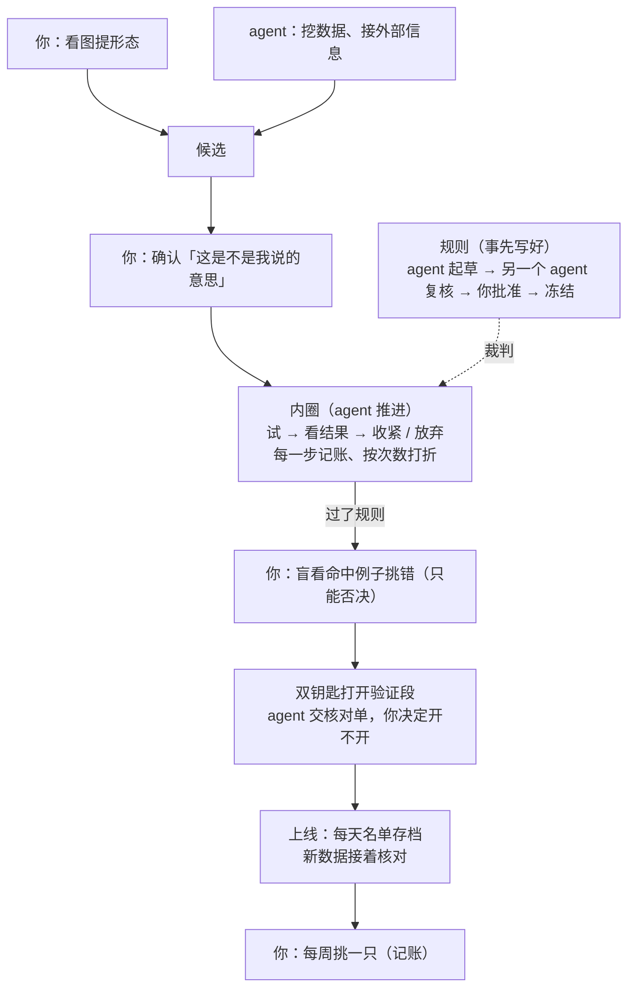

# 找 pattern 的流程：该 agent 主导，还是人主导（白话版）

> 来源：同目录 `final_report.md`（2026-10-15），由三名 agent 分析、互相挑战两轮后汇总而成。本文自包含，读它就能做决定。

## 一句话版本

**「谁主导」本身不是最要紧的；最要紧的是让「事先定好、经过独立复核的规则」当裁判，并把没碰过的数据锁起来。** 规则到位以后，两种方式只差一件事：在训练数据上「看了上一轮结果、决定下一轮试什么」由谁来推。这件事交给 agent 更好，所以整体更接近「agent 主导」。你负责的是：定方向、批准规则、确认规则是不是你的意思、挑错、决定什么时候打开验证数据、每周挑票。

## 做了什么、说明什么、不说明什么

**做了什么。** 三名 agent 分工分析：一个从最终目标倒推，看什么资源最稀缺；一个把流程拆成十四步，逐步比较人和 agent 谁更擅长；一个专门挑另外两人的毛病。三人互相挑战了两轮，红队提的十四条挑战全部被接受并改了稿。全程没有跑新实验，没有看任何 2026 年的数据，只翻了已有的票、研究记录和三处工具代码。

**说明什么。**
- 决定成败的不是「谁出的点子多、跑得快」，而是**送去验证的那个候选到底是不是真货**。
- 本项目里出现过的「大优势」全是假的（幸存者偏差、证券混杂、偷看未来、读波动率），挡住它们的都是机械检查，不是谁的判断。
- 在训练数据上「看结果、再决定下一步」这一环，人来做会悄悄把成绩抬高，而且没法记账；agent 来做每一步都能记账、能按试了几次打折。

**不说明什么。**
- **不说明这个股票池里一定有大优势的 pattern。** 如果本来就没有，哪种方式都找不到，流程能做到的只是诚实、便宜地失败。
- 「人推这一环会抬高成绩」是推理加一处代码事实，**还没有实测**（下面第五节有一个顺手测它的办法）。
- 三名 agent 是同一个模型、读的是同一批 agent 写的记录。它们的一致更像「一个推理被检查了三遍」，不是三个独立来源互相印证；对人的贡献也可能估低了。

## 词表

| 词 | 意思 | 出处 |
|---|---|---|
| 同日普通买入对照 | 同一天、同一池子里随便买，当作比较的基准 | `path2/CONTEXT.md:155` |
| 首次穿越（方向领先） | 先涨到上线还是先跌到下线；「方向领先 0.15」指比对照多出 15 个百分点的先涨比例 | `path2/CONTEXT.md:148` |
| 训练段 / 验证段 | 训练段 = 2024–2025 年，可以随便研究；验证段 = 2026 年 1 月起，只能打开一次 | 选股地图「最后检查用哪段留着没碰过的数据」 |
| 一次判决 | 拿一个候选去没碰过的数据上检验一次，诚实地判它过没过 | 本报告用语 |
| 内圈 | 在训练段上「试一个 → 看结果 → 收紧或放弃 → 再试」的循环 | 本报告用语 |
| 白得的领先 | 不是 pattern 的本事、而是数据或方法缺陷送的成绩，比如幸存者偏差、偷看未来 | 本报告用语 |

## 一张图看懂分工

## 为什么这样分

**1. 最稀缺的是「诚实判决」的次数，不是点子。** 没碰过的数据一年只够诚实地判一到三次：验证段判一次，没过可以加严再判一次，之后要等上线后新数据攒够。两种方式产出候选的速度都比这快十倍以上，所以「跑得快」帮不上忙。你的时间也不是瓶颈：哪怕每周只有一小时，一年也能看出五到十个形态。

**2. 两边都没有成功先例，不能按「谁会出好点子」来分。** 你提过的形态，用同日对照检验过的都没过线（比如「孤立跳空阴线企稳」不看涨）；agent 调出来的好成绩大多是在读波动率，还写出过偷看未来的 bug、写坏过自己的护栏。所以两边都只当「选手」，裁判交给规则。

**3. 规则到位后，只剩「内圈谁推」这一格有争议，它归 agent，理由是能记账。** 你看图收紧时，有三件事会悄悄抬高成绩：
- 你照着看过的赢家写规则，这些赢家会留在规则的命中里；
- 你看了输的例子、加条件把它们剔掉，这些输家就从成绩里消失了；
- 你看一屏图时脑子里比了几十种差别，只说出一条，账本上却只记一次。

规则命中越少，这几项抬高越大，可能和要找的优势一样大。agent 每一步都经过工具，试了几次数得清，可以照次数打折。顺带一提：对照页现在确实没有把你看过的例子排除掉，账本也不把「看大涨段」那一轮算作一次尝试，代码里核实过。

**4. 你有记录的长处，都用在了要紧的地方。**
- **审方法**：你纠正过 agent 好几次方法上的错，戳穿过动机性推理。规则质量是最要紧的一环，这项能力就作用在这里。
- **看图抓 bug**：你看图抓出过偷看未来的买点（NVX、BRNS 那次），机械检查当时没挡住。
- **只有你知道的信息**：比如你自己能不能照规则止损。

「看图觉得像 → 会涨」这一项，目前没有证据。

## 对你意味着什么

**你要做的（少而关键，大多是事先做一次）：**
- 定方向，包括一个新的方向题：**要「命中少但领先很大」的规则，还是「命中多、领先适中」的规则**。前者要领先很大才证实得了，后者可能早被人做掉了。这个以后会作为一道选择题问你。
- 批准规则；规则冻结后，改动要你批准。
- 确认「agent 写出的规则是不是你说的那个形态」。
- 每个候选送去验证前，盲看 10～30 个命中例子，只挑错：买不到、像偷看未来、数据像错的。
- 决定什么时候打开验证段。agent 会告诉你「现在开能看出多大、再等几个月能看出多大」，因为验证段不打开会自己变大。
- 每周挑一只票。会记账，以后对比「名单全体 / 名单前几名 / 你挑的」三条线。

**你不用做的：** 决定每一轮下一步试什么、每一轮收紧接不接受、什么时候放弃。这些交给事先写好的规则和 agent。你仍然可以随时插队、指定先试哪个方向、否决某个方向，或者提前放弃。

**开始之前要先补的护栏（agent 来做，做好后交另一个 agent 复核、再请你批准）：**
1. 研究只用一份截到 2025 年底的数据副本。现在挡住 2026 年的只是一个配置项，不算真锁。
2. 「看一年、判另一年」：只看一年的图找形态，在另一年上检验，同题材的连带沾光也能一起挡掉。
3. 对照页排除你看过的例子。
4. 给每个候选设「放弃条件」。
5. 「领先要大到在验证段上判得出来」的检查。
6. 用到 path2 app 的候选，加一道「不许用买点之后的数据」的检查。

护栏到位前，看图这一圈照常转，但只在训练段上转，任何候选都不送去验证。

**马上相关的一件事：** 第一份大涨段清单是 2024 年 169 段和 2025 年 131 段混在一起的。按「看一年、判另一年」，**你开始看之前，应该先按年份重新出清单，或者约定只看其中一年。**

## 一个顺手的实测

「人推内圈会抬高成绩」目前只是推理。第一圈里有个不花验证数据的测法：你只看 2024 年的图，那么同一条规则在 2024 年（你看过）和 2025 年（你没看过）上的成绩差多少，就直接说明看图抬高了多少。
- 差得很少：说明人推内圈的代价被高估了，那一格可以重新商量；
- 差得很多：「交给 agent」的理由就从推理变成了实测。

## 还没解决的

- **几种偏差叠在一起时挡不住。** 比如深跌、成交量贴着下限、某种波动水平同时出现。已知的偏差能一项一项挡，叠起来的组合挡不住；没有退市数据，也量不出能叠多大。最后只能靠验证段和上线后的新数据兜底，选哪种方式都一样。
- **你挑票这一层有没有用，一两年内大概都说不清。**
- **验证段不是绝对干净。** 你扫过 2026 年上半年的图，agent 的记录和模型自身的知识里也有 2026 年的信息。对纯价量形态影响不大，对带题材、带外部信息的方向影响更大。真正对两边都干净的，只有规则冻结之后才到来的新数据。
- **对之前草稿的一处更正：** 我之前说「按每周买一只算，攒够 30 个买点要七个月」，这把两件事混在了一起。上线后核对的是**整份名单的全部命中**，不是你买的那一只，所以新数据攒得多快，取决于规则每天命中多少：每天 1 个约 8 个月就够看出 0.15，每天 4 个约 2 个月。「七个月 30 个」只适用于检验「你挑的那一只」这一层。

## 附表：关键数字

| 项目 | 数字 | 说明 |
|---|---|---|
| 验证段大小 | 约 150 个交易日（0.6 年） | 2026-01 到 2026-08 初，后面的买点观察期还不完整 |
| 验证段要看出方向领先 0.15 | 约 176 个互相独立的买点（每个交易日约 1.2 个） | 每周只命中 1 个的规则，只能看出约 0.36 的领先 |
| 每周命中 1 个的规则，凭运气凑出 0.15 | 试 30 来次就有一半机会 | 每天命中 1 个以上、分散的规则，试上万次也凑不出 |
| 已知单项偏差能白送多少 | 目标 0.15 的 20%～70% | 偷看未来一类可达目标的两倍（+0.30） |
| 看图抬高（推演） | 看过 20 个赢家、规则共命中 150 次 → 白得约 0.13；命中 2000 次 → 约 0.01 | 每看 12 个输家并剔掉，命中 300 次时每轮再白得约 0.04 |
| 「看一年、判另一年」的代价 | 判的那一年运气波动约放大 1.4 倍 | 命中多的规则承担得起，命中少的更难证实 |
| 诚实判决次数 | 一年约 1～3 次 | 两种方式都改不了 |
