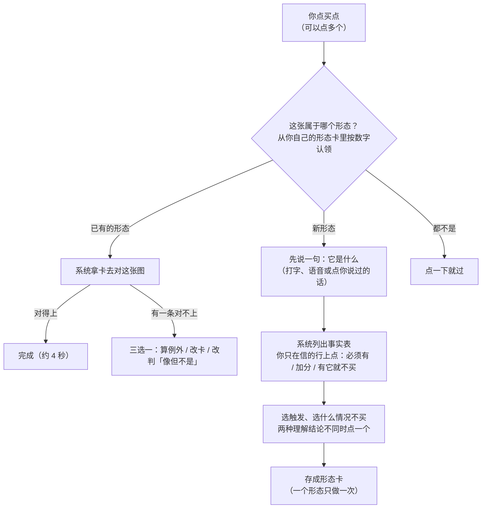

# 看图标注省力化（白话版）

> 来源：同目录 `final_report.md`（2026-10-16），由 agent team 五人（信息需求、智能推荐、交互、偏差审计、架构）的定稿整合而成。本文自包含，读完就能做决定。

## 一句话

以后你标一张图，基本只需**点买点、按一个数字认领形态**；能从 K 线算出来的东西由系统列成清单，你只在信的那几行上点一下，不用再从零写备注。代价是先花大约一周把最小版本做出来，其中一天要在你继续看图之前做完。

## 词表

| 词 | 意思 | 出处 |
|---|---|---|
| 要素 | 形态里的一个条件，比如「越过前面的峰」「买前没有派发」。你原话里的「单因子」 | 本次设计新词，词表里还没有 |
| 形态卡 | 一种形态的说明：由哪些要素组成、哪天下手、什么情况不买、为什么会涨。一个形态只填一次 | 本次设计新词 |
| 触发 | 让你决定「就是今天买」的那一下，决定规则在哪根 K 线发信号 | 本次设计新词 |
| 事实表 | 你点完买点后，系统只用买点当天及以前的 K 线算出来的事实清单，每次按同样顺序列 | 本次设计新词 |
| 训练段 / 验证段 | 2024–2025 年随便用；2026 年起是最后检查用的，谁都不碰 | `path2/CONTEXT.md:167`、`:173` |
| 同日普通买入对照 | 同一天、同一池子里随便买的结果，用来扣掉大盘涨跌 | `path2/CONTEXT.md:155` |
| 尝试 | 账本里每拿一个规则版本去看成绩就记一次，次数越多，成绩打的折越大 | 地图「流程的工作方式」 |

## 团队做了什么

五个人分工设计，互相审了两轮，最后由偏差审计逐份把关，全部通过，没有遗留分歧：

- **信息需求**：从最终要写规则、做对照、记账倒推，一张图到底需要哪些信息。
- **智能推荐**：系统能自动算出什么、怎么越用越省事、大模型怎么用。
- **交互**：界面怎么做到输入最少。
- **偏差审计**：专门挑智能化会不会让最后的判决失真。
- **架构**：怎么接到现有工具上，分几步做。

还拿你标的第一张 QMMM 做了实测。

## 核心发现：繁重的根源

倒推下来，后面写规则真正需要**只有你能给**的东西很少：

1. 买点（哪天决定买）；
2. 这张图属于哪个形态；
3. 系统发现同一句话有两种理解、在这张图上结论不同时，你选哪种；
4. 新形态的第一张图，在看到任何系统列表之前，你先说一句它是什么。

其余大多能从 K 线算出来摆给你确认，或者根本不用问。现在之所以繁重，是让你在一行备注里从零写出这些算得出来的东西。

## 以后标一张图是什么样

- **你要做的**：点买点；认领形态；新形态的第一张多花一两分钟，先说一句，再在事实表上点几下。
- **你不用做的**：写长备注；把「放量是哪几天」「峰按收盘还是最高价」这类事一张张写清楚，系统会算出来，有歧义时才问你一次，同一形态以后不再问；记哪些图看过，系统自动记。
- **你永远可以**：改任何推荐，绕开推荐自己写；库里没有的要素，随时自己加。系统会分别记下哪些是你自己写的、哪些是原样采纳的、哪些是改过的推荐。

## 为什么这么设计

**1. 机器只写算得出来的事实，信不信由你点。** 系统分三层，越往上越晚做：

- **事实层**：只看买点当天及以前的 K 线，用现成的检测算出事实表。不花钱、结果确定，也不可能偷看到之后的涨跌。
- **记忆层**：学你怎么说、怎么选：你习惯的叫法，你答过的口径，你从来不在乎的行自动收起来。「越用越省事」全靠这一层。它**不学哪些要素后来涨得好**，因为那就是挖数据，要入账、扣运气。
- **大模型层**：把你随口说的几个字对到事实表上，帮忙起草新要素。它永远不打分、不判断会不会涨。

**2. 系统不替你下判断。** 推荐只摆出来、不替你勾，你不动就算没回应。买点永远由你先点，系统不预先标候选日：你点的买点是以后检验规则的考题，系统替你点就成了自问自答。点买点之前，图上也不画「决策日」「最高点」这些事后才知道的标记，免得你照着点。

**3. 防大模型借未来。** 大模型多半知道 2025、2026 年具体股票后来怎样，比如 QMMM 后来的暴涨。所以：

- 交给它的图去掉代码、日期和真实价格，并截到买点为止；
- 它只描述图上有什么，不评价；
- 题材、新闻类的建议一律不收。

审计做了个小测试：匿名图上，两个模型都没认出是哪只股票；但直接给代码和日期，8 只里有 4 只能说出具体事件。正在跟你对话的会话本身也是大模型，所以给它也定了规矩：给你的选项只能来自事实表、你自己的说法、一份事先冻结的通用常识表，并且不谈这只股票后来怎样。

**4. 有一处特意偏离你的习惯**：问你「信不信这一条」时，选项不标「推荐」，按事实表的固定顺序排。这一步问的是你自己信什么，标了推荐就是在引导你。

## 你提的点子，各自怎么处理

| 你的点子 | 处理 | 原因 |
|---|---|---|
| 用主成分分析归纳上涨单因子库 | 不用它生成因子库 | 它产出的是各项指标混在一起的方向，没法点选；在全是赢家的图里，它找的是赢家之间的差别，而不是赢家和输家的差别；几十张图时也不稳定 |
| 表格代替一行备注 | 采纳，而且分成两层 | 形态级的项一个形态只问一次，每张图只记买点和认领 |
| 自动推荐库里没有的因子 | 采纳，但只从两处来 | 你说的话对不上库时，大模型起草定义、代码去算、你在图上确认；你选「都不是」时，才显示「这天和它自己过去 60 天比最反常的三件事」 |
| 付费大模型 | 采纳，放后面 | 前两个阶段用不着；之后每月大约不到 1 美元到 30 美元 |
| 越用越聪明 | 采纳，但只学你的选择习惯 | 学「哪些后来涨得好」就是挖数据，只能放在对照页里、入账 |
| 通用股票知识 | 采纳，做成一份冻结的常识表 | 先写定、不再改，用了就单独标来源 |

**明确不做的**：

- 按「后来涨得好」给推荐排序；
- 根据「你标过的赢家里有几张出现它」提议新要素：这个数只描述赢家，分不开赢家和输家；
- 让大模型替你标图、打分、判正反例。

## 分几步做

| 阶段 | 做什么 | 什么时候做 |
|---|---|---|
| 0（本周） | 系统算事实表，会话在聊天里问你至多三道点选题；界面小改：多买点、K 线改成你能分清的样式、点买点前不露结果 | 现在 |
| 1 | 事实表搬进网页，逐张标、回车就存 | 聊天里每张追问超过两道，或你想不开会话自己标 |
| 2 | 系统记住你的习惯；大模型听懂口语 | 有了 2 张以上形态卡、标了 20 张以上 |
| 3 | 推荐库外的新要素；大模型看匿名图 | 你常常选「都不是」，或觉得事实表漏了东西 |

每一步都要等对应信号出现才做，不出现就不做。

## 风险和局限

- **你心里想过、没输入的东西记不到。** 兜底办法是这一轮只看 2025 年，最后拿冻结的规则在没看过的 2024 年上判，两年成绩的差距就是看图挑选把成绩抬高了多少。
- **会话说话时可能无意流露它记得的行情**，这查不出来，同样只能靠年份分开量出总的影响。
- **一次数据误读**：团队里一位成员查看数据格式时，误打印了 QMMM 在 2026 年的几行数据（验证段）。没用于任何计算，也没给你看。以后建验证段账本时会记成一条已知接触；这也说明「研究只读截到 2025 年底的数据副本」必须尽早做。
- **池子里混进了不是普通股的东西**：名录里查不到的代码默认被当成普通股，2025 年清单里有 7 只这种情况，其中有铂金 ETF、黄金 ETN、场外股票。

## 要你定的几件事

1. **要不要按这个路线开工做阶段 0？** 推荐：开一张任务票来做。看图暂停一天，等「只露 2025 年、自动记看过、记账文件只存一份、截断数据副本」这几样护栏做完再继续，其余部分边做边用。
2. **几个新词要不要进词表**：要素、形态卡、触发、事实表、形态词库；还有记账用的「尝试」，它和词表里一个检测器字段同名。
3. **形态卡、操作日志、账本这些小文件要不要放进 git？** 团队一致推荐放：操作日志丢了，越用越省事的积累就归零；账本丢了，扣运气没法复算。但这和以前定的「看图工具的产物不进 git」冲突，需要你拍板。
4. **池子混进 ETF 的问题**，建议交给「候选名单的规格」那张票去修，过渡期先在图上标出证券类别。

## 附：数字

| 项 | 数 |
|---|---|
| 阶段 0 工作量 | 约 4.5～5.5 个工作日：看图前护栏约 1 天，核心约 2 天，界面小改约 1.5 天，第一次对照前的记账护栏约 0.5～1 天 |
| 阶段 1 / 2 / 3 工作量 | 6～8 天 / 6～10 天 / 5～8 天；全部做满约 22～32 个工作日 |
| 大模型月费 | 阶段 0、1 为 0；阶段 2 不到 1 美元（Haiku 5.5）；阶段 3 约 5～30 美元（Sonnet 5.5） |
| 每张图目标操作（待验证） | 已有形态、对得上：2 下约 4 秒；有一条对不上：3 下约 8 秒；新形态首张：9～11 下加一句话，50～100 秒；不是任何形态：1 下 |
| 抽查比例（待验证） | 20% 的图不显示任何预填，用来量出推荐把你带偏了多少 |
| 事实表计算速度 | 每张 0.02～0.1 秒（成员实测，未复测） |
| QMMM 实测 | 自动认出：按收盘越过两个峰、按最高价只越过一个；放量段 6/20–7/3；买前三天缩量（你没写）；5/28 有一根派发（和你说的「没有剧烈派发」相反，要问你是「不算剧烈」还是「离得够远」）；唯独 7/14 为什么下手，现有检测认不出，必须你给 |
