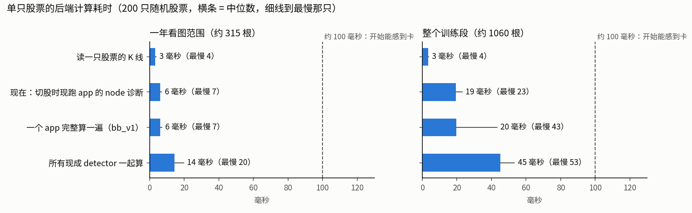

# 运算成本与系统事实（队员 cost）

## 先说人话

**做了什么**：只读截到 2025-12-31 的副本，随机抽 200 只股票，在一年的看图范围和整个四年训练段（`path2/GLOSSARY.md:123`）上计时：现在网页看一只股票时实际算了什么、一个 app（`path2/GLOSSARY.md:36`）完整算一遍要多久、把所有现成 detector（`path2/GLOSSARY.md:50`）一起算一遍要多久。另外在全部 5778 只上跑了三件事：网页「扫描」原样扫一遍、预先算好所有 detector、把 app 的某道 where 松紧一档后看买点增减多少。还量了几件会影响显示设计的事：全画出来一张图上有多少东西；同一种事件用默认参数和用 app 参数画出来差多少；随手画一个框，会不会碰巧被判成「认出」。

**说明什么**：

- **速度不是问题。** 全画只比画一个 app 多 8 毫秒（一年）到 26 毫秒（四年），全部加起来也就 50 毫秒上下，人大约在 100 毫秒才开始觉得卡。拿 app 对 20 只标过的股票约 1.5 秒；全池扫一遍 app 约 18 秒。不管「复用还是新建」的提示放在标注时还是标完后，都不用为运算量让步。
- **「所有已有 detector」画不出一张跟参数无关的图。** 同一个 detector 换一套参数，画出来就是另一批事件：默认参数的 bo 有一半以上不在 bb_v1 里，bb_v1 的 bo 也有三分之一不在默认版里。「全画」之前必须先定用哪套参数，而用户标注时并不知道该选哪套——默认的、当前 app 的、还是别的 app 的。这是回答用户第二问的关键事实，比速度更关键。
- **全画会把一张图塞满。** 一年范围里，全部 detector 中位 8 种、35 个事件、要 9 条泳道（偏多的股票 11 种、71 个、17 条）；只画 bb_v1 检测到的是 3 种、13 个、4 条。回踩有四代并存，同一处回踩至少画两遍。
- **只靠 app 注册表找「可复用的」会漏掉一批。** 现役 app 只用到 bo、burst、回踩 V1 / V4；平台段、走势区段、派发和另外两代回踩不在任何 app 里，而用户最可能先标的「底部、横盘、平台」正落在这批里。要把这几个按默认参数另列进清单。
- **改 app 一道 where 松紧一档，全池买点就会增减几十到上千个，不是几个。** 均匀抽 20 张通常能碰到新增的（概率四成到百分之百），但每张图是新增的机会只有 3%～30%；收紧只会让买点消失，消失的那些从新清单里根本抽不到。

**不说明什么**：没量浏览器画图和网络往返（事件几十个，预计可以忽略）；数字来自 upc 这台 i7-14700KF，另一台机器可能慢一些，但离 100 毫秒还差一倍以上；「认没认出」只做了可行性分析和随机框的偶然基线，没有真实的结构化标注可验；改动增减只量了个数，没量新增的买点好不好。

---

## 1. 现在三处各算了、画了什么

| 页面 | 画哪些事件 | 每切一只股票现算什么 | 缓存 |
|---|---|---|---|
| 标注页（`?wf=` 打开，`path2_web_ui/src/components/AnnotChart.vue:476`） | 不画任何事件 | 只读 K 线（`/workflow/ohlc`），不跑任何 detector | 无 |
| 调试主视图，浏览扫描结果 | 当前 app 一个 app 的事件。事件和 match（`path2/GLOSSARY.md:95`）来自扫描文件（`path2_web/GLOSSARY.md:11`），扫描时一次算好存盘 | 读 K 线 + **现跑一遍当前 app 的 node 诊断**（`path2/GLOSSARY.md:98`；`path2_web_ui/src/stores/view.ts:954` 的监听在切股、切 app 时调 `/diagnose`）。qualified 那一档（`path2_web/GLOSSARY.md:28`）靠它画（`view.ts:1075`）。显示档位默认 matched，存在浏览器里 | 无，每次重算 |
| 调试主视图，Working Copy 开着 | 同上 | 临时计算（`path2_web/GLOSSARY.md:14`）再现跑一遍 app | 无 |
| 原型 `prototypes/01-annotation/` | bb_v1 自己的 bo、burst、tb（pk 不画，`index.html:90`）+ 默认参数的平台段、走势区段。没有派发、没有回踩的其他几代，**不是全部 detector** | 静态文件，数据由取数脚本一次导出 | — |

要点：
- 「当前 web_ui 只显示选中 pattern 所需 detector 的图标」属实。
- 主视图其实**已经在每次切股时现算当前 app 的全部 detector**（node 诊断要跑一遍事件流 + 每个候选逐条 where），只是 match 本身读的是扫描文件。看图时现算 detector 不是新做法，现在每次就这么干。

## 2. 单只股票与小批量的耗时

200 只随机股票（要求整个训练段都有数据），每项 3 次取中位数，进程已热。「一年」= 2024-10-01～2025-12-31（看图一年 + 约 63 个交易日的预热，中位 314 根）；「四年」= 2021-10-08～2025-12-31（1062 根）。现有看图清单（r007，175 张）一张图中位 231 个自然日（约 7～8 个月），比「一年」还短。

| 算什么 | 一年：中位（最慢），毫秒 | 四年：中位（最慢），毫秒 |
|---|---|---|
| 读一只股票的 K 线（含副本校验） | 3（4） | 3（4） |
| bb_v1 完整算一遍 | 6（7） | 19（43，单次偶发，95% 的股票在 21 以内） |
| bb_v1 的 node 诊断（主视图切股时现跑的那一步） | 6（7） | 19（23） |
| bottom_burst 完整算一遍 | 6（8） | 20（23） |
| 挂上闸失败收集再算 bb_v1（按时段查漏检走的路，50 只） | 10（11） | 33（41） |
| **所有现成 detector 一起算 + 转成网页数据** | **14（20）** | **45（53）** |
| 所有 detector 比只算 bb_v1 多花 | 8（14），约 2.3 倍 | 26（32），约 2.3 倍 |

**冷启动**（新开进程第一次算，四年范围，3 只股票）：import 约 0.18 秒，第一次计算约 0.21 秒（app）/ 0.23 秒（所有 detector），第二次就回到 25 / 53 毫秒。网页后端是常驻进程，冷启动只在后端刚启动后的第一次请求出现一次。

**小批量**（一个进程依次算，四年范围，不并行）：

| 只数 | 拿 app 对标注（读 K 线 + app 计算 + node 诊断 + 挂闸失败收集再算一遍） | 所有 detector |
|---|---|---|
| 20 | 1.5 秒 | 1.0 秒 |
| 50 | 3.9 秒 | 2.4 秒 |
| 200 | 15 秒 | 9.6 秒 |

各 detector 单独的耗时（上游流已算好，只计它自己）与事件数：

| detector | 一年：毫秒 / 事件数中位（最多） | 四年：毫秒 / 事件数中位（最多） |
|---|---|---|
| bo+pk | 5.1 / 12（29） | 17.2 / 41（91） |
| 平台段 | 5.2 / 1（16） | 17.4 / 4（54） |
| 走势区段 | 1.0 / 14（29） | 2.9 / 47（69） |
| 派发 | 0.6 / 0（6） | 1.9 / 1（15） |
| burst | 0.3 / 4（15） | 0.8 / 17（46） |
| 回踩现役容器版 | 0.3 / 0（4） | 1.2 / 2（7） |
| 回踩 V0 | 0.2 / 0（3） | 0.5 / 1（6） |
| 回踩 V1（bb_v1 用的） | 0.5 / 1（9） | 0.9 / 6（27） |
| 回踩 V4（bottom_burst 用的） | 0.5 / 1（9） | 0.9 / 6（27） |

大头是 bo+pk 和平台段，各占约三分之一。传给网页的数据：所有 detector 一年约 9KB、四年约 35KB。

## 3. 全池的耗时与几种做法的代价

全部 5778 只、训练段四年、26 个进程并行：

| 做什么 | 实测墙钟时间 | 产物 |
|---|---|---|
| 网页「扫描」原样扫一遍 bb_v1（含收益标注、统计、写结果文件） | 18 秒 | 结果文件 27MB |
| 同上，bottom_burst | 17 秒 | 18MB |
| 预先算好所有 detector 并转成网页数据 | 24 秒 | 原始 185MB，压缩后 27MB |
| 一道 where 改前改后对拍（一只股票连算基线和改动版） | 每多一个改动约 17 秒 | 买点集合 |

| 做法 | 用户等待 | 存储 | 代价 |
|---|---|---|---|
| **按需现算**（打开一张图、或点开某种事件时才算） | 一年 14 毫秒、四年 45 毫秒，加读 K 线 3 毫秒和网络往返 | 无 | 与主视图切股现算 node 诊断同一种做法 |
| 按股票缓存 | 回看同一只时省下十几到几十毫秒 | 四年每只约 35KB | 参数或代码一改就得作废；省下的时间人感觉不到，不值 |
| 全池预算 | 读文件即可 | 压缩后 27MB | 24 秒算完；改参数即过期，还要另守「看图下界」「训练段末日」护栏 |
| 标完后批量算「认没认出」 | 不在标注时等 | 只存结论 | 20 只 1.5 秒、200 只 15 秒（单进程；要更快可以并行） |

**确定性**：detector 的产出只取决于行情、参数和代码。三者都不变就能复用；缓存的键必须同时含数据指纹、参数和代码版本，少了代码版本就会在改完 detector 后拿到旧结果。副本已有按内容的指纹登记（`chart_workflow/snaplock.py`）。按上面的耗时，缓存没有必要。

结论：按需现算就够；标完后批量对照在几十只的量级上是「秒级」，改完 app 当场能看。

## 4. 比速度更要紧的事实

### 4.1 不存在一张跟参数无关的「所有已有 detector」图

现成 detector 的输出取决于参数，而各 app 用的参数常和默认值不同、彼此也不同：

| | bo 突破门槛 | bo 按什么价判突破 | burst 的量能 where | 回踩用哪代 |
|---|---|---|---|---|
| detector 默认参数 | 0.3% | 最高价 | —（where 属于 app，不属于 detector） | — |
| bb_v1 | 0.75% | 收盘价 | 放量 ≥ 3 倍 | V1（默认参数与 detector 默认相同） |
| bottom_burst | 0.3% | 收盘价 | 放量 ≥ 10 倍 | V4（同上） |

2025 年看图范围、200 只股票，按起止根完全相同算同一个：

| 种类 | 两边都有 | 只在默认参数版 | 只在 bb_v1 |
|---|---|---|---|
| bo | 381 | 433 | 228 |
| burst | 273 | 541 | 336 |
| 回踩（V1） | 146 | 133 | 48 |

回踩 V1 的参数两边一样，差别全来自上游的 bo、burst。举例（2025 年，月-日）：

- LASR 的 bo：默认 14 个（01-07 01-21 01-23 05-09 05-12 05-23 05-27 06-16 08-22 08-25 09-15 11-07 12-22 12-23），bb_v1 9 个（01-23 05-09 05-12 05-27 06-16 08-26 09-18 11-10 12-23），bottom_burst 10 个。同一次上冲，默认版常比 app 早一到三天出 bo（08-22/08-25 对 08-26，09-15 对 09-18，11-07 对 11-10）。回踩：默认 8 个，bb_v1 只有 05-22 那一处，bottom_burst 4 个。
- TVRD 的 bo：默认 10 个，两个 app 都是 9 个；04-14、04-30、10-03、10-06 只在默认版，04-22、05-02、10-09 只在 app 版。

本次计时用的「所有 detector」是我为测速临时定的一套：`path2/atoms/` 的全部 9 个 detector 类（bo+pk、burst、回踩四代、走势区段、平台段、派发），都用构造函数默认值；burst 的构造参数没有默认值，借两个 app 的 gap_max 8、min_bos 1；上游一律接同一份默认参数的 bo / burst 流（`repro/bench_detectors.py` 的 `all_atoms_spec`）。项目里没有一套「不属于任何 app 的显示参数」。

### 4.2 全画时一张图上有多少东西

一个「种类」= 一个 node，在副图里占一条 band（`path2_web/GLOSSARY.md:39`）；同种事件重叠时要分泳道（lane，`path2_web/GLOSSARY.md:42`），这里按「同一根 K 线上最多同时有几个」算最少要几条。200 只随机股票，中位 / 九成分位 / 最多：

| 画什么 | 2025 全年（约 250 根）：种类 / 事件 / 泳道 | 截到年末的 200 根：种类 / 事件 / 泳道 |
|---|---|---|
| 所有 detector（默认参数） | 8 / 35 / 9（偏多 11 / 71 / 17，最多 12 / 133 / 27） | 7 / 29 / 9（偏多 10 / 62 / 16） |
| 只画 bb_v1 检测到的（detected 档） | 3 / 13 / 4（偏多 4 / 27 / 6，最多 4 / 42 / 12） | 3 / 10 / 4 |
| 只画 bb_v1 进了 match 的（默认档位） | 随机股票里只有 10 只在 2025 年有 match，其余图上什么都没有 | 同左 |

各种类（只算出现了该种的股票，2025 全年，中位 / 九成分位）：走势区段 12 / 17（每只都有）、pk 8 / 12、平台段 6 / 12（只有一半股票出现，出现时就很密）、bo 5 / 9、burst 5 / 9（要 2～3 条泳道）、回踩 V4 的企稳段 7 / 26（最多 65 个，要 2～4 条泳道）、回踩 V1 与 V4 各 2 / 6、派发 1 / 2。

重复画的来源：
- 回踩 V1 和 V4 在默认参数下起点完全重合（200 只 2025 年 357 个全部重合），同一处回踩至少画两遍；现役容器版只和其中 23 个重叠。
- 同一套参数里也会出现区间完全相同的两个回踩（例如 LASR 默认版 05-22～05-22 两个、06-02～06-03 两个）：burst 按「同一串 bo 的每个结尾」各出一个实例，各自带出的回踩可能落在同一段。

### 4.3 「框和事件有交叠」的偶然基线，以及我对几何判法的立场

在 2025 年看图范围里随机放框（每只股票每种框长 200 个），碰巧碰上至少一个该种事件的概率（均值）：

| 种类 | 被事件盖住的 K 线比例（中位） | 框长 1 / 5 / 20 / 60 根 |
|---|---|---|
| 走势区段 | 100% | 1.00 / 1.00 / 1.00 / 1.00 |
| pk | 2% | 0.02 / 0.12 / 0.42 / 0.68 |
| bo | 1% | 0.02 / 0.07 / 0.22 / 0.48 |
| burst | 2% | 0.03 / 0.07 / 0.22 / 0.48 |
| 平台段 | 0%（少数低波动股被大片盖住，均值 19%） | 0.19 / 0.22 / 0.28 / 0.37 |
| 回踩 V4 | 2% | 0.08 / 0.09 / 0.16 / 0.31 |
| 回踩 V1 | 1% | 0.02 / 0.04 / 0.11 / 0.27 |
| 回踩现役容器版 | 0% | 0.02 / 0.02 / 0.05 / 0.12 |
| 派发 | 0% | 0.00 / 0.01 / 0.04 / 0.12 |

把各行加起来：一个随手画的 60 根框平均碰上约 3.8 种事件（20 根约 2.5 种，5 根约 1.6 种）。

**立场（回应 critic 第 2 条，改掉初稿的建议）**：同意以「随便挪个位置也会被判认出」的底为主，判定用最简单的「有交叠」，不再加「重叠占框多少」之类的几何门槛——mind 的实验说明加了也救不了铺满型的种类，而走势区段「看态」其实就是这个 node 的 where（下跌段就是「态 = 下跌」这条 where），已包含在「同 node、要过 where」里。

但有两处不是「加码」，是防止**系统性地判错成没认出**——底只能挡「靠运气认出」，挡不了这一类，所以要单独保留：

1. **点事件要有前后几根的容差，而且按种类判是不是点事件。** 一根 K 线的事件谈不上和框「交叠」，差一两天就落在框外。哪些算点事件以种类声明为准（代码里 bo、pk 两种声明了「点几何」），不按单个实例只占一根来判：只有一个 bo 的 burst 也只占一根，但它是区段种类，不放宽。两种判法在 burst 上差别明显（框宽 1 时偶然率 1.8% 对 5.0%）。
2. **事件画在哪一根，不一定是用户看到它的那一根。** pk 事件记在「登记」那一根，峰本身在它之前至少 6 根（`path2/GLOSSARY.md:15`，代码里峰所在的那根另存一个字段）。用户框在峰上，按事件的起止根比就会稳定判成没认出。改法是用事件声明的最早一根到末根当它的位置——网页护栏取「事件锚点」本来就这么取（`path2_web/serialize.py` 的 `event_anchor`）。代价是 pk 的底会变高（下表变体 B）。同类风险还有回踩：回踩事件的区间是「企稳之后能买的那段」，不含前面下跌的那段，用户若把下跌那段框成「回踩」，可能贴着却不交叠。这一条要等有了真实标注才看得出多严重，先记「待验证」。

## 5. 「app 认没认出用户标的东西」能不能算

能，现成数据结构够用，不需要新机制：

- app 的计算结果里，每个事件都带它占的 node（`path2/GLOSSARY.md:76`）和起止根；每个 match 记着各 node 绑的是哪个事件。
- node 诊断记着每个候选在每条 where（`path2/GLOSSARY.md:79`）上过没过、实测值和阈值；还记着作为下游时找不找得到上游伙伴、没找到的卡在哪类原因。
- 按时段查漏检能给出框内 detector 的哪道闸（`path2/GLOSSARY.md:68`）把尝试拦下了。bo/pk、burst、回踩各代会上报闸失败；走势区段、平台段、派发不上报，它们「没检测到」时只能说没有，说不出为什么。

于是对每个**带角色（node）的框**，可以给出四级定性结论并附「卡在哪」：进了 match / 过了全部 where 但没凑成 match（卡在哪条边）/ 检测到但没过 where（卡在哪条、差多少）/ 根本没检测到（卡在 detector 哪道闸，仅限会上报的几种）。用户新起名、还没有 detector 的种类没法自动比；没填角色的框只能按种类找最近的同种事件。

### 5.1 bb_v1 的偶然底：独立复核

按 mind.md 第 4.1、4.2 节的文字规则自己重写了一遍（没读 mind 的脚本）：框对应 bb_v1 的某个 node；位置对上 = 该 node 的事件与框交叠一根以上（点事件放宽前后 2 个交易日）；在此之上分三档。随机抽 200 只股票（与 mind 不同的抽样），在训练段预热期之后每只每种框宽随机放 400 个框，算被判「认出」的比例（每只股票一个比例，再取均值）：

| node（用户可能叫它） | 判到哪一档 | 框宽 1 | 5 | 10 | 20 | 40 |
|---|---|---|---|---|---|---|
| bo（突破） | 检测到 = 过 where（bo 没有 where） | 5.2% | 8.9% | 12.9% | 19.8% | 32.0% |
| bo | 进了 match（是某个进了 match 的 burst 的成员） | 0.3% | 0.5% | 0.7% | 1.1% | 1.7% |
| pk（峰），按登记那根 | 过 where（pk 没有 where） | 10.7% | 19.0% | 28.4% | 42.0% | 55.2% |
| pk，按峰所在那根起（4.3 第 2 点的改法） | 同上 | 27.3% | 33.5% | 39.9% | 48.9% | 58.4% |
| burst（放量突破串） | 只检测到 | 1.8% | 5.4% | 9.7% | 17.6% | 29.7% |
| burst | **过 where**（mind 规则的「认出」） | 0.3% | 0.5% | 0.7% | 1.1% | 1.9% |
| burst | 进了 match | 0.2% | 0.4% | 0.5% | 0.9% | 1.5% |
| tb（回踩） | 只检测到 | 1.1% | 2.5% | 4.1% | 7.1% | 12.7% |
| tb | **过 where** | 1.1% | 2.5% | 4.0% | 6.9% | 12.3% |
| tb | 进了 match | 0.1% | 0.3% | 0.4% | 0.8% | 1.4% |

- 「只检测到」那几行与 mind 附录的数（bo 5/9/13/21/32%，burst 2/6/10/18/30%，回踩 1/2/4/7/13%）几乎一致，两边独立算的口径对得上。
- 按 mind 的规则（要过 where），bb_v1 的底：burst 不到 2%（它的 where 很严）、回踩 1%～12%（它唯一那条 where 很少不过）、bo 5%～32%、pk 11%～55%（这两个没有 where，底就是「检测到」的偶然率）。框越宽底越高。
- pk 在 bb_v1 里不参与 match，所以没有「进了 match」那一档。
- 这是随机位置的框，用户真实的框会落在有形态的地方；底要等有了真实标注按「把用户的框挪到同一只股票别处」再算，这张表只给量级。

## 6. 「复用还是新建」：可复用清单怎么来

- **没有 detector 注册表**，只有 app 注册表：网页启动时扫 `path2_apps/` 下带 `PATTERN_DAG` 和 `eval_meta` 的 app（`path2_web/discovery.py`）。
- **只从 app 注册表枚举「所有 app 的所有 node」会系统性地漏掉一批（critic 第 1 条，确认属实）。** 现役 app 的 detector：bb_v1、try_conplex_where 用 bo、burst、回踩 V1；bottom_burst 用 bo、burst、回踩 V4；bo_only 只用 bo。平台段、走势区段、派发、回踩 V0、回踩现役容器版不在任何 app 里——偏偏用户最可能先标的「底部、横盘、平台」落在这批里。
- **补法：两样合起来。**
  1. 在某个 app 里用过的 detector：取「所有 app 的所有 node」，带各自的参数和 where。不再另列它们的默认参数版，免得同一种事件出现两份互相打架的版本（4.1）。
  2. 不在任何 app 里的 detector：手写一份接线清单（哪个 detector、谁吃谁的流），用它们的构造默认参数。对这几个来说，默认参数就是项目里唯一存在的一套，没有 app 版可以对不上，4.1 的问题在它们身上不出现。清单约 15 行（`repro/bench_detectors.py` 的 `all_atoms_spec` 可作起点，去掉第 1 类已有的），`path2/atoms/` 增删 detector 时要跟着改。
  - 这几个默认参数从来没被调过：平台段是「10 根内振幅不超过 5%」，走势区段的「横盘」是一个对所有股票都一样的均线变化门槛，不随股票的波动大小调整。所以它们对用户的「底部」「横盘」认不出来时，可能是参数不合适而不是概念不存在；给会话的提示要说「有现成的，参数可能要调」，不宜直接判「没有可复用的，要新写」。
  - 走 detector 必须经引擎：回踩 V0 / V1 / V4 在引擎外单跑（上游事件还没有身份）时会产出完全相同的事件对象，被流校验拦下（本次实测踩到）。
- **按交叠程度和底排序，不按有没有交叠**（4.3）：否则一个 60 根的框会稳定收到三四个靠运气碰上的候选，走势区段永远在列。
- 运算上，在几十只标过的股票上把清单全跑一遍是一两秒（第 2 节小批量），放在标注时还是标完后不由速度决定。

## 7. 全池买点有多少，改一次 app 增减多少（给 flow 第 3 条、critic 第 3 条）

**口径**：训练段 2021-10-08～2025-12-31，全部 5778 只，过滤同网页扫描默认（股价 0.5～30、扫描区间日均成交量 > 1 万）。「买点」=（股票，买点 node 事件的起始日）去重：bb_v1 的买点 node 是 tb，bottom_burst 是企稳段（一个回踩里可能有好几段）。网页扫描报的 match 数是另一个口径（同一个买点日可能对应好几个 match，例如同一段回踩被两个 burst 各带出一次）。

| | 网页扫描：命中股票 / match 数 | 买点数（股票 + 日期去重） |
|---|---|---|
| bb_v1 | 982 只 / 2012 个 | 1569（与扫描结果文件里按「股票 + 买点日」去重的数完全一致） |
| bottom_burst | 502 只 / 958 个 | 2471（按每个企稳段的起始日；若一个回踩只算它第一个企稳段，是 678） |

改一处、其余不动，全池买点的变化（「抽 20 张碰到新增的概率」= 从改后的买点里均匀抽 20 张，至少一张是这次新增的；「20 张里平均几张是新增」= 20 × 新增 / 改后总数）：

| app | 改动 | 改后 | 新增（涉及几只） | 消失 | 抽 20 张碰到新增的概率 | 20 张里平均几张是新增 |
|---|---|---|---|---|---|---|
| bb_v1 | distinct_pk 3→2（松） | 2274 | 705（614 只） | 0 | 1.00 | 6.2 |
| bb_v1 | distinct_pk 3→4（紧） | 937 | 0 | 632 | — | — |
| bb_v1 | 放量 3→2 倍（松） | 1956 | 387（317 只） | 0 | 0.99 | 4.0 |
| bb_v1 | 放量 3→4 倍（紧） | 1258 | 0 | 311 | — | — |
| bb_v1 | first_drought 40→30（松） | 1832 | 263（198 只） | 0 | 0.96 | 2.9 |
| bb_v1 | first_drought 40→50（紧） | 1397 | 0 | 172 | — | — |
| bb_v1 | 回踩单日跌幅上限 20%→25%（松） | 1622 | 53（49 只） | 0 | 0.49 | 0.65 |
| bb_v1 | 回踩单日跌幅上限 20%→15%（紧） | 1469 | 0 | 100 | — | — |
| bb_v1 | bo 突破门槛 0.75%→0.5%（detector 参数） | 1609 | 76（62 只） | 36 | 0.62 | 0.94 |
| bb_v1 | bo 突破门槛 0.75%→1%（detector 参数） | 1519 | 39（33 只） | 89 | 0.41 | 0.51 |
| bb_v1 | 关掉 distinct_pk | 2700 | 1131（893 只） | 0 | 1.00 | 8.4 |
| bb_v1 | 关掉放量 | 2427 | 858（647 只） | 0 | 1.00 | 7.1 |
| bb_v1 | 关掉 first_drought | 2564 | 995（666 只） | 0 | 1.00 | 7.8 |
| bb_v1 | 关掉回踩单日跌幅 | 1677 | 108（99 只） | 0 | 0.74 | 1.3 |
| bottom_burst | 放量 10→8 倍（松） | 3003 | 532（127 只） | 0 | 0.98 | 3.5 |
| bottom_burst | 放量 10→12 倍（紧） | 2102 | 0 | 369 | — | — |

读法：
- **改 where 是单向的**：放松只增不减，收紧只减不增（where 只做筛选，这是结构上必然的，实测也是如此）。改 detector 参数则有增有减。
- 一档改动在全池动几十到上千个买点。最小的一档（回踩单日跌幅放松）也新增 53 个，均匀抽 20 张约一半机会碰到一张；多数改动新增几百个，抽 20 张几乎必然碰到，但每张图是新增的机会只有 3%～30%，20 张里平均不到一张到八张。若要专门判断「这次改动加进来的东西对不对」，单独从新增里抽一批更直接。
- **消失的买点从改后的清单里永远抽不到。** 收紧类改动（以及 detector 参数改动的那部分消失）要看效果，只能另出一份「这次没了的」清单。
- 对拍一次的代价：每多比一个改动，全池约 17 秒（26 进程）。

## 8. 口径与没测的东西

- 机器 upc，i7-14700KF（28 线程），Python 3.12、pandas 2.3。单只计时为单线程、3 次取中位数、进程已热；全池为 26 进程墙钟时间，跑时机器上另有一个单进程轻任务，影响几个百分点以内。并行时单只平均要 107 毫秒左右（比单线程慢一倍，多核同时满载时频率下降、部分是能效核），所以全池时间按单线程数字乘只数再除以进程数会低估。
- 引擎运行时自检保持开着（网页后端的默认状态）。
- 「转成网页数据」只计整理成字典的那一步，不含 JSON 编码与网络传输（几十 KB 的编码在 1 毫秒以内）。
- 没量：浏览器画图、HTTP 往返、网页护栏记「看过」的写盘（护栏端点会往看图账本写记录，为了不污染账本，全部直接调函数，没经端点；全池扫描的结果文件写在 scratchpad，没进 `outputs/`）。
- 泳道数是「同一根 K 线上最多同时几个」的下限，网页实际排泳道的办法可能多用一两条。
- 4.3 与 5.1 的框是均匀撒的随机框，用户真实的框会落在有形态的地方；它们给的是偶然基线的量级，不是真实框的实测。
- 第 7 节只量了买点个数的增减，没量新增买点的涨跌好坏。
- 副产品登记：本次只量耗时、事件数、重叠率和买点个数，没量任何与涨跌有关的指标，没有过及格线的副产品，未登记 `docs/feature_candidates.md`。

## 附：复现

都在本目录 `repro/` 下，`uv run python` 运行，只读截到 2025-12-31 的副本：

- `bench_detectors.py [只数]` —— 第 2 节单只耗时与事件数，原始数字写 `out_bench.json`；`summarize_bench.py` 出汇总，`plot_latency.py` 出上面的图。
- `bench_gate_collect.py` —— 挂闸失败收集的耗时。
- `batch_and_density.py [cold|batch|density|example 代码...]` —— 冷启动、小批量、4.2 的显示密度、4.1 的举例，写 `out_batch_density.json`。
- `pool_scan.py` —— 第 3 节全池三项和第 7 节的松紧一档对拍，写 `out_pool.json`（网页扫描的结果文件写到 scratchpad）；`pool_where_off.py` —— 第 7 节「关掉一道 where」四行。
- `overlap_baserate.py` —— 4.1 默认参数对 bb_v1 的表、4.3 的偶然基线，写 `out_overlap.json`；`tb_generation_overlap.py` —— 回踩各代互相重复。
- `chance_base_bb_v1.py` —— 5.1 的 bb_v1 偶然底，写 `out_chance_base_bb_v1.json`。
