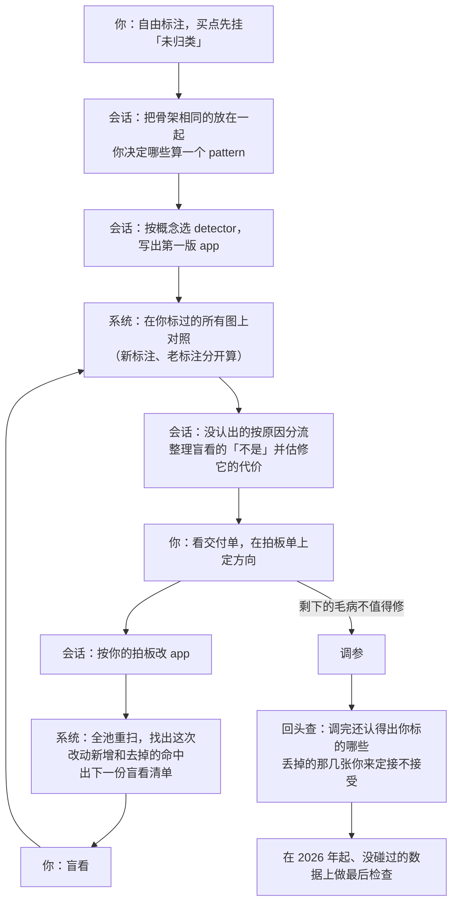

# 标注时看什么、标完怎么对、app 怎么改：白话版

> 来源：同目录 `final_report.md`（2026-10-25），它汇总了四名队员的分稿 `mind.md`（你看图时的心智与界面）、`flow.md`（工作流）、`cost.md`（实测运算量）、`critic.md`（挑刺审查）。研究目录是临时的，实施完会删，所以下面把要紧的事实都抄进来了，读这一份就够。

## 一句话版本

**标的时候只看 K 线和你自己画的框；标完再看 app 认出了什么，只分「认出 / 看到了但不够格 / 没认出」，不比起止；用哪个现成的 detector 来认你标的东西，由会话去选，你只在一张对照表上看结果；app 建好后，「回到你标过的图上对照」和「盲看 app 抓的图」每轮都要做，两样查的是相反的错，缺一不可。** 运算量不是问题：把所有现成 detector 都跑一遍，一只股票约 45 毫秒，人要到 100 毫秒左右才会觉得卡。

## 会反复出现的词

| 词 | 意思 | 出处 |
|---|---|---|
| app | 一个走势形态的完整写法，可以单独扫描和评估 | [path2/GLOSSARY.md](../../../path2/GLOSSARY.md) 第 36 行 |
| detector | 产出事件的那段代码，吃 K 线或别的事件，吐出一串事件 | 同上，第 50 行 |
| node | app 里的一个位置：由哪个 detector 供货、占这个位置的事件要满足什么条件 | 同上，第 76 行 |
| where | 一个事件够不够格占某个 node 的条件，只看事件自己 | 同上，第 79 行 |
| match | 一次完整命中：app 的每个位置都找到了一个具体事件 | 同上，第 95 行 |
| band | 副图里的一条轨，一个 node 一条 | [path2_web/GLOSSARY.md](../../../path2_web/GLOSSARY.md) 第 39 行 |

另外两个词词表里还没有，就地说明：
- **盲看**：从整个股票池里随机抽 app 抓到的图，先把买点之后的走势藏起来，你逐张点「是 / 不是我说的形态」。
- **正例 / 像但不买**：你点买点时给的判断，「这天有我说的样子，我会买」和「长得像，但我不买」。

---

## 你的七个问题，逐个回答

**1. 标注时是不是已经能看到现成 detector 的图标？**
原型里能看到一部分，并不是全部：只有 bb_v1 这个 app 自己的事件，外加平台段、走势区段两种。现在正在用的旧标注页什么都不画。主视图只画当前选中的那个 app 的事件。

**2. 有没有必要标注时看所有现成 detector 的图标？会不会慢？**
没必要。慢的方向你猜对了，但慢得感觉不到：全画是只画一个 app 的 2.3 倍运算量，绝对值只多 8 到 26 毫秒。不画的真正理由有三条：
- **画不出一张「所有现成事件」的图。** 同一个 detector 换一套参数，画出来的就是另一批事件。拿突破来说，默认参数画出来的有一半以上不在 bb_v1 里，bb_v1 的也有三分之一不在默认版里；有的 detector（如 burst）根本没有默认参数。你标注时并不知道该看哪一套。
- **会把眼睛带偏。** 图上有现成的色块，眼睛先看色块、描述也会往它的名字上靠。更要紧的是，看着 app 的事件标下来的东西，拿去检验 app，就成了 app 自己考自己。
- **太挤。** 全画时一年的图中位数有 8 种、35 个事件、9 条泳道；色弱下这么多种颜色也分不开（色板第一轮，新颜色里只有朱红一种能和主视图现有的颜色都分开）。

**3. 是不是标完再由系统去发现「我要的 node 已经有了」？**
是。标完以后，会话把你同一个名字下的所有框，拿到你标过的那几十只股票上，和所有现成的 detector 逐个比，毫秒级就能算完。有一个坑要避开：可选的不能只列现有 app 里用到的那几个，平台段、走势区段、派发这些没进任何 app 的也要列上。你最可能先标的「底部」「横盘」「平台」恰好落在这一批里。

**4. 复用还是新建，该在标注时实时让我选，还是标完推荐给我选？**
两条都不选，这道题本身是个假的二选一。「这个现成 detector 能不能认出我说的东西」，要知道它的规则、要跨很多张图看，这是会话擅长的事；你在标某一个框的那一刻判断不了，而且每个框都问一次，次数太多。

所以改成：会话按概念去选（不是按框），选好直接写进 app，然后在对照页开头给你一张表：

| 你标的 | app 里由谁来认 | 你的例子里认出几处 |
|---|---|---|
| 放量突破 | 现成的 burst | 9 / 10 |
| 横盘 | 现成的走势区段里的横盘段 | 8 / 10 |
| 缩量回落 | 回踩上加一条「量比之前缩了」的要求 | 6 / 10 |
| 跌得够深 | 还没放进 app（附理由） | — |

你只需要看表和对应的图，说「这一行没认对」。直观来自「结果画在图上」，不来自「实时」。会事先问你的只有一种情况：会话要新写一个 detector，或者要改一个别的 app 也在用的 detector。那时给你看一列小图：你的框，和最接近的现成事件叠在一起。

**5. 想知道我标的和 app 算出的差在哪，不要求起止对齐，但希望我标的东西被认出来。**
分三层看，每层只有几档，不比起止：

| 层 | 档位 |
|---|---|
| 每个框 | ✓ 认出：那个位置上 app 有对应的事件，而且过了它全部的 where ◐ 看到了但不够格：有事件，但没过某条 where ✗ 没认出：那个位置上根本没有事件 |
| 两个框之间 | 前后连上没有。两个框都认出、买点却没成时，毛病在两者的关系上，字样挂在两框之间的连线上，不怪到某一个框头上 |
| 每个买点 | 正例：app 是否在附近也买（买点所在那段之内或前后 3 天） 像但不买：app 是否在前后 1 天内买了 早买、晚买几天另外写一句 |

两个配套规矩：
- **每一层都配一个底。** 把你的框随便挪到这只股票的别处，用完全相同的规则再判一次，看几处也会被判成「认出」。有的事件铺满整条时间轴，比如走势区段里的上涨段、下跌段，随手画个框就有约四分之三的机会碰上。这种「认出」不说明任何问题，底高的时候页面会提醒你。
- **字样只写人话，不写阈值数字。** 写「看到了，但量不够 app 的要求」，不写「1.6 倍，要 2 倍」。看见数字的自然反应是「那降到 1.5」，这是在定参数；而一张张图这样放宽，就是在拟合你的标注。数字由会话按概念汇总去用。

**6. app 建好后，要回到标注图上反馈修正，还是只靠盲看就够？**
两样都要，它们查的是相反的两种错：
- **回到标过的图上对照**：查「我要的，app 漏了没有」。只有这一步查得出漏。
- **盲看**：查「app 抓的，是不是我要的」。只有这一步查得出乱抓。

只靠盲看，没被抓到的图根本不会出现在清单上，所以 app 可以越改越窄，而你每张都点「是」，一直很满意；只靠对照，就会一路放宽去迁就最宽的那张标注，最后在全池乱抓。

**7. 工作流怎么设计？显示的最佳方案是什么？** 见下面两节。

---

## 推荐的显示方案

**标的时候**：只有 K 线、成交量和你自己的框。框按你起的名字各占一条轨，只用虚线和字，不上色。
- 不能「点一下系统事件来标」。点选的好处是边界准，可你已经说过不要求起止对齐，这个好处就没了，剩下的只有带偏和自己考自己。
- 起名时只提示你自己以前用过的名字，不列系统现成的种类名。
- 特征用你自己的词写，比如在框上写「放量」，不从 app 的条件清单里勾；会话负责把你的词接到对应的 where 上。
- 「这个框在这个买点里扮演哪个角色」不用你填，会话按名字和位置推断，推不出来才在图上问你一句。

**标完一张**：有一个「对照 app」开关，打开时照主视图的画法把当前 app 的输出叠上来，框旁贴上 ✓ ◐ ✗ 字样；换下一张图，开关自动关上。还没有 app 时开关是灰的。

**主要的看法是每轮的汇总页**：按概念列出上面那张对照表、连不上的前后关系、买点情况，问题多的排前面；点某一行就进到那张图的对照画面。在你全部标过的图上跑一遍 app，20 张约 1.5 秒，改完马上能看。

**色弱**：靠所在的轨、文字、虚线和实心、✓ ◐ ✗ 这些符号来区分；app 的事件沿用主视图配色，不新增颜色。

示意图在同目录 `mock_display.png`：左边是标注时的样子，右边是打开对照之后的样子。

---

## 推荐的工作流

一轮里你只出场两次：一次拍板，一次盲看。其余全是系统和会话的事。

### 防止 app 变成「专门拟合你那几张图」的三件事

1. **没认出的按原因分流，不让你逐处拍板。**
   - 结构上的问题（根本没检测到、前后没连上、一段被切成两段）：会话直接修，在交付单里写明是因为哪几张图。
   - 只差一点门槛的：不一张张放宽，汇总起来交给调参统一定。
   - 只有会话拿不准「这段到底是不是你说的那种东西」时才问你。问的时候先把买点之后的走势藏起来，免得涨了的你倾向答「是」、跌了的倾向「放过」。
   - 「放过（我标宽了）」你随时都可以点，它只把这一处拿出样本，不改 app。
2. **盲看清单要专门混进这次改动影响到的图。** 改一道门槛松一档或紧一档，全池的买点会增减几十到上千个，随机抽 15 张几乎碰不到它们，收紧后消失的那些更是永远抽不到。所以每份盲看是：随机 15 张，加这次改动新增的 5 张、去掉的 5 张。三部分混在一起不告诉你，结果分开报，只有随机那部分算比例。
3. **新标注、老标注分开报。** 被拿去写过 app 的、被某次改动当过理由的、标的时候看过 app 的，都算老标注，它们的认出率天然偏高。只有建好 app 之后才标、标的时候没接触过 app 的「新标注」，才能说明 app 对没见过的图认不认得出。「接触过」由界面自动记，你不用做任何事。从大涨段清单或「随机一张」进来的图，默认就进不画 app 的干净界面，好让新标注攒得起来。新标注不足 5 张时，页面只逐张列出、写「还不知道」。

### 什么时候停

由你按「剩下的毛病值不值得修」来定，不靠任何计数。会话会给每类毛病写清：出现了几次、修它要动哪里、修了全池少抓多少、会不会让你标过的图认不出来。

不用计数，是因为数字太粗：随机 15 张里 3 张「不是」，真实比例可能在 7% 到 45% 之间。要是定成「同一类出现两次就得改」，几类小毛病同时存在时几乎永远停不下来，还会一层层加条件，把命中削没。

### 训练段成绩

训练段成绩每轮不主动报，要看随时说一句就行。主动给的只有三个时候：准备调参时、调参之后、成绩明显跑输同日普通买入时（这时交付单开头会提醒你）。理由是，如果每轮都看着成绩决定留不留某个改动，结构就会被悄悄改成「训练段赢家」的样子，到最后检查才露馅。

---

## 需要你拍板的方向变更

这几条和之前已经定下的说法不一样。团队按「不受已有决策影响」推出来，但不能替你定：

1. **标注时默认只看干净 K 线，取消「点系统事件来标」。** 原方向是「标注图像主视图一样画出现成事件，抓对了点一下就收」。
2. **特征用你自己的词，由会话接到 where 上。** 原先已批准的是「特征从 app 的 where 名单里勾、名字和 where 同名」。新做法里两边照样对得上，靠的是会话写的对照表，而且是 where 照你的词起名。
3. **角色不用你填，会话推断，推不出才问。**
4. **训练段成绩每轮不主动报**，只在调参前后和明显跑输时报。
5. **盲看清单分三部分**：随机 15 张，加改动新增、去掉的各最多 5 张，分开报。原先说的是「整个股票池随机抓」。
6. **调参前多一个方向选项**：
   - 「先放开搜，调完回头看丢了你哪几张」（推荐）；
   - 「事先只在大多数标注还认得出的范围里搜」。

   推荐前者，是因为后者的「八成标注要认得出」这条线是会话替你编的数，而你的标注本来就是定性的。
7. **（会话补充）** 地图上「以后从框过的例子给 detector 定参数默认值」这一条，在你说标注是定性的之后站不住了，多半该划掉。

---

## 这套方案的局限

- **单张图对照看多了，你的印象会往 app 的样子靠。** 标完一张就能看 app，好处是你还记得自己想表达什么；代价是看过十几张 app 认出的「底部」以后，你心里的「底部」会悄悄变得像 app。这个影响记不下来，所以单张对照只当次要看法，以汇总页为主。
- **防线都偏粗。** 改动增减各抽 5 张，只拦得住明显改坏的：真实有八成不像时，约四分之三的机会被拦下；四成不像时，只有约十分之一。新标注只有 5 到 12 张时，一个严重偏窄的 app 只有一半左右的机会被看出来。流程能保证问题迟早冒出来，保证不了这一轮就看得出。「没看出问题」不等于「没有问题」。
- **回踩可能被系统性地判成没认出。** app 的回踩只记企稳之后能买的那段，你框回踩时多半连前面的下跌一起框了。这要等第一批真实标注出来再查，要修的是判定规则，不是 detector。
- **管不了「意图本身就是挑出来的赢家」。** 如果你主要从大涨段清单里找图，循环可以把「涨了的图长什么样」表达得很忠实，但它在没碰过的数据上未必成立。这只有最后检查能判断。所以找图时，涨了的和长得像却没涨的都要看。
- 所有带「待验证」的数（前后 3 天、15/5/5 张、新标注 5 张等）都还没校准，第一次真用时会话会列出来请你过目。

## 附表：实测数字

200 只随机股票取中位数，括号里是最慢一只；数据截到 2025 年底；机器是 upc。

| 算什么 | 一年的看图范围 | 整个四年训练段 |
|---|---|---|
| 一个 app 完整算一遍 | 6 毫秒（7） | 19 毫秒（43） |
| 所有现成 detector 一起算 | 14 毫秒（20） | 45 毫秒（53） |

| 其他 | 数 |
|---|---|
| 全池 5778 只扫一遍 bb_v1 | 约 18 秒（26 个进程同时跑） |
| 在标过的股票上拿 app 对标注 | 20 只约 1.5 秒，50 只约 3.9 秒 |
| 全画时一年的图上 | 中位 8 种、35 个事件、9 条泳道；只画 bb_v1 是 3 种、13 个、4 条 |
| 突破：默认参数 vs bb_v1 参数（2025 年 200 只） | 两边都有 381 个，只在默认版 433 个，只在 bb_v1 228 个 |
| 随手画个框被「认出」的机会（过了 where 那一档，bb_v1） | burst 不到 2%，回踩 1%～12%，突破 5%～32%，峰 11%～55% |
| 改一道门槛松 / 紧一档（bb_v1 全池 1569 个买点） | 放松新增 53～705 个，收紧消失 100～632 个 |

附带发现：词表里「训练段」那条还写着旧的 2024-01 到 2025-12，和地图上已批准的 2021-10-08 到 2025-12-31 对不上，要不要改你定。
