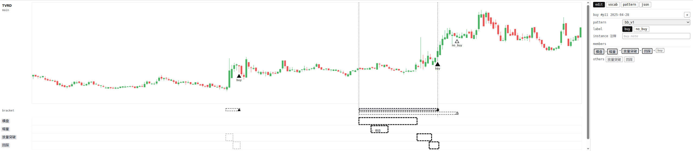
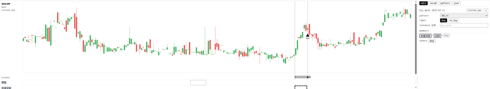
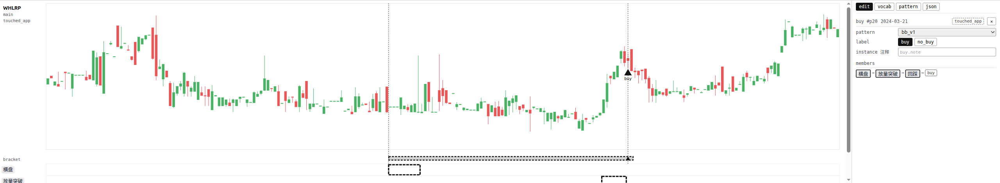
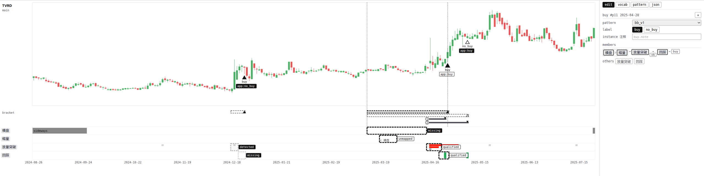
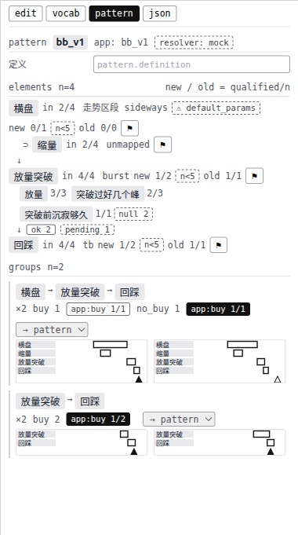
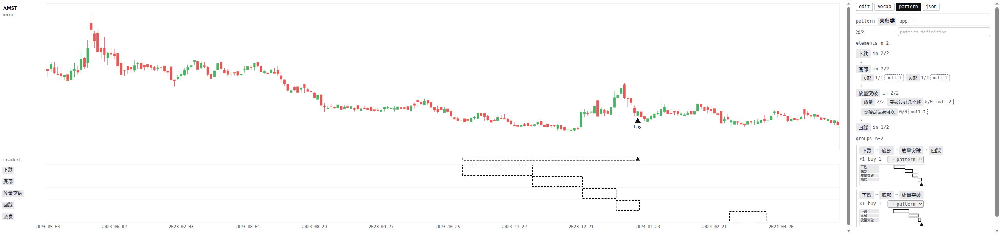

# 标注时怎么表达「哪些框是一组」和「框之间的关系」（白话版）

> 来源：同目录 `final_report.md`（2026-10-26，agent team：ux / topo / flow / critic）。截图来自 `repro/mock.html`，数据最晚到 2025-07-23。

## 一句话

**每个买点自己记住「这次是因为哪几个框才买」；图上那条虚线横条就是这一组的边界；关系不用另外画；跨图的整理全放在一个 `pattern` 页里。** 现有的拓扑图在标注时不出现。

## 用到的词

| 词 | 意思 | 出处 |
|---|---|---|
| bracket | 图上一条横线，标出一次命中从哪到哪 | `path2_web/GLOSSARY.md:45` |
| 拓扑面板 | 看图模式里那张 app 结构图 | `path2_web/GLOSSARY.md:50` |
| node | app 里的一个位置 | `path2/GLOSSARY.md:76` |
| where | 判一个事件够不够格的条件 | `path2/GLOSSARY.md:79` |
| 边 | app 里两个 node 之间的关系 | `path2/GLOSSARY.md:86` |
| 成员 | 本方案新词：这个框是「这次买入的理由之一」 | 本报告 |

---

## 1. 主图：一个买点 = 一条虚线

- 放下买点，bracket 轨上马上出现一条**虚线**，从最早的成员画到买点。这就是你要的「pattern 边界」。
- 点虚线或买点：成员**加粗**，其他框**变淡**。
- 不在任何虚线下的框，就是只标了事件，不属于哪个 pattern。你截图里左边那个孤立的框会自然落在外面。
- 名称轨按「通常谁先谁后」从上往下排，一组读起来是一道**台阶**，先后不用另外标。
- 虚线不能拖。

## 2. 成员怎么来、怎么改

默认由界面推断：从买点往前，把挨得近的一串框收进来，再带上套在它们里面的小框。

| 默认没收进远处的横盘 | 点一下名称块，收进来，虚线跟着变长 |
|---|---|
|  |  |

- 右栏 `members` 是成员，`others` 是没收进来的框。**点一块 = 收进或移出**，鼠标停上去，图上会描出是哪个框。
- 默认规则只在你放这个买点的那次起作用：这期间新画或拉长的框贴上来就自动收进，只收不踢；离开这张图就定死。以后改规则，也不会动你已经定下的买点。
- 「挨得近」暂定为两段之间相隔 20 根 K 线以内，这个数待验证。

## 3. 关系：不用另外画

- **先后**：看框的位置。
- **属于**：看框套框。
- **「回踩不破突破价」这种不靠位置的关系**：写成回踩框上的一条属性。

最后一条有个硬事实：app 里的边只能比较「谁在前、谁包住谁」，比不了价格。所以这种关系在 app 里本来就落在后一个 node 的 where 上，写在后一个框上，正好对得上。我上一轮说「翻成边」，这里更正。

## 4. 对照：用户虚线、app 实线，同一条轨

- 你的虚线和 app 的实线（带圈号）上下挨着画。
- 框的状态只在图上显示，不在侧栏重复。
- 侧栏只多一样图上画不出的：成员块之间的箭头上标 `ok` / `broken` / `pending`，也就是前后连没连上。

## 5. `pattern` 页：原来的 summary 改成它

| 有 app 时 | 还没归类时 |
|---|---|
|  |  |

- **定义**：你写一句话，说这个 pattern 想抓什么。
- **elements**：一列竖排的名称块，就是骨架。每个名字后面：
  - `in 2/4`：4 个买点里有 2 个用到了它；
  - 有 app 时再加上由谁来认、`new` / `old` 认出几个，以及 ⚑。⚑ 用来说「这个词翻译错了」。
- **groups**：前后顺序完全相同的买点归成一组，每组一个 `→ pattern` 下拉。归组、合并、把归错的拆出去，都用这一个下拉。这就是「你决定哪些算一个 pattern」的全部操作。
- 每组展开后，每个买点是一张**小缩略图**，不是一行字。少收了成员的买点，缩略图上成员左边会紧挨着一个淡框，一眼就看得出（右上截图里就是这种小图）。

## 6. 现有拓扑图能不能复用？不能，只借画法

- 它只画 app 的结构。还没有 app 时它是空的；有 app 时，上面全是 node 名和门槛数，正是标注时要挡住的东西。
- 你的骨架和 app 的结构不是一回事。比如「可有可无」「取其一」，在 app 的结构图里根本画不出来。
- 只借它的布局也不行：实测三个词就宽 404 像素，侧栏只有约 360 像素，而且不能折行。
- 借用的只是画法：先后顺着读，包含挂在下面，虚线表示你的、实线表示 app 的。看图模式里它照旧。

---

## 7. 需要你批准的改动

| 现在 | 改成 |
|---|---|
| 买点只记日期、label、pattern | **加一份成员清单**（唯一新增的用户数据） |
| pattern 只是顶栏里的一个 app 编号 | pattern 用**你起的名字**，加一句定义；app 编号作灰字旁注 |
| summary 页、vocab 页里的属性计数 | 合成 **`pattern` 页**；认出几个，只数这个 pattern 买点里的成员框 |
| 对照时按「买点前 40 根」猜哪些框算一组 | 只看成员 |
| 我上一轮的候选：存范围、拖左端、翻成边、新开 tab | 存成员、虚线不可拖、翻成 where、不新开 tab |
| 拓扑面板 | 标注模式下隐藏，看图模式不变 |

另外几条交给后续的票：
- **盲看时露结构**：用你的词当轨名；「要求没有的东西」画成斜线空心区域。
- **循环技能**：会话把某个名字当成「可有可无」之前，必须先问你一次「是没画，还是真没有」。

## 8. 局限：第一批真实标注后必须先查的

- **20 根这个默认值是借来的数。** 要回到 upc 上，用截到 2025 年底的数据量一下「突破后隔几天才回踩」（这台 pc 按数据墙不能量）。
- **你多半会直接接受默认成员。** 所以第一批标注后要分开报三个数：多收了几个、少收了几个、收短了但你没改的几个。第三种会在第一次归组时，一次性列给你确认。
- **`pattern` 页一点就开**，看多了，你对形态的印象可能会往 app 的样子靠。这个风险只能接受。
- **按顺序完全相同来分组，可能分得太碎。** 碎了由会话在对话里建议合并。
