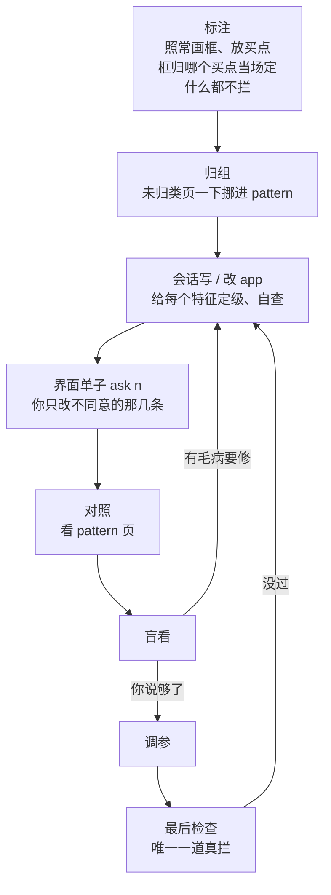
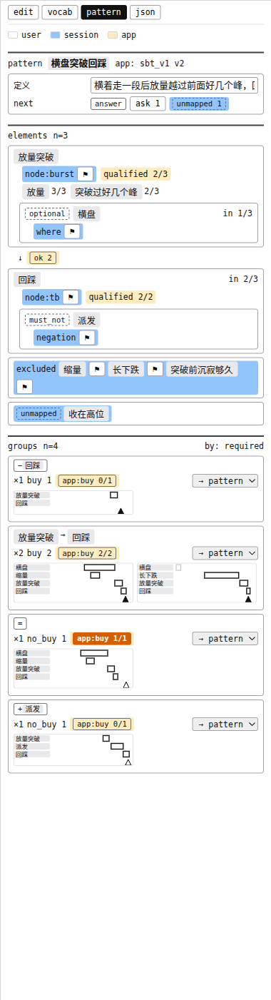
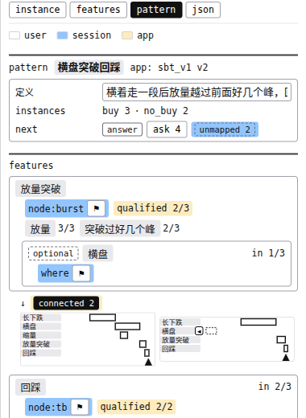
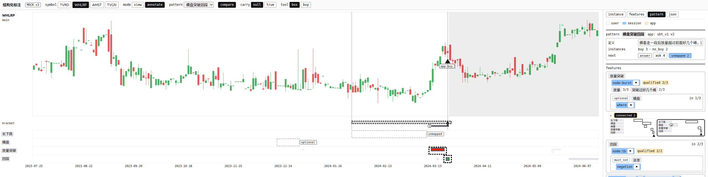
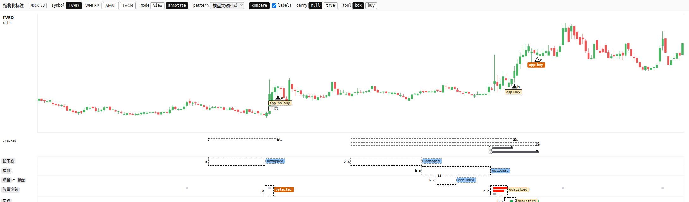
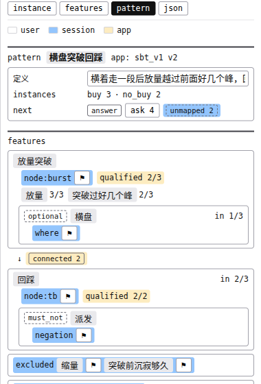
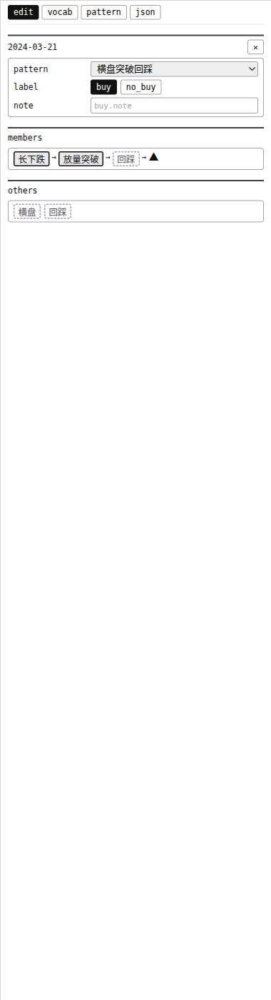
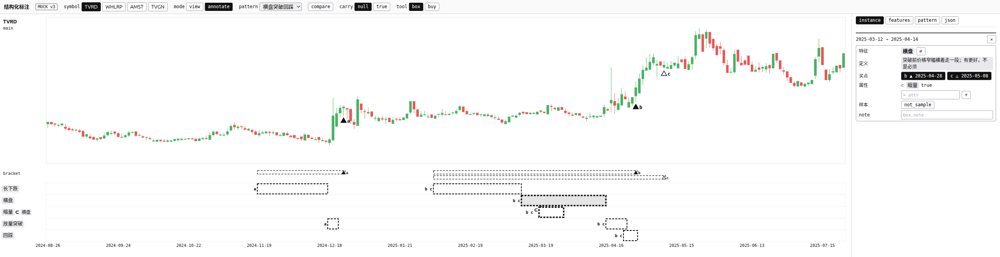
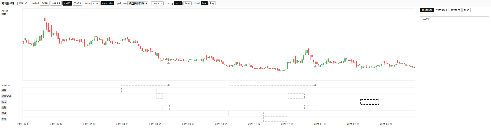
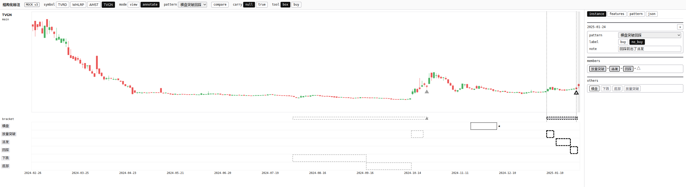

# 标注流程与界面打磨（白话版）

> 来源：同目录 `final_report.md`（2026-10-28 版），汇总了 flow / sim / ux / critic 四份产出。界面样子见 `repro/mock_v3.html`。以下全是**待你批准**的设计，票 01、地图、词表都还没动。

**一句话**：你照常画，「这个是不是必须的」改由会话在写 app 时问你一次；你自己要记住的规矩只剩两条；每轮要你回答的事集中在界面的一张单子上；框归哪个买点在标注时就由你在界面上定，会话不猜。

---

## 词表

| 词 | 意思 | 出处 |
|---|---|---|
| pattern | 一种要找的走势 | [path2/GLOSSARY.md:73](../../../path2/GLOSSARY.md) |
| app | 把一个 pattern 写成代码的那份声明 | [path2/GLOSSARY.md:36](../../../path2/GLOSSARY.md) |
| node / where | app 里的一段 / 挂在一段上的条件 | [path2/GLOSSARY.md:76](../../../path2/GLOSSARY.md)、`:79` |
| match | app 认出一次：每个 node 都得找到对应的一段 | [path2/GLOSSARY.md:95](../../../path2/GLOSSARY.md) |
| 买点 | 你点的那根 K 线，`buy` = 正例、`no_buy` = 像但不买 | [path2/GLOSSARY.md:118](../../../path2/GLOSSARY.md) |
| bracket | 买点下方那条虚线，标出它收了哪些框 | [path2_web/GLOSSARY.md:45](../../../path2_web/GLOSSARY.md) |
| 特征 | 图上被标出的那样东西，框标的、属性标的都算（如横盘、缩量） | [path2/GLOSSARY.md:160](../../../path2/GLOSSARY.md) |
| 特征名 | 特征的叫法，如「横盘」；随便改 | [path2/GLOSSARY.md:164](../../../path2/GLOSSARY.md) |
| 定义 | 一句话说清什么算、什么不算；意思定下就不能改 | [path2/GLOSSARY.md:168](../../../path2/GLOSSARY.md) |

---

## 1. 你原来的问题，答案是什么

| 你问的 | 答 |
|---|---|
| 同一个 pattern 要不要规定同一种拓扑？ | app 那边必然只有一种（一次 match 每个 node 都得有）。**你这边不规定**，照常画；差别由会话写 app 时定级吸收。 |
| app 建好了顶层还要「可选」吗？ | 不要。写完 app 后 pattern 页**顶层只剩必须有**，每个正例都有；有更好的挂在它依附的那段下面。 |
| 可选只该出现在次级？ | 对。落成 where 的「或」、可空的子事件。写法有个坑（读一个不存在的子事件会让整只股票扫描中断），已转给票 06。 |
| app 建好了为啥还有 unmapped？ | 旧 mock 的演示数据拿标注之前写的 bb_v1 硬配，是假象。定稿后 `unmapped` 只会是上一轮之后新起的特征；会话决定不放的另叫 `excluded`、写原因。 |

为什么不采用「规定同一拓扑、让你回头改图」：sim 实测，横盘有时在突破前、有时没有，你自然把它画成单独一段；按那条规定就得逐张改框，套在横盘里的缩量还会掉出去。等于要你画的时候就分清 node 和 where——票 01 已定不让你做这件事。

---

## 2. 整个流程



四个级，每个特征只问你一次：

```
必须有      每个正例都得有，是买的理由        → pattern 页顶层
可有可无    有更好，或几种有一种就行          → 挂在它依附的那段下面
必须没有    有它就不买                        → 挂在相关那段下面
不放        只是背景 / 出现太少               → 底部 excluded 区，写原因
```

会话会预填猜测，你只改不同意的。**唯一不预填的**：每张图都有、又没写定义的特征——这多半是你顺手框的背景，预填成「必须有」你又没看的话，app 会悄悄变严，而且没有任何地方会暴露。

写完 app 后的 pattern 页长这样（横盘挂在放量突破下，派发挂在回踩下，底部两区）：



---

## 3. 灵活和规范的分界（回答你的两次追加）

判断标准不是「你想不想」，而是**由着你，麻烦会不会随图越标越多、会不会变成看不出来的错**：

| 待遇 | 什么情况 | 例子 |
|---|---|---|
| **随你** | 当场看得见、改一处就好；或者麻烦只随特征个数涨，会话一次清掉 | 框边画个大概；先放买点后画框；背景框画不画都行；有更好的照常画；中途改主意；对着 app 结果改框 |
| **在那一刻引导** | 麻烦随图数涨、要逐张清 | 起特征名时相近的已有特征排到最前；同一特征起了两个特征名能一下合并（能拆回）；带上的属性先算「没看过」 |
| **规定你别做** | 会变成看不出来的错证据，或撤不回 | 见下 |

规定的四条里，两条由机器拦（看 2026 年数据有数据墙；送最后检查有会话的清单），**你自己要记的只有两条**：

1. **一个特征不装两种意思（特征名随便改，定义的意思不能改，要改就另起一个特征）**。提醒时刻：点下特征名时定义直接显示一行。
2. **label、像但不买的理由、属性有没有，只按买点那天及以前看得到的判。** 提醒时刻：选中买点时，这天之后的 K 线暗一档。

第 2 条是最大的残余风险：第一次定 label 时看了后面的走势，谁也查不出来，要到最后检查才露馅，而最后检查撤不回。会话能查的只有「翻过的 label」和「盲看揭开前后判断相反的」。

---

## 4. 界面上最有感的几处变化

| 变化 | 以前 | 现在 |
|---|---|---|
| 画框 / 选中 | 两个互斥的工具，点一下会造出一天的框 | 拖 = 画，点 = 选，拖框边 = 改起止 |
| 当前买点 | 画完框侧栏跳走，要回去点三角 | 最后放下或选中的那个买点一直是当前的，新画的框自动收进它 |
| 缺了必须有 | 自己去找 | 成员链上画个空槽；图上其实画过只是没收的，空槽就是按钮，点一下收进 |
| 「属于」 | 曾想留几天容差 | 必须整个落在大框里；画歪了在子框的 `instance` 页点一下 `⊂` 挂上 |
| 几周后回来 | 要回忆进度 | 页头 `next` 一格说现在等谁 |
| 会话的问题 | 在终端里读、去浏览器找图 | `ask n` 点开就是单子，带缩略图和选项 |
| 偏离 | 标红 | 不标红，排最前；红只留给「app 和你对不上」 |
| 框归哪个买点 | 只能先选买点、再在它的成员链里点 | 框的 `instance` 页多一行 `买点`，直接点选属于哪几个；两边改的是同一份 |
| 一张图几个买点 | 只看 bracket 分不清：落在跨度里的框看着都像成员 | 两个及以上买点时买点标 `a` / `b` / `c`，框外左侧写它属于谁（如 `b c`）；一个买点时不标 |
| 画了没收 | 会话每轮查一遍、写进单子 | 选中买点时界面直接标出：近处没收的框不变淡、右边挂 `◂`，侧栏 `others` 里排最前；不进单子 |
| 同一个买点里两段同名 | 会话提交后才问「哪段是哪段」 | 收进第二段时成员链上当场标 `dup`：你看成两种东西就换一个特征名；哪段对应 app 的哪段仍由会话定 |
| 侧栏标签页 | `edit` `vocab` `pattern` `json` | `instance`（选中的那一个框或买点）`features`（全部特征）`pattern` `json`：前两个是「实例」和「概念」之分；界面上残留的「名字 / 词 / 措辞」都改成「特征 / 特征名」 |
| pattern 页 | 特征区叫 `elements`，后面跟 `n=3`，像是「由 3 个特征组成」 | 特征区改叫 `features`；页头单独一行 `instances  buy 3 · no_buy 2`，说的是这个 pattern 一共有几次买点 |
| 两段之间的签 | `ok` / `broken` / `pending`，看的是「在不在同一次 match 里」，悬停「上下两样连成同一次命中」看不懂 | `connected` / `disconnected` / `not_qualified`，只看这两段之间那条边的条件（先后、隔几根）成不成立；悬停直接写特征名。整次凑没凑成看买点上的 `app:buy` |
| 想看签说的是哪几个 | 没办法 | 点签，在下面展开那几个买点的小图；点小图跳到那张图，两个框和 app 认出的两个事件一起描出来、图上其余的框和事件都变淡，对照自动打开；悬停写出隔了几根、边要求几根 |
| 对照时的框 | 框旁挂 `qualified` / `detected` 字；band 叠多了被压扁 | band 颜色和看图模式同一套（进了 match 是本色、够格深灰、不够格浅灰）；`qualified` / `detected` / `missing` 字签由 `compare` 旁的复选框 `labels` 开关，`qualified` 琥珀底、另两个朱红底；`optional` 这类会话定的签改成会话的浅蓝底。band 一样粗，叠多了这条轨加高 |
| 子框的 `⊂` | 挂在框左上角外侧，和归属字母挤在一起 | 放到框的上边沿、转 90 度开口朝上，朝着上一条轨里的父框 |
| 切到别的 pattern 时的框 | 只有三角和 bracket 变淡，框照常黑 | 只被别的 pattern 的买点收的框跟着一起淡；没被任何买点收的框（只标事件、刚画的）照常显示 |

点 `connected 2` 展开的两张小图，和点第二张跳过去的样子（WHLRP：放量突破、回踩两个框粗虚线，app 认出的两个事件黑框）：





对照开着、`labels` 勾上时（TVRD）：



pattern 页的页头：`instances` 一行写这个 pattern 一共几次买点，下面 `features` 是它由哪些特征组成：



空槽的样子（回踩是虚线空槽）：



### 框归哪个买点（2026-10-28 你追加的）

原则：归属是你的事，在标注时定；界面先给默认（放下买点时往左收连着的那串、当前买点自动收新画的框），你看着不对就改，然后才交给会话。会话只读存下的那份清单，不再猜、也不再问归属，只问「哪段对应 app 的哪段」这种翻译问题。

三个买点、框外左侧写归属、`instance` 页点选属于谁（选中的是横盘，它属于 b、c）：



顶栏切到「横盘突破回踩」时，AMST 上两次未归类的买入连同它们的框一起淡下去，只标了事件的派发照常显示：



选中一个买点时，左边隔了 21 根没被默认收进的横盘不变淡、右边挂 `◂`，侧栏 `others` 里它排最前：



「属于」为什么不留容差：sim 实测，随手画的回踩和 3 根长的放量突破首尾交叠 2 根，按容差放量突破被判成回踩的子框，结果**所有图**的轨标题都变成「放量突破 ⊂ 回踩」、上下顺序倒过来，pattern 页还看不出来。不留容差的代价只是那一个框读成「先后」，框上边沿没出 `⊂` 当场看得见。

---

## 5. 需要你定的

**方向题 D1：可有可无的东西在哪里表达？**——**已定（2026-10-27）：照常画，写 app 时会话问。**
- **照常画，写 app 时会话问一次（推荐）**：画的时候不用想必不必须；代价是 pattern 页的层级和图上框的套法可以不一样，靠两种记号分开。
- 画的时候就表达：页和图一模一样；代价是画框时就得定，定错要逐张改图，也违背票 01「标注时不分 node / where」。

**方向题 D2：选特征名时带上的属性，默认算「有」还是「没看过」？**——**已定（2026-10-28）：默认没看过，点一下才算有。**
- **默认没看过，点一下才算有（推荐）**：代价是每个新框多点几下。
- 维持默认有（票 01 现行）：最快；代价是没勾掉的「有」和你确认过的「有」存成一样，会话会照着写条件，事后分不出。

**词表题**：特征 / 特征名 / 定义已进词表，旧词「要素」标成了别用。另外「骨架、主组、偏离组、必须有 / 可有可无 / 必须没有 / 不放、当前买点、画了没收、对应表」在讨论里反复出现，两份词表都没有。要不要收？

**请过目（推出来的改动，不单独问）**：对照开关换图不再自动关；自动收进跟着当前买点走；会话每轮列出无结构原因翻过的 label 问「那天看得见吗」；`features` 页加「合并」（先预览、能拆回）。

---

## 6. 局限与下一步

- mock 最后一版（不留容差、单子能答、合并预览）**没让 sim 再实操一遍**，只经 ux 自测和 critic 对文核对。你追加的框归属四处只在 mock 上自测过。
- 归属字母在一张图四个以上买点时挤不挤、「紧挨 bracket 左边 40 根」这个窗口宽不宽，都标「待验证」，第一批真实标注时看。
- 颜色（之后暗一档 vs 非成员框变淡、浅琥珀 vs 浅灰）要你亲眼看。
- 一半门槛、拖动 4px、框边 5px 这类数都是默认值，标「待验证」，第一批真实标注时看。
- 单子要存成文件随 app 走，归票 09；票 09 没做之前只能在对话里列。
- 你批准后要做：并进票 01 草稿（属性默认从「有」改成「没看过」）、更新原型 v2、同步上一轮白话版、写词表、更新地图。

---

## 附表：团队审查数字

| 项 | 数 |
|---|---|
| sim 实操 | 三轮；第一轮从零标 4 只股票 7 个买点 |
| 界面改动 | 26 项（ux U1～U26）+ 你追加的 12 项（U27～U38） |
| critic 质疑 | 46 条：解决 39、交你定 4（并成 D1、D2）、不接受 1、critic 自己撤回 2 |
| 高频操作点击数 | 画已有特征的框 3→1；改起止 不能→1；补收没收的框 2～3→1；归组 2→1；几周后回来 要回忆→0 |
