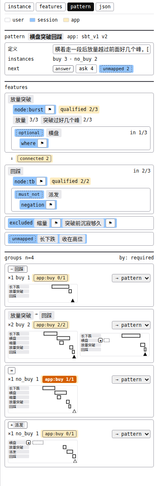
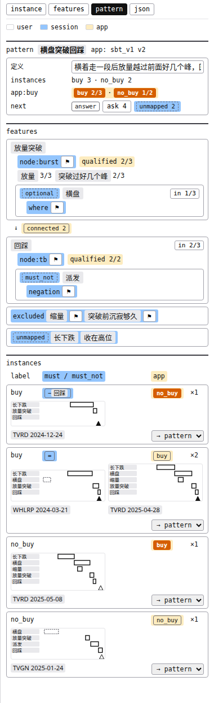
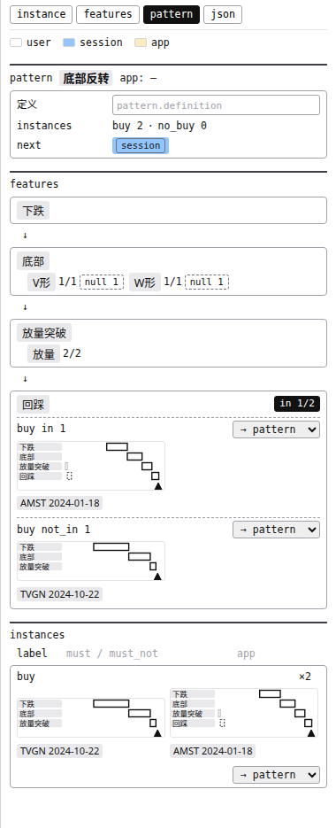
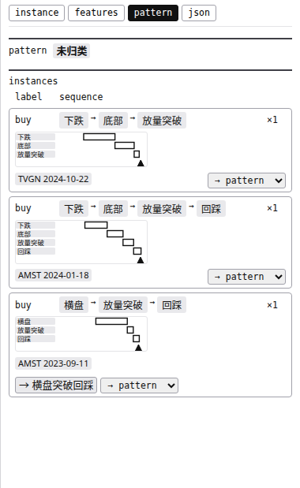

# pattern 页买点列表（groups）重想：白话版

> 来源：同目录 `final_report.md`（2026-10-28），agent team 五人（flow / model / sim / ui / critic）的结论。图都是同目录截图，演示数据只有 5～8 个买点。**还没动 mock_v3 和旧报告，等你批。**

**一句话**：列表要留，「组」这个说法不要了。列表改名 `instances`，用三列分别写清「你标的」「你的框和会话那张表比出来的」「app 判的」，三列都一样的并成一行；查「有没有混进别的」改成在 features 区点一个特征的计数。

## 词表

| 词 | 意思 | 出处 |
|---|---|---|
| pattern | 一个形态的声明（标注里：一个名字加归在它下面的一批买点） | `path2/GLOSSARY.md:73` |
| 特征 | 你框出来、起了名的一段（放量突破、回踩……） | `path2/GLOSSARY.md:160` |
| 正例 / 像但不买 | 你标 `buy` / `no_buy` 的买点 | 上一轮报告的用法，词表还没有 |
| 对应表 | 会话写 app 时定下的每个特征算哪一级（必须有 / 可有可无 / 必须没有 / 不放） | 同上 |
| 差 | 一个正例收的框和对应表比出来的：`=` 对得上，`−回踩` 缺了必须有，`+派发` 有了必须没有 | 同上 |

## 现版 vs 新版（有 app 时）

| 现版 `groups` | 新版 `instances`（推荐的变体 A） |
|---|---|
|  |  |

看图对照：
- 现版每组的组头有时是特征串、有时是 `=`、有时是 `−回踩`，意思还随正例 / 像但不买变；新版表头直接写着每列是谁给的：`label` 你的、`must / must_not`（浅蓝）会话那张表的、`app`（琥珀）app 的。
- 现版要自己把各组的 `app:buy 0/1`、`2/2` 加起来，还看不出漏的是哪张；新版页头一行 `app:buy buy 2/3 · no_buy 1/2` 给总数，漏买的那张自成第一行、朱红。
- 现版第一组 `app:buy 0/1` 不红（旧规矩），sim 第一眼读成「没问题」；新版只要 app 和你标的不一样就朱红。

## 你会在什么时候看这份列表

| 时刻 | 你想知道 | 新版里看哪 |
|---|---|---|
| 未归类攒了一批 | 哪些是一回事，归进哪个 pattern | 未归类页，按特征串排，整行挪 |
| 写 app 之前 | 这个 pattern 里有没有混进别的 | features 区点那个特征的计数 |
| 每轮 app 之后 | app 对得怎样、漏买误买的是哪几张 | 页头总数 + 朱红的那几行 |
| 有 app 后 | 某个正例为什么和要求对不上 | `must / must_not` 那一格 |
| 任何时候 | 挨个翻一遍 | 每张缩略图下写着股票和日期 |

只有第一件是对「一整批」做决定；已命名 pattern 页上的决定要么一张一张做，要么针对一个特征做——没有一件是按「整条特征串」做的，所以已命名页不需要「组」。

## 新版另外两种页面

| 没写 app、点开「回踩 in 1/2」 | 未归类 |
|---|---|
|  |  |

- **没写 app**：列不变，后两列表头灰字、空着，只按 buy / no_buy 并两行；写完 app 只是有了值，分法不换。点 features 区某个特征的 `in k/N`，就在那一块里列出有它、没它两排（像但不买也列进去，写成 `buy in 2 · no_buy 2`），每排一个 `→ pattern` 整排挪走。
- **为什么混进来的要在写第一个 app 之前挪**：会话定级时，顶层特征出现在不到一半正例里的默认「不放」、不问你。混进来的买点会把真特征（比如横盘）压到一半以下，它被悄悄定成不放，之后再挪走它也不会自己回来。
- **未归类**：列是 `label` / `sequence`（特征串），对得上已有 pattern 的行多一个 `→ 横盘突破回踩` 一键挪。

## 心智负担

| | 现版 | 新版 |
|---|---|---|
| 要知道的概念 | 11 | 8 |
| 要记的规则 | 8 | 1 |
| 屏上固定词 | 17 | 18 |
| 找出 app 漏的那张 | 点 4 下，还要记看过哪几张 | 0 下 |
| 查有没有混进别的（8 个买点） | 8 个分成 7 组，自己在脑子里归类 | 点 1 下 |

省下的是概念和规则；固定词没少，因为三个列名顶替了 `groups`、`by:`、`n=`。

## 推翻的两处旧规矩（批的时候一起改旧报告）

1. **朱红一刀切**：app 判断和你标的 buy / no_buy 不一样就朱红。旧规矩是「正例缺了必须有、app 没买，不标红」。去掉它，你的动作不变（都不用补画，会话下一轮会在单子里问），却少记一条规则；保留它时页头整块红、行里一红一琥珀，sim 会去找第二张红的。判据事先定好：sim 若把那一格读成「得让会话放宽 app」就恢复旧规矩——实测读成「app 没买，因为我的框缺回踩」，所以维持。
2. **已命名页不再按特征串分组**：实测 8 个买点分 7 组，看不出混没混；改由 features 区点计数。

## 要你定的三件

1. **每轮改完，app 判断翻了哪几张，放哪？** 现在定的是只写在会话的交付说明里——那里没有缩略图、点不过去，每轮要自己按股票和日期找图。另一条路是在列表上给每张标「这轮翻了」，代价是要存下每一版 app 对每一张的判断。
2. **像但不买要不要恢复差签？** 现在不显示，因为同一个 `=` 在像但不买上意思相反，sim 第一轮就读反了。代价：列表上看不出你「不买的理由」画了没有（缩略图里能看到画没画那个框）。
3. **列表里补收「画了没收」的框，从 1 下变 3 下，要不要补回入口？** 列表缩略图上的一键收进 `◂` 去掉了（会不看图就收进）。补收现在要：点缩略图跳过去 → 切 instance 页 → 点空槽。若你常遇到这种情况，可以加一个「点了先跳到图上、在图上确认再收」的入口。

## 局限

- sim 扮演用户只有第一轮是新鲜的；后两轮它已经知道大部分签的意思，新版「读错少」的数偏低。朱红那一格能读对，靠的是同一行里的 `−回踩`，以后排版若把两格拆开，可能又被读成「app 错了」。
- 演示数据只有几个买点。几十上百个时，「全都对上」那一行会很长，未归类页可能一张一行——只能推，等真实标注再看。
- 步数、规则数是照代码和截图数的，不是计时。

## 附：文件

| 文件 | 内容 |
|---|---|
| `final_report.md` | 完整结论与出处（给下一轮 AI） |
| `repro/variant_a_columns.html` | 推荐的变体 A，可直接打开点 |
| `repro/variant_b_flat.html`、`variant_c_doors.html` | 不采用的两个，只留作记录 |
| `flow.md` / `model.md` / `sim.md` / `ui.md` / `critic.md` | 五人各自的记录 |
