# 标注原型自动打磨三轮：结果与待你拍板的方向题（白话版）

> 来源：同目录 `final_report.md`（2026-10-28）。改动的文件是 `repro/mock_v4.html`。

## ⚠ 2026-10-30 补充：这份文档里哪些还算数

做这三轮的自动打磨工具，后来查出有好几处毛病：
- 每轮截图宽度不一样；
- 同一个问题被几个评审重复记；
- 「子项都达标」的检查几乎没起作用；
- 「卡住了」的判断会误报。

所以这份文档按「谁下的判断」来定算不算数：

- **还算数**：你拍板的决定，即「已定」那一节的 D1～D5，以及配色规范。
- **不算数**：下面这些都是那个有毛病的工具自己判断的：
  - 「三轮全部通过、必须改的清零」；
  - 问题条数；
  - 「还没改完的」清单；
  - 心智负担计数的终态值。
- **页面本身**：不信也不扔，下一次用修好的新工具从头评一遍，不参考这里的问题清单。
- **第二次打磨**：10-29 还跑过一次，这份文档没写。它的判断同样不算数，它改出来的页面已经提交，作为下一次的起点。

## 一句话

自动打磨跑了 3 轮，6 个评审角度在最后一轮全部通过，「必须改」的问题清零；要认的屏上固定词从 135 个降到 129 个，要记的规则从 43 条降到 42 条。剩下 15 道题会动到你以前定的规矩，程序按约定没碰，等你拍板。其中 4.1 已经被你 10-29 的决定取代（见「已定」）。4.3 你定了不改，其余的你定了全部按推荐。15 道已经全部定完。

## 先认几个词

| 词 | 意思 | 出处 |
|---|---|---|
| 买点 | 你在图上放的那个三角，标 `buy` 或 `no_buy`（这个标记叫 label） | [path2/GLOSSARY.md:118](../../../path2/GLOSSARY.md) |
| 特征 | 你在图上认出并框下来的一样东西，如横盘、缩量、放量突破 | [path2/GLOSSARY.md:160](../../../path2/GLOSSARY.md) |
| pattern | 一个形态的声明；标注页里一个 pattern 收一批买点 | [path2/GLOSSARY.md:73](../../../path2/GLOSSARY.md) |
| app | 照 pattern 写出来、能自己跑的程序；它跑出的判断在界面上一律带 `app:` 前缀 | [path2/GLOSSARY.md:36](../../../path2/GLOSSARY.md) |
| detected、qualified、matched | app 认出的事件的三档，范围依次收窄：认出了、够格了、进了一次完整命中 | [path2_web/GLOSSARY.md:28](../../../path2_web/GLOSSARY.md) |
| 朱红 | 界面上唯一的「该去改」信号：app 的判断和你的标注对不上 | 配色约定（groups 报告第 4 节） |
| 会话、单子 | 会话 = 和你对话、替你整理标注的 AI，它写的东西用浅蓝底；单子 = pattern 页上会话问你的那几道题（`ask 4`） | 界面词，词表未收 |

## 这次是怎么跑的

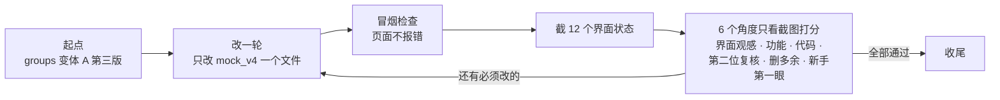

- 每个角度都对着同一张验收表判「过 / 不过」，不是想到更好的做法就判不过。
- 凡是会推翻你以前定的规矩、或者两条路都说得通的，只能记成「方向题」，程序不动手。

## 三轮改了什么（看图）

### 主图：朱红只剩一个意思，差签统一成会话浅蓝

| 起点 | 第 3 轮后 |
|---|---|
| 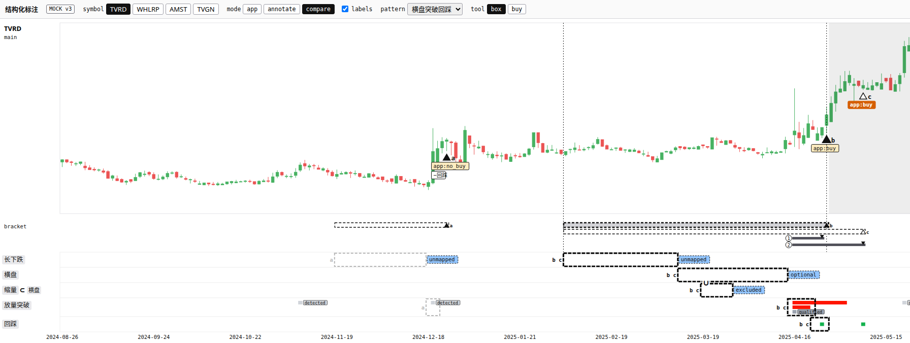 | 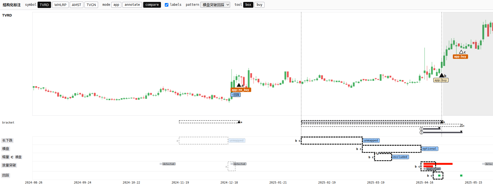 |

- 买点 a 下的 `app:no_buy`：起点是浅黄底（app 来源色），现在是朱红。规则改成只要 app 的判断和你的 label 不一样，就一律朱红，原来那个例外删了。
- 买点 a 下的 `−回踩`（这张少了回踩）：起点是白底，现在是会话浅蓝。主图、列表、单子三处统一成同一种样子。
- 顶栏的 `MOCK v3`、主图左上的 `main` 都删了，它们对应不上你要做的任何事。

### 侧栏买点页：删除按钮写明是删除

| 起点 | 第 3 轮后 |
|---|---|
| 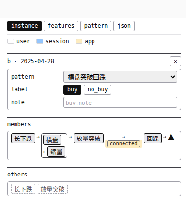 | 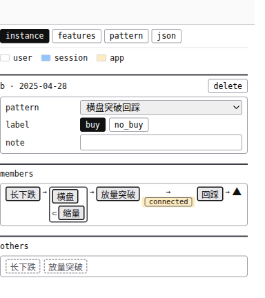 |

- 右上角的 `✕` 新手会读成「关掉面板」，点下去却是删除买点。现在写成 `delete`。
- note 框里的占位字 `buy.note` 删了，左边已经写着 `note`。

### app 档：app 认出的突破改画菱形

| 起点 | 第 3 轮后 |
|---|---|
| 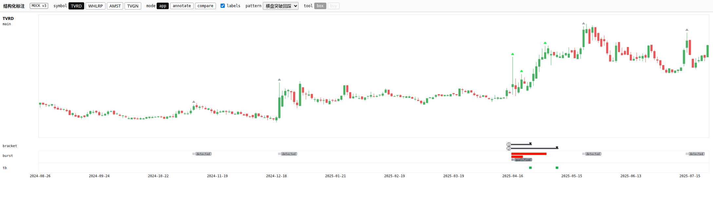 | 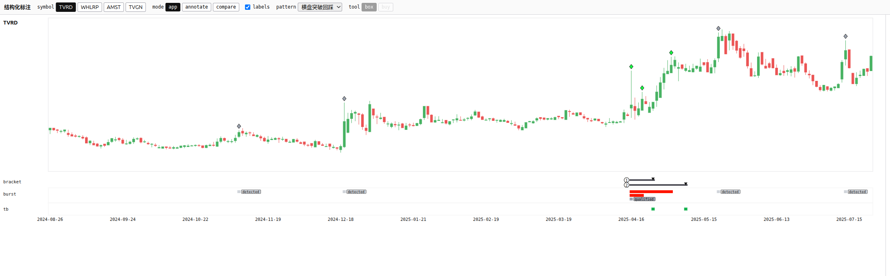 |

- 起点时 K 线上方的灰三角和你的买点三角长得一样，新手会读成「app 在这里买」。现在改成带黑边的小菱形，三角只留给你放的买点。

### 单子：计数说清「没判断」，看得见题写明是 label

| 起点 | 第 3 轮后 |
|---|---|
| 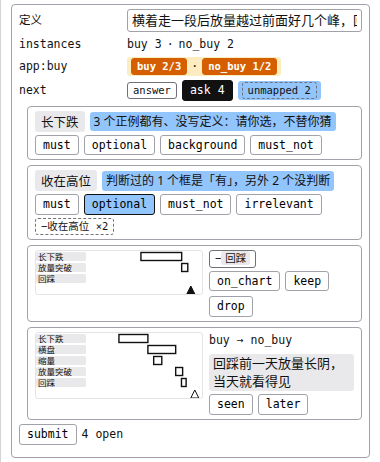 | 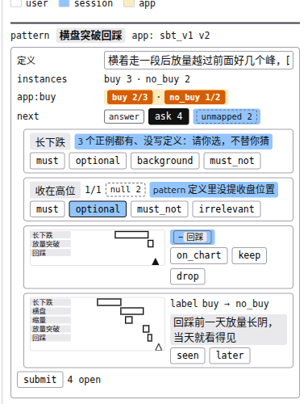 |

- 第 2 题（收在高位）：起点是一句话加 `−收在高位 ×2`，会把「没判断」算成「没有」。现在写成 `1/1 null 2`，意思是判断过的 1 个框里 1 个有，另有 2 个没判断。这和 features 区同一种写法，悬停也一字不差。
- 第 4 题：`buy → no_buy` 会被读成「app 判 buy、你标 no_buy」。现在写成 `label buy → no_buy`。
- 第 3 题的 `−回踩` 也改成了会话浅蓝。

### 其他看不太出来的改动

- 框页的 `样本 not_sample` 改成复选框：勾上就是这个框不当样本。原来会被读成「这个框现在是 not_sample」。
- features 页头那行 `features n=14` 删了。
- 成员链里能一下收进的空槽，改成深色虚线。原来要悬停才知道哪个能点。
- checks 表里，你没判断的那一条，app 没过只写普通的 `fail`，不再标朱红。
- 主图在窄屏下不再被截掉一半，选中的买点会自动滚进看得见的地方。

## 还没改完的（不影响这轮通过）

**能直接修的 5 条**，下一轮顺手做：

1. **（优先）TVGN 这只票右边缘有两个 `detected` 签叠成「d|detected」。** 第 3 轮加了一段避让，但没起作用，而且它在图中间也会把签推离自己那根条。12 张截图都是 TVRD，所以截图里看不到。
2. compare 档里，买点下面的签压在 K 线上。
3. next 一行里的 `answer` 和能点的 `ask 4` 长得一样，新手会先去点 answer。
4. 单子第 3、4 题的缩略图下面没写「股票 日期」，同页其他缩略图都写了。
5. 同一个差签，侧栏和主图画法不一样：侧栏里特征名多一层灰底。

**判不了的 9 条**：这次的 12 个截图状态里没出现这些情形（比如选中一个框时的对照一节、关掉档位签以后的样子）。下次跑之前要先把这些状态加进截图清单。

## 15 道方向题

每道都写了：在决定什么、有哪几条路、各自的代价、我推荐哪条。推荐的依据是你定的两条原则：①标注又快又准；②要记的少。读错以后会写进错数据的，排在最前面。

### 已定（2026-10-29）

**单子的问题和选项改由会话来问，标注工具只放每道题要看的图。**

- **会话**：每轮开头在对话里出题。题干写全，选项用中文写清选了会怎样，推荐项放第一。每道题带一个链接，点开就到工具里这道题的图。你在对话里答，会话自己记下回答，不改你的标注。
- **标注工具**：按题号显示每道题的图，比如缺回踩的那个买点直接选中、标出缺了什么。补画、收进照旧在工具里做。
- **工具里删掉**：`ask`、单子上的选项按钮、`submit`、`4 open`、next 里的 `answer`。
- **代价**：答题要开两个窗口；只能在会话开着时答；原来「不改就算同意、一键提交」改成「推荐项放第一，可以说『按推荐』」。
- **连带**：4.1 作废。下面「还没改完的」第 3、4 条随单子一起删掉。

**4.3 不改。** K 线图上的朱红只有一种：compare 档里买点下方的 `app:buy` / `app:no_buy` 签，在 app 判断和你的 label 不一样时出现。它是一枚带白字的小签；burst 是一根没有字的条，靠形状就能分开。

**app 的判断改叫 `match` / `no_match`。** 原来写的 `app:buy` / `app:no_buy` 其实是在说「这一天对不对得上 app 的一次命中」，现在直接用词表里的 match（[path2/GLOSSARY.md:95](../../../path2/GLOSSARY.md)）。`buy` / `no_buy` 只剩你的 label 一个意思，`app:` 前缀也去掉了（4.11 跟着改）。

**no_buy 也挂差签（4.14 改了）。** 差签是拿对应表比出来的客观结果，会话蓝不表示好坏，所以 buy 和 no_buy 一样显示、一样算。

**其余全部按推荐（4.2、4.4～4.15）。** 要改的几个词我先取了默认值，改完列给你看：顶栏 `labels` → `tiers`，next 里的 `session` → `run_session`，标签页 `instance` → `selection`，tool 里的 `buy` → `point`。

### 先定这三道（4.1 作废、4.3 不改、4.2 按推荐）

**4.1 单子里的选项词会被读反，「不放」有三个名字**（已作废：单子挪到会话里，选项变成中文句子）

- **在决定**：单子里几个按钮叫什么。它们是你以前定的词（U17）。
- **现在的问题**：
  - `later` 会读成「稍后再答」，其实是「后来才看出来」。
  - `keep` / `drop` 挨着 `−回踩`，会读成「保留 / 去掉回踩这条要求」，其实是「这张还算不算这个 pattern」。drop 读错以后的效果，正好是 keep 的真实意思。
  - `on_chart` 会读成「跳到图上看」，其实是回答「图上其实有」。
  - 「不放进 app」这一级有 `background`、`irrelevant`、`excluded` 三个名字。
- **路**：
  - A. 词不动，靠悬停。代价：点错的回答会进记录，会话下一轮会照着它去改。
  - B. 换成直接说出「选了会怎样」的词，并把三个「不放」合成一个。代价：要重新认 3～4 个词，总词数不增加，概念少一个。
- **推荐 B**。单子是你答题的唯一入口，读反就是错数据，悬停兜不住。具体用词我拟一版给你看。

**4.2 顶栏按钮「按下」的意思不统一**

- **在决定**：当前 pattern 没 app、compare 用不了的时候，顶栏怎么显示。
- **现在的问题**：
  - 第 1 轮把 mode 一组改成了「按下 = 图正按什么显示」。所以没 app 时显示 annotate 按下，可程序记的还是 compare，切回有 app 的 pattern 会自动回到 compare（这是你定的 U39）。
  - 你如果点一下看上去已经按着的 annotate，「自动回 compare」就被悄悄取消了，事先看不出来。
  - 同一条顶栏上，tool 和 `labels` 还是「按着又变灰」的旧画法。
- **路**：
  - 甲. 维持现状。代价：有一个看不见的状态，一条顶栏两套规则。
  - 乙. 三组统一成「按下 = 你选的，变灰 = 这一档现在用不了，能用时自动恢复」。代价：变灰的 compare 仍显示按下，新手可能以为对照开着；但图上马上能看出没有对照内容。
  - 丙. 没 app 时真的切到 annotate，不再自动恢复。代价：推翻 U39，回到有 app 的 pattern 要多点 1 下。
- **推荐乙**。没有看不见的状态，三组同一条规则；灰色本来就只表示「用不了」。这需要撤回第 1 轮的那处改动。

**4.3 进了命中的 burst 的红色和朱红，色弱分不开**（已定：不改）

- **在决定**：标注工具里，进了命中的 burst 那根条用什么颜色。
- **现在的问题**：它用的是 burst 本色红（#FF1500），和朱红（#D55E00）都是暖色、明暗几乎一样。每张对照图上都有这么一块红，朱红「该去改」的意思被冲淡了。
- **路**：
  - A. 不动。代价：你只能靠「这是条还是签」来区分。
  - B. 只在标注工具里，把它换成冷色。代价：同一个 burst 在标注工具和主视图里颜色不一样。
  - C. 连主视图一起改。代价：动主视图配色，你说过主视图配色不动。
- **推荐 B**。主视图里没有「朱红 = 对不上」的用法，换色只影响标注工具。颜色从你确认过的安全色板里挑。

### 一词两义，改名就能消掉的

**4.4 顶栏 `labels` 和买点的 `label` 同根，意思无关**

- `labels` 只管图上 app 的档位签显示不显示，新手会读成「显示我标的 buy / no_buy」。
- **推荐**：给顶栏这个开关换个名。它只出现在一处；改买点的 label 要动整个界面。代价：推翻你定的这个名字（U38），要重新认一个词，词数不变。

**4.5 `session` 一词两义**

- 图例里的 `session` = 会话写的；next 一格里的 `session` = 等会话处理，而且还用了浅蓝底，看着像「会话写的」。
- **推荐**：给 next 里这个值换名，去掉浅蓝底。它只出现在一处。代价：推翻 U17 的这个值名。

**4.6 `instance` 页和 `instances` 表范围不同**

- 选中一个框时标签页叫 `instance`，可 pattern 页的 `instances` 表只数买点，这个框在那里数不到。
- **推荐**：给标签页换名，因为它显示的其实是「当前选中的东西」。`instances` 表是 groups 刚定的，不动。代价：推翻你定的标签页名（U31）。

**4.7 tool 里的 `buy` 和 label 的 `buy` 不同义**

- tool `buy` 是「放一个买点」，放下以后可以标成 no_buy。全界面「不带前缀的 buy 就是 label」，只有它例外。
- **推荐**：换名，但不急。你放买点时知道自己在做什么，实际读错的可能小。

**4.8 `→` 一个记号有好几种意思**

- 它在不同地方分别是「先后」「挪到」「并进」「改成」，同一行里能同时出现两种。
- **推荐**：动作按钮去掉箭头，改成 `move`、`merge` 这样的词，和这次把 `✕` 改成 `delete` 一个做法；`→` 只留给「先后」和「改成」。

### 推荐保持现状的

**4.9 `qualified` 在图上和计数里范围不同**

- 图上的 `qualified` 签只挂在「够格但没进命中」的条上，进了命中的写 `matched`。pattern 页的 `qualified 2/3` 却把进了命中的也数进去了。
- 评审建议统一成一个范围，**我不同意，推荐保持**：
  - 按词表，三档是依次收窄的，进了命中本来就够格。图上的签写的是「最高到了哪一档」，计数数的是「到没到这一档」，两边都对。
  - 读错的后果只是诊断时数字对不上眼，不会写进错数据。
  - 如果你觉得这条规则确实难记，最省的改法是给计数换个名。

**4.10 「能一下收进的同名框」有宽、窄两种算法**

- 成员链的空槽按宽的算（买点前任何一个没收进的同名框都算），others 列表和主图 ◂ 按窄的算（得在附近，而且没被同一 pattern 的别的买点收走）。两处画的却是同一种深色虚线。
- **推荐全部用窄的**。这样「深色虚线 = 画了没收」只剩一个意思，也和你定过的「画了没收」一致。代价：离得远的同名框，要去 others 里点。

**4.11 instances 表 app 列，格子里写 `app:buy`，列头又写 `app`**

- **推荐保持**。去掉前缀的话，格里的 `buy` 就和 label 列的 `buy` 长得一样了。多几个字只是啰嗦，不会读错。

**4.12 一天宽的灰条上挂的档位签，看着像框的状态签**

- 见 `final_shots/09-compare-labels.png`：放量突破框里那根一天宽的深灰条挂着 `qualified`，签比条宽得多，贴在框边上。
- **推荐保持**你定的「每根灰条都挂签」。同一个框里就有进了命中的红条，误读有限；另外两种做法都要改你的规矩，还多一条规则。

### groups 报告留下的三道（这次没添新证据）

**4.13 每轮改完 app，判断翻了哪几张放在哪**

- 现定：只写在会话的交付说明里。代价：没有缩略图，也点不过去。
- 另一条路：在列表每张上标「这轮翻了」。代价：要存每一版 app 对每一张的判断。
- **推荐**：维持现定。真调完第一轮参数，看每轮翻多少张，再决定。

**4.14 像但不买的差要不要重新显示**

- **推荐**：维持不显示。恢复的话，删掉的两条规则会带回来一部分。

**4.15 列表里补收「画了没收」的框，从 1 下变成 3 下**

- **推荐**：维持 3 下。真标注时发现这种情况常见，再在列表缩略图上加「先跳到图上、确认后收进」的入口。
- 如果 4.10 选了窄算法，这种情况会更常碰到，要多留意。

## 10-29 按你的决定改完了

四条决定都已经改进 mock_v4，自动检查通过，截图我看过。这一轮没有再跑多角度评审。

**单子挪走以后**：工具里只剩按题号打开的图。会话在对话里问，每道题后面附一个链接，点开就到工具里这一题的图。题目和选项怎么写，看本目录的 `session_questions_example.md`。

| 第 1 题的图（`#q=q1`） | 第 3 题（`#q=q3`）：图切到那个买点，侧栏显示缺的回踩 |
|---|---|
| 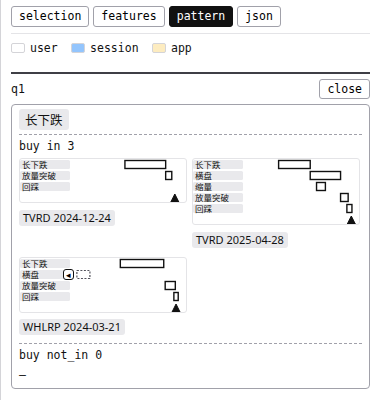 | 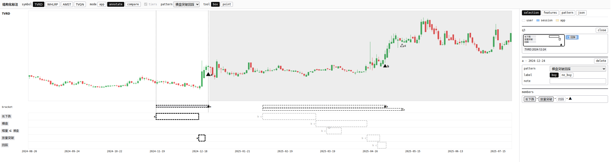 |

**match / no_match**：主图买点下面、pattern 页的 `match` 一行、instances 表的 app 列，都换成了新写法。buy 却 no_match、no_buy 却 match 的，照旧标朱红。

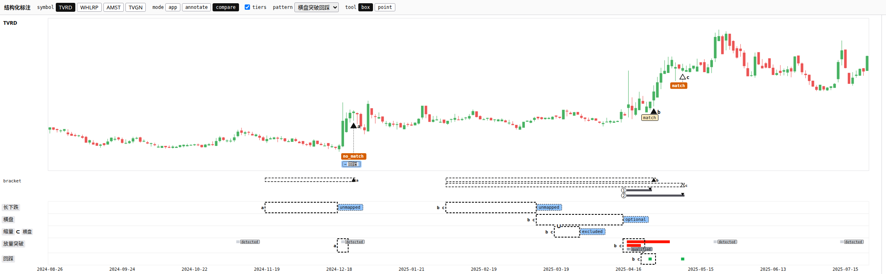

| pattern 页 |
|---|
| 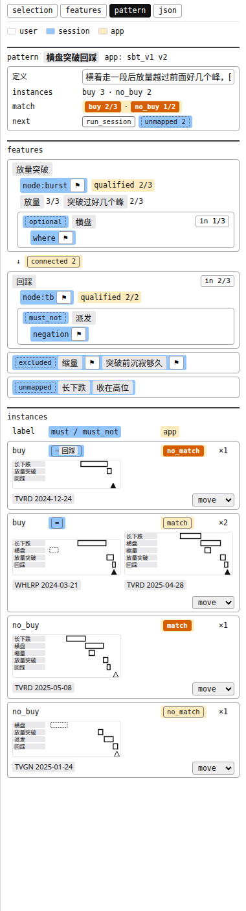 |

**还要你知道的**：
- 第 1 题故意没写推荐。这类名字每个正例里都框了，推荐哪一档你都容易顺手同意；如果推荐的是「买的理由」，app 会悄悄变严。
- 未归类那一行有两个 `move`：一个是「一下挪到某个 pattern」的按钮，一个是下拉菜单。
- TVGN 在窄屏下，最右边会少挂一枚档位签，换来的是不再叠字。

## 局限与下一步

- **截图只覆盖 12 个状态，而且都用 TVRD 这只票**。没截到的情形，评审只能读代码推断，TVGN 上的叠字就是这么发现的。
- **三轮的截图宽度不一样**，第 1 轮主图被截的问题，一部分来自截图太窄。
- **自动打磨工具自己有几处小毛病**：最后的总结里误写了「暂停」，有一轮的评审记录没存下来。这些不影响结论，`final_report.md` 第 5 节留给以后修工具用。
- **下一步**：方向题已经全部定完，也已经改进 mock_v4（见上一节）。你看过 mock_v4 和出题示范、整体批准后，我再把方案并回 mock_v3、polish 报告和 ticket 01。

## 附表

### 心智负担三项

按验收表的数法，逐项对照起点清单。

| | 要知道的概念 | 要记的规则 | 屏上固定词 |
|---|---|---|---|
| 起点 | 67 | 43 | 135 |
| 第 1 轮 | 67 | 42 | 132 |
| 第 2 轮 | 67 | 42 | 129 |
| 第 3 轮（终态） | 67 | 42 | 129 |

概念数没降，是因为能砍的概念都卡在方向题上。

### 每轮评审

| 轮 | 界面观感 | 功能 | 代码 | 第二位复核 | 删多余 | 新手第一眼 | 剩下必须改的 |
|---|---|---|---|---|---|---|---|
| 1 | 不过 | 过 | 过 | 不过 | 不过 | 不过 | 8 |
| 2 | 过 | 过 | 过 | 过 | 过 | 不过 | 1 |
| 3 | 过 | 过 | 过 | 过 | 过 | 过 | 0 |

### 开销

- 一共 42 个代理，全部跑完，没有出错。
- 用时约 1 小时 54 分。
- 每轮冒烟检查都通过（页面零报错）。

### 文件位置

- 终态截图：`final_shots/`（只留正文用到的 1 张）
- 起点截图：`baseline_shots/`（只留起点记录里引用的 8 张）
- 前后对照图：`shots/`
