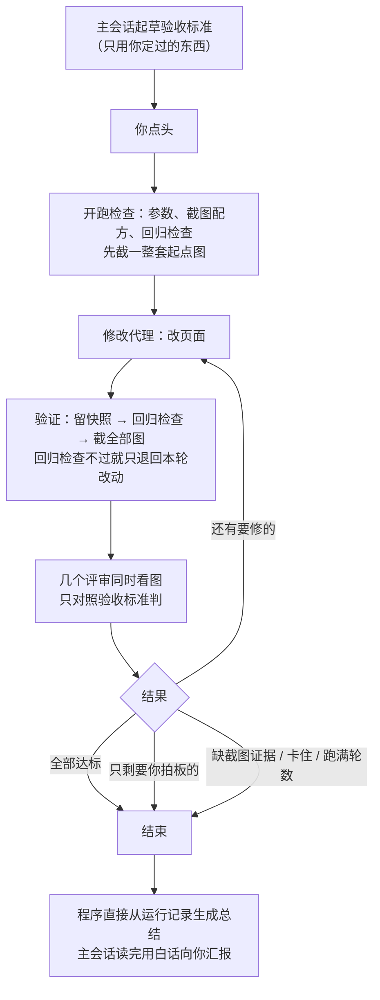
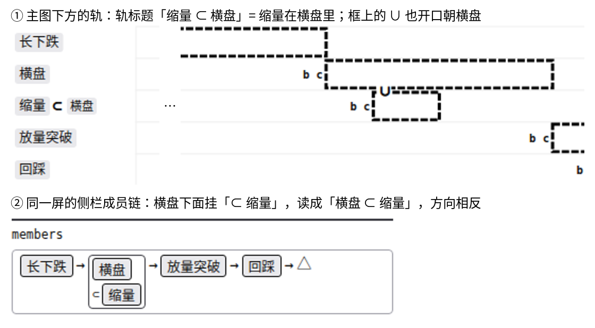

# web-loop 大改：做了什么、现在怎样（白话版）

> 来源有两处：
> - 同目录 `final_report.md`（2026-10-30 版，含真跑验收结果）；
> - 本次对话里你问过、我核对源码答过的几件事：它管哪几层、原型模式怎么处理方案问题、旧运行产物怎么办。

## 一句话

web-loop 已经重写完，在标注原型上真跑了一次，整条链路走通了：
- **修掉的旧毛病**：第 3 轮必然误停、出错时冲掉改动、记录要靠代理抄写。
- **真跑查出的新缺陷**：有 1 个会让第 1 轮白跑，已经修好。
- **token**：省了，主要省在每轮的代理数从 12～14 个降到 5 个；单个干活的代理并没有变便宜。
- **都还没提交**，等你一句话。

## 先认几个词

| 词 | 意思 | 出处 |
|---|---|---|
| 评审角度 | 一个评审代理负责的看法，比如「新手第一眼」「模拟用户走流程」「后端要求清单是否一致」，每个角度一个代理 | web-loop 说明文档 |
| 验收标准 | 开跑前写好的一份判断依据，评审只照它判对错。来源限定为你定过的决定、项目规范、词表，你点头后才开跑，跑的过程中不许改 | web-loop 说明文档 |
| 方向题 | 评审发现、但要你来选的取舍：写明在决定什么、几个选项、各自代价、推荐哪个。修改的代理不许自己动手做 | web-loop 说明文档 |
| 原型模式 | 专门给「界面先行、后端还没开发」的项目用的跑法：原型里的演示数据和模拟逻辑就是方案本身 | web-loop 说明文档 |
| 后端要求清单 | 原型模式下放在原型旁边的一份清单：原型里每一处模拟逻辑、每个演示数据字段，将来要后端提供什么 | web-loop 说明文档 |
| 买点 | 一次命中里真正用于计算收益的那根 K 线；在标注工具里由你放下并给出 buy / no_buy | [path2/GLOSSARY.md:118](../../../path2/GLOSSARY.md) |
| pattern | 一个形态的声明；在标注工具里是一批买点归属的那一组 | [path2/GLOSSARY.md:73](../../../path2/GLOSSARY.md) |

## 一、web-loop 现在管什么、不管什么

按你说的四层：

| 层 | web-loop 的态度 |
|---|---|
| 外观（皮囊） | 随便改 |
| 交互逻辑（肉体） | 随便改，只要结果在页面上看得见；有真后端时前后端代码都能改 |
| 流程（骨架） | 只把流程「做得符合验收标准」，不自己发明新流程；有专门的「模拟用户走流程」评审 |
| 业务目标（根基） | 不碰。它是输入，开跑时冻结在验收标准里 |

**原型模式下，问题出在方案上怎么办**（方案只有文字、没有代码）：
- 原型里体现方案的那部分（演示数据、模拟逻辑、术语的含义），修改的代理不许自己改。它只能把问题写成方向题，而且要负责那一角度的评审也同意「这确实要你拍板」，才算数。
- 纯文字的方案文档（研究报告、设计文档），web-loop 从来不改。总结里会列出「方案受影响的地方」，由主会话在你同意后去改。
- 节奏是：跑 2～3 轮 → 停下交方向题 → 你拍板 → 主会话把决定写进下一次的验收标准 → 再跑。

## 二、一次运行怎么走

每轮只有「1 个修改代理 + 1 个验证代理 + 每个评审角度 1 个代理」。截图、回归检查、记账、写总结这些杂活都交给不花 token 的固定程序。

## 三、修掉了旧版哪些毛病

1. **第 3 轮几乎必然误判「卡住了」而停下**：上一次运行第 3 轮修好了 14 条，仍被叫停。这条判断删了，改成一条简单规则：连续两轮既没修好问题、达标的子项也没变多，才算卡住。
2. **回归检查一红就把所有没提交的改动全部冲掉**，连开跑前就有的也算在内。现在只退回本轮的改动；退回后回归检查还是红，就判定环境坏了，把改动放回去并停下。
3. **记录要让代理来回抄**：抄错、抄漏，总结两次都没写出来。现在记录和总结都由程序直接从运行记录生成，全程不经任何代理抄写。
4. **截图每轮让代理现写脚本**：三轮视口宽度都不一样；配方选错对象也照样「截成功」。现在用自带的截图工具，配方里写明「截的应该是谁」，对不上就报失败。开跑前还要先截一整套起点图，配方有错当场就能发现。
5. **主会话一回复子代理，就会冒出一个副本**，两个进程同时改同一个文件。现在子代理不发消息，有事写进交回结果里；主会话也不许回复它们。
6. **「子项都达标」这道检查几乎不起作用**：以前看代码的评审凭改动记录，就能宣称「新手第一眼读对」已经达标。现在每个子项只认指定的评审角度来判，证据不够的不算达标。
7. **中途发现截图配方错了改不了**。现在配方每轮重新读，可以中途修；还能放一份纠错说明给修改的代理。

另外加了三样你同意过的新能力：验收标准开跑前起草、你点头后冻结；可以自定义评审角度；原型模式。

## 四、省没省 token

**省了，但省在哪里和设计时的预想不完全一样。**

- **省下来的是代理数量**：
  - 每轮代理数从 12～14 个降到 5 个（这次是 3 个评审角度）；
  - 开跑前的 4 个准备代理、收尾写总结的代理都没有了；
  - 截图、回归检查这些杂活加起来每轮不到 1 千 token。以前每样都要单独起一个代理，光启动就要读进约 5.5 万 token 的上下文。
- **单个干活的代理没有变便宜**：修改代理每次写 5.5～6.7 万，新手评审写 6 万，都和旧版同一量级。
- **现在最大的开销**：修改代理会把那个 166KB 的页面文件反复读几十遍，每次要重读的上下文合计 1200～1400 万 token。以后要再省，主要从这里下手，这次没动它。

具体数字见文末附表。

## 五、真跑验收：结果怎样

在标注原型上用原型模式跑了 2 轮，有 3 个评审角度：新手第一眼、模拟走流程、后端要求清单。

**走通了的**：
- 开跑检查一次通过，用时 25 秒；
- 每轮验证（回归检查加截 18 张图）约 30 秒，旧版这一步要 2～3 分钟；
- 总结由程序生成，内容齐全；
- 没有任何代理给别人发消息。

**查出并修好的缺陷**：
- **第 1 轮评审整轮没跑。** 验证代理交回结果时多包了一层，程序没认出来，就当它缺席。根子是给它的指示（「一字不改、原样交回」）和规定的交回格式互相矛盾。现在只留一种交回方式，程序自己解析；包了一层也认得。拿这次的运行记录重放，第 1 轮已经能正常进入评审。
- **验收标准的标题格式卡得太死**，带编号就不认。已放宽。
- 修好后补了回归测试，全部测试 92 个场景全过。

**页面改了 7 处小地方**，全是界面层，没碰演示数据：
- 定义输入框改成多行，整句都看得见；
- 选中买点时两条竖线不再从签的字中间穿过；
- 两段之间的箭头放大到看得清；
- 图上还没有买点时，轨名不再压到下一条轨上；
- 另外几处折行和宽度的小修。

**评审的眼力**：
- 新手评审看了 38 张图，没判出必须修的问题，提了一个有实质内容的方向题（下面第 1 道）。
- 后端清单评审抓到一处清单漏写，确实存在。
- 我事先留了 10 处代码里的可疑点当暗中答案，没告诉评审，结果只覆盖到 1 处。另外 9 处是代码内部的不一致，比如注释和代码对不上、同一件事两套算法。这次的三个角度只看截图，或只拿清单和代码比，本来就不查这一类。
- 评审换成了起步更轻的代理类型，没看到变浅的迹象，但只有一轮三个评审，证据很薄。

## 六、旧运行留下的东西怎么处理的

你不用逐条分辨，按「这东西是谁判断出来的」一刀切：

| 类别 | 怎么对待 |
|---|---|
| 你拍过板的（D1～D5、配色规范、悬停样板、界面文字规范） | 照用 |
| 主会话手写的（起点基线、任务清单、截图配方） | 照用，但没人复核过 |
| 旧 web-loop 自己的判断（「收敛了」、问题清单、条数、残留） | 全部作废，不再喂给任何后续工作 |
| 旧 web-loop 改的页面 | 先提交成检查点，再交给新版从头评一遍 |

两份旧报告的开头已经加上这张划分，以后其他会话读到时不会被带偏。检查点提交是 `e195d8b`，效力说明的提交是 `30a05f9`。

## 七、等你拍板的两道方向题（原型设计，不急）

1. **成员链里 ⊂ 的读向和轨标题相反。**
   - 同一屏里，轨标题写「缩量 ⊂ 横盘」，侧栏的成员链却读成「横盘 ⊂ 缩量」，新手会读反。
   - 评审推荐：统一成和轨标题同一个读向。
   - 代价：要推翻以前定的「成员链里的 ⊂ 不变」，属性栏那一处也要一起改；改完要补两张截图才能验证。

   

2. **会话出题的链接，将来靠什么找到题目里的那个买点。**（这一道没有截图：问题出在保存下来的标注文件里，页面上看不出来。）
   - A：用「股票 + 日期 + pattern」去找，标注文件不加东西。缺点是买点挪到别的 pattern 以后，旧链接就找不到了；不过题目一轮一换，影响小。
   - B：给每个买点存一个编号，链接稳定。缺点是标注文件多一个字段。
   - 评审推荐 A。

## 八、局限与下一步

- **都还没提交。** 包括 web-loop 的全部改动、这次真跑对原型的 7 处修改、新写的验收标准、截图配方和后端要求清单。你说一声我就提交。
- **方案文档的同步完全靠主会话手动做**，没有机制兜底，可能漏。
- **原型模式默认的评审角度不查代码内部是否一致。** 需要查时，加一个看代码的角度。
- **评审眼力的证据还很薄**：只有一轮三个评审。
- **修改代理反复重读大文件，是现在最大的开销**，这次没处理。
- **第 1 轮评审没跑那个缺陷的修复，是用重放验证的**，没有再真跑一次。下次真正使用时，留意第 1 轮有没有派出评审。
- 后端清单评审指出的那一处遗漏（清单没写标注文件里每只股票下面那几个键）还开着，一句话就能补上。

## 附表

### 真跑每个代理的用量

「写出」= 代理生成的内容；「重读」= 它每调一次工具都要把已有上下文再读一遍，累计起来的量。

| 代理 | 写出 | 重读 | 工具调用 | 上一次运行同类单次写出 |
|---|---|---|---|---|
| 修改代理 第 1 轮 | 5.5 万 | 1213 万 | 58 次 | 4.8 万～10.5 万 |
| 修改代理 第 2 轮 | 6.7 万 | 1365 万 | 70 次 | 同上 |
| 验证代理（每轮） | 约 0.09 万 | 5.6 万 | 1 次 | 上一次每轮杂活约 1 万，加上抄记录 2.5 万～7.3 万 |
| 新手第一眼评审 | 6.0 万 | 492 万 | 60 次 | 5.2 万～7.3 万；重读 420 万～990 万 |
| 模拟走流程评审 | 1.7 万 | 100 万 | 26 次 | 新角度，没有对照 |
| 后端清单评审 | 2.5 万 | 293 万 | 32 次 | 新角度，没有对照 |

### 真跑概况

| 项 | 数 |
|---|---|
| 轮数 | 2（第 1 轮因缺陷没有评审） |
| 代理数 | 7，0 个出错 |
| 总用时 | 36.7 分钟（修改代理每轮 11～13 分钟，验证约 30 秒，评审 3～11 分钟） |
| 结果 | 跑满轮数结束；3 个子项里「新手读对」「流程走得通」达标，「清单与原型一致」差 1 处 |

### 测试

| 项 | 数 |
|---|---|
| 测试场景 | 4 个文件、92 个场景，全部通过 |
| 截图偶发失败的修复 | 修之前单独跑 4 遍有 2 遍撞上；修之后合计跑了 20 遍，一次都没出现 |
