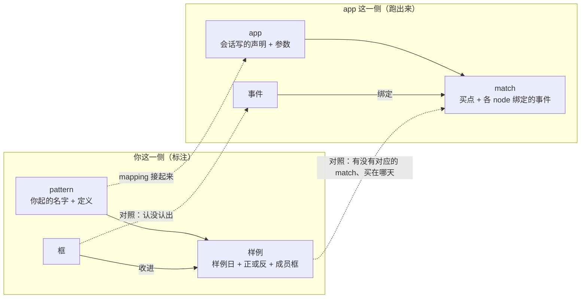

# 标注命名梳理：白话版

> 来源：同目录 `final_report.md`（2026-10-30，agent team 三人：现状盘点、建模、挑错，挑错方三轮后签字）。本文自包含，不用打开原报告也能做决定；原报告里的出处、逐条影响面和词条草案供下一轮 AI 用。
> 状态：**全是提案，什么都还没改。** 代码、词表、票、原型一律没动，等你定下文末四道方向题。

## 一句话

标注里的「买点」装了三件事，名不副实。提议把**你放三角并收进一组框这件事整体叫「样例」**，分成正例和像但不买，三角那一天叫「样例日」；「买点」只留给 app 一侧，指 app 真正买的那根 K 线。样例要挂在 pattern 下面，挂的是你起名的那个形态，不是哪一版 app。

## 先认几个词

| 词 | 意思 | 出处 |
|---|---|---|
| 样例 | 你在一张图上、相对某个 pattern 下的一次判断：一个样例日 + 正或反 + 作为依据的那组框 | 本报告提议（新） |
| 样例日 | 样例的那一天，图上就是你放的实心 ▲ 或空心 △ | 本报告提议（新） |
| 正例 / 像但不买 | 样例的两种：这个 pattern 的 app 该在这天买 / 像这个 pattern 但当天就看得出不该买 | 本报告提议；「像但不买」是 10-25 定的说法 |
| 成员框 | 样例收进的那些框，就是这次判断的依据 | 沿用现有说法 |
| match | app 在某只股票某段 K 线上认出这个形态的一次 | [path2/GLOSSARY.md](../../../path2/GLOSSARY.md) `:95` |
| 买点 | app 那次 match 里真正买的那根（或几根）K 线，评估就在这里算收益 | [path2/GLOSSARY.md](../../../path2/GLOSSARY.md) `:118` |
| pattern | 一种形态；app 用一组 node 加一组边来声明它 | [path2/GLOSSARY.md](../../../path2/GLOSSARY.md) `:73` |

## 一、你问的三个问题

### 「买点」包不包含 no_buy？

包含。原型里 buy 和 no_buy 是同一种东西，只差 label 那一项。别扭的根子在于，「买点」这个词现在同时装着三件事：

1. 你放的三角**连同它收进的那组框**——这里面有不买的，而且是一组框，不是一个点；
2. 三角**那一天**——对像但不买来说，那天并不是买；
3. app 一次 match 里**真正买的那根 K 线**——这个叫买点是准的，app 确实在那里买。

前两件是标注里的东西，拿「买点」叫都名不副实；第三件本来就是业务上的事。所以提议：标注这一侧整个不再用「买点」，app 那一侧留着（见方向题 Q1）。

### 你列的五样东西，该叫什么

五样其实是三个概念：你的一次判断、那一天、app 的一次命中。三角不是一个独立的东西，它是样例那一天加上正反判断在图上画出来的样子。

| 你说的 | 提议的叫法 | 界面上 | 数据里 |
|---|---|---|---|
| 标注的 buy 三角 | 正例的样例日 | 实心 ▲ | 样例的 `date`，`judgment: "pos"` |
| 标注的 no_buy 三角 | 像但不买的样例日 | 空心 △ | 样例的 `date`，`judgment: "neg"` |
| 正例（三角 + 一堆框） | 正例 | `pos` | `examples[]` 里的一项 |
| 反例（三角 + 一堆框） | 像但不买（别名反例，见 Q3） | `neg` | `examples[]` 里的一项 |
| app match 出来的那一次 | match | 图上的 bracket | path2 现有的 match |

正例和像但不买合称**样例**。顺带一点：「app match 出来的 pattern」应该说 match。pattern 是那种形态，match 是它在某处被 app 认出的一次。

几个改名点的理由：

- **「样例」而不是「实例 / instance」**：path2 里 instance 已经指单个事件的身份，比如你说「诊断 SYM 的 INSTANCE_ID」时就是它；前端还把 app 的买点叫过实例。
- **字段叫 `judgment` 而不是 `label`**：评估里 label 指的是「后来涨没涨」的结果，你口头说的「label 中位数」就是这个意思。同一个主视图里出现两个 label，一个是你当天的认定，一个是后来的走势，而整条标注工作流恰恰要把这两件事分开。
- **取值用 `pos` / `neg`，不用 `buy` / `no_buy`**：光写「买 / 不买」，会被读成你整体的买卖决定；而这个判断是相对某个 pattern 下的，同一天可以对 P1 是正例、对 P2 是像但不买。`pos` 读作「这个 pattern 的正例」，正好钉在 pattern 上。

### buy / no_buy 要不要挂到 pattern 下面？

要。决定性的理由是：正反判断本身就是「在这个 pattern 看来」的判断。正例的意思是这个 pattern 的 app 应该在这天 match；像但不买的意思是这天像这个 pattern，但 app 不该 match。离开 pattern，这个判断就没有对象。同一天对两个 pattern 判断相反，也不矛盾，那就是两个样例。

三点说明：

- **挂的是你心里的那个形态**（你起名、配一句定义），不是 app，也不是 app 的某一版。app 改版、换 app，样例的归属都不变。
- **不挂 pattern 的**是所有 pattern 共用的素材：特征、框、框上的属性。
- **「未归类」**是还没指定 pattern 的过渡状态，不是一个 pattern。正例可以先挂在这里，攒够了再归组；像但不买的「像」必须有对象，挂在这里只算没填完。

还考虑过要不要把三角和那组框拆成两样东西、把「正反判断」和「属于哪个 pattern」拆开，结论都是不拆。三角和那组框是同一个判断的两部分，一个是判断的那一天，一个是判断的依据，流程里没有哪一步需要单独拿出其中一个。判断离开 pattern 又没有对象，所以后两者也拆不开。

## 二、组织原则：两边成对，各用各的词

每一层两边都有一个对应物：pattern 对 app、框对事件、样例对 match、样例日对买点。两边各用各的词，互不借用。「买点」之所以别扭，根子就是标注这一侧借了 app 那一侧的词。

有两处不对称，名字要保住：

- **你的判断有正有反，app 只有正的。** app 只报它会买的地方，不存在「反 match」。像但不买在 app 那一侧对应的是「这里不该有 match」。
- **没标的日子是「不知道」，不是「反」。** 像但不买只是你专门挑出来的一小撮，就是像这个 pattern、最容易让 app 犯错的那几天。它们说明不了 app 在全部「不该买」的日子上错了多少。

## 三、四道方向题（推荐的放第一个）

### Q1　app 那一侧还叫不叫「买点」？

在决定：标注这一侧不用「买点」之后，app 一次 match 里真正买的那根 K 线叫什么。

- **留着，只给 app 那一侧用（推荐）。** 标注这一侧退出以后，它就只剩一个意思，而且这个意思是准的。你嫌它是业务词，说的是拿它去叫一个标注里的东西；app 真正买的那根 K 线本来就是业务上的事。这条路 app 那一侧一处不用改。
- 两侧都不用，app 那一侧另起一个名字：消除不了任何会读错的地方，只换来名字整齐，代价是要改大量调参、特征验证相关的 skill、path2 代码和词表，规模见附表。
- 两侧都留，靠前缀区分（「标注买点 / app 买点」）：标注那一侧名不副实的毛病还在。

### Q2　你的 pattern 和框架里的 pattern 是不是同一个词？

在决定：样例挂靠的那个 pattern（你起名、写定义、可能还没有 app），和词表里「一组 node 加一组边的声明」的 pattern，用不用同一个词。

实际上有三样东西：你心里的形态；某个 app 对它的声明（node 加边）；app 本身（声明加参数，有版本）。

- **pattern 就指形态本身，声明归实现它的 app（推荐）。** 形态和它的声明，是同一个东西的两个阶段，对照就是在比这两者。说话时靠动词就能分开：只有 app 能认出、能 match，只有你能定义、能收样例。代价：一个 pattern 可以先后由几个 app、几个版本来实现，「这个 pattern 有几个 node」要读成「它现在那个 app 的声明有几个 node」；「改 pattern」会有两个意思，说的时候要讲清改的是定义还是 app 的结构。这条路要改写词表里 pattern 那一条。
- 你这一侧另起一个词，比如「形态」：两个意思彻底分开。代价是同一个东西要记两个词，而你一直管它叫 pattern。

### Q3　判为 neg 的样例，正式叫「像但不买」还是「反例」？

在决定：讨论、文档、skill 里统一写哪个。界面和数据照你说的用 `pos` / `neg`，不受这道题影响；两个词都进词表，你怎么说都行，这道题只定 AI 写下来用哪个。

- **「像但不买」为主，「反例」作别名（推荐）。** 这个词自己带着两层限定：像这个 pattern，当天就判得出不买。以后写循环 skill、做评估、做盲看的会话，即使没读词表，也不会犯三种错：
  - 嫌反例太少，从没标的日子里抽一批补上（没标的是不知道，不是反）；
  - 把盲看里判「不是」的那些并进来（没说清是不像还是像但不买，抽样方式也不同）；
  - 把「这些日子里 app match 了几个」当成 app 的误报率（它们是专门挑出来的最难的几天）。

  代价是正和反两个词不对称。
- 「反例」为主，靠词表收窄意思：和正例对称，也是你提的说法。代价是限定全押在词表上，不读词表的后台会话会按通用意思读成「所有不是正例的日子」，上面三种错在通用意思下都顺理成章。

注意：这道题的推荐和你原话的提法不同，唯一的理由就是上面说的读错风险。

### Q4　对照时 app 的那枚签，叫什么、分几种？

在决定：对照时每个样例旁边那枚 app 的签。它现在实际查的是「样例日附近有没有 app 的买点」，名字却叫 match / no_match。

名不副实的后果是：你在突破那天放了正例，app 认出了这段走势，但它在几天后的回踩那天买，两者隔了 3 天以上。这时 match 的 bracket 明明盖住了你的三角，签上却写着 `no_match`。这一格里混着两种该分头修的情况：app 根本没认出，要改认法；认出了但买在别的天，要改买点的位置，或者其实是三角放在了突破日，而这个 pattern 本来就在回踩时买。

- **拆成两问、显示三种，正例和像但不买用同一套签（推荐）。** 先问 app 有没有一次 match 对应这个样例，再问那次 match 的买点在不在样例日附近：

  | 签 | 意思 | 正例上 | 像但不买上 |
  |---|---|---|---|
  | `match` | 认出了，买在这天附近 | 对得上 | 朱红：app 在你说不买的那天买了 |
  | `shifted` | 认出了，买在别的天 | 显示，用朱红以外的另一种标记（待验证） | 显示，默认不标朱红（待验证）：不买的理由常对整段走势都成立，app 隔几天照样买，多半是同一个错 |
  | `no_match` | 没认出 | 朱红：app 没认出 | 对得上 |

  好处：上面那个边角情况不再出现；「没认出」和「买的时机不同」在汇总、盲看、调参里都分得开。代价：多一条「哪次 match 对应这个样例」的判定规则（看 match 的跨度和样例的 bracket 交不交叠，交叠到什么程度算，待验证），界面上多一种状态。

  还有一个小变体：像但不买不拆，仍只按前后 1 天判。这样界面少一种情况，但像但不买上「认出了、隔两三天照样买」会被判成对得上，正好把 app 的错藏起来，所以不推荐。
- 只问一件事，按实际查的东西改名（这天附近 app 买不买）：名字准了，但「没认出」和「买点错开」仍混在一格里，汇总页上要一个个点开才知道该修哪一头。
- 保持 match / no_match 不变，只在词表里加一句「no_match 不等于没认出」：签和图上看到的互相矛盾，每次都要靠悬停来解释。

## 四、按推荐，名字总表

| 东西 | 讨论时说 | 界面上 | 数据里 |
|---|---|---|---|
| 你的一次判断连同依据 | 样例 | 表头 `examples`；页头 `examples  pos n · neg n` | `examples[]` |
| 正向的 / 反向的 | 正例 / 像但不买 | `pos` / `neg` | `judgment` |
| 那一天 | 样例日（别名三角） | 图上 ▲ / △ | `date` |
| 依据 | 成员框 | `members`（没收进的叫 `others`） | `members[]` |
| 一句话 | 注释 | `note` | `note` |
| 还没挂 pattern | 未归类 | `unsorted` | `pattern` 存空值 |
| app 的一次命中 | match | bracket | 不变 |
| app 真正买的那根 | 买点 | bracket 上的 ▼ | 不变 |
| 对照时 app 的签 | 对照结果 | `match` / `shifted` / `no_match` | 现算不存 |

「成员」单说时容易和 app 那一侧复合事件里的成员混（比如 burst 收进的那几个 bo），所以你这一侧一律说「成员框」。

改名的成本主要在原型、后端要求清单、web-loop 的验收标准和截图配方，以及几张票。仓库里还没有按新格式存下来的真实标注文件，改字段名不需要迁移旧数据。按 Q1 的推荐，path2 框架、各个 app、其他 skill 都不用动。

## 五、顺带发现的问题（不属于命名，待分派）

1. **成员框可以伸到样例日之后。** 原型只要求成员框的起点不晚于样例日，终点不限；标注时样例日之后的 K 线又看得见。这样，判断依据里就可能混进事后才看得到的东西。词表草案已经写成「只算样例日及以前那一段」，工具里要不要在样例日处截断，或者给个提示，还没定。
2. **像但不买的成员框，现在不参与「app 认没认出这个框」的计数。** 它们和正例的成员框一样，是真实画出来的特征，算进来能多一些检验样本；但也可能有理由不算，比如为了说明「不买」，框画得比较勉强。
3. **新放的样例默认挂在哪个 pattern，正式版没有定。** 一份设计报告写的是默认未归类，原型为了演示，默认挂在当前 pattern。
4. **盲看里判「是」的那天要不要变成正例。** 它和样例是同一类判断，但抽样方式不同，也没有成员框。归盲看那张票处理。
5. 两处文档前后矛盾或说法不准，以代码为准即可。一处是后端要求清单里「存不存编号」前后说法不一致；另一处是一份报告把 instance 说成 app 的一次 match。

## 六、局限

- 四道方向题都没定，第四节的总表是按推荐写的。Q3 如果选「反例」，全文「像但不买」和「反例」对调；Q4 如果选另外两条路，对照结果的名字跟着变。
- 下面这些都还待验证：对照的容差（正例前后 3 天或落在回踩事件里，像但不买前后 1 天）、「对应」要交叠到什么程度、`shifted` 用什么样式显示，以及 `judgment` 这个字段名、框的「我标宽了」开关的新名字。

## 附表

**A. 旧说法 → 新说法（读旧文档时对照）**

| 旧 | 新 |
|---|---|
| 买点（标注里，三角 + 框） | 样例 |
| 买点（标注里，那一天） | 样例日 |
| 正例买点 / 像但不买的买点 | 正例 / 像但不买 |
| `label` / `buy` / `no_buy`（你的判断） | `judgment` / `pos` / `neg` |
| `buy_points` / `bp_id` / 编号前缀 `p` | `examples` / `example_id` / `e` |
| pattern 页 `instances`、instance 注释、当前买点 | `examples`、注释（`note`）、当前样例 |
| 对照的签 `match` / `no_match` | 按 Q4 |
| 界面「未归类」 | `unsorted`（讨论里仍说未归类） |
| 买点（app 那一侧） | 不变（按 Q1 推荐） |

**B. 被替换的你定过的说法**（按你「从第一性原理分析」的要求，来历只列在这里，不作取舍理由）

- 10-25：存储项「买点」→ 样例，内容不变。「像但不买」作规范词 → 看 Q3。
- 10-26：「instance 注释」→ 注释。label 的 buy / no_buy 记在「你定的」名下，但当天的原话里没有这个说法，它是原型实现出来的写法 → `pos` / `neg`，这也是你这次自己提的。
- 10-28：pattern 页的 `instances`（意思出自你说的「pattern instance number」）→ `examples`。
- 10-29：app 的签写成 match / no_match → 看 Q4。当时这样改，是为了不和 label 的 buy 撞；label 改名以后，这个理由就不存在了。
- 10-30：样例存编号 → 保留，只是改了键名。

**C. 如果 Q1 选「两侧都不叫买点」，要改的量**

skill 约 649 处 / 66 个文件（调参相关的旧版 438、特征验证 129、新版调参 68）；path2 代码约 59 处；app 声明 5 处；path2_web 约 35 处；CLAUDE.md 1 处；词表 6 处；记忆 45 处；`docs/explain/` 5 个文件。其中新版调参 skill 是按行号引用词表里「买点」那一条的。
