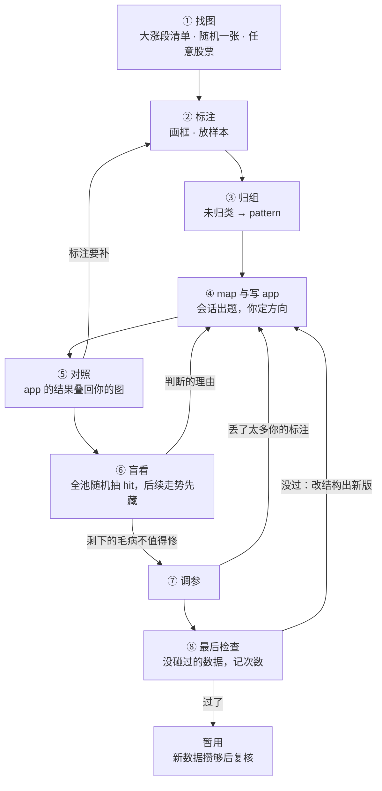

# 标注工具说明书：结论白话版

> 来源：同目录 `final_report.md`（2026-10-30 终稿，团队 auditor 主笔），说明书本体在 `.scratch/annotation-path2/manual.md`（writer 写，critic-2 两轮评审、reader 试读两轮后定稿，共 77 条承诺）。本文只讲结论和要你拍板的事，说明书本身请直接读，它已经是白话写的。

## 一句话

说明书写成了：把标注工具放进「从直觉到一个在没碰过的数据上胜过同日普通买入的 pattern」的八步流程里，每个功能都对到「找 pattern 时会犯的十四种错」中的某几条。拿它反过来对照原型：原型做好了标注、归组、对照这几块的大半；**要改或要加 14 项**，最大的缺口是**盲看界面整个没有**；**多余的 3 项**可以删；另有 **7 道方向题**要你定。

## 你已拍板（2026-10-31）

下文第四、五节的方向题和票 15 四问，你都已定；除下面两处，都选了推荐项：

- **检查次数只按单个 pattern 记**（推荐是另记一个「所有 pattern 一共」）。理由是各 pattern 是独立的判断，一个过不过不改变另一个的分量，「改到过为止」只发生在同一个 pattern 身上。边界：没过的 pattern 改个样子、换个名字替它上场，算它的新版本，次数记在旧的名下；标注时另外看出来的规律才单独起算。说明书已照此改。
- **`tiers` 开关保留**（推荐是删）。说明书已加回；仍要做的一处小改：框旁的 `missing` 不受开关管，关掉开关时「app 没认出你的框」不会跟着消失。

另外：删 `json` 页和两条竖虚线；盲看第三个按钮叫 `off_pattern`，「下一步」的新状态叫 `review`。决定已写进最终报告第 12 节、票 01、03、04、06、08 的 Comments 和地图；票 15 已写好答案，等你批准。

## 先认几个词

| 词 | 意思 | 出处 |
|---|---|---|
| sample / 样本 | 你在一张图上、相对某个 pattern 下的一次判断连同依据；正样本「这天会买」，负样本「像这个 pattern，但当天就看得出不该买」 | `path2/GLOSSARY.md:180`、`:185`、`:190` |
| member box / 成员框 | 样本收进的框，即判断依据；必须在样本日当天或之前结束 | `path2/GLOSSARY.md:199` |
| hit | app 求解出的一次完整命中（path2 里旧称 match，改名还没实施） | `GLOSSARY-MAP.md:27` |
| match | 拿 hit 和样本比：app 的买点落在样本日附近就是 `matched` | `path2/GLOSSARY.md:180` |
| mapping | 会话把你的每个特征对到 app 的哪一部分、定哪一级，写下的那张表 | `path2/GLOSSARY.md:172` |
| 盲看 | 从全池随机抽 app 的 hit，后续走势先藏着，你判断「这是不是我的 pattern」 | 说明书新词 |
| 最后检查 | 拿 2026 年起的数据跑一次冻结的 app，判输赢，每次记次数 | 说明书新词 |

## 一、说明书给出的宏观视角

### 流程

④⑤⑥ 是主循环，转几圈都行；①②③ 随时可以插进来。**只有 ⑧ 判输赢**，前面每一步只决定「值不值得送检」。

### 每个功能为什么存在：十四种错，分五组

说明书的骨架是一张「找 pattern 会在哪里出错」的清单。每个功能都要说得出它防的是哪一条，说不出的就是多余。

- **后见之明**：判断用了当天看不到的东西，比如看到后来跌了才去找不买的理由。工具的对策是成员框必须在样本日之前结束、盲看先藏走势。
- **翻译走样**：话说得清意思、说不清位置；一个词两个意思；改动没有对应的图；定级和调参悄悄改了意思。对策是用框代替描述，app 的结果用同一套画法叠回你的图上，调参后报告丢了哪几张。
- **挑图偏差**：只看涨了的；盯着几张没认出的图一张张放宽；少见的样子只有一两张图撑着。对策是随机找图入口、盲看全池随机抽、对照只给状态不给数字、按分支拆开报。
- **自我欺骗**：看着结果判断「是不是」；把「app 忠实于我的图」当成「app 能赚钱」；在训练段成绩上挑结构。对策是盲看，以及训练段成绩平时不报。
- **检查不诚实**：2026 年的数据被看到；反复检查挑运气；把大盘的功劳算给 pattern。对策是数据墙、记检查次数、只和同日普通买入比。

### 三类数，用途不能混

| 类 | 每轮都看吗 | 能说明什么 |
|---|---|---|
| 忠实度计数：几个正样本对上、几个框被认出、盲看里几张「不是我的样子」 | 每轮都看 | app 有没有把你的意思翻走样，**不说明它赚钱** |
| 训练段成绩 | 只在你问、准备调参、送检前给 | 参考；训练段你看过改过，分不清多少是凑出来的 |
| 最后检查成绩 | 送检时 | **判输赢** |

### 分工

方向归你，翻译归会话。「这天我会不会买」「这两组算不算一个 pattern」「这个毛病值不值得修」由你定；「翻成 node 还是 where」「门槛放多少」由会话定。工具负责画图、存标注、算对照、出盲看清单、守数据墙、记检查次数。

### 说明书说得很老实的一处

最后检查只有九个多月的数据，尺子很粗：一个毫无优势的 pattern 也有大约一半机会「过」。所以「过了」只算暂用，等新数据攒够再复核一次；「没过」只说明还没证明有用。writer 自己也承认这会削弱「工具强大」的印象，但团队一致认为不能说过头。

## 二、原型要改或要加的 14 项

按对找 pattern 的影响排序。工作量：小 = 几十行，中 = 一两百行，大 = 新页面或新后端模块。

| # | 是什么 | 为什么要 | 工作量 |
|---|---|---|---|
| **M1** | **盲看界面**：新标签页列出随机抽来的 hit；作答前只画到买点那天、不画 app 的分段；三个按钮「是 / 像但不该买 / 不是我的样子」；答完才露出后续走势，露出后不能改答案 | 对照只能检查你挑过的图。盲看是唯一检查 app 在它真会遇到的图上忠不忠实、并补上「长得像却没涨」那一半的地方 | 大，依赖票 08 |
| **M2** | 两段之间没连上时，悬停里去掉「实测间隔 25 根，要求 1～20」这类数字，只说差在哪一类 | 看到数字，你的下一步就是让会话放宽到 25，正是一张张拟合。这是原型里唯一给出门槛的地方 | 极小 |
| **M3** | 每次 app 改版或调参后，结论变了的样本挂一个「上一版是什么」的标记、排在最前；从这里打开图时，后续走势先藏 | 「这一版改坏了哪几张、调参丢了哪几张」是判断改动好坏的唯一依据。藏起走势，防的是你因为「这张后来跌了」就接受调参丢掉它 | 中，取决于方向题 Q1 |
| **M12** | 拖长一个框时，不让它越过收了它的样本的样本日；删框前列出会波及哪些样本 | **已实测的漏洞**：把一个已冻结样本的框拉长到样本日之后，它会悄悄退出成员，界面没有任何提示。冻结本来就是防这种事的 | 小到中 |
| M4 | 「量特征」的结论（看得出更好 / 更差 / 没多大用 / 看不出）挂在 features 区那个特征上，可点开看因它多出或去掉的买点 | 几周后回来，最容易忘的就是「这条为什么留在 app 里」 | 中 |
| M5 | 找图入口：代码输入、大涨段清单、随机一张 | 原型只有 4 只写死的股票。随机入口是负样本最自然的来源，没有它负样本偏向「后来还是涨了」的那类 | 中 |
| M6 | 「取其一」的特征（W 形或 V 形）按分支拆开计数 | 少见的分支只有一两张图时，合计数看不出那一支没把握 | 中，依赖票 06 |
| M7 | 画成交量 | 放量、缩量这类特征没有成交量没法标。正式版建在已有成交量的主视图上，主要是让文档一致 | 小 |
| M8 | 参照层（先只做「峰」），默认关、换图自动关 | 「突破了好几个峰」不看峰在哪标不准 | 小到中 |
| M9 | 未归类页的负样本也提示「待选 pattern」 | 负样本的「像」必须有对象，现在只有选中它时才看得到提示 | 极小 |
| M10 | 数据墙写进后端要求：一切截到 2025-12-31，最后检查只回汇总数 | 现在只是顺带一句，不是要求 | 极小（文档） |
| M11 | match 容差里「样本日落在回踩里」改成「落在 app 买点所在的那一段里」 | 写死回踩，换一个没有回踩的 pattern，正样本就会被错判成没对上 | 小 |
| M13 | 「下一步」加一个状态「暂用中，等复核」，旁边写最早复核日期 | 过了最后检查后原型显示「轮到你」，意思正好说反：这时该等 | 小 |
| M14 | 按「股票 + 日期」直接打开的链接 | 你在对话里贴截图时，会话给链接，你点开就能在那张图上标 | 小 |

## 三、多余的 3 项

判据是说不出它在找 pattern 的哪一步、防住什么错。三项都先问过 writer，它也找不到意义。

- **`json` 标签页**：显示标注文件原文。你是方向的决策者，读 JSON 不回答任何找 pattern 的问题。删掉，位置让给盲看页。
- **选中样本时的两条竖虚线**：一条和「样本日之后暗一档」说同一件事，另一条和 bracket 轨上的虚线说同一件事。删掉。
- **`tiers` 开关**：档位信息本身有用，开关只是为了把它藏起来；关掉时连「没认出」都会悄悄消失。删开关、一律显示。注意这个名字是你 10-29 定的，删它算推翻已定做法，报告里已注明。

另有 8 处代码里有、界面上没入口的死代码，正式版不搬。其中「页头计数可点开」那一处会因票 15 的推荐复活。

切换 pattern 后其他 pattern 的样本变淡、样本卡上的字母 a / b / c、主图样本下的 tag、框旁的级 tag 这几项也曾被怀疑多余，writer 都给出了意义，保留。

## 四、要你拍板的 7 道方向题

**Q1 「这一版翻了哪几张」要不要在工具里标出来**

- 在决定什么：app 改版或调参后，结论变了的样本，你在哪里看到它们。
- (a) **工具里标（推荐）**：样本表里结论变了的挂一个「上一版是什么」的标记、排最前，打开图时后续走势先藏。代价是后端要存上一版结果，界面多一种标记。
- (b) 只写在会话的交付说明里：工具不加东西，但你要自己按股票和日期去找；看调参丢掉的图时，「先藏走势」没地方落，只能靠自觉。
- 推荐 (a)：「翻了」是每轮判断改动好坏的唯一依据，放在每轮必看的地方，漏看的机会最小。

**Q2 盲看里判「像但不该买」的图，要不要直接存成负样本**

- 在决定什么：这类图以后是作为盲看记录留着，还是变成这个 pattern 的负样本。
- (a) **不转，自成一组（推荐，auditor 与 writer 主张）**：它留在盲看页，每轮照样核对 app 又买没买它；会话定级时把它当 `must_not` 的证据一并读。代价是证据分在两处，pattern 页的负样本计数里看不到它们。
- (b) 作答时就存成负样本，必须在露出走势之前：证据只在一处。代价是它只有理由框、没有整条骨架，差异标记会是一串噪声，除非你当场补画，盲看就快不起来了；随机抽来的图混进你挑的负样本，计数口径变杂。
- 露出走势之后再决定转不转：不可取，那是看着涨跌挑负样本。
- 这道题团队里各方看法不同：上一位评审主张转、带「来自盲看」标记分开计数，理由是随机抽到的更有代表性；critic-2 认为要转只能在露出之前。

**Q3 盲看作答前，图上显示多少 app 的结构**

- (a) **只标 hit 买点那一天（推荐）**：和你放正样本时的判断方式一样，不被 app 的分段往「是」上带。代价是有时露出后才发现 app 认错了地方，所以露出后可以补标「是，但认错了地方」。
- (b) 再加上 hit 的时间跨度。
- (c) 全部结构都画：最好懂，也最容易被带偏。

**Q4 最后检查「过了」的门槛要多严**

- 现在的规则：按证据多少打过折后，比同日普通买入多出的部分大于 0 就算过。这条线写死在工具里，每次检查都一样，你和会话都不能临时改。
- (a) **维持现状（critic-2 倾向，说明书按此写）**：说明书老实写明「过了 = 一次独立观察支持它，暂用；复核再过一次才算两次」。好处是九个月的数据也能出结论；代价是「过了」含金量低，要靠复核和次数来补。
- (b) 提高门槛：「过了」更可信，但现在只有九个多月的数据，几乎什么都过不了，要等更久。

**Q5 检查次数怎么数**

- 背景：一个没优势的 pattern 每次约一半机会过；试两个不同的 pattern，至少一个过的机会约四分之三。
- (a) 只按单个 pattern 记：简单，但挡不住「试很多个、挑过了的那个」。
- (b) **另记一个你所有送检的总次数（critic-2 倾向，说明书按此写）**：每次送检前两个数一起告诉你，「过了」的分量看得见。代价是要一本跨 pattern 的账，还要定从哪天起算。

**Q6 盲看抽到你找图时看过结果的图，怎么办**

- 藏起走势挡不住你的记忆：你在大涨段清单里见过、记得后来大涨的图，照样可能被抽到，你会不自觉地点「是」。
- (a) **卡上加一个「认得这张」键（推荐）**：点了就跳过，不进比例，补抽一张。训练段照旧不记「看过什么」，只多一个键；代价是靠自觉。
- (b) 记下你找图时打开过哪些股票，抽样时排除：机械可靠，但推翻「看过什么一律不记」，而且打开过不等于记得，会排除过多。
- (c) 什么都不做，只在说明书里写明这个漏洞。

**Q7 `optional` 的特征，app 到底拿它做什么**

- 背景：path2 的 where 是硬条件，一条 `optional` 写成 where 就等于 `must`。原型的演示正是这么写的，这是翻译走样。
- (a) **算，但不拿来筛（推荐，说明书已按此写）**：app 照样把它算出来，对照里显示认没认出，也可以拿去量「改成 `must` 会不会更好」，只是不拿它决定买不买。代价是在买不买上，它和 `excluded` 一样。
- (b) 你在 pattern 定义里写明「有一个就行 / 凑够几样就行」时，那几样一起落成「至少 k 条成立」。这其实是整组的 `must`，和 (a) 并用。
- 曾考虑过、已放弃的写法：同一段下有两条以上 `optional` 就自动凑成「至少 k 条」。你没说过「凑够几条」，工具替你凑，等于悄悄改了意思。
- 推荐：默认 (a)，定义写明时用 (b)。

## 五、票 15 暂停的四问：推荐

说明书里，features 区和样本卡被用到的五个时刻有个共同点：**读完一个数，下一步都是打开那些样本看图**。你从来只对样本做决定：挪走的是样本，补框补的是样本的依据。四问的推荐都从这一点推出。

1. **计数单位**：features 区一律数样本，不数框。现在有的数数框、有的数样本，写法却一样；一个框被两个样本收进时还会重复算。
2. **汇总与分排**：汇总处写比例，如 `pos 3/4 · neg 1/2`；点开后分排写个数，各排加起来等于分母。题目视图和 features 区共用同一个点开，不再各写一套。
3. **可点开**：凡是数样本的数都能点开，包括页头计数、对照那一行、`must_not` 块。规则只有一条，你不用记哪个能点、哪个不能。
4. **卡片标记**：一张样本卡在哪里都挂同一组标记，唯一例外是样本表，因为行头已经写了。主图上没有差异时也画 `=`。

第一轮定的五条原则复核后都成立，补了两处限定：

- 负样本的数只说「你挑的负样本里有几个」，不是比率，悬停里不写比例。
- 挂靠特征的「认出没有」要先定义清楚；算不出时写 `—`，元素照样显示，不藏。

## 六、实施时不能违反的 6 条

1. 最后检查只回汇总数和次数。工具和后端都不提供 2026 年起的任何图、hit 清单或逐只结果，开发调试时也不许加。
2. 藏后续走势要做在数据层：后端只给到那天为止的 K 线，免得切换模式或刷新时漏出来。
3. 盲看露出走势后不能改答案。
4. 标注界面不画系统算出来的东西，参照层是唯一例外，默认关。
5. 及格线写死，送检时没有可填的线。
6. 同一版没过、以后再查时，只用上次检查之后新来的数据。

第 1、5、6 条护的都是撤不回的最后判决，也是开发时最容易顺手放松的地方。

## 七、writer 推出来、要你顺便确认的

- **加一条收紧型条件后怎么判它有没有用**（票 05 只定了放宽型）：看因为它被挡掉的那些买点。挡掉的明显比同日对照差就并进 app，明显好就不并，看不出就照你的标注先留着。
- **新起的界面名**：盲看第三个按钮叫 `off_pattern`，「下一步」的新状态叫 `review`。
- **冲突要改**：票 01 的结论写着「换一张图，对照 app 开关自动关」，而说明书、原型和你「训练段上看着 app 标是自由的」的决定都是换图不退出。批准后改票 01。
- **数据墙对会话靠什么保证**：会话临时跑的分析也只读截到 2025 年底的数据，但现在靠约定，不是物理上读不到，归票 03。

## 八、局限与下一步

- 原型的演示数据只有 4 只股票和一个假 app，有几种状态造不出来，相关判断来自读代码。
- 方案里的英文界面名都是占位，要按命名规则起。
- 下一步：你拍板 7 道方向题和票 15 四问 → 按 `final_report.md` 第 9 节把结论同步进票 01、03、04、05、06、08、10、12、13、15 和词表 → 再决定原型先改哪些（小改动 M2、M7、M9、M11、M12、M14 和删 3 项冗余可以直接在原型里做）。

## 附：对照数字

| 说明书 77 条承诺 | 条数 |
|---|---|
| 原型已兑现 | 32 |
| 部分兑现，要改 | 14 |
| 界面上没有，要加 | 18 |
| 归会话或后端，不算原型缺口 | 12 |
| 只是说法，不是功能 | 1 |

待验证的默认值：盲看每组随机 15 张；「翻了」只和上一版比；复核要等买点之后 40 个交易日的新数据；随机找图的窗口 250 根；成交量副图高为主图的四分之一。
