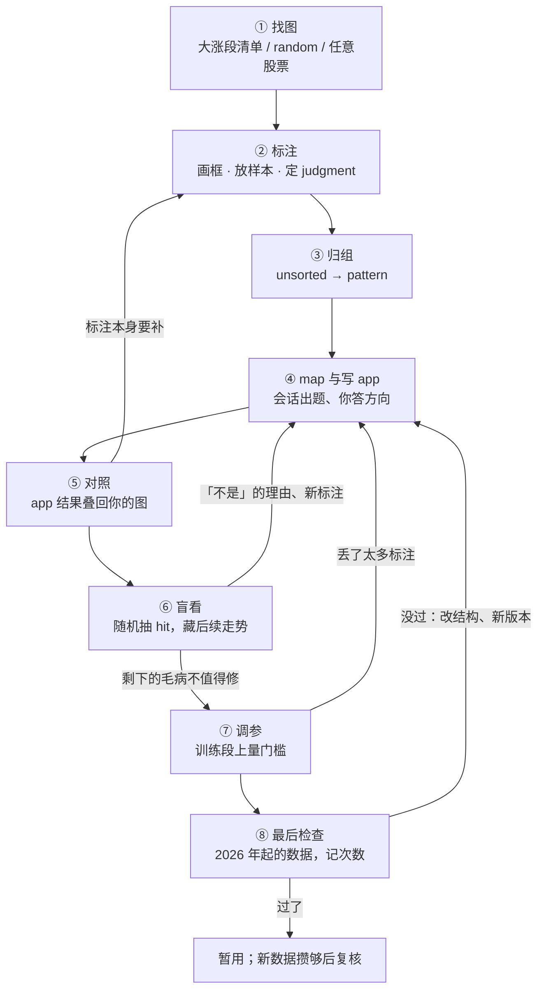

# 标注工具说明书：骨架（第一阶段）

> 写给 critic 和 auditor 的骨架，不是终稿。正文按「工具已经做完」来写；末尾的承诺清单才对照原型。词汇以 `path2/GLOSSARY.md`、`path2_web/GLOSSARY.md` 为准，命名照票 14（sample / box / hit / match / map 等）。

## 0. 一句话

你在训练段的 K 线上框出你看到的东西、点出你会买和不会买的日子；会话把这些翻成 path2 app，再把 app 的结果画回你的图上和你的标注对照，再拿你没挑过的图让你盲看；你只负责「看」和「定方向」，翻译、写代码、量数字都由会话和工具做。终点是一个在 2026 年起的数据上胜过同日普通买入的 pattern。

## 1. 宏观使用场景

**谁在用**：懂 path2 的你。你脑子里有「这种走势后面常涨」的直觉，但直觉是一团画面，不是 node 和边。

**难在哪**（工具的每个功能都对着其中一条或几条）：

| # | 找 pattern 时会出的错 | 后果 |
|---|---|---|
| E1 | 直觉翻成代码会走样：话说得清意思、说不清位置（底部从哪天到哪天、放量指哪几天），写代码的人只能猜 | app 抓的是猜出来的东西，你以为在验证自己的想法，其实在验证别人的猜测 |
| E2 | 后见之明：知道后来涨了，就把「后来才看得出」的东西当成买入理由 | pattern 用到了当天看不到的信息，真用时根本触发不了或触发了也没用 |
| E3 | 只看涨了的：从大涨段里归纳共同点，没看「长得一样却没涨」的 | 归纳出来的是「上涨行情的共同点」，不是「能分开涨和不涨的特征」 |
| E4 | 在几张图上拟合：盯着没认出的那几张，一张张放宽门槛 | app 变成那几张图的记忆，换一批图就失效 |
| E5 | 自我欺骗：看着结果判断「这是不是我的 pattern」，「是」会偏向涨了的 | app 被悄悄改成专挑训练段赢家的样子 |
| E6 | 反复检查挑出运气：同一份「没碰过的数据」查十次，总有一次好看 | 最后的「通过」不可信 |
| E7 | 选股和择时混在一起：pattern 赚钱是因为挑得好，还是因为恰好出现在大盘涨的日子 | 把大盘的功劳记到 pattern 头上 |
| E8 | 一个词装两种意思、两个词说同一件事 | 证据被拆散或混在一起，会话照着错的意思写 detector |
| E9 | 改动没有对应的例子（「底部应该再深一点」） | 改完无法检验，以后被改坏也查不出 |

**工具的答案（总体设计）**：

- 把直觉落成**结构化标注**：框（box）标位置，样本（sample）标判断，判断的依据就是收进它的框。语言只做挂在图上的附注。→ E1、E8、E9
- 把「当天看不看得到」做进界面：成员框必须在样本日当天或之前结束；选中样本时之后的 K 线暗一档；盲看时后续走势先藏。→ E2、E5
- 让 app 的结果和标注**用同一套画法叠在同一张图上**，只给状态不给数字。→ E1、E4
- 用**盲看**从整个股票池随机抽 app 的 hit，补上「长得像却没涨」那一半。→ E3、E5
- 数字只在两处产生：调参（在训练段上量）和最后检查（在 2026 年起的数据上判）；最后检查记次数，报四样成绩、只用「比同日普通买入多多少」判输赢。→ E4、E6、E7

**三方分工**：

| 谁 | 做什么 | 不做什么 |
|---|---|---|
| 你 | 找图、画框、放样本、归组；在对话里答方向题；盲看点是 / 不是；拍板「剩下的毛病值不值得修」「要不要送最后检查」 | 不定阈值、不区分 node 和 where、不写代码 |
| 会话（写 app 的 Claude Code 会话） | 读标注、map、写 app 和 detector、出题、分流没认出的、量特征、调参、做最后检查 | 不改你的标注文件；不凭脱离图的话改 pattern |
| 工具（网页 + path2） | 画图、存标注、按 app 跑出 event 和 hit、算对照、出盲看清单、守数据墙、记检查次数 | 不替你下判断 |

**一个典型的节奏**：自由标一阵（样本先 unsorted）→ 某一组攒到几张，起名成 pattern → 对会话说「看看我的标注」→ 在对话里答几道题 → 看 pattern 页对照 → 做一份盲看 → 再说「看看我的标注」…… 几轮后觉得剩下的毛病不值得修 → 调参 → 最后检查。pattern 页头的 `next` 一格随时告诉你现在等谁。

## 2. 全景

④⑤⑥ 是主循环，次数不限；只有 ⑧ 判输赢。①②③ 随时可以插进来（循环中看到新东西照样标）。

## 3. 界面一览（正文展开时放在步骤之前）

- 顶栏：`symbol`（当前股票）、`mode` 三档 `app` / `annotate` / `compare`、`tiers`、`pattern`（当前 pattern，含 `unsorted · n`）、`tool` 两种 `box` / `point`。
- 主图 + 副图：主图是 K 线，样本日画成三角（正样本 ▲、负样本 △）；副图第一条是 `bracket` 轨（样本的跨度，以及 app 每次 hit 的跨度），下面一个特征名一条轨（`annotate` / `compare`），或一个 node 一条轨（`app`）。
- 侧栏四页：`selection`（选中的框或样本）、`features`（你的特征词表）、`pattern`（当前 pattern 的总览）、`json`（待定，见 7 节）。
- 图例：`user` 白底 / `session` 蓝底 / `app` 琥珀底——一眼分出这句话是谁说的。朱红只留给「app 和你的判断相反」。
- 数据：任何地方都只看得到 2025-12-31 及以前。

## 4. 按步骤展开（每步：你想知道或决定什么 / 看哪里点什么 / 会话做什么问什么 / 产出 / 意义）

### ① 找图

- **你想**：找出心里那个样子出现过的图；也要看长得像却没涨的。
- **看哪里、点什么**：三个入口——大涨段清单（训练段里涨幅大的段，点开跳到那段之前）；`random`（股票池 × 训练段随机一段）；按代码打开任意股票。进来默认是 `annotate`：只有 K 线和你自己的框。
- **会话**：不参与。
- **产出**：一张摆在面前的图。看过什么不记录。
- **意义**：大涨段清单让你从结果找方向（训练段允许）；`random` 让你看到没涨的；不记账，所以你不用担心「看过就脏了」。它只解决「有图可看」，解决不了 E3——大涨段清单全是涨了的，另一半要靠 ⑥ 盲看补。默认干净 K 线，是为了不让现成 detector 的画法把你的眼睛往已有种类上带（E1 的源头）。

### ② 标注

分两件事：**框**标「这里有什么」，**样本**标「这天我会不会买、凭什么」。

**框（box）**
- **你想**：把看到的一段东西留下来，名字用自己的话。
- **点什么**：`tool` 选 `box`，在图上一拖即成；拖框边改起止。起名从你自己的特征词表里挑（相近的排前），没有就新起；新特征第一次用时写一句定义。框上可挂属性（一条属性就是词表里的另一个词），每条三态 `true` / `false` / `null`（没看过）。时间上被大框包住的小框默认属于它（轨标题写 `缩量 ⊂ 横盘`），推断错了可以摘掉或手动挂上。
- **意义**：
  - 框给出位置，会话不用猜（E1）；以后 app 的 event 落没落在你的框上，可以直接比。
  - 词表跨图、跨 pattern 共用，改名一处生效；意思一旦定下不改，要改就另起一个特征（E8）。为什么不给 app 的 where 名或现成事件种类当选项：现成选项会框住你看到的东西。
  - 属性三态：后来才想到的属性，在旧框上是「没看过」而不是「没有」，越晚发现的特征不会因此吃亏。
  - 框套框表达「属于」，对应 path2 的复合事件和子事件，让「底部是 W 形或 V 形」这种说法有地方落。
  - 框不属于任何 pattern：同一段横盘可以同时是两个 pattern 的依据。

**样本（sample）**
- **你想**：说「这一天有那个样子，当时我会买」（正样本），或「像这个 pattern，但这一天就看得出不该买」（负样本）。
- **点什么**：`tool` 选 `point`，点一根 K 线放下样本，默认归当前 pattern（可以是 `unsorted`）、默认 `pos`；在 `selection` 页改 `judgment`、写 `note`。选中样本时，样本日之后的 K 线暗一档。样本日之前、离它近的框自动收成成员框（member box），成员链在 `selection` 页显示，点进点出可改；跨过样本日的框收不进，悬停说 `crosses sample date`。
- **意义**：
  - judgment 是当天的认定，不是后来涨没涨——涨没涨由系统按后续走势算，你不用标，也不该标（E2）。
  - 成员框 = 判断的依据。会话靠它知道「凭什么买」，所以必须在样本日当天或之前结束；否则依据里混进后见之明（E2）。
  - 负样本是专门挑的：像，但当天就看得出不该买，理由画成框、属性或写进 `note`。它是会话写「有它就不买」的唯一来源。没标的日子不是负样本；所以负样本上 app 买了几个，不能当误报率。
- **辅助**：画了没收的框（样本前不远、名字在这个 pattern 里用过、却没进成员）在图上和成员链空槽里标出，一下收进；同一个样本里两段同名标 `dup`，提醒你分清是不是两种东西。

- **产出（整步）**：一份新的标注文件（每批一个、文件名带机器名、只新增；记数据指纹）。
- **会话**：不参与。

### ③ 归组

- **你想**：哪些样本说的是同一个 pattern。
- **点什么**：`pattern` 下拉选 `unsorted`，侧栏列出未归类的样本，按骨架（成员框里顶层特征名的先后）分行，同骨架排一起；整行 `move` 进已有 pattern，或起新名。pattern 页可写一句定义（这个 pattern 想抓什么）。也可以直接对会话说「帮我归组」，它把骨架相同的列在一起给建议。
- **意义**：一个 pattern 对应一个 app。骨架相同、只差某段的样子（W 形底 / V 形底）合成一个，差别放进那个 node 的 where；骨架不同（底部反转 vs 突破回踩）分开——混在一起，app 会被两种东西拉扯，哪种都抓不好。先看特征、后归纳（unsorted）让新规律能冒出来；先定目标（当前 pattern）让每张图标得一致。两种阶段配合，不必二选一。
- **辅助**：没有 app 时，pattern 页 features 区点开某个特征的计数，列出有它 / 没它的样本，查有没有混进别的。负样本必须挂在它像的 pattern 下，挂在 unsorted 算没填完。

### ④ map 与写 app

- **你想**：让 app 抓你标的那个样子；你不想思考 node 和 where。
- **怎么开始**：在对话里说「看看我的标注」。
- **会话做什么**：读上次以来的变化 → 给每个特征定级（`must` 必须有 / `optional` 有更好 / `must_not` 有它就不买 / `excluded` 不放）→ 把要你定的写成题，在对话里一道道问，每题带一个链接，点开在工具里显示这道题要看的图 → 写 mapping（你的特征由 app 的哪一部分来认）和 app（dag、node、where，缺的事件新写 detector）→ 跑对照。
  - 出题的几类：定级（「长下跌」是买的理由还是背景？）；正样本缺了必须有的一段（补画 / 真没有所以不算 / 真没有但仍算）；judgment 改过的（「那天看得见吗」）。
  - 可以只答一部分说「先写」，没答的按「不放」写。
  - 你脱离图说的话（「底部应该再深一点」），会话会反问「在哪几张图上看到的」，转去标注。
- **你在工具里做**：答题时点链接看图；觉得 mapping 某一行 map 错了，在 pattern 页那一行点 ⚑，会话下一轮处理，改了会显示 `remapped`。
- **产出**：mapping、新版本的 app、题目记录（在会话那边，不写你的标注文件）。
- **意义**：翻译归会话、方向归你。同一个词翻成 node、where 还是边，用现成 detector 还是新写，要懂 path2、要跨图看证据，不该落到你画某个框的那一刻（E1）。定级问一次，而不是要求你标注时就区分「必须 / 可选」：要看过好几张图才说得准。出现在每个正样本里、又没写定义的特征，会话不预填猜测——那正是每张都顺手框的背景，预填成必须有你会顺手同意，app 悄悄变严而训练段上看不出。

### ⑤ 对照

- **你想**：app 认没认出我标的？哪里没对上？是 app 的错、翻译的错，还是我标注的问题？
- **看哪里**：
  - pattern 页页头：`samples pos n · neg m`；`match` 一行按 judgment 分——正样本 `matched` / `unmatched`、负样本 `matched` / `unmatched`，和你相反的那段朱红；`next`。
  - features 区：按 mapping 分层——必须有的各段依序一块，块之间 `↓` 加两段之间的 tag（`connected` / `disconnected` / `not_qualified`）；有更好、有它就不买挂在它依附的那段下面；最下面 `excluded`（带原因）和 `unmapped`。每块带计数：多少正样本收了它、app 认出了几个（`qualified k/n`）、属性判了几个 `true`；`⚠ chance_high` 提醒这一行的数说明不了多少。
  - samples 表：一行一种组合（judgment / 差 tag / match tag），全同的折成 `×n`，问题排前，缩略图点一下跳到那张图。
  - 图上：`mode` 切 `compare`，app 的 event 画在你的框所在的同一条轨上，框旁的档位 tag 说认到哪一档（`bound` 进了 hit / `qualified_only` 过了 where 没进 hit / `detected_only` 看到了但不够格 / `missing` 没认出）；`tiers` 开关显示 detected、qualified 两档。选中框，`selection` 页列出框上属性和 app where 逐条对不上的。`app` 档只看 app 跑出了什么。
- **会话做什么**：没认出的按原因分流——结构性的（没认出、没连上、一段被切成两段）直接修；只差门槛的不逐张追，留给调参；拿不准的出题问你。每轮改完 app，报这轮哪些样本的 match 翻了、因为哪条改动（只报不拦）。新并进一个 node 的特征，「放在要用的地方量」：app 带它、不带它各跑一遍，只因它多出来的那些买点和同日普通买入比，四选一（看得出更好 / 看得出更差 / 看得出没多大用 / 看不出），结果按特征挂在 pattern 页，多出来的买点可以逐张看。
- **产出**：你知道下一步该补标注、答题，还是去盲看。
- **意义**：
  - 标注就是「你期望的显示」，主视图就是「app 实际的输出」；画法相同，差在哪一眼看得出（E1）。
  - match tag：hit 的买点落在样本日附近才算 matched（正样本前后 3 天，或样本日落在那次 hit 的回踩事件里；负样本前后 1 天；天数待验证）。为什么要容差：你的样本日是定性的认定，app 的买点是按规则算出的那根 K 线，差一两天是常态。
  - 差 tag：样本的成员框和 mapping 比（`−X` mapping 里 X 必须有、你的标注里没有；`+Y` 标注里有 mapping 定为有它就不买的 Y；`order` 先后不同；`=` 一致）。它不说错在哪边，只摆事实。
  - 只给状态不给数字：看到实测值和门槛，人会一张张放宽，app 变成拟合那几张图（E4）。数字由调参在整个训练段上量。
  - 三层各管一件：框的档位 tag 管一元 where，两段之间的 tag 管边，match tag 管整次 hit。哪一层断了，就知道去改哪儿。
  - 「随手一框也认出」的底：走势区段这类铺满时间轴的东西，随便挪个位置也被认出，`chance_high` 提醒你别信那一行的 `qualified` 计数。

### ⑥ 盲看

- **你想**：app 在我没挑过的图上抓的，是不是我说的那个样子？
- **怎么开始**：`next` 显示 `blind` 时（app 改过、还没盲看），打开盲看清单。
- **点什么**：每张图只显示到 hit 的买点那天，之后的走势藏着；你点「是我的 pattern」/「不是」，「不是」在图上写一句理由（可以画框）。点完才露出后续走势和 app 的结构；露出结构后发现「是，但 app 认错了地方」一键标出。
- **清单怎么来**：从整个股票池随机抽这个 app 的 hit（你标过的股票不抽），约 15 张；混入这次改动新增的、去掉的各几张（数目待验证），不告诉你哪张是哪类；结果分开报，只有随机部分算比例。
- **会话做什么**：「不是」的理由归类，每类拟改法并说代价（全池少抓多少、会不会丢掉你标过的正样本），回到 ④。理由里有买点之后才看得到的，当新想法，不直接当结论。
- **产出**：一份盲看标记（带 app 版本），进入以后每轮的对照集。
- **意义**：对照只能检查你挑过的图；盲看检查 app 在它真会遇到的图上是否忠实于你，而且涨的不涨的按真实比例都会抽到，补上 E3 那一半。后续走势先藏：看着结果点，「是」会偏向涨了的，app 会被改成专挑训练段赢家（E5），到最后检查才暴露、白白用掉一次。不抽你标过的股票：那些图你已经看过结果。混入改动增减：均匀抽 15 张，改动新增的那批很可能一张都抽不到。

### ⑦ 调参

- **你想**：结构定了，门槛放在哪。
- **什么时候**：你判断「剩下的毛病不值得修」时。工具不拿计数当门槛：15 张里 3 张「不是」，真实比例可能在 7%～45% 之间。
- **会话做什么**：用 tune-gates-v3 在训练段（2021-10-08～2025-12-31）上搜，排名看「比同日普通买入多出的部分」；调完报调过参的版本丢了哪几张你的标注（看时藏样本日之后的走势），你定接受还是限范围重调；同时给训练段成绩四样（见 ⑧），按半年拆开，最近半年单列。
- **意义**：门槛是在全部训练数据上量出来的，不是对着几张图拟合的（E4）；但调参只看成绩，可能把门槛动到你的正样本大批认不出——那时它已在改 pattern 的意思，所以要你回头看丢了哪几张。训练段成绩平时不主动给：多轮里留下「让训练段成绩变好的改动」，就是在训练段上挑结构；只在你问、准备调参、最后检查前给，明显为负时主动提醒。

### ⑧ 最后检查

- **你想**：这个 pattern 到底行不行。
- **会话做什么**：先过进门清单——版本和参数冻结；没有 `unmapped`、没有没答的题；最后一次结构改动后盲看过；调参丢的标注你看过；训练段四样成绩你看过。然后在你点头后，用 2026 年起的数据跑一次，次数 +1（按 app 记，悬停 app 版本可见用过几次）。
- **报什么**：四样——比同日普通买入多多少（选股，**判输赢**）；比随机日多多少（选股加择时，参考）；两者之差即择时贡献，附出手日落在几段独立行情（参考，样本少时明说）；绝对收益（参考）。
- **结果**：过了 → 暂用；新数据攒够后再复核一次。没过 → 回 ④ 改结构，出新版本，再查再记。
- **意义**：训练段随便看以后，训练段上的成绩分不清多少是凑出来的；只有没碰过的数据能说明 app 有没有用。记次数防 E6。只用「比同日普通买入」判，防 E7：择时的有效样本太少（训练段里大盘真正的牛熊转换只有几次），数据只含仍在交易的股票会让绝对收益偏好看；择时那一块单独报，让你知道钱从哪来。2026 年起的数据只有九个多月，只看得出大的优势，所以次数要省着用。

## 5. 贯穿全程的几样

- **`next`**（pattern 页头一格）：`run_session`（会话有题、还没 app、有 unmapped 或 ⚑）/ `blind`（改过还没盲看）/ `you`（继续标、调参或送最后检查）。几周后回来，看一眼就知道停在哪。
- **数据墙**：工具、对照、盲看、调参、量特征都只读截到 2025-12-31 的数据；只有最后检查读 2026 年起的，每次记账。看图不记账、不限次数。
- **版本**：app 每改一次升一版；对照、盲看标记、量特征结果、检查次数都记版本，旧版本的结论显示为过期。
- **两台机器**：标注每批一个新文件、文件名带机器名、只新增不改旧文件，两台同步时不会冲突；标注里记数据指纹，数据重做后也知道每条标注对应哪一版。
- **语言的三个位置**：新特征第一次出现时的定义；盲看「不是」的理由；pattern 想抓什么的一句话。其余一律落到图上。

## 6. 关键设计的所以然（终稿单列一章，每条三层：做什么 → 防住什么 → 为什么不用更显然的做法）

1. 为什么用框，不用一句话描述 pattern。
2. 为什么标注时不画系统事件、不给 app 的词当选项。
3. 为什么特征名随便改、定义的意思不能改。
4. 为什么属性有「没看过」第三态。
5. 为什么成员框必须在样本日当天或之前结束。
6. 为什么 judgment 不看后来涨没涨。
7. 为什么负样本要专门挑、为什么不能当误报率。
8. 为什么 match 有容差，正负样本容差不同。
9. 为什么对照只给状态不给数字。
10. 为什么定级由会话问，而不是标注时让你区分 node / where、必须 / 可选。
11. 为什么脱离图的话不能直接改 pattern。
12. 为什么盲看要藏后续走势、从全池随机抽、不抽标过的股票、混入改动增减。
13. 为什么训练段随便看、不记账。
14. 为什么 2026 年起的数据永远不给看。
15. 为什么只有最后检查判输赢、为什么记次数、为什么只看「比同日普通买入」。
16. 为什么并进一条特征要「放在要用的地方量」，不单独量。

## 7. 待定 / 我还没想清的

- `json` 页：除了「看会话读到的是什么」，我找不到它在找 pattern 里的意义；倾向不写进说明书。
- 盲看第一步显示多少 app 结构（只标 hit 买点那天，还是连各段 event 一起画）：显示了会把你往「是」上带，不显示你可能看不懂 app 指的是哪段。我写的是「先只标那一天，点完再露结构」，需要用户拍板。
- 盲看「不是，但像」能不能一键转成负样本：我觉得应该能（盲看是补「长得像却没涨」的地方，负样本就是这类东西的结构化形式），但没有已定决定支持。
- 「这一轮翻了哪几张」只写在会话的交付说明里，还是在 samples 表每张上标出。
- 最后检查的具体入口（是工具里一个按钮，还是只在对话里）。

## 8. 一个完整例子（终稿写）

拟用「横盘突破回踩」：从大涨段清单翻到 TVRD、WHLRP 几张 → 框长下跌、横盘（套着缩量）、放量突破（属性：放量、突破过好几个峰）、回踩 → 放正样本；在 TVGN 上发现「回踩前出了派发」的那天放负样本 → unsorted 页同骨架三张挪进新 pattern、写定义 → 「看看我的标注」→ 会话问「长下跌是买的理由还是背景」「TVRD 2024-12-24 缺回踩怎么办」→ 写出 app v1 → pattern 页：正样本 matched 2、unmatched 1（朱红）；负样本 TVGN unmatched（app 用「有派发就不买」接住了）→ 盲看 15 张，4 张「不是」，理由「突破那天量没放出来」×3 → 会话把放量属性从「有更好」升为必须有 → v2 → 再盲看 → 调参 → 最后检查。

## 9. 工具不做什么（终稿写）

不给你看 2026 年起的数据；不在对照里给实测值和门槛；不让你定阈值；不把负样本上的买入数当误报率；不凭对话里的一句话改 pattern；不记录你看过哪些图；不替你判「剩下的毛病值不值得修」；不研究大盘择时（只把择时那一块单独报给你）；不管仓位和资金。

---

## 承诺清单

「原型」一列是我对 `mock_v4.html`（含 `backend_contract.md`）的判断：有 / 部分 / 无 / 不确定；无和部分请 auditor 核实后记成缺口。

| # | 说明书承诺你能做到的事 | 原型 |
|---|---|---|
| P1 | 工具里任何地方都只看得到 2025-12-31 及以前的数据 | 不确定（演示数据本身截断，墙在后端） |
| P2 | 从大涨段清单找图，点开跳到那段之前 | 无 |
| P3 | `random`：股票池 × 训练段随机给一张图 | 无 |
| P4 | 按代码打开任意股票 | 部分（只有 4 只演示股票的按钮） |
| P5 | `annotate` 模式只显示 K 线、成交量和你自己的框，不画系统事件 | 部分（没有成交量） |
| P6 | 一拖画框、拖边改起止 | 有 |
| P7 | 特征名从自己的共享词表点选，起名时相近的已有特征排前；新特征首次用时写定义，选中框时定义显示一行 | 有（起新词时相近的已有词排最前、加粗） |
| P8 | 改特征名处处生效、意思不变 | 有 |
| P9 | 近义特征一次合并，可拆回 | 有 |
| P10 | 属性三态，后加的属性在旧框上是 `null` 不是 `false` | 有 |
| P11 | 框套框默认表达「属于」，可手动挂上 / 摘掉 | 有 |
| P12 | `point` 放样本，选 `judgment`、写 `note`，可删 | 有 |
| P13 | 成员框自动推断、点进点出；跨过样本日的框收不进并提示 | 有 |
| P14 | 选中样本时样本日之后暗一档 | 有 |
| P15 | 画了没收的框标出，一下收进 | 有 |
| P16 | 同一样本里两段同名标 `dup` | 有 |
| P17 | 样本可先 `unsorted`；按骨架分行，整行挪进 pattern | 有 |
| P18 | pattern 带一句定义 | 有 |
| P19 | 负样本必须挂在它像的 pattern 下，挂在 unsorted 显示待选 | 有 |
| P20 | 说一句「看看我的标注」，会话按顺序做完 map、写 app、跑对照、出题 | 无（技能侧，原型不涉及） |
| P21 | 会话的题在对话里，每题一个链接在工具里打开要看的图 | 有（`#q=`） |
| P22 | 脱离图的话不能直接改 pattern，会话反问在哪几张图 | 无（技能侧） |
| P23 | ⚑ 指出 mapping 某一行不对，会话改后显示 `remapped`，可撤销 | 有 |
| P24 | pattern 页按 mapping 分层显示特征，带 `in k/N`、`qualified k/n`、属性计数 | 有 |
| P25 | `⚠ chance_high`：随手一框也被认出的行会提醒 | 有 |
| P26 | 两段之间 app 连没连上（`connected` / `disconnected` / `not_qualified`），可点开看是哪几张 | 有 |
| P27 | samples 表按 judgment / 差 tag / match tag 折叠，问题排前，缩略图一下跳图 | 有 |
| P28 | match tag 的容差：正样本 ±3 天或落在回踩事件里，负样本 ±1 天；朱红只标 app 和你相反 | 有 |
| P29 | `compare`：app 的 event 和你的框同轨叠画（bound 本色、qualified 深灰、detected 浅灰，灰条挂 `qualified_only` / `detected_only`）；框旁挂 `missing` 或会话蓝的级；选中框时 `selection` 页写档位 | 有 |
| P30 | 选中框时列出框上属性和 app where 逐条对不上的，不给实测值和门槛 | 有 |
| P31 | `app` 档只看 app 在 K 线上跑出了什么 | 有 |
| P32 | 页头 `next` 告诉你现在等谁 | 有 |
| P33 | 显示当前 app 和版本；对照按当前版本现算；存下的结论（盲看标记、量特征结论、检查次数）带版本，app 改版后显示为过期 | 部分（显示版本；过期标记无） |
| P34 | 每轮报哪些样本（含盲看标记）的 match 翻了、因为哪条改动；samples 表上同样标出（调参丢的也用它看） | 无（方向题：只在会话交付说明里，还是表上也标） |
| P35 | 量特征：带 / 不带，四选一，结果按特征挂在 pattern 页，多出来的买点可逐张看 | 无 |
| P36 | 盲看清单：全池随机约 15 张 + 改动增减各几张混入，不抽标过的股票 | 无 |
| P37 | 盲看第一步只显示到 hit 买点那天、不画 app 的结构；三个按钮 是 / 像但不买 / 不像，后两种在图上写理由（可画框），理由只在走势藏着时写；点完才露后续走势和结构 | 无 |
| P38 | 盲看露出结构后「是，但认错了」一键 | 无 |
| P39 | 训练段四样成绩，按半年拆开、最近半年单列；平时不主动给，明显为负时主动提醒 | 无 |
| P40 | 调参后列出丢了哪几张标注，看时藏后续走势；你定接受或限范围重调 | 无 |
| P41 | 最后检查进门清单 | 无 |
| P42 | 最后检查记两个次数：这个 pattern 各版本累计、你所有 pattern 一共；送检前都告诉你 | 部分（只在 app 版本悬停里有单个 app 的次数；跨 pattern 怎么数待拍板） |
| P43 | 最后检查报四样，只用「比同日普通买入多多少」判输赢；过了暂用、到期复核 | 无 |
| P44 | 标注每批一个新文件、带机器名、只新增；记数据指纹 | 部分（文件名、指纹是假值） |
| P45 | 概念相对算出来的东西定义时（如「突破了前面好几个峰」），可单开那一种参照层，默认关 | 无 |
| P46 | 一个特征有「取其一」的分支时，认出数按分支拆开报 | 无 |
| P47 | 框不属于任何 pattern、跨 pattern 共用；一个样本只属于一个 pattern，可 `move` 到别的 pattern | 有 |
| P48 | 没有 app 时，点开特征计数列出有它 / 没它的样本，查有没有混进别的 | 有 |
| P49 | 差 tag 比到属性一级（必须有的属性判 `false`、有它就不买的属性判 `true` 都算差）；`null` 不算差 | 无（原型只比特征名） |
| P50 | 只在负样本里出现过的特征一定进定级题，不被「不到一半」吞掉 | 无（会话侧；原型演示 mapping 是手写的） |
| P51 | judgment 改过而成员框没变时，会话问「那天看得见吗」 | 有（题视图的改判题） |
| P52 | 认不出用户的框时，会话先排除判定口径的问题再下「要新写 detector」的结论 | 无（会话侧） |
| P53 | 盲看标记自成一组、不混进样本计数，每轮和样本一起重新对 | 无 |
| P54 | 必须有的各段在新图上没画也有轨（空轨提醒缺段）；在轨上拖直接带名字；轨序 = 这个 pattern 内的先后 | 有 |
| P55 | 当前样本：期间新画的框自动并进；选中框时侧栏顶上显示它的成员链；换样本时冻结 | 有 |
| P56 | 同图同 pattern 多个样本时标 a / b / c，框旁字母说明它是哪几个样本的成员 | 有 |
| P57 | 框旁会话蓝 tag（`unmapped` / `excluded` / `optional` / `must_not`）分开「没认出」和「没被要求认」 | 有 |
| P58 | `compare` 下样本三角下挂 match tag 和差 tag，改框时原地看到结论变化 | 有 |
| P59 | 成员链上相邻两段的两段之间的 tag，点一下描出两段和 app 用到的两个 event；收了 must_not 的成员划线 | 有 |
| P60 | `features` 页每个特征的用量 `box×n · attr×m`，改名、合并前看得到波及范围 | 有 |
| P61 | 框和样本的 `note` 放还画不出来的观察，会话把它当线索、请你画成框或属性，本身不进 app | 部分（`note` 有；会话侧无） |
| P62 | 最后检查的及格线是写死的固定规则（打折后比同日普通买入多出的部分 > 0），所有 pattern、每次都一样，送检时不临时写 | 无（原型无最后检查；线要不要更严是方向题） |
| P63 | 「没过」的读法：只说明还没证明有用，分辨力随数据变多而提高 | （说明书表述，不是功能） |
| P64 | 最后检查只回四样数和两个次数，不给 2026 年的图、hit 清单或逐只结果 | 无 |
| P65 | 同一版没过后等数据再查，只用上次检查之后新来的数据（同复核） | 无 |
| P66 | 盲看随机部分不再抽以前揭开过的 hit | 无 |
| P67 | 盲看揭开后，可从「是」却没涨的图里找当天看得出的区别，照常放负样本（note 注明来源，走新想法的路）；盲看标记揭开后不许改 | 无 |
| P68 | 切换当前 pattern 后，别的 pattern 的样本、bracket 和只被它们收进的框变淡 | 有 |
| P69 | 量特征两个方向都量：放宽的看因为它多出来的买点，收紧的（必须有的 where、有它就不买）看因为它去掉的买点；看不出时照标注先留着、标待验证 | 无（会话侧；收紧方向的默认处理是 writer 推的） |
| P70 | 有更好（optional）默认不进 app 的求解，只留在 mapping、对照里显示认没认出、可以拿去量；定义里说「有一个就行 / 凑够几样」时那几样才一起落成「至少 k 条成立」 | 无（原型演示 mapping 把横盘写成落法 `where`，按字面等于必须有；方向题 Q7） |
| P71 | `next` 多一个值 `review`：暂用中，旁边写最早能复核的日期 | 无 |
| P72 | 盲看的三个按钮用 `pos` / `neg` / `off_pattern`，前两个和样本的 judgment 同义；「有它就不买」的来源 = 负样本 + 盲看判 `neg` 的图 | 无（按钮名待词表确认） |
| P73 | 特征定义可以先空着；空着的，会话定级时为它多问一句 | 有（定义可空）；会话侧无 |
| P74 | 用户贴的 K 线截图：会话认出股票和日期，给链接在工具里打开那张图，由用户来标 | 无（会话侧；需要「按股票 + 日期打开」的链接） |
| P75 | 数据墙：所有读数据的入口只读截到 2025-12-31 的副本，完整数据只有最后检查的入口读；会话临时分析也从副本取数（靠规矩，不是物理隔离） | 不确定（墙在后端） |
| P76 | 拖长一个框时不让它越过收了它的任何样本的样本日；选中框时列出收了它的全部样本（含别的 pattern）；空槽因同名框太长收不进时悬停说明 | 无（auditor 提的 M12） |
| P77 | 盲看卡上有 `known` 键：认得这张就跳过、不进比例、补抽一张 | 无（方向题 Q6；键名待定） |
