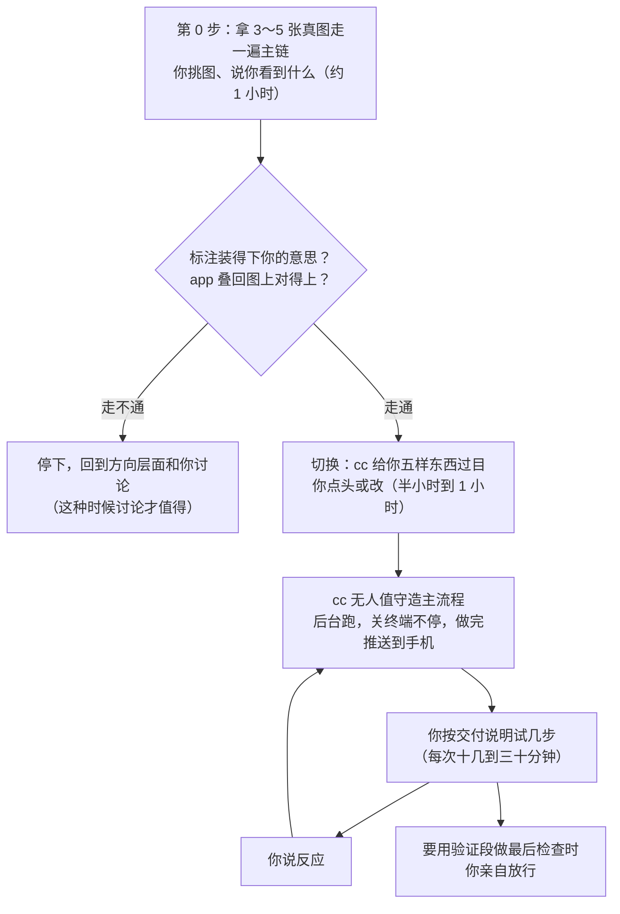

# 让 cc 当开发者、你当使用者：白话版

> 来源：同目录 `final_report.md`（2026-11-01 定稿），细节取自 `方案.md`（designer 定稿，经 critic 两轮审查）和 `诊断.md`（auditor 对 12 天会话记录的计数）。

**一句话**：你担心「交给 cc 做出来不是我要的」，于是只好自己去审细节。其实绝大多数细节错了，你用的时候一眼就能看出来，用不着事先审。真正用的时候看不出来的错只有三四类，这几类由你说一次原则，cc 把它们写成每次自动跑的检查。所以你只需要做两件事：用工具，以及在少数撤不回的关口点头。

## 先认几个词

| 词 | 意思 | 出处 |
|---|---|---|
| app | 一个走势形态的完整声明，可以拿去扫描和评估 | [path2/GLOSSARY.md:36](../../../path2/GLOSSARY.md) |
| 样本 | 你在一张图上对某个 pattern 下的判断：这天该买或不该买，连同依据的框 | [path2/GLOSSARY.md:180](../../../path2/GLOSSARY.md) |
| 训练段 | 2021-10 到 2025 年底这段数据，随便看、随便试 | [path2/GLOSSARY.md:124](../../../path2/GLOSSARY.md) |
| 验证段 | 2026 年起、谁都没看过涨跌的数据，只用来做最后检查。每用一次就少一次，撤不回 | [path2/GLOSSARY.md:134](../../../path2/GLOSSARY.md) |
| 同日对照 | 和买点同一天、波动相近的普通买入。pattern 的成绩要减掉它才算数 | [path2/GLOSSARY.md:114](../../../path2/GLOSSARY.md) |
| 拍板层 | 本方案新起的名字，指一两页纸，只写你亲自拍过板的决定和红线。改它之前必须问你 | 本方案 |

## 1. 这对矛盾为什么是假的

你觉得只有两条路：一是交给 cc，然后逐条审它的票、文档和原型；二是自己泡在细节里。两条路背后其实是同一个假设：**要确认 cc 做的对不对，只能读它的中间产物。**

这个假设在大部分情况下不成立。按钮放哪、文字怎么写、一个功能顺不顺手，你用一下就知道了。错了也不要紧，花的是 cc 的时间，再改一轮就好。

用的时候真看不出来的错，只有这几类：

- **撤不回的**：不小心读了验证段的数据、检查次数被白白用掉。
- **会让成绩变好看的**：比如 app 偷偷用到了买点之后才出现的信息，成绩反而更漂亮、更稳。
- **对照显示本身错了**：屏幕上说「一致」，实际并不一致。

这几类错，你试用时的反应往往是「挺好」，所以不能靠试用发现。它们交给自动检查，你只在检查没过时才会看到。

## 2. 这 12 天时间去了哪

auditor 把你这 12 天亲手写的 458 条消息逐条分了类：

- **真正在定方向的，只有 4%。**
- **将近一半，花在看懂、挑错、改名 cc 做的界面原型上。**其中近三成，是同一个疑问来回问了好几轮。
- **你在替 cc 补课。**几十次是把 cc 的话翻成自己的话再问「对么」，或者补一个它早该知道的前提。有一处是地图本身写错了：把你的「色弱」写成了「色盲」，cc 就照着做出了黑白原型。
- **标注工具的正式代码，到现在还是 0 行。**
- 新开的 4 张票，全是从打磨原型里长出来的。
- 「看图标注 → 写成 app → 叠回图上看」这条主链，一次都还没走过。

auditor 还看出一个规律：**你在哪种时候改主意，是有层次的。**

- 方法和范围（盲看、只按同日对照判输赢、验证段只用一次等）在讨论里定下以后，一直没变过。
- 界面和概念，一看到原型就改。
- 最大的那次转向，发生在你真正用过旧看图工具之后。

这说明方法论这一层适合讨论着定，而且已经定完了。界面和概念讨论了也会改，适合直接做出来让你看。

所以慢的原因不只是「先讨论后动手」这个顺序。还有四点：

- cc 往里加概念的速度，比你消化的速度快。
- cc 说的话要你自己去翻译，一处看不懂就升级成一轮研究。
- 定下来的前提散在七八个地方，新会话接不住。
- 为了省事引进的辅助工具（web-loop），自己又成了一个要你理解的项目。

光把顺序倒过来，负担只会从「审票」挪到「试用」上。所以 cc 自己的习惯也得改（见第 4 节）。

## 3. 新流程长什么样

### 3.1 决定分给谁

判断一件事该谁定，只问两个问题：**错了你用的时候看不看得见？错了谁来付代价？**

| 哪类事 | 例子 | 谁定 | 你什么时候知道 |
|---|---|---|---|
| 看得见，错了只花 cc 的时间 | 布局、按钮、文字、默认张数 | cc 直接定 | 试用时 |
| 看得见，但会动到你的东西 | 你已经存下的标注怎么存；你学过的词；别的工作里你看惯的数 | cc 先在交付说明里告诉你，等你答 | 改之前 |
| 看不见，又撤不回或会让成绩变好看 | 验证段、检查次数、及格线、偷看未来、对照怎么算怎么显示 | 原则你已经定过；具体怎么拦，cc 拿几个实例问你一次；之后由自动检查守 | 只在检查没过时 |
| 看不见，错了也只花 cc 的时间 | 代码怎么分模块、旧代码什么时候拆 | cc 定 | 不告诉你 |
| 会改变工具拿来干什么 | 什么算好 pattern、要不要盲看 | 问你 | cc 会停下来问 |

「这次改动要不要告诉你」，不靠 cc 自己觉悟，而是按改动碰到了什么来机械判断。名单由一个没参与写代码的复核代理列出来，写给你时只讲对你有什么影响，不报文件名。

### 3.2 cc 只在三种情况下停下来等你

1. 要改变工具的用途。
2. 要动你已经存下的数据。
3. 要用掉一次验证段。cc 造东西、自己测试时也不许碰验证段，那条路只拿训练段最后半年假装成验证段来测。

其余要问的，都攒到交付说明末尾一起问。每次最多三个，多数时候一个都没有。阈值、张数这类数字，cc 先给默认值并标「待验证」，不问你。决策票和访谈会话不再开。

### 3.3 每次交付给你什么

只有三栏：

1. **现在你能做什么**：第一行是一条能直接复制的启动命令，接着最多五步，每步一个链接，能直接打开到那张图、那个状态。
2. **哪些改动碰到了你的东西**：每条一句话，说清对你有什么影响。
3. **要你定的**：零到三个问题。

自动检查全部通过时，不额外出现任何内容。交付前，cc 会自己按那五步在浏览器里走一遍、截图，确认没坏。

### 3.4 你怎么学会这个工具

你要掌握的东西只压缩到两处，都做成界面上的悬停提示，第一次用到时就能看到：

- **你输入的东西是什么意思**。比如「正样本」指的是按样本日当时的信息会不会买，不是后来涨没涨。这个标错了，工具照样跑，但后面全错，而且看不出来。
- **工具给的结论是什么意思**。比如「过了」只说明有一次独立的观察支持它，可以暂时用，不等于「有效」。一个毫无优势的 pattern，大约也有一半机会能过。

每个要你认的词，悬停提示里除了说「这是什么」，还会主动带一句「它防的是哪种错」，不用你一条条来问。

你提过的交互式引导教程，这次先不做。原因是它又是一份要跟着代码同步更新的东西。第一次交付时的「请试这几步」，本身就是在你自己的真图上走一遍的引导。如果第一次试用后你仍然觉得难上手，再做教程。

有一项外部实验可以当旁证：完全把活交给 AI 的人，事后理解得最差；先让 AI 做、再追问「为什么」的人，理解得和自己动手写的人差不多。新流程里，标注、盲看、判断值不值得修这几件事都由你亲手做，这几件事恰好就是这个工具的核心概念所在。

## 4. cc 要改的五个习惯

这五条专门对着第 2 节说的那几个慢的原因：

1. **少加词。**一个新词、新状态，只有当它防的是「动到你的东西」或「你看不见」的错时，才值得让你学。
2. **你说看不懂时，先问能不能删。**过去你问懂了以后，被问到的概念有 12 处后来被删掉或改了名。说明这一步本该 cc 先做。
3. **第一句先说清三件事：这是什么、谁产生的、在哪一步。**然后当场回答，不升级成研究，也不再向你播报团队进度。
4. **动手前先对一遍拍板层**，和拍板层冲突的地方由 cc 自己发现。
5. **不先造辅助工具。**同样的手工动作重复两三次以后，再考虑造工具。

你的反应，cc 会自己分成四种处理：

- **这次改掉。**
- **这次不做。**这种只适用于看得见的小事，看不见的问题不能悄悄丢掉。
- **以后都这样。**同一类反应出现第二次才算；能写成自动检查的就写成检查，不写成文字规矩。
- **方向变了。**直接改拍板层，下次交付起照新方向做。

什么时候算打磨够了？标准不是「你没话说了」，而是你的新反应不再出现新的种类。

## 5. 落到标注工具上，具体怎么走

1. **第 0 步，约一小时。**你挑一个现有 detector 就能表达的 pattern 想法，再挑 3～5 张真图。cc 先把你的意思用新的标注格式画回图上，问你「哪里装不下」；然后把标注翻成 app，把结果叠回这几张图给你看。这几张图和你说的「这天该买、这天不该」会留下来，以后每次改动都要重新对一遍。**你的标注本身就成了验收标准。**
2. **切换，半小时到一小时。**cc 给你五样东西，你点头或改：
   - 一页拍板层：改写现有的地图，顺手把「色盲」改正过来。
   - 几条红线的具体实例，形式是「这种情况拦、这种情况放」。
   - 10 张没关的票各自怎么处理。cc 逐张核过，没有一张还需要你定方向。
   - 建议删掉的词。
   - 两件只有你知道的事：两台机器各做什么；旧看图工具留下的旧标注还要不要。
3. **造。**cc 写一份完整计划，用一个后台会话无人值守跑完主流程。
4. **用。**先标 3～5 张试一次，确认标注能表达你的意思，再大量标、开始盲看。最后检查留到最后，每次都由你放行。旧代码等你用新工具做完一轮再拆。

要新增的东西只有四样：一份十几行的协作规矩、一组自动检查、一份你批准过的例子文件、拍板层。不新建技能，也不新增要你学的东西。

## 6. 看不见的错，怎么防

- **锁住的是你批准过的例子，而不是检查代码。**检查代码 cc 可以随便改，但改完以后，对这些例子必须给出和原来一样的答案。例子文件本身一旦要改，cc 就用一句白话问你，比如「要把『同一版没过、用旧数据再查』从拦改成放吗？」。这样你永远不用去审代码。
- **成绩突然明显变好时，先查再报。**cc 先跑偷看未来和泄漏的检查，过了才告诉你。
- **成绩流水线本身也要体检。**cc 会造两只假 pattern。一只随机挑买点，成绩应该接近零，用来查流水线有没有白送领先。另一只专买股票池里最便宜的那一成，用来查下面这个偏差。

还有两点要老实说清楚：

- **「不达标不准停」只是软约束。**cc 有个功能可以设定「条件没满足就不许停」，但它判断的依据是会话里写出来的文字，不会自己去跑检查。真正兜底的，是交付时由一个没参与写代码的复核代理实际跑一遍检查，结果写进交付说明。
- **验证段的隔离现在还不存在。**好几个现有脚本默认读的都是完整数据。「本工具只读到 2025 年底」要作为实施的一个单独步骤来做。它防的是不小心读到，挡不住存心绕开。更硬的办法（让系统层面直接读不到）存在，但在你常用的权限模式下能不能生效还没核实，所以暂时不默认用。

## 7. 放弃了什么、哪里可能出错

- **放弃的是「每个细节都经过你」。**cc 猜错的细节，会在你用的时候暴露。按过去的记录，细节题里大约每四道就有一道你会选和 cc 推荐不同的答案。所以细节交给 cc 的理由，不是 cc 猜得准，而是错了看得见、改得起。
- **第 0 步可能走不通。**那时停下来和你讨论方向，这种时候讨论才值得。
- **这套流程本身可能又膨胀成一个项目。**信号是规矩文件超过一页。真到那一步就砍。

## 8. 顺带发现、需要你知道的四件事

1. **股票池有个没人管的偏差。**股票池按复权后的价格设上限，池里最便宜的那一成，不靠任何本事就白得一截领先。这事原来归一张旧票管，那张票已经随旧 effort 归档。方案已经把它列成红线；在修好之前，临时办法是判输赢时剔除这一成，这个办法切换时请你定。
2. **地图把你的「色弱」写成了「色盲」。**改写拍板层时一并改正。
3. **superpowers 插件装了但没启用。**你记忆里「默认用它的执行器」这条，现在实际调不到。新方案不依赖它。
4. **项目 CLAUDE.md 里「评估纪律」一节，指向一个已经不存在的 skill 文件。**

这四件我都没有动。

## 9. 要你拍板的

1. 标注工具是否停用决策票流程，改用上面这套流程。
2. 第 0 步用哪个 pattern 想法、哪几张图。
3. 第 8 节第 3、4 条的两处配置，要不要处理。

---

## 附表：主要数字（auditor 计数，一人逐条人工分类，边界条目可能归到相邻类）

| 项目 | 数 |
|---|---|
| 在场时间（按消息间隔估） | 约 36.5 小时 |
| 你亲手写的消息 | 458 条 |
| 其中定方向 | 20 条（4%） |
| 看懂、挑错、改名原型 | 208 条（45%） |
| 同一疑问来回问的澄清链 | 12 段，127 条（28%） |
| 你复述求确认 / 补前提、纠误解 | 26 条 / 21 条 |
| 问懂后被删或改名的概念 | 12 处 |
| cc 在聊天里写的字 | 约 48 万（其中团队播报约 6.9 万） |
| 每次回复字数中位数：cc / 你 | 748 / 31 |
| 选择题作答 | 84 次，81% 选了推荐 |
| 不选推荐的比例：细节题 / 方向题 | 7/29 / 5/38 |
| 提交 | 28 个约 7.6 万行，74% 在研究目录；标注工具正式代码 0 行 |
| 票 | 15 张关了 5 张；新增 4 张全部来自原型打磨 |
