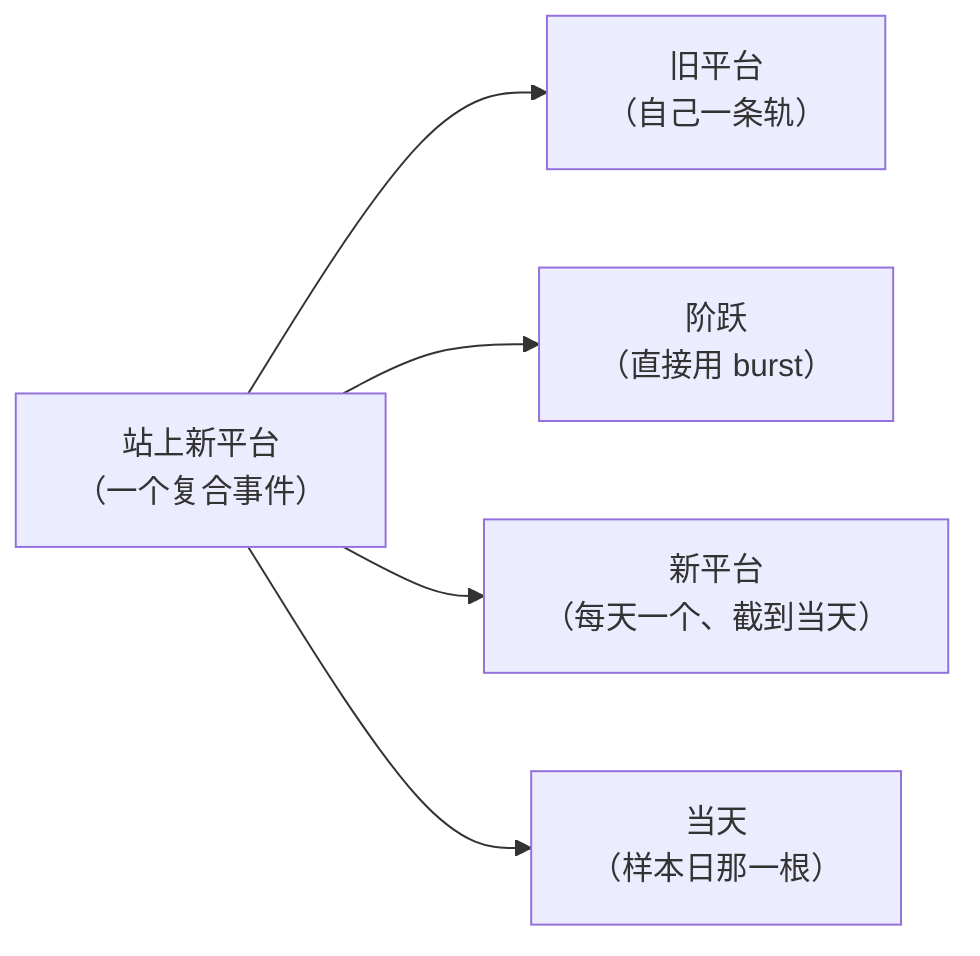

# 标注和 app 为什么对不上、怎么办（白话版）

> 来源：同目录 `final_report.md`（2026-11-05，agent team 四人共识版）。依据和全部数字在那份报告和四份成员笔记里；本文只讲结论和要你定的事，关键数字抄在文末附表。

**一句话**：你说的「根本不是一个东西」是对的。第一版 app 用现成零件拼凑，你的一个框被拆得只剩阶跃那一小截能对上；compare 又只把这一截给你看，所以你只看到结果，看不到原因。处理分三步：先让 compare 把 app 的每一部分都摆出来；再把你的特征和 app 的部分按段对齐；最后为现成零件表达不了的部分写新的识别器。第三步要你点头放开一条范围限制。

## 词表

| 词 | 一句话意思 | 出处 |
|---|---|---|
| 特征 | 你在图上认出并标下来的一样东西，一个框或框上的一条属性 | `path2/GLOSSARY.md:133` |
| 样本日 | 你下判断的那一天，图上的 ▲ | `path2/GLOSSARY.md:167` |
| burst | app 认「阶跃」用的现成零件：一串挨得很近的突破 | `path2/GLOSSARY.md:18` |
| 企稳段 | app 认「阶跃后企稳、可以买」用的现成零件，段里每一天都是买入日 | `path2/GLOSSARY.md:24` |
| 复合事件 | 由几段子事件合成的一个大事件，每段各有自己的轨 | `path2/GLOSSARY.md:62` |
| where | app 判「够不够格」的一条条件，可以用你的词命名，没过时能指出是哪条 | `path2/GLOSSARY.md:79` |
| mapping | 你的每个特征由 app 的哪一部分来认的对照清单 | `path2/GLOSSARY.md:144` |
| band | 图下方副图里 app 的一条轨，一个 node 一条 | `path2_web/GLOSSARY.md:39` |

另外，「hit」指 app 的一次完整命中，和你的一个样本对等。

## 一、问题出在哪：三层

你的原话里其实混着三件事，要的改法各不一样。

```
你的「站上新平台」框（CRNC 为例，53 根）
┆- - - - - - - 旧平台 47 根 - - - - - - - -│阶跃 1 根│- 新平台 5 根 -▲ 样本日
app 这一版：
                                           █ burst（阶跃，只有 1 根宽 → 图上那块小红块）
                                             ████████ 企稳段……一直到状态机结束（compare 里不画）
旧平台那一截：app 里根本没有对应的东西
```

1. **看不见**：compare 只画 mapping 写到的那一部分，这一版只写了阶跃。真正决定哪天买的企稳那一层、每条条件过没过、主视图的档位按钮和诊断，在 compare 里全被藏了。所以你「只知道错了，不知道错在哪」。这一层不需要新识别器，改 compare 就行。
2. **对不上**：你一个框装了三段：旧平台、阶跃、新平台。app 那边是按阶段切的零件，而 mapping 只许一个特征对一个零件，只能对上阶跃。所以框大、红块小，两者根本没法比。这一层也不需要新识别器，放开 mapping、按段对齐就行。
3. **表达不了**：有三样东西 app 确实没有：旧平台（按「比前期波动小」判平）；拿「新平台最低点」当支撑；「价格还在不在新平台上」。这一层才需要新的识别能力。

还有一处更根本的错位：你的样本是「站在样本日、截到这一天看得到的证据」；app 的一次命中却是「从阶跃到企稳结束」的一整段，里面带几个到几十个买入日。一次命中对的是你的一串样本，所以 ▲ 和 ▼、虚线和琥珀条，本来就不是一一对应的。

## 二、第一版具体错在哪

- **阶跃那一层基本认对了**：6 张图里 5 张，你标的阶跃都被 app 认出来了。SMX 除外，那段数据本身可疑。
- **错全在阶跃之后**：10 个样本买了 6 个，没买的 4 个是：
  - CRNC、RGTI 的 11-29：app 判成追涨。它看的是「当天涨了多少」，你看的是「价格还在不在新平台上」，两边定义不同，不是阈值没调好。
  - CRNC 12-13：app 每企稳完一段，就把支撑抬到那一段的低点，12-12 跌破后就不再买了。你心目中的支撑是新平台最低点，比它低，所以按你的支撑这天该买。
  - SMX 12-02：数据可疑，不下结论。
- **那一长串 ▼**：app 的企稳判断里没有「新平台」这个概念。阶跃后它一直跑满 60 天，之后价格再涨几倍或一路阴跌，它都照样买。
- **调参救不了**：把「追涨」的界线放宽，漏买的能救回来，但别的日子也会多买两成；把支撑改低，CRNC 那一段的买入日会从 4 个变成 39 个。要同时做到不漏买、不多买，缺的就是「价格还在不在新平台上」这个判断，这是结构问题。

## 三、你提的「每条特征轨配一个 detector」

方向对：别拿现成的将就，要精准表达。但照字面做会适得其反。`new_step` 里必须有的特征只有「站上新平台」一条，而你的框右端就是样本日。如果只写一个识别器，产出贴合整个框的一大块，它其实就等于买点本身。这样「哪个特征没认出」永远只有一个答案，反而看不出断在哪一段。

团队一致推荐的做法：**一个框类特征对应 app 里的一个部分；一个框装了几段，就做成带子段的复合事件。**



- 每一段都有自己的轨，compare 里能看到断在哪一段。
- 识别器只负责切段，「够不够格」全写成用你的词命名的条件，比如「平台交界放量」「阶跃比两侧强」。没买的时候，能指出是哪一条没过。
- 「新平台」做成每天产一个、截到当天为止的实例。这样一个买入日对一次命中，你的样本和 app 的命中就能一一对上。
- 你画框的起点，团队试了三种规则都复现不出来，所以起点只摆出来给你看，不拿来判 app 对错，也不拿来调参数，免得 app 去迎合你随手画的框边。

## 四、方案和顺序

| 步骤 | 做什么 | 需不需要你放开范围 |
|---|---|---|
| A | compare 改成「主视图原样 + 你的标注」：app 每条轨都画，你的框轨插在它对上的轨正上方；点样本就列出 app 在那段时间里每一部分走到哪一步、断在哪 | 不需要 |
| B | mapping 允许一个特征对 app 的某一段或某一条条件；「认出」改按关键位置判：大框只说「样本日那天 app 认为它在场」，台阶位置对不对，靠你在大框里顺手画的「阶跃」小框来核对（不画就注明没核对） | 不需要 |
| C | 你在阶跃后补几个负样本（团队已备好候选清单）；样本日的理由以后可以写成样本属性 | 不需要（可选） |
| D | 新写「站上新平台」复合识别器（约 300 行，框架引擎不用改） | **需要** |
| 备选 | 不放开范围，只给共用的企稳判断加几个可选做法 | 不需要；能修买点，修不了「不是一个东西」 |

**顺序**：全仓改名的 02 已经在另一个调度会话里跑了，03 接着做。它们和 compare 的改动要碰同一批前端文件，所以先让改名跑完，这期间只改 spec 和说明书。改名做完后，A 和 B 一起做，顺带做掉档位按钮和拖动这两条（拖动的建议是：拖 K 线 = 平移，和主视图一样；在特征轨上拖 = 画框，不用按键也不用切工具）。左侧列表那条随时可以插。范围一放开就写 D，但「当天」那几条条件要等下面第 2 题有了答案、负样本补上之后再写。

这推翻了我之前「改名 01 后先停、先改界面三处」的建议：改名的 02 已经开工，而 compare 重排会重写那三处里的同一段代码，先改等于改两遍。

## 五、要你定的事

1. **要不要放开「不写新识别器」的限制**：spec 里写着「写具体的 detector 不在这次的范围内」，V-S1 的前提也是「挑一个现成零件就能表达的 pattern」。`new_step` 证明，按你自己的眼光画的框，这个前提不成立。
   - **推荐：把「为认不出的特征写识别器」纳入流程**，仍先试现成零件、先排除口径问题，不行再写。你的工作量不变，会话的工作量上去。
   - 只为 V-S1 放开这一次：下一个 pattern 还会撞同一堵墙。
   - 不放开，换一个现成零件能表达的 pattern 重走 V-S1：等于让标注去迁就现成零件，正是你这次否定的做法。
2. **「没追涨」到底指什么**：你标的 10 个正样本全是阳线，9 个当天涨 3% 以上，有的涨了近三成；但收盘都还在阶跃后的最高价以下。照字面理解「没追涨」，会把你自己的样本判死。你指的是「还没回到阶跃那波的高点」，还是「当天没有大涨」，还是别的？
3. **「平稳」「放量」用什么尺子量**：各只有一张图可参考。比如 CRNC 的底部，按价格差看波动变小了，按百分比看反而变大了。写识别器之前要你定，按价格差还是按百分比。
4. **「认出」的判法改严**：改完以后，第一版那批框实际上一个都算不上被认出，读数比原来难看得多，但更真实。同意这样改吗？
5. **补负样本**：在 app 买得离谱的那些日子里，挑几天标成「不该买」。有了它，才第一次能数清 app 挑的日子对不对。另外，样本日的买入理由要不要做成样本上的属性？
   - 顺带一条不强制的建议：以后画「站上新平台」时，顺手把阶跃那一两根也框成一个「阶跃」小框。花几秒钟，换来「app 认的台阶是不是你说的那个」的核对。
6. **新词要不要进词表**：「每天一个截到当天的实例」以后会常用到，词表里还没有这个说法。

## 六、顺带发现的问题

- **扫描结果会随截取起点变**：`new_step` 判「越过几个旧高点」时，回看的范围比它声明的大得多，有时要看到 80～330 天前，它只声明了 63 天。所以扫描时 K 线截得短，结果就会变。compare 每次从头跑，不受影响；扫描、评估、调参会受影响。bottom_burst、bb_v1 也用同类条件，可能有同样问题，还没核查，建议另开一张票检查。
- 项目 `CLAUDE.md` 里引用的评估纪律文档 `.claude/skills/eval-discipline/SKILL.md` 不存在。
- **V-S1 的结论**：两句话都没过。「看不出差在哪」靠 A、B 解决；「装不下」靠 B、D，再加上样本日理由的去处。第二段继续不拆票。

## 附表：关键数字

| 项 | 数 | 说明 |
|---|---|---|
| 你标的阶跃被 app 认出 | 6 张图中 5 张 | SMX 除外（数据可疑） |
| 样本被 app 当天买到 | 10 个中 6 个 | 按 compare 的口径（全段数据） |
| 阶跃后随便挑一天被买到 | 28% | 10 个样本，看不出 app 挑日子比随便挑强 |
| 一次命中带的买入日 | 4～36 个 | 一次命中对你的一串样本 |
| 显示窗里 app 的买入日 | 120 个，81 个比样本价位高出三成以上 | 「一长串 ▼」 |
| 追涨界线放宽 1.5→3.1 倍 | 漏买救回 3 个，全历史买入日 299→358 | 多买两成 |
| CRNC 支撑改成新平台低点 | 救回 12-13，那一段买入日 4→39 | 同上 |
| 「站上新平台」框的构成 | 旧平台 11～47 根 + 阶跃 1～8 根 + 新平台 3～17 根 | burst 只有 1～11 根宽 |
| 现成零件和框的最好重合度 | 0.31～0.58；同宽框随便挪：0.44～0.72 | 是对不上，不是差一点 |
| 按现行判法「认出」的框 | 9 个中 8 个；改按终点判 3 个，且这 3 个也是碰巧 | 现行判法太松 |
| 你画框的起点能否复现 | 不能，差 2～138 天 | 起点只给人看，不参与判断 |
| 截取起点前 100 / 200 天 / 全段 | 买到 2 / 5 / 6 个样本 | 扫描口径问题 |
