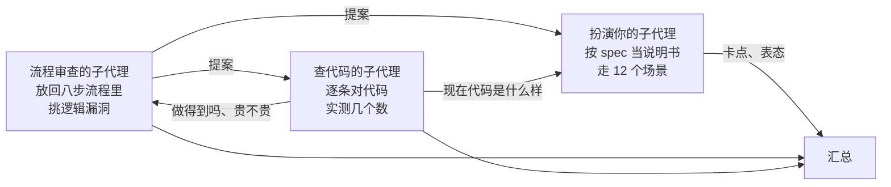
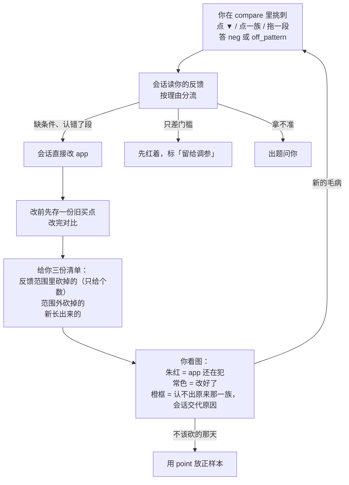

# 反馈功能方案审查：白话版

> 来源：同目录 `final_report.md`（2026-11-09），由三个子代理分工审查后汇总：一个扮演你走了 12 个场景，一个从整个标注流程的高度挑逻辑漏洞，一个对照现有代码查哪些做得出来。被审的是 spec 里今天写进去的反馈功能（`.scratch/annotation-path2/spec.md` 第 1.11、6.13 节）。

## 一句话

方向没问题，你这一轮定的 12 条一条都不用推翻。毛病集中在两处：挑完刺之后，会话怎么改、改完怎么查；以及几处照字面做不出来的界面细节。有 5 件事要你点头，其余改动会话可以直接写进 spec。

## 先认几个词

| 词 | 意思 | 出处 |
|---|---|---|
| 反馈 / `feedback` | 你在图上对 app 已经买了的地方挑刺，答 `neg` 或 `off_pattern` | [path2_web/GLOSSARY.md:71](../../../path2_web/GLOSSARY.md) |
| `off_pattern` | 样子就不对，不是这个走势 | [path2_web/GLOSSARY.md:66](../../../path2_web/GLOSSARY.md) |
| 正样本 | 你标的「是这个 pattern、当天会买」的那天，图上的实心 ▲ | [path2/GLOSSARY.md:157](../../../path2/GLOSSARY.md) |
| 负样本 | 你专门挑的「像这个 pattern，但当天就看得出不该买」的那天，空心 △ | [path2/GLOSSARY.md:162](../../../path2/GLOSSARY.md) |
| 成员框 | 一个样本收进来作为依据的那几个框 | [path2/GLOSSARY.md:171](../../../path2/GLOSSARY.md) |
| 族 | hits 行里起点相同、并成一串的那些 hit；在 new_step 里就是「同一次阶跃之后的那一串买点」 | 界面用语，spec 5.8 |
| 定级 | 会话给每个特征定「必须有 / 可有可无 / 不能有 / 不要」的那一步。规矩之一：某个特征在不到一半的正样本里出现，就默认不要 | spec 6.1 |

## 审查是怎么做的

三个子代理互相发消息讨论。每条改法都经扮演你的那个表过态，也经查代码的那个核过能不能做。用的数据是 new_step 第二版在你标过的 6 只股票上的买点。

## 用起来是什么感觉

按今天那份差异清单真实走一遍：大约 15 条反馈、60 来下点击、14 句话就能清完，另有约 40 下翻股票、拖视窗。和在会话里逐条说相比，写的句子差不多。省掉的是抄约 30 个日期、来回确认「你说的是哪一段」。另外记录会留下来，每次改版自动核对。

## 改好之后，一轮反馈怎么走

## 要你拍板的 5 件事

**1. 为保住一天放的正样本，不算进定级。**
- 现在的规矩是：会话砍掉了你觉得该买的那天，你就用 point 放一个正样本保住它。
- 问题在于，你在没画框的地方随手放的正样本没有依据框，定级时只会加分母。攒多了，你原来画的特征就被挤到「不到一半」，被默认不要，而且不会有任何提示。
- 粗算一下：「站上新平台」这个主特征要攒到 12 个才会被挤掉，但一个在七成正样本里出现的次要特征，5 个就够了。
- 推荐：没画框的正样本只用来核对「app 还买不买这天」，不进定级的计数，pattern 页上单独写个数；也不再提示你给它补框。代价是这类样本不能拿来证明「这个 pattern 长什么样」，想让它算数，就得在附近画框。

**2. 对单个买点的反馈，只看那一天。**
- 现在写的是「那天前后一天内 app 还买，就算没改好」。可 new_step 的买点有近七成前后一天内还挨着别的买点，其中 8 个就挨着你自己的正样本日。会话就算精确砍掉你说的那一天，记号也会一直红，除非连你的正样本那天一起砍掉。
- 推荐：三种范围统一成「这段日期里还有买点就红」，单个买点就只看那一天。你点的本来就是 app 自己的 ▼，日期不会有偏差。代价是：app 把买点整体挪一天时，这条会显示「改好了」。这种情况由下面「新长出来的买点」清单兜住。

**3. 反馈只在 compare 里用。**
- spec 原来写的是「记号画在 compare 和 app 模式」。查代码发现，app 模式下没有标注侧栏和工具组，反馈列表也就看不到；而且 app 模式里的图可能来自旧的扫描结果，用的不是当前 app，反馈对不上。
- 推荐：只在 compare 里反馈；app 模式最多把记号画出来给你看，不能在那里反馈。扮演你的子代理说它不在意 app 模式。

**4. 1.11 节跟着改的几处文字。**
- **点一族存下的东西**：原方案只存这一族第一个到最后一个 ▼ 的日期。可是改版后买点常在同一族里往后挪，比如 CRNC 2025-01 那族改完后可能在 02-07 又买，记号就会假装「改好了」。改成再存这一族的起点：同一起点的还在买，或原来那段日期里还有买点，都算红。新一版里连这一族的起点都认不出来时，记号画成白底橙框（第三种状态），会话每版交代一句：是真改好了，还是认法变了。
- **会话每版报什么**：原来只报「砍掉的买点日」。改成三份：你反馈范围里砍掉的（只给个数）、范围外砍掉的、新长出来的。后两份按族折叠，比如「CRNC 11-21 那次阶跃：11 天剩 6 天」，每族带一个直接落在 compare 那一天的链接。原因是，改版在你熟悉的股票上新长出来的错买点，现在没有任何东西会告诉你，盲看又不抽这些股票。你说一版细看十几族就是上限，再多由会话挑代表。
- **一直红着的反馈要有交代**：侧栏每条红记号旁挂一个会话写的短标签，比如「还没处理」「留给调参」「量过不值得加」「当天看不出」「你说过接受」。对话里只报变化。
- **反馈不会过期**：你说「这里不该买」，不会因为 app 换了一版就失效，每次都按当前的 app 现算红不红。

**5. 几个新的界面名要你认。**
第三种状态（暂叫 `lost`）、拖选范围里没有 ▼ 时的提示（暂叫 `no buy in range`）、面板上「重新拖范围」的按钮（暂叫 `redraw`），以及上面那几种红记号标签。会话按命名规则起好后列给你。

## 其余改动（会话直接写进 spec，你知道大意即可）

**防止流程得出错结论的两条**
- **「由反馈推出的条件先量、再过盲看」要有真的关卡。** 量特征和盲看都还没造，反馈却先造了，现在没有任何地方记「哪条条件是从反馈来的、量过没有」。改法：会话在 app 的 mapping 文件里记一本账；给这条条件挂上你那句原话，compare 的诊断里能看到；送最后检查前的进门清单加一条「由反馈推出的条件都量过了」。没过你仍可以坚持送。
- **不许会话对着几张图拧门槛。** 让反馈变常色最省事的办法，是把现有门槛拧到刚好砍掉那几天。这在训练段上看着全对了，换一批图就失效；而且你看得见后来跌没跌，挑出来的多半是后来跌了的，照它拧出的门槛会显得特别好。改法：只差门槛的反馈先红着、留给调参；新加条件的初始门槛按你那句话的字面意思取，不按那几天的实测值取。量这条条件时，来源那几只股票不算进判断。

**核对那一半的补丁**
- 调参前后，也按同样的格式报各条反馈红没红。
- 盲看作答和反馈存成同一种记录，但盲看答完不许改、不许删，要在存储层挡住。
- V-S1 的记录里，把你用反馈那句话（而不是框或属性）表达的不买理由，记成「只能写进备注的话」。否则 V-S1 会显得比实际更容易通过。
- 拖了一段，里面一个 ▼ 都没有：不弹面板，只提示一句。

**界面细节**
- hits 行里族的底线现在只有 1 像素，而且点不中，要做成整行都能点。代价是：hits 行里格与格之间的空白，原来点了是取消选中，以后会变成弹出这一族的面板。
- 作答面板不抢键盘：点别处、平移、缩放就收起；Esc 第一下只关面板；点了 `neg` 才把光标放进理由框，这样同一天几个 hit 时还能用 ←/→ 挑；点到另一个 ▼ 就关旧开新。
- `off_pattern` 的分段按钮用和 band 表头一样的名字，悬停显示你的原话，同时把那条 band 加亮。像 new_step 的 `today` 这种你看不懂的名字，就靠悬停的原话说明。
- hits 行的反馈带太矮，写不下 `off_pattern`：写不下就只画记号，悬停时显示全文；常色记号靠描边来认，因为 hits 区本身是浅黄底。
- 侧栏列表点一行、会话清单里的链接，都直接落在 compare 那一天。
- 两台机器：两台都更新到新代码之后，再存第一条反馈。否则没更新的那台会整页读不出标注（数据不会丢，更新代码就好）。
- 还有几处小的：保存后能改范围；同一族点两次不会存出两条；会话改完 app 后要刷新页面。

**文档里补的分工**
- **负样本和反馈 `neg` 怎么分**：app 买了、你嫌它买错，用反馈；你想教会话一个不买的理由、又画得出来，用负样本（app 没买的地方也能放）。
- **`neg` 和 `off_pattern` 拿不准时**：随便选一个，理由写清楚就行。两者的核对方法一样，选错不吃亏，会话会按理由归类。
- **系统性毛病不用逐处反馈**：给一两个例子，再在会话里说一句「这一类都不要」就算数。别处被砍掉的会出现在「范围外砍掉的」清单里，你扫一眼即可。
- **一族盖住好几天时**：哪天当天看得出、哪天看不出，不用你一天天分。会话来分，看不出的那几天留红，标「当天看不出」。

## 被否掉的做法

- **把一族的核对范围一直延到这一族最后一天**：实测 22 族里有 5 族会盖住别的族的买点。最糟的是 CRNC 2024-10 那次小阶跃，会盖住你 11-29 的正样本日，这条反馈就永远红了。
- **按阶跃日期认族**：等于让界面认识「阶跃」这种具体走势，违反「界面不为某种走势写特例」这条红线。
- **起点前后几根以内算同一族**：INDO 有两次不同的阶跃，起点只差 4 个交易日，会被并成一族。
- **把记号挪到你的区（蓝线上方）**：扮演你的子代理说，紧贴 ▼ 更容易看出盖住了哪几天，所以撤回。

## 局限

- 只在 new_step 一个 app、6 只股票上量过；换 app 以后，族的认法和分段按钮要重新核对。
- 你会怎么操作，是子代理照你的画像模拟出来的，不是你本人；界面还没做，操作数是按 spec 推算的。
- 「来源股票会让量出来的效果偏好看」这一条，偏差有多大没有量过。

## 附表：实测数字

| 量 | 值 |
|---|---|
| new_step 在 6 只股票上的买点日 | 108 个 |
| 前后一天内还挨着别的买点的 | 73 个（68%），其中 8 个挨着你的正样本日 |
| hits 行里的族 | 22 族 |
| 族在最后一个买点之后还延续的天数 | 18 族超过两周，中位数 34 天 |
| 把族的范围延到最后一天，会盖住别族买点的 | 22 族里 5 族；只取首末 ▼ 时 0 族 |
| 侧栏现算一只股票的状态 | 约 0.2 秒，6 只约 1 秒 |
| 主特征 / 七成出现率的特征被光样本挤掉要几个 | 12 个 / 5 个 |
