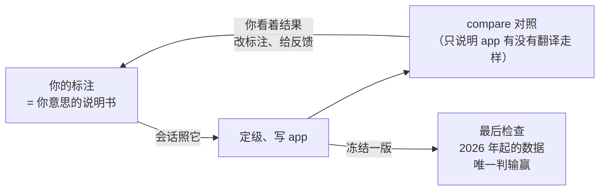

# 反馈迭代时能不能改标注：白话版

> 来源：同目录 `final_report.md`（2026-11-09）。三个子代理分工：一个扮演你走了 10 个场景，一个从「标注在流程里到底起什么作用」出发推规矩，一个查清 spec、说明书和代码现在怎么规定、能不能做到。

## 一句话

标注随时能改，改标注本来就是反馈迭代的一部分，页面不拦你；「第一轮定死、不满意就另起 pattern」在诚实上换不来任何东西，只会更费事。真正要管的只有三件小事：会话每轮把「你改标注造成的变化」和「app 改动造成的变化」分开报；定级时同一段走势上的几个样本只算一处；送检过的 pattern 拆出来、改出来的共用一本检查次数的账。有 4 道题要你拍板。

## 先认几个词

| 词 | 意思 | 出处 |
|---|---|---|
| 正样本 / 负样本 | 你标的「是这个 pattern、当天会买」的那天（▲），和「像这个 pattern、但当天就看得出不该买」的那天（△） | [path2/GLOSSARY.md:157](../../../path2/GLOSSARY.md)、`:162` |
| 成员框 | 一个样本收进来作为依据的那几个框 | [path2/GLOSSARY.md:171](../../../path2/GLOSSARY.md) |
| 特征定义 | 你给一个特征名写的那句解释，现在写下就不能改 | [path2/GLOSSARY.md:141](../../../path2/GLOSSARY.md) |
| 反馈 | 你在图上对 app 买了的地方挑刺（今天刚设计的功能） | [path2_web/GLOSSARY.md:71](../../../path2_web/GLOSSARY.md) |
| 定级 | 会话给每个特征定「必须有 / 可有可无 / 不能有 / 不要」的那一步；规矩之一是某个特征出现在不到一半的正样本里，就默认不要 | spec 6.1 |
| 最后检查 | 拿 2026 年起没碰过的数据跑一次冻结的 app、判输赢，每次记次数；整套流程里只有它判输赢 | spec 6.7 |

## 为什么标注应该能改



- **标注是你意思的说明书，不是定死的考题，也不是成绩。** 你看着 app 的结果想清楚了，就该把它写进标注；否则 app 追的是你已经不认的旧意思，新的意思只能靠对话里一句话传进去，而 spec 恰恰禁止「脱离图改 pattern」。
- **改标注碰不到输赢。** 判输赢只靠最后检查，用的是训练段之外的数据。训练段上改得再多，最坏的结果是「做出一个没优势的 pattern、白用一次检查」，不会得到一个假的「通过」。这和你 10-26 定的「训练段上看着 app 改标注是自由」是一回事，维持不变。
- **第一轮并不更「干净」。** 你那 11 个正样本，之后 40 天里股价最高涨到样本日的 2.3～17 倍。它们本来就是看着后来大涨挑出来标的，把第一轮定为标准不会更客观，只会更旧。
- **「定死、不满意就另起 pattern」只是更费事的改法：**
  - 检查次数本来就按来历算，换个名字也省不了；
  - SMX 那个建在坏数据上的样本会被锁死；
  - 挂在旧名字下的样本、反馈、app 对应全要重来。工具现在不能给 pattern 改名、复制或删除，也不记新旧之间的关系。
- **现有的 spec 和说明书本来就允许改**：约十来处写着或默认「迭代中改标注」，唯一锁住的只有特征定义。你实际上也一直在改，历史上画过 51 个框、删了 40 个。

## 但有三件事要管（都只报告，不拦你）

**1. 每轮把翻转按原因分开报。**
会话每轮开头把你的标注定格一份。下一版出来时，「翻了几张」拆成两栏报：app 改动造成的，和你改标注造成的。后一栏会点名「删掉的、app 原来认不出的正样本」「新放在 app 买点日上的正样本」。你可以照样这么改，只是会看得见 compare 是怎么变绿的。不这么报的话，标注和 app 会互相迁就到全绿，那时它们就再也考不出 app 有没有改对了。

**2. 定级按「处」数，不按样本个数（题 2）。**
扮演你的子代理量出一个问题：在 compare 里点一下就能补成正样本的那些日子，全落在你画过框的大涨段里。这些日子之后 20 天的收益中位数约 +81%，需要先画框才能补的约 −19%。所以最省事的补样本方式只会补到赢家身上。按样本个数定级的话，你在哪张图上多补几个，就能把一个特征推过半数，app 会悄悄跟着变。「底部平稳」现在是 3/10，只在 CRNC 补 7 个就变成 10/17、过了一半。改成按「处」数：同一张图上共用至少一个依据框、或依据框被你手动挂成框套框的几个正样本，只算一处。这样现状是 1/7，在 CRNC 补 7 个还是 1/7，把 23 个都补上也只到 2/7。

**3. 检查次数按来历记（题 3）。**
已经送检过的 pattern，从它改出来、拆出来、替它上场的，共用一本账。还没送检过的随便拆、合、另起，各自从 0 算起。来历在送检那一刻由会话问你一句。

## 页面怎么引导你

你追加的要求是：页面要让你一眼看出此刻该做什么、什么随时能做、什么此刻不能做。现状是：只有几处单个按钮会变灰并写原因；页头那格「下一步」还没做出来；「做了会怎样」几乎没有提示。比如删除既不确认也不能撤销，pattern 定义框不告诉你它直接决定定级，特征定义要写完才锁、事先也不说。

提案（扮演你的子代理全部接受）：

```
页头：  next: you  ·  edited 3   ·  checks 0
          │            └ 会话上次读过之后，你改了几处（悬停列出）；
          │              只是旁注，不改「下一步」本身
          └ 此刻该做什么；悬停解释，并写「标注随时可改，改了会话下一版报出来」
```

- **此刻该做**：页头「下一步」一格照 spec 原设计做出来。缺的数据由会话写进工具读得到的地方，比如还有几道题没答。
- **随时可做**：不列清单。改了以后页头旁边多一个「改了几处」的计数，会话读过一轮就清零。它不会把「下一步」改成「去找会话」，免得你标到一半一直被催。
- **此刻不能做**：落在那个按钮本身，变灰，悬停写原因和替代做法。比如特征定义框在你**动笔之前**就提示「写下就不能改，意思变了另起一个词」；盲看答完的答案按钮写「露出后不能改」。
- **改了会怎样，就写在改的地方**：
  - pattern 定义框悬停「定级照这句话定」；
  - 样本的判断和删除按钮悬停一句口诀：「当天看得出不该买 → 改成负样本；样子就不是 → 挪到未归类或别的 pattern；数据错了 → 删」；
  - 删样本时提示「这几个框只为它画的，要一起删吗」；
  - 删除可以撤销最近一次。

删样本时的那条提示是专门为 SMX 准备的。实测删掉 SMX 2025-11-24 以后，页面会在剩下的 12-02 样本上冒出两个「画了没收」的空位，等于劝你把坏数据上的两个框收回来。所以删那个样本时，要把只为它画的两个框一起删掉。

## 要你拍板的 4 道题

1. **改标注算不算反馈迭代的本职？** 推荐：算。框、样本、属性、pattern 定义、归组随时能改，不拦；会话把「你改标注造成的」和「app 改的」分开报。这一条要写进 spec 第 1 节。
2. **定级按「处」数，不按样本个数？** 推荐：按处。pattern 页的特征计数写处数，样本表照旧写样本个数。代价：哪几个样本算同一处，由会话按依据框自动划，可能划错，但你不用维护它。pattern 页的处数悬停会列出哪几个样本被算作一处；只有划错会影响某个特征「要不要」时，会话才附链接问你一句「这几个是同一段走势吗」。按现在的标注，不会因此出题。
3. **送检过的 pattern，改出来、拆出来、替它上场的，共用一本检查次数的账？** 推荐：共用；没送检过的各自从 0 算。代价：拆成两个以后，两个都背着旧账的次数。不共用的话，「没过就拆成两个各送一次」会让次数少算。同一份数据查得越多，越容易碰巧过一次，次数少算，「过了」就不可信。
4. **特征定义的锁怎么落？** 推荐分两步走：
   - 现在：照旧写下就锁，但在你写之前就提示。
   - 等会话能看见「上一轮以来你改了什么」之后：放开改字。你改了，会话下一轮问一句「意思变没变」，变了就另起一个词，并把用旧词画的框逐个给你链接去改。

   另一条路是永远锁着，最省事，但写错的字也改不了。

## 和上一份反馈审查里 5 件事的关系

- **第 1 件（没画框的正样本不进定级）**：包含在本报告的题 2 里。「按处数」的规矩里本来就有一句「没有依据框的正样本不计」。题 2 选了按处，第 1 件就跟着成立；题 2 不选，第 1 件仍可单独定。
- **第 2、3、5 件**（单个买点只看那一天、反馈只在 compare 里用、新界面名）：与本题无关，照旧待你定。
- **第 4 件**（1.11 跟着改的几处）：其中「会话每版报几份清单」会和本报告的「按原因分开报」合成同一份改版报告；「反馈不过期」旁边要补半句：你改了 pattern 定义时，旧的反馈和盲看答案会另外标出「定义改过」。

## 顺带查出的事

- **你的标注现在没有跨机器同步。** 这台机器的 Syncthing 只同步了 Claude 的会话目录，标注目录还没接进去；现有 171 批标注全部来自 pc。spec 写的是两台机器都标注、靠 Syncthing 同步。你要在 upc 上标注的话，需要先接上。这件事属于你的环境设置，会话不会去动。
- **会话现在看不见「上一轮以来你改了什么」**：标注文件里其实存着带时间的全部历史，但会话读标注的唯一入口只给当前状态。所以 spec 里写好的「改判了要问你」「每轮读变化」现在都落不了地。补法很小：给这个入口加一个「截至上一轮」的选项。它也是上面题 4 第二步的前提。

## 局限

- 只在 new_step 一个 pattern、10 个正样本上量过；「处」的划法换到框画得很长或很碎的 pattern 上要重新核对。
- 「处」怎么划由会话来定，目前标的是「待验证」。团队定稿后又改了两次：先是被「样本日当天画一天小框」的反例推翻，后来又被「台阶式连续阶跃会并成一处」的反例推翻（INDO 2022 年 1 月和 3 月的两级只隔 17 根 K 线）。最后定下的划法是：共用至少一个依据框，或依据框被你手动挂成框套框，才算一处。加上「手动框套框」这一条，是为了照你 11-04 的决定，把 RGTI 那两个样本算成同一个新平台。只认你手动挂的，不认工具按位置自动推出来的「包住」，因为台阶式两级之间，后一级的框画得早一点就会包住前一级。按这个划法，现在是 7 处：RGTI 合成一处，QBTS 仍算两处（你对 QBTS 没有表过态）。还有一种情形会并错：同一张图上两次不相干的阶跃共用了一个很长的背景框。这些现在都不会改变任何特征「要不要」，也不影响要你拍板的 4 道题。
- 你的反应是子代理照你的画像模拟的；页面引导只说了显示什么、什么时候变，还没画界面。
- 定级、翻转报告、检查账本这些都属于还没造的第二段，本报告给的是写进 spec 的规矩，不是实施计划。

## 附表

| 量 | 值 |
|---|---|
| 11 个正样本之后 40 天内最高价 / 样本日收盘 | 2.3～17 倍（SMX 坏数据那个 96 倍） |
| 你历史上画过 / 删过的框 | 51 / 40 |
| 你历史上放过 / 删过的样本 | 13 / 2 |
| 点一下就能补的多买日 / 需先画框的 | 23 天（之后 20 天收益中位数约 +81%） / 75 天（约 −19%） |
| 「底部平稳」按样本数：现状 → CRNC 补 7 个 → 全补 23 个 | 3/10 → 10/17 → 11/33 |
| 「底部平稳」按处数：同上三种情形 | 1/7 → 1/7 → 2/7 |
| 每个样本当天另画一天小框（假想）时按处数 | 1/7（所选划法）；若改用「最近的框交叠」会退回 3/10 |
| 把样本同一天重放到新 pattern，依据框和原来不同的 | 11 个里 3 个 |
