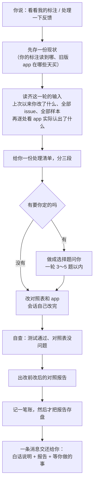

# 反馈去掉二分类、会话的一轮写成 skill：白话版

> 来源：同目录 `final_report.md`（2026-11-10），由 agent team 完成设计、开发和审查后写成。这份白话版自成一篇，不必再打开原报告；研究目录删掉时两份一起删。

## 一句话版本

你在 `compare` 里挑刺时不用再先选 `neg` 还是 `off_pattern`，直接点出问题落在哪个 node（可以不点）并写一句话就行；会话这边多了一个叫 `annotation-round` 的 skill，你说「看看我的标注」或「处理一下反馈」，它就按固定顺序走完一轮：先存一份现状，读齐你标的东西，给你一份处理清单，只把必须由你定的几条做成选择题，改完 app 再交一份改前改后的对照报告。

四块（存储、界面、skill、文档）都做完并各自通过了审查，自动测试全过。skill 另外请了一名没有任何背景的读者只读它三遍，前后找出二十多处会让会话走错的地方，都已改掉，其中最危险的几种现在由程序直接拦住。全部改动还在工作区里，**没有提交**。你的标注文件没有被动过。

## 先认几个词

| 词 | 意思 | 出处 |
|---|---|---|
| feedback / 反馈 | 你在图上对 app 已经买了的地方挑刺，一条反馈是一处（某只股票的一段日期） | `path2_web/GLOSSARY.md:71` |
| issue / 问题 | 几处反馈共用的那份内容：你写的那句话，加上点出的 node | `path2_web/GLOSSARY.md:76` |
| node | app 里对应你一个特征的那一块 | `path2/GLOSSARY.md:76` |
| where | 挂在 node 上的一条条件 | `path2/GLOSSARY.md:79` |
| detector | 从 K 线里切出某种事件的程序 | `path2/GLOSSARY.md:50` |
| mapping | 会话写的对照表：你的每个特征由 app 的哪一部分来认 | `path2/GLOSSARY.md:144` |
| sample / 样本 | 你在图上放的正样本或负样本 | `path2/GLOSSARY.md:152` |

下文说的「定格」不是词表里的词，指的是会话在动 app 之前，把你当时的标注读到哪儿、旧版 app 在哪些天买，存一份备查。

## 一、界面：你会看到什么变化

**作答面板**一打开就是三行，不用先选答案：

```
┌──────────────────────────────────────────────┐
│ CRVO  2024-02-16 — 2024-02-27  range         │
│ issues  [ 以前写过的问题，点一条就复用 ]      │
│ nodes   [plateau] [old_plat] [step] ...      │  ← 可以一个都不点
│ note    [ 写一句话，必须写              ]     │
│                                      [save]  │
└──────────────────────────────────────────────┘
```

- **note 每次必写。** 只点 node 不写字存不了，因为光有 node 说不清问题是什么。同一句话只用写一次，别处从 `issues` 列表里挑它复用。
- **node 可点可不点，可多选。** 意思统一成「问题落在这一块上」。说不出是哪一块就不点。
- **`dag` 按钮没有了。** 一个 node 都不点，已经表示「不在某一块上，或说不清」。
- **issue 的规则没变**：挑一条就和它共用；所属的 issue 还标在别处、你又改了内容，才问 `all`（各处一起改）还是 `only this`（只改这一处，另立一个）。

**侧栏 `feedback` 页**照旧按 issue 分组。组头第一行是点出的 node，没点的写灰字 `none`；旁边是标了几处、其中几处 app 还在买。

**图上的反馈带**：记号上原来写 `neg` / `off_pattern` 的位置，现在写 node 名；放不下就写第一个加 `+n`，再放不下就不写字。

### 你以前存的反馈怎么办

什么都不用做。旧记录照样显示、能编辑、能被复用。两点要知道：

- 旧记录里的 `neg` / `off_pattern` / `dag` 在界面和报告里都**不再显示**。原来的内容仍留在标注文件的历史里，没有丢。
- 旧记录点开再保存，会被改写成新写法（哪怕你什么都没改）。以前没写 note 的旧记录，编辑时要先补一句才能存。

你现在的标注里只有 1 条反馈（一条写了 note 的），新代码读它没有任何问题。

## 二、会话这边：一轮怎么走



**处理清单的三段**，把 issue、和 app 对不上的样本、还没对到 node 的新特征放在同一份里：

| 段 | 放什么 | 要你做什么 |
|---|---|---|
| 我这一版直接改 | app 认得比你的定义松的；毛病明显在结构上的样本；新特征 | 不用，改完在报告里告诉你 |
| 要你定 | 你说的有道理，但你的定义里没有这一条 | 做选择题：写进定义 / 不写、这种可以买 / 先放着 |
| 这一轮不改 | 当天看不出的；只差门槛的（留给调参）；量过不值得加的 | 不同意可以反对 |

选了「写进定义」时，会话给你一句建议的措辞，**由你自己贴进页面上的 pattern 定义**；会话不动你的标注文件。这一版 app 会先把这条条件加上。

**几条写死的规矩**，都是因为错了补不回来：

- 动 app 之前必须先定格。旧版 app 的买点只存在那一份里，改了 app 就再也算不出来。
- 一轮只定格一次。会话中途断了，新会话会认出「上一轮没走完」并接着做，不重新定格。**程序也拦**：上一轮还没存报告时，换个文件名再定格会被拒绝。
- 「这个 pattern 还没有 app」不能默认成立。找不到对应的 app 时程序先拒绝，因为 pattern 改过名、对照表丢了或写坏、app 没被认出来，看起来都是这个样子；会话逐条排除后明确确认，才按没有 app 定格。如果这个 pattern 已经有反馈，那它一定有过 app，直接停下告诉你。
- 把现状写进对照表之前先留一份底，写完对比，除新写的那一段外应一字不差。
- 不为了让红色记号消失去拧门槛；只差门槛的留给调参，调参单独算一轮。
- 新加条件的初始门槛按你那句话的字面意思取，不按被挑刺那几天的实测值凑。
- 对照报告只看你标注过的股票，不带后续涨跌。它说明「你指出的地方现在怎样」，不说明这一版赚不赚钱。

**还没有 app 的第一轮**走同一套顺序：没有旧版可比，报告只列第一版 app 下每张样本的结论。

### 和旧 skill 的关系

`annotation-round` 不依赖 `authoring-path2-app`：目录里没有它的名字，你把它删掉后新 skill 照样完整可用。

- **取了的**：写 app 时不知道就会悄悄出错的规矩，比如 node、边、where 各管什么，参数文件怎么落，买点怎么声明。每条都对着现在的代码核过，其中几条写脚本实测成立。
- **没取的**：入口分诊、三层逐层找你确认、交给 plan mode、网页看图确认、整个扫描范围的改前基线和回归对拍，以及只对某种走势有用的经验。
- **从标注这条线自己推出来、旧 skill 里没有的**：样本和框算不算认出来了怎么判；新条件只能用当天及以前看得到的东西；砍整族还是只砍几天；加一条条件要一起动哪几处；不随手改 node 名（你反馈里点的 node 是按名字存的）。

要新写或改 detector、要调门槛、要量一条条件值不值、说不清某处为什么认成这样时，它转给 `authoring-path2-detector`、`tune-gates-v3`、`feature-study`、`diagnose-event`。

规格里写了但还没做的（特征定级、盲看、页头的下一步提示、最后检查），skill 里只列一句「尚未实现」，以后补进同一个 skill。

## 三、要你定的六件事

1. **票 09「循环技能」现在关不关。** 规格里那一行已改成现状（skill 已经写了），但实现者顺手把关票条件写成了「定级、盲看、最后检查实现后补进同一个 skill 再关」。这是它的推断，关不关由你定。
2. **照你定义里已有的话改的条件，送最后检查之前要不要也量一遍。** 现在的记法是：照定义改的直接记为「照定义」，只有你新同意写进定义的才记为「还没量过」。最后检查还没实现，这个问题先挂着。
3. **`authoring-path2-detector` 自己会读到 2026 年的行情。** 它做体检和对拍的命令默认读完整行情。经新 skill 转过去时，已写死必须指定截到 2025-12-31 的那份；但它自己的文件没改，绕开新 skill 直接用它时仍会越线。要不要改它由你定。
4. **`authoring-path2-detector` 仍是每一步找你确认、再交给 plan mode**，和这条线「你不审批设计」相抵。新 skill 消不掉这一点，属于票 11 的事。
5. **有一种说法可能绕过定格。** 你不提「标注」、直接说「给 new_step 加一条条件」时，新 skill 不一定被触发，会话可能直接改 app，没有先存旧买点。实现者建议在 `CLAUDE.md` 里加一句，把这类请求引到新 skill。加不加由你定。
6. **删 `authoring-path2-app` 时要一并清理的地方**（清单见文末附表）。（2026-11-10 后续：已删，引用已清；第 3、4 条提到的 `authoring-path2-detector` 也已改造并改名 `write-detector`——不再逐步找你确认、不进 plan mode，只读到 2025-12-31 的行情。原先写的「有一段要先搬再删」核实后不成立，那段内容本来就在 detector skill 自己的手册里。）

## 四、要你认的名字和要你看一眼的默认值

**待认的名字**（都已记在规格的待认名单里）：

- skill 名 `annotation-round`；
- 侧栏里没点 node 时的 `none`，面板的两个键 `issues`、`nodes`；
- 会话账本里条件状态的五个开头词：`from_definition`（照定义改的）、`unmeasured`（你同意新加、还没量）、`declined`（你说不写进定义）、`for_tuning`（留给调参）、`not_worth`（量过不值得）；
- 上一批留下还没认的：`all` / `only this`、`lost`、`no buy in range`、`redraw`、`pos sample inside`、六个原因标签。

**待验证的默认值**，用起来不顺再调：

- 只占一根 K 线的记号基本写不下 node 名，多半是没字的色块，内容靠悬停看。
- `issues` 列表约五条高，多了在框里滚动；「最近用过的在前」是按编号先后近似的。
- 一个 node 上对了好几个只当属性用的特征时，那个 node 的 band 表头会把特征名连着写，表头会变长。
- 一轮最多问 3～5 题，多了的挑最要紧的问。

## 五、这次验证说明什么、不说明什么

**说明的**：新代码读得出你的旧标注；新旧两种写法都存得进、不会存坏；界面和一轮的流程照设计工作。依据是各块的自动测试、审查者独立重跑、在你的真实标注上只读地跑过 skill 的命令，以及在临时目录里把完整一轮（含三种中途中断、清单为空、还没有 app 的第一轮）走通。

**不说明的**：

- 没有真人在真页面上用过新面板，顺不顺手要你用了才知道。
- skill 没有对着真人走过完整一轮：出题那一步，以及「清单发出后必须接着做事、不能停在那里」，都是会话真跑时的行为，临时目录里验不了。你第一次说「看看我的标注」就是它的第一次真跑。
- 改出来的 app 好不好，不在这次验证范围内。

### skill 的独立审读：三遍，找出什么

带着背景的成员互相审，看不出「一个什么都不知道的会话照字面读会怎么走」。所以另请了一名只读 skill、不看任何设计材料的读者，让它设想几种场景逐步走。

| 遍 | 找出的 | 处理 |
|---|---|---|
| 第一遍 | 12 处，其中 4 处定格前后走错就补不回（app 写错加载不上被当成没有 app；定格报错后没有去向；一句话会诱导定格前改代码；定格「做完的标志」是空的） | 全部改掉 |
| 审查者复审时 | 再 1 处同类：对照表文件写坏，会被当成没有 app | skill 和程序各拦一道 |
| 第二遍 | 8 处，最要紧的是：会话记账时引你的原话，话里带冒号或引号就可能把整份对照表写坏，而当时的检查查不出 | 检查换成能发现的；写法里点明怎么避免 |
| 第三遍 | 3 处小缺口，并列出还剩哪些补不回的路径 | 缺口改掉；能让程序拦的都加进了程序 |

它第三遍的总评：正常情况下，一个没有背景的会话只读这个 skill 把顺序走对的把握很高；最可能出事的仍是定格前后遇到意外的时候。第三遍之后改的那几处，没有再请它读第四遍。

**仍然只能靠会话自觉、程序管不了的**：

- 定格之前改了 app 的代码。
- app 坏到没法定格、你让会话修时，规定是只修到能运行、不动任何判定条件；它有没有顺手改了条件，没有程序检查，事后只能看代码差异。毛病恰好出在判定条件里时规定不修，由你定怎么办。
- 存现状的文件丢了，或换了工作目录。
- 会话做「真的还没有 app」那次确认时判断错了。

还有一个没验证的疑点：你给 pattern 改名之后的第一轮，可能把全部样本和反馈当成新的再报一遍。只会多报，不会漏报，也不丢东西；没有造改名的数据实际跑过。

### 开发中途中断过，补救到什么程度

开发途中因为额度用尽，会话重启过一次，四名成员换成了三名新成员；之后做 skill 的成员又被打断过一次，那次是原地续做的。

**补上的**：

- 成员之间的 38 条讨论消息从磁盘上找回（同目录 `discussion_log.md`），核对后确认定稿前谈定的都在设计里；定稿后口头约定、没落文档的几条补进了设计。
- 前任后端成员的完成汇报当时没人审，后来逐条对着代码审过。
- 前任 skill 成员安排过一次「没有背景的独立审读」，被打断后没人补做。这是你追问「是否完全补救」之后才查出来的，上面那三遍审读就是补它，结果它找出的问题最多。
- 前任做过一份 20 条的代码核对，新成员当时不知道。取回后逐条对照，结论没有矛盾，并据此补了两条遗漏的陷阱。

**出过的差错**：我告诉接手的 skill 成员「看图脚本还没写」，其实前任写过一版，它没看就覆盖了。前任那版的原文在记录里，事后对照过：只少一个开关，已加回；新版能显示出前任那版显示不了的 4 条条件的实测值。

**补不回的**：前任成员没写出来的考虑查不到。四名前任的记录我都查过三样（写过哪些文件、派没派过子代理、正文里有没有没报出来的保留意见），没有发现没报的；但前任后端成员改规格、说明书、词表是用命令行改的，列不出逐处清单，只能看它的汇报和现状。

## 六、现在要你做的

1. **重新启动网页。** 你原来开着的前后端已经不在了，要自己重启才能看到新面板。
2. 在 `compare` 里试新面板：点一个 ▼，直接写 note 保存；再到另一处从 `issues` 里挑它复用。
3. 想走一轮时说「看看我的标注」。第一次真跑时，你标注里有三个特征（底部平稳、平台交界放量、触底放量）还没对到 node，会出现在清单的第一段。
4. 对上面六件事表态；改动要不要提交也由你说。

## 附表

### 自动测试结果

| 项 | 结果 |
|---|---|
| 后端测试 | 653 通过，1 条失败（之前就有、与这次无关） |
| 前端单测 | 1369 通过，4 条失败（之前就有、与这次无关） |
| 前端类型检查 | 0 错 |
| 端到端测试 | 12 条全过（实现者、审查者、主会话各跑过） |
| new_step 的 app 测试 | 56 通过 |
| 你的真实标注在新代码下读取 | 0 违规、0 冲突 |
| 定格程序新加的几道拦 | 在你的真实标注上只读试过五种调用，都符合预期，没留下文件 |
| skill 的独立审读 | 三遍，全程只读；会写文件的定格、出报告两条命令它没实际跑，只核对了写法和行为 |

### 删 `authoring-path2-app` 时要清理的地方

| 位置 | 要做的 |
|---|---|
| `.claude/skills/authoring-path2-detector/SKILL.md` 第 3、20、22、49、51、275 行 | 把指回旧 skill 的话改成指 `annotation-round` |
| 同文件第 191 行 | 改成指它自己手册里讲「失败记录归哪条流」的那一节（那段内容本来就在，不用搬） |
| `.claude/skills/tune-gates-v3/SKILL.md:10` | 「结构改动转旧 skill」改成转 `annotation-round` |
| `scripts/path2/path2_eval_scan.py:1`、`path2_web/eval_runner.py:3` | 注释里去掉对旧 skill 的指称（不影响运行） |
| `.scratch/annotation-path2/spec.md:763` | 整条删 |
| `.scratch/annotation-path2/issues/09-loop-skill.md:14`、`issues/11-skills-take-annotations.md:16` | 票里对应那一项划掉或标明已被取代 |
| 根 `CLAUDE.md`、说明书、用户级配置 | 没有它的名字，不用改 |

### 与本任务无关、顺带发现的一处

两处代码里的说明和实际相反，skill 里已注明以实际为准，说明本身没有改，由你决定要不要顺手修：

- `path2/dag/nodes.py:38` 还写着「子结构 node 上的 where 是无效字段、会被拒绝」，而实际代码和 new_step 都允许。
- `path2_web/mapping.py:68` 写着「新写的 app 要重启后端才认得」，而后端平时是自动重启的。
