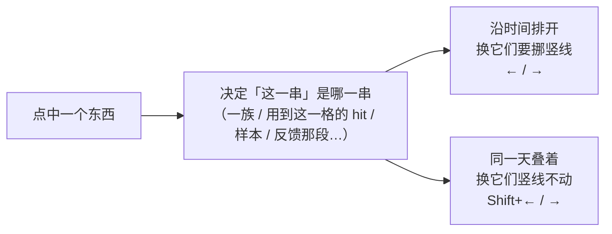

# 点一个东西、背后连着一串时，怎么看、怎么切：白话版

> 来源：同目录 `final_report.md`（2026-11-11），由三名研究成员（盘点现状、出方案、站在你这边挑刺）三轮往来后写成。代码基准是 `annotation-path2` 分支的 f3d64f3。本文自包含，不必打开底稿。

## 一句话

现在不对称，是因为左右键在哪一串里走、提示条上的数在数哪一串，是两套互不相干的规则；推荐的改法是：**← / → 永远挪当前日竖线、换一天，Shift+← / → 永远竖线不动、换同一天叠着的那几次，要换「哪一串」只靠鼠标点**。提示条上的每个数，都对应一对真在走它的键。

## 先认几个词

| 词 | 意思 | 出处 |
|---|---|---|
| hit | app 求解出的一次完整命中，每个 node 各绑一个具体事件 | `path2/GLOSSARY.md:95` |
| 买点 | 一次 hit 里真正用来算收益的那几根 K 线；▼ 画在买点上 | `path2/GLOSSARY.md:118` |
| 一族 | hits 行里起点相同、并成一串的那些 hit | `path2_web/GLOSSARY.md:71`（feedback 词条里） |
| band | 副图里的一条轨，一个 node 一条 | `path2_web/GLOSSARY.md:39` |
| sample / 样本 | 你在某一天对某个 pattern 下的判断 | `path2/GLOSSARY.md:152` |
| feedback / 反馈 | 你对 app 已经买了的地方挑的刺 | `path2_web/GLOSSARY.md:71` |
| 当前日竖线 | 贯穿主图、副图的那条竖线，标着「现在看的是哪一天」 | 规格 5.8（不在词表） |

## 你遇到的那件事，到底怎么回事

CRNC 起点 2024-10-31 的那一族一共 22 次 hit。它其实是一张表：11 个买入日，每天两种阶跃切法（阶跃算一根、用 step 11-21；阶跃算两根、用 step 11-21～11-22）。

```
                     11-27  11-29  12-02  …  12-26     ← 11 个买入日
切法一（step 11-21）   h      h      h    …    h       ← 点 step 11-21 那格，拿到的是这一行（11 次）
切法二（step 11-22）   h      h      h    …    h
                       ↑
              点 11-27 的 ▼，拿到的是这一列（2 次，图上并成一个 ▼，上方写 2）
```

- **点 ▼**：提示条写 `hit 1/2 ←/→`。这个 2 数的是那一列，可 → 走的是整张表的 22 次：第一下到这天的另一种切法，第二下就跑到下一天了。所以你当成「正确参照」的这一边其实也是错的。我上一轮在说明书和规格里写的「按 → 换到同一天的下一次」也和代码不符。
- **点 step 11-21 那格**：拿到的是一行 11 次，买入日各不相同，所以先出 `candidates 11` 让你挑。按一下 → 就选定了第一个，提示条换成另一件事（这一次在它那天是第几种切法），于是显示 `hit 1/2`。这一行 11 次全是切法一，在各自那天都排第 1，所以一路按下去永远是 1/2；→ 实际在这 11 次里走，提示条却不再告诉你走到第几个。

盘点下来，这种「数的和走的不是一回事」在 15 种点法里普遍存在，一次点击背后最多同时牵着 6 种「一串」：用到这一格的 hit、同一天的几次、一族、band 上的一族、样本、诊断卡片。现在有三类毛病：

- 写了 ←/→ 却走的是别的；
- 能走却不写；
- 进了下一层就回不到上一层。

## 关键发现：其实只有两个方向

所有「一串」都只沿两个方向展开，判据就是那条竖线：



- **沿时间排开**：一族里一天一天的买点、band 上一格一格、样本一个一个；
- **同一天叠着**：同一天只差切法的几次 hit、band 同一格里并着的几个、样本那天在场的几次 hit；
- **「哪一串」不是第三个方向**，而是走动的范围；同一次 hit 可以同时属于好几串，用点来选。

上面那张表说明了为什么不能把它们排成一条「放大 / 缩小」的梯子：「同一天」是一列、「用到这一格」是一行，谁也不包含谁。

## 推荐方案 B 长什么样

**按键**：
- ← / →：竖线挪到这一串的上一个 / 下一个位置。看竖线动没动，就知道自己按的是哪种。
- Shift+← / →：竖线不动，在这天叠着的几次之间换。
- 点：换「这一串」。竖线尽量不动，所以在两串之间来回点不会丢掉看到第几天。
- 按键从不换串。

**提示条**固定三格，没有的格不写：

```
这一串                         位置           这天叠着的                      
hit_family 2024-10-31 ×22      day 1/11 ←/→   same_day 1/2 ⇧←/→ step→2024-11-21   Esc
hits_using step 2024-11-21     day –/11 ←/→                                        Esc
samples                        sample 1/3 ←/→ hits 1/2 ⇧←/→ step→2024-11-21       Esc
```

- `×22`：这一串一共几次。只在和天数不同时写，写了就说明有的天叠着不止一次；step 那格是每天一次，就不写。
- `day k/n`：这一串有几天、竖线在第几天；`–` 表示还没选。
- `same_day`：这天这一族画着的几次，和 ▼ 上方的个数是同一个数。
- `hits`：样本那天在场的几次，和诊断块的组头同名。
- `step→…`：当前这次和另几次差在哪。

你的两个现场在 B 下读法一样：点 ▼ 是 `day 1/11  same_day 1/2`，点 step 那格是 `day –/11`，按 → 变 `day 1/11`、再按 `day 2/11`。

**几个顺带的改变**：

- **点反馈记号**：「这一串」变成这条反馈收进来的那些 hit，口径和它变朱红一致，所以朱红就说明这一串不空。按 ←/→ 能逐个看是哪几次让它还红着，面板一直开着。代价是原来选中的那次 hit 会被换掉。
- **在样本上**：← / → 照旧走样本；同一天的第 2 次第一次有了键（Shift+→），不必再去点诊断卡片。
- **复制（Shift+C）**：连按的三层就是提示条上的三格，按之前就知道这一下会复制什么。
- **候选的细框**：选定后不再消失。
- **提示条**：改成浅灰底黑字，并一直占着那一行，不再出现时主图来回跳。

**要付的代价**：

- 多学一对键（Shift+← / →）、三个新词（`day`、`same_day`、`hits_using`）和一条规矩（按键不换串）；
- 再点同一个 ▼ 不再跳回这天的第一次（Shift+← 可以回）；
- 点 band 上一格进的是哪一串，点之前看不出来，点下去提示条第一格写明；
- 改动面在三个方案里最大。

## 另外两个方案为什么不推荐

| | A 一根轴，只修数字 | C 一条梯子 |
|---|---|---|
| 做法 | 保留 ← / → 逐个走，提示条老实写「走到这一串第几个」，同一天几次只作旁注 | 提示条写出整条梯子（这一次 / 同一天 / 整族），Shift+↑/↓ 换层，← / → 在那层里走 |
| 好处 | 改动最小，不用学新键 | 复制和走动合成一个概念 |
| 问题 | 数的是次数不是天数；知道有第 2 次却没有键能直接去；点框时 ←/→ 又临时改了意思 | 「同一天」和「用到这一格」排不进一条梯子，从 step 进来够不到同一天的另一次——又回到你报的那个错位；漏按 Shift 会切股 |

A 和 B 不冲突：A 要做的几件事（数字带名字、细框不消失、按键不换串）B 全都包含。所以 A 可以当止血的第一步，以后再补上 Shift+← / → 和按天走。

## 不管选哪条都可以先修的

1. **Shift+C 复制成样本**：选中过样本后，在候选里按 →，再按 Shift+C，复制出来的是样本而不是图上那次 hit。
2. **诊断卡片抢键**：诊断卡片写着 `× k`、几次又买在不同天时，提示条写 `candidates ←/→`，按键却在样本之间走。CRNC 上没有现成例子，是直接调程序复现的。
3. **反馈面板不跟着走**：点 ▼ 打开的反馈面板，不随 ←/→ 跟着走。
4. **改错的说法**：说明书和规格里「按 → 换到同一天的下一次」与代码不符，要改。
5. **提示条颜色**：现在是深底琥珀字，不合「界面文字一律黑色」。

## 局限

- 这是设计，没做可点的原型，你没试过手感。按键、落在哪一次等都是默认值，待验证。
- 只在 new_step 上实际点过。bottom_burst 那种一次 hit 买好几天的情形，是按程序结果推算的：KULR 04-08 的 ▼ 上方写 4，选中其一时提示条却写 `hit 1/2`，B 下会统一成 `same_day j/4`。这一条没在页面上看过。
- 待你认的新名字有十来个，如 `hits_using`、`day`、`same_day`、`in_set`、`hit_family`，清单在 `options.md` 第 8 节。
- 考虑过、没采用的做法：选中一族时把叠着的几次按切法摊成几行。它最合「看图」，但每次选中副图都要变高，也推翻了刚定的「同一天并成一格」，可以等 B 做完再议。

## 要你定的两件事

1. **走哪条路**：
   - B 全套（推荐）；
   - 先做 A 止血、以后再补 B；
   - 只修上面五处，切换方式暂时不动。
2. **点反馈记号要不要改成「换串」**：好处是能逐个看段里的买点；代价是原来选中的 hit 会被换掉，影响写反馈时的手感。
