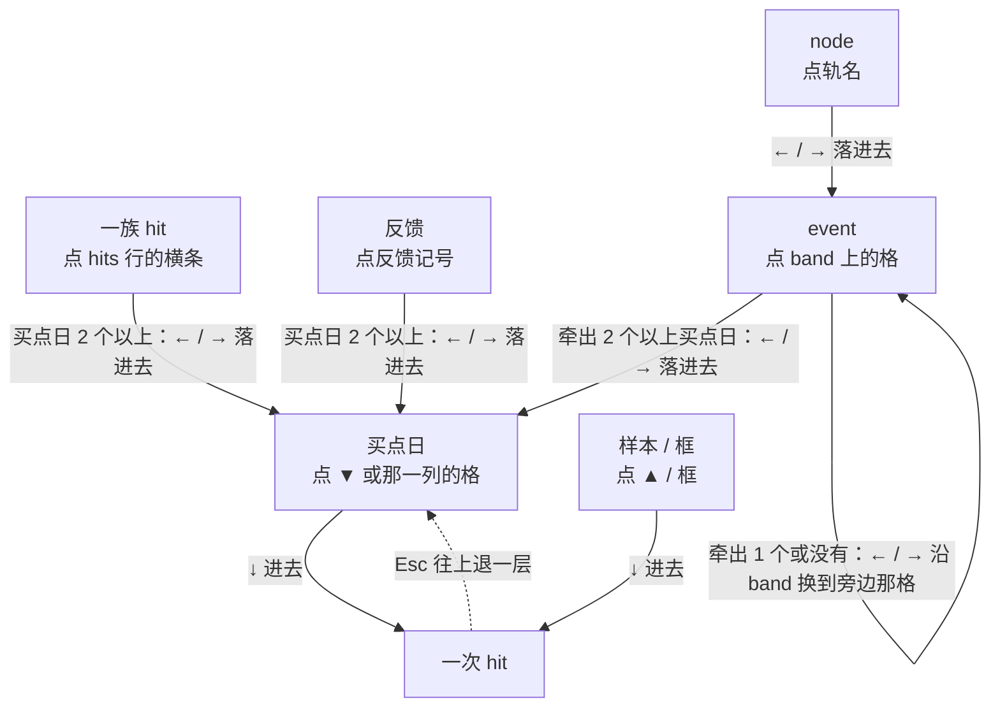

# 只选有业务意义的东西：选中、显示栏与 Shift+C（白话版）

> 来源：同目录 `final_report.md`（2026-11-11 定稿），以及它依据的 `entities.md`、`design.md` 第五稿、`challenge.md`。本文只是翻译，没有新结论。
> 2026-11-12 更新：6 件事你都已拍板，结果在下面「你定下的 6 件事」，正文相关段落已照改。
> 只出设计，正式代码没改。现场核对用的是 CRNC 的 new_step、compare 模式、档位 in_hit。

**一句话**：图上能被选中的只留 8 样有业务意义的东西。同一天叠着的几次 hit 合起来就是「这一天」，它恰恰是写反馈的单位。显示栏拆成 9 个位置固定的格子，选中的是什么永远在最左格，两个按键格直接写出按了会去哪。Shift+C 按一下，就复制选中的那一样。

## 你定下的 6 件事（2026-11-12）

| 题 | 你定的 |
|---|---|
| ① 点 ▼ 选中什么 | 这一天整体。这天只有一次 hit 时，点下去就是那次 hit |
| ② 按 ← / → 的规矩 | 你提的通用规律：里面有得挑（两个以上）就进去；否则本层有得换就换到旁边；两样都没有、里面只有一个，就进那一个。← / → 跨天，↑ / ↓ 留在同一天，两组键同一个判断 |
| ③ 换天落哪一次 | 最像的那次，也就是同一种切法 |
| ④ Esc | 往外退一层，到头再清空 |
| ⑤ 显示栏 | 形态 C：固定九格加选中卡 |
| ⑥ 点样本 | 只选中样本 |
| ⑦ 同一天里换（后加） | 用 **↑ / ↓**，不再用 Shift+← / →；左侧列表切股票改成 **PageUp / PageDown** |

关于第 ⑦ 条换键：
- ← / → 跨天，↑ / ↓ 留在同一天，两根轴正好对应键盘上的两个方向，不用再按 Shift。规律本身不变。
- 上一轮没用上下键，是怕漏按 Shift 切了股票、选中全丢。股票挪到 PageUp / PageDown 后就没有这个风险了。
- 代价：切股票的手感要重新习惯，按一下换一只；图上同一天的几次 hit 是并成一格画的，「上下」只是概念上的方向；什么都没选时 ↑ / ↓ 不再有作用。
- 先取的默认（待验证）：↓ 是进去或换到下一个，↑ 是上一个。
- 下文讲新设计的地方都已写成 ↑ / ↓；讲现在实现的地方（各个「现在：」行）仍是 Shift+← / →。

规律的全文和八种东西逐个套出来的结果在同目录 `切换规律.md`。它是纸面推演，还没在页面上跑过。

## 用到的词

| 词 | 意思 | 出处 |
|---|---|---|
| hit | app 求解出的一次完整命中：每个参与求解的 node 各绑定一个具体事件 | [path2/GLOSSARY.md:95](../../../path2/GLOSSARY.md) |
| 买点 | 一次命中里真正用来算收益的那些根 K 线（可以不止一根），只用于 app 一侧 | [path2/GLOSSARY.md:118](../../../path2/GLOSSARY.md) |
| event | 一次观察结果的不可变记录，落在一段 K 线上；在 band 上画成一格 | [path2/GLOSSARY.md:44](../../../path2/GLOSSARY.md) |
| node | 声明里的一个位置：由哪个 detector 供货、占这个位置的事件要满足什么条件 | [path2/GLOSSARY.md:76](../../../path2/GLOSSARY.md) |
| band | 副图里的一条轨，一个 node 一条 | [path2_web/GLOSSARY.md:39](../../../path2_web/GLOSSARY.md) |
| 档位 | 全局的显示深度旋钮，三档从浅到深：detected、qualified、in_hit | [path2_web/GLOSSARY.md:25](../../../path2_web/GLOSSARY.md) |
| 反馈、一族 | 你在图上对 app 已经买了的地方挑刺：选一个买点、一族或拖一段日期，写一句 note；一族是 hits 行里起点相同、并成一串的那些 hit | [path2_web/GLOSSARY.md:71-73](../../../path2_web/GLOSSARY.md) |
| 样本 | 你在一张图、一个 pattern 下的一次判断：一个样本日、正或负，加上作依据的成员框 | [path2/GLOSSARY.md:152](../../../path2/GLOSSARY.md) |

**买点日**是本次新起的说法，词表里还没有，等你认：指一只股票上 app 在买的那一天，不管是哪一族、哪一次 hit 买的。词表里的「买点」是按每次 hit 算的（一次 hit 可以有好几根），两者口径不同。

---

## 1. 先回答你的两个「对么」

### event 族点横条选不中，因为它只是显示简化，对么？

**选不中是事实；不该被选中，结论也对；但理由要换。**

- band 上一族的横条，现在点了确实什么都不发生，只有悬停提示。
- 你截图里提示条写着 `event_family …`，是因为你点了 band 上的某一格。它写的是按 ← / → 会在哪一串里走，不是你点中的那一格。
- 「只是显示简化」站不住。hit 族用的是同一条折叠规则：起点相同就并成一行。而且在 new_step 里，step 的一族恰好就是「一次阶跃」，today 的一族恰好就是那天的买点日。只凭这条理由，你随口一句「step 的族就是一次阶跃啊」就能把它推翻。

真正该拿掉 event 族的理由有三条：

1. **它的意思随 node 变**：step 的族是一次阶跃，today 的族是买点日，plateau 的族是 hit 族换了个名字，new_plat 则把一个新平台拆成两族。前端不为具体的 node 写分支，没法只让其中几种族可选。
2. **它对得上你的概念的地方，已经有别的东西代表了**：一次阶跃之后那一串买点就是 hit 族，那一天就是买点日。
3. **拿它当按键范围时会走歪**：沿 new_plat 那一族按 →，竖线落在格子的终点，比买点早一个交易日，而那一天恰好是另一次 hit 的买点，最容易看错。它的个数还会随档位变：new_plat 11-22 那族在 in_hit 下是 11 个，切到 qualified 变成 39 个。

### 同一天叠着的几次 hit，整体有意义吗，还是只是显示简化？

**有意义，而且它就是写反馈的单位。这和你的直觉正好相反。**

同一天叠着的几次 hit 合起来就是**那一天的买点日**。看看判断「买得对不对」的地方认的是什么：

- point 反馈只记日期，不记是哪一次 hit。
- 反馈状态、样本有没有对上、调参计数、扫描结果里的首次穿越，都按买点日算，同一天几次只算一次。
- 唯一的例外是扫描结果的收益统计，它按 hit 次数算。那是调参评估的口径，不影响写反馈、比样本、指给会话这一层。

你说的「每个 hit 买点都有意义」，其实混着两样东西：

```
买点日   ── 回答「这天买得对不对」  ── point 反馈挂在它上面
一次 hit ── 回答「app 把这里认成了什么样子」── 两种阶跃切法就是两次 hit
```

这两样是交叉的，不是上下级：一个买点日可以叠好几次 hit，一次 hit 也可以占好几个买点日。后一种在 bottom_burst、bb_v1 里会出现；new_step 每次 hit 只有一个买点日，所以看起来像上下级。

所以「左右切到叠着的那天就选第 1 个」这条前提不成立，改成分两层走：

- 按 ← / → 时，停在**这一整天**上；
- 按 ↓，才进到那天的**某一次** hit。

另外，现在的做法其实也不是选第 1 个，而是沿着同一种切法走。现场核过：从 11-27 的第 2 次按 →，落到的是 11-29 的第 2 次。你截图里看到 1/2，是因为你是从第 1 次出发的。

### 关于「能附着 feedback 才有意义」这条判据

用来证明有意义，它成立；但拿它当唯一标准太窄了。照它推下去，一次 hit、一个 event、一个 node 全都不算，这就和你自己说的「每个 hit 买点都有意义」冲突。规格里也早已定下：event、node 要能指给会话，档位这类查看能力「可以不看，但不该没有」。

改用的判据是：凡是用来做这三件事之一的对象，就有业务意义：**写反馈、指给会话、看 app 怎么认**。另外加两道筛：

- 复制给会话时，它不能被它的上一级或下一级代替；
- 它的意思不能随 node 变。

---

## 2. 你的四条验收清单（skeptic 逐条验收都通过，但验的是你拍板前的按键规则）

| 你要确认的 | 结论 |
|---|---|
| ① 哪些东西有业务意义，只有它们能被选中 | 能被选中的只有 **8 样**：一族 hit、买点日、一次 hit、event、node、反馈、样本、框。下面这些不能被选中：event 族、band 同一格里叠着的几个 event、用到某个 event 的全部 hit（现在的 `hits_using`）、一条反馈收进来的那批 hit、图上的全部样本。点到它们所在的位置，实际选中的都是 8 样里的某一样 |
| ② 选择操作能不能覆盖全部 | 鼠标加键盘，8 样都选得到。**鼠标不能一下点到的有一处**：compare 下 new_step 的某一次 hit，要先点 ▼ 再按 ↓。**光用键盘到不了的有四处**，都能用鼠标点到：从一次 hit 去它用到的某个 event；从只牵出 1 个买点日的 event、族、反馈到那一天；越过一个「里面有得挑」的东西到它后面那个；什么都没选时的第一下 |
| ③ 清楚显示选中了什么，并用显示引导按键 | 最左格写**选中的是什么**；两个按键格直接写**按了会去哪、现在第几个**，用不到的键帽画灰（见第 4 节的图） |
| ④ 复制跟着选中走，取消循环 | 按一下 Shift+C 复制选中的那一样，不再连按。同一样东西不管从哪条路选中，复制出来都是同一行。显示栏前 5 格从左读到右，就是复制行的前半 |

skeptic 没验过你后来定的通用规律。第 ①③④ 条不受按键规则影响；第 ② 条我按通用规律在纸面上重走了上一轮的 14 个使用场景：14 个都还能做，其中 3 个的走法变了。

| 场景 | 通用规律下 |
|---|---|
| 看 band 一格背后同一天的几次 hit | 能，但路变了：那格只牵出一天，按 → 是沿 band 换，不再进那一天。改为点那天的 ▼，再按 ↓ |
| 沿同一行看没进 hit 的 event | 现在能了（原来要你定） |
| 选中一条反馈看它的买点 | 收进两天以上照旧按 → 进去。只收进一天时，按 → 是换到旁边一条反馈，那一天要点 ▼ |

---

## 3. 选中和按键怎么走



- **点什么，决定从哪种东西开始**。之后按键只做三件事：横着换到同一种的另一个、往下落进它装着的、往上退回装着它的。不会跳到不相干的种类。
- **← / → 跨天，↑ / ↓ 留在同一天，两组键用同一个判断**，只看选中的东西「里面装着几个」和「同一层还有没有别的」：
  - 里面有两个以上：进去，在它们之间走。比如选中一族、一条反馈、牵出好几天的 step，按 → 落进离竖线最近的那个买点日。
  - 里面只有一个或没有，同一层有别的：留在本层，换到旁边那个，并落在对应的那个上。选着整天落整天；选着某一次 hit 落那天最像的那次；选着只牵出一天的 new_plat 那格，沿 band 换到旁边那格。
  - 两样都没有、里面只有一个：进那一个。比如样本当天只有一次在场的 hit，按 ↓ 进那一次。
  - 都没有：不响应，键帽画灰。
- **这条规律自带三条后果**：
  - 同一个键是进去还是换旁边，由数据定。能预判靠的是按键格在按之前就写明了 `into …` 还是 `… k/n`。
  - 只装着一个的东西，从它到那一个没有键。比如只牵出 1 天的 new_plat 那格，到那一天要用鼠标点 ▼。
  - 换旁边时碰到里面有得挑的，下一下就被带进去；要越过它得用鼠标点。
- **Esc：往上退一层**，退到最外层再按才清空。点空白仍是一下清空。
- **取消「还没选」**，也就是提示条上的 `day –/n`。那个状态其实是选中了外面那一层：一族、那个 event，或那条反馈。
- **竖线永远停在选中的东西自己的日子上**，不会再停在别的 hit 的买点上。
- **按键走出画面时，图跟着平移**。这是现在就有的毛病：现场按 6 下 →，竖线走出了画面，图却没动。这次一并修好，而且按键带出的平移不会关掉你写了一半的反馈面板。

---

## 4. 显示栏：拆成维度，每个维度固定位置、固定写法（推荐形态 C）

先列出你选中一样东西时可能想知道的 29 件事，再逐件定放在哪：

- 按键时每一步都要看的，进**显示栏**；
- 想追问时才看的，进**右侧栏的选中卡**；
- 只对某一个格子有用的，进**悬停**；
- 图上已经画出来的，不重复写。

### 显示栏：副图上方一行，9 格，从左到右永远不动

```
┌──────────┬───────────┬────────────────┬────────┬────────┬───────────────────────────┬───────────────┬────────────────────┬─────┐
│kind [buy]│node  —    │date 2024-11-27 │name  — │diff  — │in hit_family 2024-10-31   │←/→ buys 1/11  │↑/↓ into hits ×2   │ Esc │
└──────────┴───────────┴────────────────┴────────┴────────┴───────────────────────────┴───────────────┴────────────────────┴─────┘
  选中的是什么  │←──────── 是哪一个 ───────────────────→│    属于什么（Esc 退到这）      按 ← / → 去哪   按 ↑ / ↓ 去哪        退一层
```

| 格 | 回答什么 |
|---|---|
| `kind` | 选中的是什么：`hit_family` / `buy` / `hit` / `event` / `node` / `feedback` / `sample` / `box`。白底粗黑边、粗字，整条里最显眼 |
| `node` | 它对应哪个 node |
| `date` | 哪一天，或从哪天到哪天 |
| `name` | 你那边的叫法：样本字母和判断，或特征名 |
| `diff` | 同一天叠着几个时，它和别的差在哪 |
| `in` | 它属于什么，也就是你从哪一层走进来的；最后一节就是按 Esc 会退到的地方 |
| `←/→` | 按 ← / → 去哪、现在第几个：`buys 1/11` 是在 11 个买点日里的第 1 个；`into buys ×11` 是按了会落进它装着的 11 个买点日 |
| `↑/↓` | 按 ↑ / ↓ 去哪：`hits 1/2` 是这一天 2 次里的第 1 次；`into hits ×2` 是按了会进到这一天的 2 次 |
| `Esc` | 键帽；悬停时写会退到哪 |

你点名的几件事各在哪：**选中什么**看 `kind`，**属于什么**看 `in`，**按键的工作范围**看两个按键格。**包含什么**不单独占一格：按键格里的 `into buys ×11`、`into hits ×2` 写出它装着几个、按了会落进去；卡里的 `buys`、`hits`、`nodes` 三行写出具体是哪些。

**统一写法**：

| 写的是什么 | 写法 |
|---|---|
| 一天 | `2024-11-27` |
| 起止 | `2024-10-31→2024-11-27` |
| 一组日子 | `2024-11-27…2024-12-26 ×11` |
| 第几个 | `1/11` |
| 个数 | `×22` |

**两种「空」分开写**：

- 这一格对这种东西**不适用**：格子照占，写灰色 `—`，键帽也画灰。
- 这一格**适用、但这次没有**：写黑字 `none`。

这样你一眼分得出「这种东西不会有这一项」和「这次刚好没有」。灰色调得够深，在浅灰底上看得清。

### 选中卡：右侧栏顶上，11 行，行序固定

```
┌─ selection ───────────────────────────────────────────────┐
│ buys      2024-11-27…2024-12-26 ×11   它牵出哪些买点日      │
│ hits      ×22                         它牵出几次 hit（跨族另写 families ×k）│
│ nodes     —                           一次 hit 由哪几个 event 组成            │
│ family    —                           结构上属于哪一族                        │
│ feedback  none                        盖住它的反馈、状态、原因标签             │
│ sample    a pos 2024-11-29 ✓（示意）   附近的样本、对上没有                    │
│ paired    —                           配对的另一方                            │
│ level     —                           档位                                   │
│ failed    —                           没过的 where                           │
│ id        —                           编号                                   │
│ copy      CRNC new_step hit_family 2024-10-31 buys … hits ×22               │
└───────────────────────────────────────────────────────────┘
```

上面是选中「一族」时的样子，右边是每行的说明，界面上没有。「这一处买得对不对」，也就是盖住它的反馈和附近样本对没对上，一直显示在卡里。

### 为什么推荐 C

- **A：保留现在的单行，只改内容。** 选中的东西仍是一句连在一起的话，日期在句子里的位置随种类变。
- **B：答案写成一枚标签，贴着竖线。** 好处是按键时不用挪眼睛。但标签跟着竖线和种类挪位置，违背「同一项永远在同一处」。
- **C：固定格子加选中卡。** 只有它满足三条：一格一项、位置不挪、写法统一。记住一次 9 格的顺序，就能读懂任何状态。代价是按键时要把视线挪到条的右端看第几个，栏里常有几个灰 `—`。

### 你的四个现场：现在和新设计

**现场一（img24）：点 11-27 的 ▼**

```
现在：hit_family 2024-10-31 ×22  day 1/11 ←/→  same_day 1/2 ⇧←/→ step→2024-11-21  Esc
      选中的其实是第 1 次 hit，第一格却写着一族；弹出的反馈面板说的又是这一天

新：  kind [buy]  date 2024-11-27   in hit_family 2024-10-31   ←/→ buys 1/11   ↑/↓ into hits ×2
按 ↓：
      kind [hit]  date 2024-10-31→2024-11-27  diff step→2024-11-21  in hit_family 2024-10-31 › buy 2024-11-27  ←/→ buys 1/11  ↑/↓ hits 1/2
```

**现场二（img25）：点 step 一根阶跃那格**

```
现在：hits_using step 2024-11-21  day –/11 ←/→  Esc
      那格画了黑粗框，看着像选中了 step，其实什么都没选中；按一下 → 之后，step 本身再也复制不出来

新：  kind [event]  node step  date 2024-11-21  in node step   ←/→ into buys ×11   ↑/↓ —（灰）
按 →（就是你上一轮要的 1/11、2/11）：
      kind [buy]  date 2024-11-27  in node step › event step 2024-11-21   ←/→ buys 1/11   ↑/↓ into hits ×2
      （这条 in 路径约 50 个字符，你的屏幕上放不下，会从最外一节省成 `…› event step 2024-11-21`，悬停看全文）
连按 Esc：退回 11-27 这天 → step → step 那条 node → 清空
```

**现场三（img26）：点 new_plat 起于 11-22 那格**

```
现在：event_family new_plat 2024-11-22  day 1/11 ←/→  Esc
      竖线落在 11-26，加粗的那次 hit 却买在 11-27；两样同时加粗，复制只给 event

新：  kind [event]  node new_plat  date 2024-11-22→2024-11-26  diff 〈和另一个的区别〉  in node new_plat
      ←/→ events 1/n   ↑/↓ events 1/2
      它只牵出一个买点日，里面没得挑，所以按 → 是沿 band 换到下一格（n 是这条 band 上有 event 结束的日子数，没数）
      （同一天还有一个起于 11-25 的 new_plat 也结束在 11-26，所以按 ↑ / ↓ 能在这两个之间换）
```

**现场四（img19）：在 new_plat 上按 →，想看平台再长一天**

```
现在：event_family new_plat 2024-11-22  day 2/11 ←/→  Esc
      竖线 11-27，加粗的那次买在 11-29；竖线那天恰好是另一次 hit 的买点，最容易看错

新：  接着现场三按 →，沿 band 换到下一格，落同一个起点的那个
      kind [event]  node new_plat  date 2024-11-22→2024-11-27  in node new_plat   ←/→ events 2/n   ↑/↓ events 1/2
      选中的还是这个 event，竖线停在它自己的终点上；用到它的那次 hit（买在 11-29）只画细框，不算选中
```

---

## 5. Shift+C：选中什么就复制什么

所有种类都用同一种拼法：股票、pattern，接显示栏前 5 格（跳过灰 `—`），再接卡里的 `buys`、`hits` 两行，最后是编号。

| 选中 | 复制出来 |
|---|---|
| 买点日 | `CRNC new_step buy 2024-11-27 hits ×2` |
| 一次 hit | `CRNC new_step hit 2024-10-31→2024-11-27 step→2024-11-21 buys 2024-11-27 ×1 [编号]` |
| event | `CRNC new_step event step 2024-11-21 buys 2024-11-27…2024-12-26 ×11 hits ×11 [编号]` |
| 一族 | `CRNC new_step hit_family 2024-10-31 buys 2024-11-27…2024-12-26 ×11 hits ×22` |
| 什么都没选 | `CRNC new_step day 2024-11-29` |

现在一共有 14 种复制行，留下 9 种，砍掉 5 种。砍掉的那几种，内容都能由留下的某一行代替：比如「用到 step 的 hit 有几次、买在哪段日子」已经并进了 event 那一行。

---

## 6. 代价

**你会失去的**：

1. 点 ▼ 不再直接落到某一次 hit，看某一种切法要多按一下 ↓。compare 下的 new_step 没有地方能用鼠标直接点到某一次。
2. 沿 band 一格一格走只对「只牵出一天或没被用到」的 event 有（现场四）；从这样的 event 到它那一天没有键，要点 ▼。换旁边时碰到里面有得挑的会被带进去。
3. Esc 不再一下全清，要一层层退；点空白仍是一下清空。
4. Shift+C 少了 5 种行；选中样本或框时，不再和配对的那次 hit 写在同一行。
5. 点 band 上的格，不再顺带选中用到它的那次 hit；点样本，也不再顺带选中配对的那次。
6. 反馈记号的粗边，点了别的东西就会取消，不再一直留着。
7. 显示栏常驻 9 格，比现在「满」一些。

**你会得到的**：

- 一眼看出选中了什么。
- 买点日点一下就能选中、按一下就能复制，而且和弹出的反馈面板说的是同一样东西。
- 点 band 上一格之后，选中的始终是那个 event。按 → 是落进买点日还是沿 band 换，仍然由数据定，这点和现在相近；不同的是现在点之前看不出、提示条第一格还会换名字，改后按键格在按之前就写明了。
- 竖线不会再停在别的 hit 的买点上。
- 同一样东西永远复制出同一行。

---

## 7. 要你拍板的 6 件事（每条第一项是推荐）

> 这 6 件你已在 2026-11-12 全部拍板，结果见文首「你定下的 6 件事」。第 ② 条没取下面三条路，用的是你提的通用规律。下面是拍板前的原文，留作经过。

**① 点 ▼（或它那一列的格）选中什么**：这决定反馈面板、显示栏、复制三者说的是不是同一样东西。

- **选这一天整体**（推荐）：三者都在说「这天买得对不对」。代价是要看某一种切法得多按一下 ↓，并且推翻规格里今天刚定的「▼ 点下去总是落定一次」。
- **选这天的第 1 次 hit**（现在的做法，也是你原来的提议）：少按一下，但面板说的是这一天、显示栏说的是其中一次，同时有两样「当前」。

**② 选中 band 上的一个 event 后，按 ← / → 去哪**：这决定从 event 出发时，按键是去看「它让 app 在哪些天买了」，还是看「这条 band 上的下一个 event」。

- **落进用到它的那几个买点日；没被任何 hit 用到的 event，按了不响应**（推荐，三名队员都倾向这条）：点 step 后按 → 就是 1/11、2/11，全程用键盘能进能退。代价：不能沿 band 一格一格走；同一条 band 上的其他 event 只能用鼠标点；上一轮「沿同一行看没进 hit 的 event」那个用法没了。
- **同上，但没被 hit 用到的 event 改为沿 band 走**：能保住那个用法。代价是同一个键在不同的 event 上意思不同，不过按键格里会写出来。
- **一律沿 band 走**：任何 event 都按得动，同一条 band 上的 event 用键盘都能到。代价：从 event 到它的买点日没有键可按；走到哪还随档位变，几族的 event 混在一起走。

第一条和第三条在「光用键盘能不能选到」上各缺一块，我判为打平，所以交给你；第二条是第一条的变体。

**③ 停在某一次 hit 上按 ← / → 换天，落到哪一次**

- **同一种切法的那次**（推荐，现在就是这样）：band 上的粗框不会跳。
- **一律第 1 次**：更好预测，但每走一步，粗框可能在两种切法之间跳。

**④ Esc**

- **往上退一层，退到头再清空**（推荐）：键盘能退回外层。
- **一下全清**（现在的做法）：要回外层只能用鼠标点。

**⑤ 显示栏的形态**

- **C：固定格子加选中卡**（推荐）：位置和写法永远不变。
- **B：标签贴着竖线**：按键时不用挪眼睛，但位置会变。

**⑥ 点样本选中什么**

- **只选中样本**（推荐）：任何时候只有一样「当前」。配对的那次 hit 画细框，按 ↓ 进去才加粗。
- **样本和配对的那次同时当前**（现在的做法）：少按一下。

---

## 8. 这份设计没说明什么

- 这是设计，不是原型。按键、平移、卡片用起来顺不顺手，都没在真页面上试过；样张是一张静态网页，只核过版式。
- 只按 CRNC 的 new_step 推演过。一次 hit 买好几天、两族在同一天都买，这两种情形是按代码和规格推的，没在页面上看过。
- compare 下真点 ▼ 会弹出反馈面板，为了不往标注里写东西，没有真点。
- 你定的通用规律是纸面推演，skeptic 没走查过，也没在页面上跑过。别的 app 上同一条 band 混着「牵出一天」和「牵出好几天」的 event 时，走起来顺不顺没看过。
- 静态样张网页还是旧规则，没有重做。
- 这份白话版是在原稿上就地改的，没有整份重写。

---

## 附表 A：现在就有、不管怎么选都要修的毛病

| # | 毛病 | 现场 |
|---|---|---|
| 1 | 按键走出画面时图不跟着平移，选中的东西可能在画面外 | 按 6 下 →，竖线走到 12-16，画面停在 12-03 |
| 2 | band 一格「叠着几个」数错：把一个 event 按用到它的 hit 拆成几条 | today 11-27 那格只有一个 event，提示条却写 `1/2`，复制出来写 `×2` |
| 3 | 点 step 那格后，看着选中了 step，其实什么都没选中 | 按一下 → 后，step 本身复制不出来 |
| 4 | 点 new_plat 那格时，event 和用到它的那次 hit 同时加粗，复制只给 event | — |
| 5 | 选轨名、从侧栏跳到一条反馈、选中被档位筛掉的 event：选中了，提示条却空白 | — |
| 6 | 一格里叠着几个 event 时，提示条的名字和复制行的编号只写第一个 | — |
| 7 | app 模式下点 hits 行的横条没反应，整族只能靠连按 Shift+C 拿到 | — |

## 附表 B：等你认的新名字

| 名字 | 用在哪 | 备选 |
|---|---|---|
| 买点日 / `buy` | 选中的种类、按键格、复制行 | `buy_day` |
| `kind` `node` `date` `name` `diff` `in` | 显示栏 9 格的标签 | `in` 是介词，按界面规则字段名该用名词，备选 `parent` / `path` |
| `into` | 按键格里的「按了会落进去」 | `enter` |
| `none` | 卡里的「这一项适用，但这次没有」 | `empty` |
| `buys` `samples` `hits` `events` | 按键格里的第几个，取代 `day` `same_day` `in_set` | — |
| `families ×n` | 跨了几族 | — |
| `hit_families k/n` `feedbacks k/n` `boxes k/n` | 通用规律下，一族、反馈、框换到旁边时按键格里的第几个 | 族用 `hit_families`，免得和上一行撞名 |
| `into X ×1` | 里面只有一个时按键格的写法 | — |
| 卡的 11 行名 | `buys` `hits` `nodes` `family` `feedback` `sample` `paired` `level` `failed` `id` `copy` | — |

格子宽度、灰色深浅、平移时两边留几根 K 线这类数值，先取了默认值，标为「待验证」，不需要你定。
