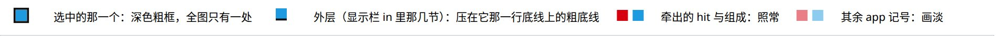
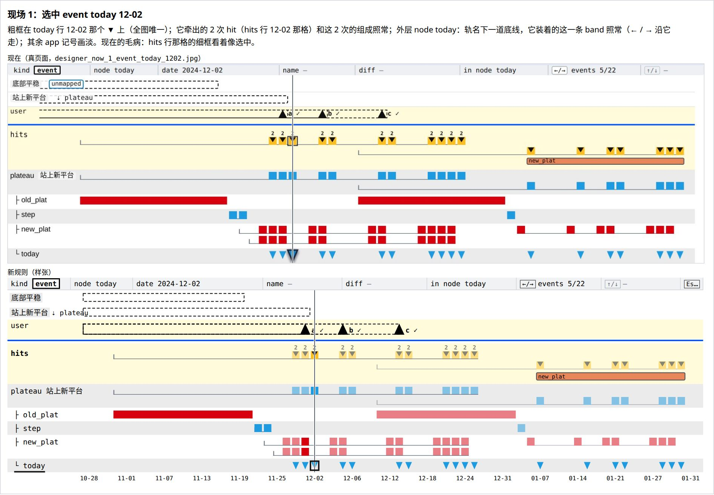
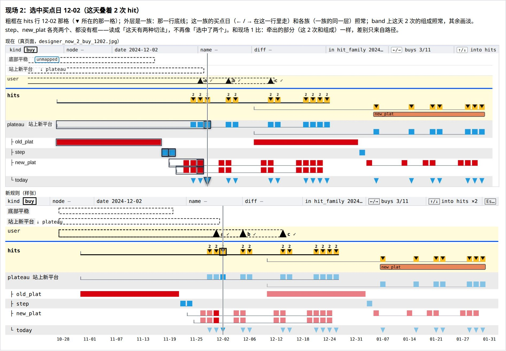
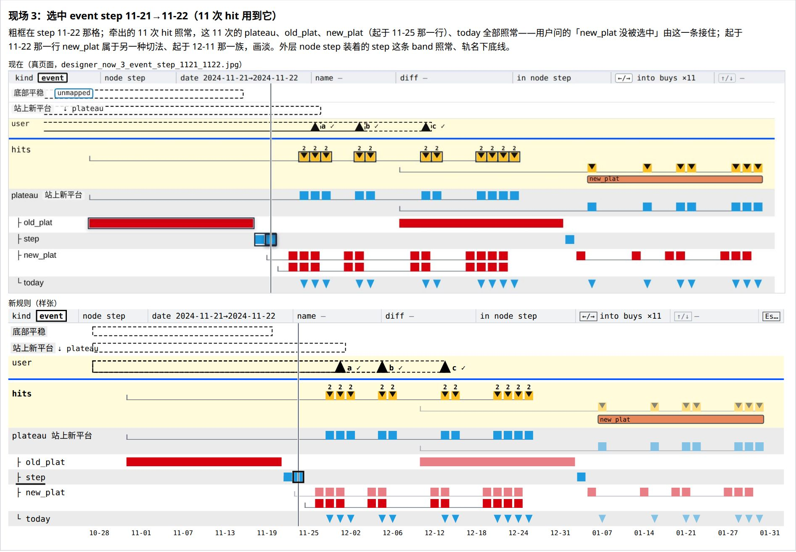
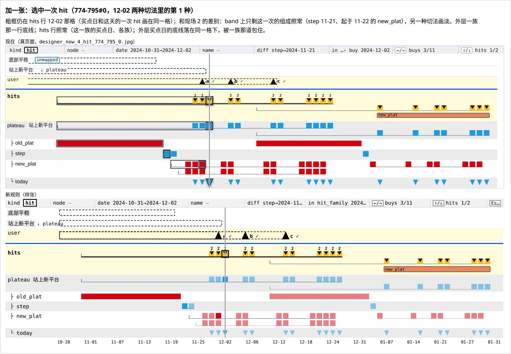

层级：研究（只出设计，正式代码未改）

# 选中的显示与关联规则（designer 稿）

> 锚：同目录 `原始问题.md`（用户原话）、`lead_brief.md`（现状与四个问题）。前序：`docs/research/2026-11-11_selection-business-entities/`（选中路径、八种可选中的东西、切换规律、显示栏九格与选中卡，都已拍板，本稿不改它们，只管「图上怎么画、哪些算有关」）。
> 样张：`repro/mock.html`（按 CRNC / new_step / compare 的真数据画，数据由 `repro/designer_dump.cjs` 从真页面只读导出；画法由页里一个纯函数 `roles(path)` 给出，各场景只换输入）；截图在 `repro/screenshots/`，`designer_now_*` 是真页面现状（`repro/designer_now.cjs`），`designer_mock_*` 是样张（每张上半是现在、下半是新规则）。
> 现状与视觉语汇占用：同目录 `inventory.md`（下称 inv）；验收清单与质疑：同目录 `challenge.md`（下称 sk 清单、sk 质疑 Qn）。
> 词：hit（`path2/GLOSSARY.md:95`）、event（`path2/GLOSSARY.md:44`）、复合事件（`path2/GLOSSARY.md:62`）、node（`path2/GLOSSARY.md:76`）、买点（`path2/GLOSSARY.md:118`）、样本（`path2/GLOSSARY.md:152`）、成员框（`path2/GLOSSARY.md:171`）、band（`path2_web/GLOSSARY.md:39`）、lane（`path2_web/GLOSSARY.md:42`）、tag（`path2_web/GLOSSARY.md:48`）、显示档位与三档（`path2_web/GLOSSARY.md:25`、`:28`）、反馈（`path2_web/GLOSSARY.md:71`）。买点日、一族、装着、显示栏、选中卡、当前日竖线是规格 `.scratch/annotation-path2/spec.md` 5.8 的说法，词表里还没有。

## 0. 先用白话说清

**做了什么**：把「选中一个东西后图上画什么」从现在的五六种画法（粗框、细框、跨度框、hits 格细框、放大复本、闪烁，多半是同一种深色）收成三种，各管一件事，并给出两句能预测任何选中的总规律；用真数据画了 19 张样张（`designer_mock_cmp1`–`cmp18` 与备选方向 `alt3`；其中有窄格、侧栏列表、换中蓝各一张），和真页面现状逐张对照。

**说明什么**：用户的三个现场都能由同一套话推出来——选中的永远只有一个粗框；「有关的」不再加框，而是让无关的变淡；「我是从哪走进来的」用粗底线。现状的四个毛病（选中和有关分不出、选中买点日那格没框、一天两次 hit 看着像选中了好几个、选中 event 时亮的是一个随手挑的上层 event 而 new_plat 不亮）都由这两句消掉，没有给任何一种 node 写特例。

**不说明什么**：样张是静态页，没在真页面实现过；画淡的深浅受 node 本色里那个天蓝的限制，「淡得分得开」和「淡了还看得见」之间余量不大（5.5），数值待在真页面上调；只在 new_step 一个 app 上画过；默认聚焦样本后整张图先变淡，用户用起来烦不烦没试过。

## 1. 总规律

> **粗框只框选中的那一个，它外面那几层（显示栏 `in` 的各节）各在自己下面画一道粗底线。选中那一个的组成、它牵出的 hit（同一天叠着几次只算 ↓ 先落到的那一次）和这些 hit 的组成落在哪一边（app 的记号、用户的记号），那一边其余的记号就画淡，只留路径上每一节的同一层（← / → 在它们之间换的那些）照常。**

第 10 稿起括号里那半句是用户拍板加的（`final_report.md` 第 11 节，方向 4 及追问）：同一天叠着的几次在 hits 行共用一格，那一格照常、格上个数照写；只是图上照常的组成每天只跟一次走，同一天别的几次的组成画淡，要看就 ↓ / ↑ 换过去。

三种画法各回答一个问题，彼此不借用：

| 画法 | 回答 | 和显示栏 / 选中卡的对应 |
|---|---|---|
| 粗框（深色粗边，全图只有一个东西这样画） | 选中的是哪一个 | 栏的 `kind` 白块 |
| 粗底线（一道深色粗线，压在那个东西所在那一行的底线上，横跨它自己的起止） | 我是从哪几层走进来的 | 栏的 `in`（末节就是 Esc 退到的地方） |
| 照常 / 画淡（照常的不加任何记号，其余整体变淡） | 跟它有关的是哪些、← / → 能换去哪 | 卡的 `hits`、`nodes` 两行（卡上 `hits ×m` 数全部，图上同一天只亮其中 ↓ 先落到的一次的组成）；栏的两个键槽 |

三样靠「有框 / 没框」「线在下面」「深 / 淡」分开，不靠色相，也不靠 1px 的粗细差（sk 清单 C1）。

### 1.1 规律里的词（各只定义一次）

- **选中的那一个**：显示栏 `kind` 写的那个。它的记号：一族 → hits 行它那一整行；买点日 → 那一族那一天的 ▼（▼ 立在 hits 行那一天的格位上）；一次 hit → 它在当前日竖线那天的 ▼ 所在格位（竖线对一次 hit 总落在它的某个买点日上，规格 5.8；它终点那一格作为它牵出的照常，不加框）；event → band 上它的格、整条或点（价格区 node 的 event 在主图上）；node → 轨名；反馈 → 反馈带上那一块；样本 → ▲（主图与 user 行）和 user 行它的跨度；框 → 那个虚线框。买点日就是 hit 终点的 app（如 new_step）里，▼ 画在格里，一次 hit 的格位就是它终点那一格，和买点日同一处（1.3）；一次 hit 买好几天的 app 里，它的粗框跟着竖线在它的几个买点日之间挪（第 11 节）。这样粗框永远在竖线那一列上（sk 清单 B1）。直接后果：在 hit 终点不是买点日的 app 里，点一个没 ▼ 的格，竖线按规格落到这次 hit 的第一个买入日，粗框也出现在那一列的 ▼ 上，被点的那一格照常、不加框（sk Q15）；那一格上没有 ▼，琥珀格的照常和画淡几乎分不开，所以「它是这次 hit 的终点」在图上看不出来，靠显示栏 `date 起→止` 和卡（第 11 节、第 8 节，sk Q23）。
- **粗框**：把选中的那一个自己的记号描成深色粗边，比平常的描边粗一倍以上，全图只有它这样画。app 的记号上是一圈实线，外扩 1.5px；用户的东西沿用现有的选中画法——▲ 描 3px、样本跨度与框描 2.5px 虚线并填浅灰（用户的框本来就是虚线，「填浅灰只表示选中」是现有约定）、反馈记号描 3.5px 黑边并带贯穿主副图的竖带（sk Q8、Q12）。
- **组成**（只往下找）：一次 hit 的组成是它绑定的 event（连同这些 event 的子事件）；一个 event 的组成是它的子事件（复合事件沿 `child_refs` 往下到底）；一个 node 的组成是它那条 band 上画着的 event；一个样本的组成是它的成员框；其余没有组成。
- **牵出的 hit**：就是选中卡 `hits` 行数到的那几次——一族的全部 hit；买点日是那个 ▼ 上的几次（只算点的那一族：`path2_web_ui/src/render/selWorld.ts` 的 `members`，选中卡 `render/selSnapshot.ts` 约 165 行用的就是它，↑/↓ 走的也是这一组；前序 design 2.3 写的「卡写 `families ×2`」是旧说法）；一次 hit 就是它自己；event 是用到它的那几次；反馈是它收进来的那几次；样本、框是样本日 / 框终点在场的那几次；node 不牵出 hit。**同一天叠着几次时图上只算一次**（用户拍板，`final_report.md` 第 11 节）：算从选中的那一个走进那一天时 ↓ 落的第一个。这个顺序只有一个来源，就是规格 5.8「进去落哪」与 `stores/compare.ts` 的 `stackCards` 已定的顺序：样本、框落在配对那次；从 event、反馈走进来时，用到这个 event / 收进这条反馈的排前面；否则按族内先后（即侧栏 hits 列表的顺序）。只有算上的这几次，它们的组成照常；同一天别的几次和算上的那次共用 hits 行那一格（照常，格上个数照写——个数是「这天还有别的几次」在图上唯一的提示），它们的组成画淡。卡上 `hits ×m`、键槽 `into hits ×m` 仍数全部。一次 hit 牵出的就是它自己，不受这条影响。
- **路径上每一节的同一层**：直接用规格 5.8 的「同一层」——有上一节时，是上一节装着的那一串（一族装着它的买点日、反馈装着收进来的买点日、event 装着用到它的 hit 的买点日、node 装着它那条 band 上的格、买点日装着那个 ▼ 上的几次、样本和框装着在场的几次）；最外一节没有上一节，就是图上和它同种的那些（各族、各样本、各条反馈、各框、各 node）。路径上每一节（外层各节和选中的那一个）都有自己的同一层，它们照常；**只亮记号本身（▼、格、▲），不带它们的组成**——组成只跟着选中的那一个走，免得一大串的组成把选中的那一份淹掉；**也不引起画淡**——画淡只由组成和牵出引起。它就是 ← / → 换来换去的那些，在图上看得见（sk Q5、Q16、U1）。
- **两边**：app 的记号（hits 行的格、▼、个数、族底线；band 的格、整条、点、族底线；主图价格区 node 的记号）和用户的记号（特征轨的框、▲ 与样本跨度、反馈记号）。一边里有选中那一个的组成或牵出的，这一边其余的画淡（每一节的同一层除外）；一边里一个都没有，这一边照旧。K 线和轨名不属任何一边，不画淡。
- 选中的那一个、外层的记号和底线永远不画淡。什么都没选时什么都不淡。

为什么按「边」画淡：compare 的用处是把 app 和用户的东西放在一起对照。选中 app 那边的东西时，用户那边没有和它有关的（app 的东西往用户那边只有「配对」这种反向关系，不是组成也不是牵出），照规律整边照旧，正好原样留着拿来对照；选中样本时，用户那边有它的成员框、app 那边有它牵出的 hit，两边各自画淡——用户那边不是成员的框画淡，就是现在「点样本时不相干的框画淡」那条现有规矩，它本来就是同一句话在用户那边的样子；别的样本是样本的同一层，照常，和现在一样不淡（sk Q6、Q17）。主图「样本日之后暗一档」是另一条现有规矩（样本日之后是后见之明），和有关无关，照旧。

### 1.2 从规律推出来的几条（不是另加的规矩）

1. **合并的记号**：一行里有一个照常的成员，这一行的族底线就照常；一格里并着几个，有一个照常这一格就照常；一格里有选中的那一个，粗框就框这一格。
2. **外层和选中落在同一个记号上**（「… › 买点日 › 一次 hit」里买点日和那次 hit 是同一个格位；「样本 › 一次 hit」里样本装着的在场几次就在那一格）：粗框和底线都照画。买点日的底线横跨它自己的起止（就那一天），压在 hits 行那一行的底线上：路径里有一族时它被一族那道底线包住、看不出来；路径里没有一族时（「node › event › 买点日 › 一次 hit」「反馈 › 买点日 › 一次 hit」）它单独露成粗框下面的一小段。都是规律直接画出来的样子，不需要另一句规矩（sk Q4）。
3. **选中的画不出来**（被档位筛掉、轨被收起；inv 核实过：从样本 diagnose 点 not_in_hit 卡就会这样）：它那条 band 的轨名旁挂一个 `hidden` tag（和轨名旁现有的 `unmapped`、`app_only` 同一种），粗框框这个 tag——全图唯一的粗框仍指着选中的那一个，指的是它的替身。路径上没有 node 这一层（如「样本 › event」）也一样，tag 挂在它所属的那条 band 上，所以它在哪条 band 不靠外层（sk Q11）。不替它另算 lane 硬画出来：那样选中一下整条 band 可能多出一行、下面全部往下挪。轨被收起（node 显隐关掉）时同理挂在轨名旁：代码里副图的轨列表不按显隐筛（`render/visible.ts` 的 `subBandTagList`），收起的 node 轨名仍在（读代码所得，没在页面上核过）。
4. **选中的东西在视窗外**（从侧栏、diagnose 卡选中，或它的日子本来不在画面里）：规格已定「按键把当前日带出视窗时图平移」；建议把同一条平移推广到「选中换了、它的日子不在视窗里」，不论是按键、点卡片还是点侧栏（待验证，不改走动规则本身）。
5. **同一样东西从不同路径选中**：粗框、它的组成、它牵出的 hit 一样，差别只来自路径——底线、各节的同一层，以及同一天叠着几次时算哪一次（↓ 先落到哪次由从哪走进来决定）（sk 清单 A5）。例：直接点 ▼ 选中 11-27，和从 event step 按 → 进到 11-27，粗框同一格；这天叠着两次，直接点 ▼ 时算族内第一次（`plateau_774_793#0` 那次），从 step 进来时算用到 step 的那次（`#1`），所以 band 上照常的组成是两种切法里不同的一种；前者那一族一行加底线、hits 行各族照常，后者 step 的 11 个买点日照常、step 那一行和轨名加底线、step 这条 band 照常。
6. **两族同一天都买**：牵出的只是点的那个 ▼ 上的几次（上面「牵出的 hit」的口径，图上其中只算 ↓ 先落到的一次），另一族那个 ▼ 不是它牵出的；它是否照常只看路径：路径最外一节是一族时，各族是这一族的同一层，照常；路径从 event、反馈进来时它不在路径任何一节的同一层里，画淡。粗框只在点的那个 ▼ 上（sk Q3）。
7. **没有组成、也没牵出任何 hit 的选中，那一边不画淡**：画淡说的是「这些跟它有关、其余的不相干」，一样有关的都没有时没有可对照的，就不淡——图上只有粗框、底线和照常的同一层，「它没牵出任何 hit」由卡上 `hits none` 说。会落到这一条的：没进 hit 又没有子事件的 event（样张 `designer_mock_cmp18.jpg`）、样本日没有在场 hit 的样本（app 漏掉的正样本；用户那边仍按成员框画淡）、没收进任何 hit 的反馈、终点没有在场 hit 的框。所以「选中了却整张图不变淡」本身就是一个信息：app 在这里什么都没认出来 / 这个东西没被任何 hit 用到。
8. **按得到的都看得见**：← / → 换去的同层兄弟（每一节的同一层）、← / → 或 ↑ / ↓ 进去落到的（它牵出的 hit、node 装着的格）、↑ / ↓ 换的同一天几次和同一格里的几个，都在照常的那部分里——凡是按键能到的，图上都没被画淡（sk 走查第 4 稿时指出的性质）。同一天叠着的几次共用一格，格照常；没算上的那几次只是组成画淡，↓ / ↑ 换过去后照常的组成就换成它的。
9. **当前日竖线**只说日子，规则不变（落在选中的那一个自己的日子上）。层次：竖线仍压在记号上面（`render/chart.ts` 副图竖线 z:30，注释写明缩小后连成一片的格会把下层的线整段盖住，不能垫到下面），粗框和粗底线再压在竖线上面，竖线不会切断粗框（sk Q9）。hits 行格上方的个数数字也压到竖线上面，带一圈白边，竖线在数字处断开：用户追报竖线停在叠两次的那天时把「2」盖住了，而按「同一天只算一次」，个数成了「这天还有别的几次」在图上唯一的提示，不能被盖（`final_report.md` 11.2；待验证，样张 `designer_mock_cmp6.jpg` 的 11-29 也有这个问题）。

### 1.3 为什么买点日和一次 hit 在 new_step 里框在同一格

一天叠着的几次 hit 在 hits 行里本来就画成一格一个 ▼，买点日和其中一次 hit 是同一个格位，粗框只能在那一格上。按用户拍板的「同一天只算一次」，选中买点日时照常的是 ↓ 先落到的那一次的组成，和 ↓ 进到这一次之后图上一样（粗框同一格，买点日的底线又被一族那道底线包住）——两者在图上没有差别，只靠显示栏的 `kind`（`buy` / `hit`）、`↑/↓ hits 1/2`、选中卡（买点日的卡逐行列出这天几次）和侧栏列表（买点日描这天几行黑粗边、一次 hit 只描一行）分开，这是拍板时已向用户说明的代价（`final_report.md` 11.1）。「这天有两种切法」在图上只由格上个数 2 说；再按 ↓ 换到第二次，照常的组成换成另一种切法。这一处是图形本身合并造成的，不算例外（sk 清单 B7）。

## 2. 选中 × 区域（完整表）

记号：**框** = 粗框；**底线** = 粗底线；**照常 / 淡** 按 1.1 的判据；「照旧」= 这一边没有有关的，不画淡。竖线一列写当前日竖线停在哪（规则来自前序拍板，不变）。显示栏、选中卡的内容不变（前序已拍板），表里只写和图对应的那几格。

| 选中（路径） | K 线主图 | 特征轨、user 行 | hits 行 | band | 反馈带、竖带 | 当前日竖线 | 显示栏 / 选中卡 | app 侧栏 hits 列表 |
|---|---|---|---|---|---|---|---|---|
| 什么都没选 | 照常 | 照常 | 照常 | 照常 | 照常、无竖带 | 无 | 九格灰 `—`；卡空 | 无标记 |
| 一族 | 价格区记号：有关的照常、其余淡；▲ 照旧 | 照旧 | **框**它整行；各族的格和 ▼ 照常（它的同一层是图上的各族），格上个数照写 | 每个买点日只算族内第一次，这几次的组成照常；同一天别的几次的组成和其余的淡 | 照旧 | 不动 | `kind hit_family`；`buys`、`hits ×n`（数全部） | 它的各行黑粗边；每天算上的那一行左蓝条 |
| 买点日（一族 › 买点日） | 同上口径 | 照旧 | **框**那一天的 ▼；那一族一行**底线**；这一族的买点日（它的同一层）、各族（一族的同一层）照常 | 只 ↓ 先落到的那一次（族内第一次）的组成照常；这天别的几次的组成和其余的淡；「这天有几次」由格上个数说 | 照旧 | 这天 | `kind buy`、`in hit_family …`；`hits ×m` 逐行区别 | 这天那几行黑粗边；算上的那一行左蓝条 |
| 一次 hit（一族 › 买点日 › hit） | 同上 | 照旧 | **框**竖线那天它的 ▼ 所在格位（new_step 即终点那格）；那一族一行**底线**；各族照常（同上） | 只它的组成照常 | 照旧 | 它的买点日 | `kind hit`、`diff`；`nodes` 逐行 | 这一行黑粗边、左蓝条 |
| event（node › event） | 它在主图时：**框**；有关的照常 | 照旧 | 它牵出的几次所在的格照常（个数照写），其余淡 | **框**它；轨名**底线**；这条 band 照常；它的子事件照常；它牵出的 hit 每个买点日只算一次（用到它的排前面，再按族内先后），这几次的组成照常；其余淡 | 照旧 | 它的终点 | `kind event`、`in node …`；`buys`、`hits ×n`、`level`、`failed` | 每天算上的那一行左蓝条 |
| 没进 hit 的复合事件（node › event） | 同上 | 照旧 | 全淡（它不牵出 hit） | **框**它；轨名**底线**；这条 band 照常；它的子事件照常；其余淡 | 照旧 | 它的终点 | `hits none`、`level`、`failed` | 无标记 |
| 没进 hit、没有子事件的 event（node › event） | 照旧 | 照旧 | 照旧（1.2 第 7 条：没有可依据的有关，不淡） | **框**它；轨名**底线**；其余照旧 | 照旧 | 它的终点 | `hits none`、`level`、`failed` | 无标记 |
| node（点轨名） | 价格区 node：它的记号照常 | 照旧 | 全淡 | **框**轨名；这条 band 照常（它的组成）；别的 band 淡（轨名不属任何一边，各 node 的同一层不涉及画淡） | 照旧 | 不动 | `kind node` | 无标记 |
| 反馈（收进了 hit；没收进时照旧） | 同「一族」口径 | 照旧（反馈没有组成；各条反馈是它的同一层，本来也不淡） | 它牵出的几次所在的格照常，其余淡 | 每个买点日只算一次（收进它的排前面，再按族内先后），这几次的组成照常 | **框**它（现有 3.5px 黑边）+ 竖带 | 不动 | `kind feedback`；`buys`、`hits`、`feedback` | 每天算上的那一行左蓝条 |
| 样本（样本日有在场的 hit；没有时 app 那边照旧，1.2 第 7 条） | ▲ 现有选中画法；别的 ▲ 照常（它的同一层） | ▲ 与跨度现有选中画法；成员框照常、别的样本照常，不是成员的框淡（点样本时现有规矩；默认聚焦时是新的，5.5） | 样本日那一格照常（个数照写），其余淡 | 只配对那次的组成照常（配对的 event 没进 hit 时是在场的第一次，待验证）；同一天别的几次的组成淡 | 照旧 | 样本日 | `kind sample`；`hits ×m`、`paired` | 配对那一行左蓝条 |
| 框（终点有在场的 hit；没有时照旧） | 照旧 | 框现有选中画法；别的照旧（框没有组成） | 框终点那一格照常（个数照写），其余淡 | 只配对那次的组成照常（同样本）；同一天别的几次的组成淡 | 照旧 | 框终点 | `kind box`；`hits ×m`、`paired` | 配对那一行左蓝条 |
| node › event › 买点日（从 event 按 → 进来） | 同「买点日」 | 照旧 | **框**那一天的 ▼；event 装着的买点日（11 个）照常，其余淡 | event 那一行底线上横跨它起止一道**底线**、轨名**底线**；这条 band 照常；这天只算用到 event 的那一次（↓ 先落到的），它的组成照常 | 照旧 | 这天 | `in node … › event …`；`hits ×m` | 这天那几行黑粗边；算上的那一行左蓝条 |
| node › event › 买点日 › 一次 hit | 同「一次 hit」 | 照旧 | **框**那一格（和买点日同格，买点日的底线落在这一格下）；event 的 11 个买点日照常 | event **底线**、轨名**底线**；这条 band 照常；只这一次的组成照常 | 照旧 | 它的买点日 | `in node … › event … › buy …`；`nodes` | 这一行黑粗边、左蓝条 |
| 样本 › 一次 hit（↓ 进去） | ▲ 回到普通 | user 行它的跨度下**底线**（规格写了、代码没画，inv 第 6 节第 1 条）；用户那边没有有关的，照旧 | **框**那一格；样本装着的在场几次（同一格）照常 | 只这一次的组成照常 | 照旧 | 样本日 | `in sample …`；`nodes` | 这一行黑粗边、左蓝条 |
| 反馈 › 买点日 › 一次 hit | 同「一次 hit」 | 照旧 | **框**那一格；反馈装着的各买点日照常 | 只这一次的组成照常 | 反馈记号下**底线**；无竖带（竖带是反馈被选中时的样子） | 它的买点日 | `in feedback … › buy …`；`nodes` | 这一行黑粗边、左蓝条 |
| 框 › 一次 hit | 照旧 | 框下**底线** | **框**那一格；框装着的在场几次照常 | 只这一次的组成照常 | 照旧 | 框终点 | `in box …`；`nodes` | 这一行黑粗边、左蓝条 |
| 选中的画不出来（样本 › event，event 被档位筛掉） | 照旧 | 样本跨度下**底线** | 样本装着的在场几次照常，其余淡 | 它那条轨名旁 `hidden` 加**框**；它的子事件里画得出的照常；其余淡 | 照旧 | 它的终点 | `kind event`；`level … hidden` | 无标记（它不牵出 hit） |

列表一列（sk Q21）：列表不画淡（画淡会把字变灰，界面规范规定灰字只给空和不适用），也没有底线可画，所以只用现成的两样，各对应图上的一种画法——**黑粗边 = 粗框**：选中的那一个由哪几次 hit 组成，那几行描黑粗边（一次 hit 一行；买点日是那个 ▼ 上的几行；一族是它的各行；event、node、反馈、样本、框不由 hit 组成，没有黑边）；**左侧中蓝竖条 = 因为有关而照常**：它牵出的 hit 里图上算上的那几行——同一天叠着几次只标 ↓ 先落到的那一行，和图上照常的组成是同一组（`final_report.md` 11.1，会话自定，待验证）；所以选中一整天时是「这天几行黑粗边、其中一行带蓝条」。图上另一种照常——「每一节的同一层」——列表里不标：图上它的意思是「这些不淡，按键换得到」，列表本来一行都不淡、全部 hit 本来就排成一串，再标就是整列都标，蓝条反而什么都没说（第 4 稿曾这样，sk 指出选一族、选一族里的一天时每行都挂蓝条，这天那两行认不出来）。这改了规格 5.8 的一句（约 549 行：「路径上最外一节牵出的 hit、选中那一天的几次，行一直标着；……选中一整天时不画当前行」），单列方向题 6。

同理，节点漏斗里候选表的选中行（`DetailSidebar.vue` 的 `attr-row--selected`，现在是浅黄底加琥珀边，inv：界面里第三套「选中」画法，浅底上色盲看不出）改成黑粗边，和 hits 列表、diagnose 卡片的选中同一个样子（sk 清单 C6）。

## 3. 用户的三个现场，现在 vs 新规则

每张上半是真页面现在（CRNC、new_step、compare、档位 `in_hit`，视窗 2024-10-28→2025-01-31），下半是新规则样张。

### 3.1 现场 1：选中 event today 12-02

- 现在：today 12-02 的 ▼ 粗框，hits 行 12-02 那格细框——两个都是深色框，读不出哪个是选中；另有一个随手挑的 plateau（09-16→12-02，不在任何 hit 里）及其组成被框着，画不出来或在视窗外（inv）。
> 样张画的是拍板前的「全部几次」，以 `final_report.md` 第 11 节为准：today 12-02 被这天两次都用到，图上只算 ↓ 先落到的那次（族内第一次 774-795#0），band 上照常的组成和 `designer_mock_cmp4.jpg` 一样，另一种切法画淡。

- 新规则：粗框只在 today 12-02 的 ▼ 上；它牵出的 2 次 hit 共用 hits 行 12-02 那格（照常，个数 2），图上只算其中 ↓ 先落到的一次，这一次的组成（plateau、old_plat、一种切法的 step 和 new_plat）照常；外层 node today：轨名底线，today 这条 band 照常（← / → 沿它走）；其余 app 记号画淡；用户那边照旧。

### 3.2 现场 2：选中买点日 12-02（叠着 2 次 hit）

- 现在：被选中的 ▼ 那格什么都没画（毛病 2，▼ 的画法根本不读选中）；band 上两种切法的组成都描深色框，加上跨度框，step、new_plat 各框两个，像选中了好几个（毛病 3）。
- 新规则：粗框在 hits 行 12-02 那格；外层一族：那一行底线；这一族的买点日（← / → 在这一行里走）和各族（Esc 退到一族后 ← / → 换的）照常；band 上只算 ↓ 先落到的那一次（族内第一次），它的组成照常，另一种切法和其余画淡；「这天有两种切法」由格上个数 2 和卡说，↓ 换到第二次就看到另一种。和现场 1 比：照常的部分一样，差别只来自外层——这里是一族那一行，现场 1 是 today 那条 band。

> 样张画的是拍板前的「全部几次」（step、new_plat 各亮两个），以 `final_report.md` 第 11 节为准：只亮一种切法，图上和 `designer_mock_cmp4.jpg` 的 band 一样。

### 3.3 现场 3：选中 event step 11-21→11-22（11 次 hit 用到它）

- 现在：step 那格粗框，hits 行 11 格细框；band 上框的是一个随手挑的 plateau（10-31→11-26，detected，不在任何 hit 里）的组成——plateau、new_plat 11-25、today 11-26 都画不出来，只剩 old_plat 被框着（inv），所以用户看到「new_plat 没被选中」（毛病 4）。
- 新规则：粗框在 step 11-22 那格；它牵出的 11 次 hit 照常，这 11 次的 plateau、old_plat、new_plat（起于 11-25 那一行）、today 全部照常；外层 node step：轨名底线，step 这条 band 照常；起于 11-22 那一行 new_plat（另一种切法）、起于 12-11 那一族画淡。用户问的「为什么 new_plat 没被选中」由此接住：new_plat 照常，因为它和 step 在同一次 hit 里。

### 3.4 加一张：选中一次 hit（774-795#0）

- 现在：hits 行那格粗框，它的组成五个 event 细深框加跨度框——和粗框只差 1 像素。
- 新规则：粗框在 hits 行 12-02 那格（和现场 2 同一格，见 1.3）；band 上只剩这一次的组成照常：step 11-21 那格、起于 11-22 那一行 new_plat；另一种切法画淡。外层一族那一行底线，hits 行照常（这一族的买点日、各族）。

### 3.5 其余场景（样张里都有，截图同目录）

| 场景 | 截图 | 规律给出的画法 |
|---|---|---|
| 从 event step 按 → 进到买点日 11-27 | `designer_mock_cmp5.jpg` | 粗框在 11-27 那格；step 的 11 个买点日 ▼ 照常（走动范围，U1）；step 那一行横跨 11-21→11-22 一道底线、轨名底线（取代现在白底琥珀闪烁 / 粗框落在 event 上）；band 上只有 11-27 这天用到 step 的那一次（`#1`）的组成照常。样张画的是拍板前的「全部几次」（这天两次都照常），以 `final_report.md` 第 11 节为准 |
| 选中样本 a | `designer_mock_cmp6.jpg` | ▲a 现有选中画法；11-29 那格照常（个数 2），只配对那次的组成照常，app 那边和 cmp7 一样；成员框照常、样本 b、c 照常（它的同一层）。样张画的是拍板前的「全部几次」（在场 2 次的组成都照常），以 `final_report.md` 第 11 节为准；样张里竖线盖住 11-29 的个数，也是 1.2 第 9 条要修的 |
| 样本 a ↓ 进配对那次 | `designer_mock_cmp7.jpg` | 粗框移到 hits 行 11-29 那格；user 行它的跨度下底线；只这一次的组成照常；用户那边照旧 |
| 选中一族 | `designer_mock_cmp8.jpg` | 框整行；11 个买点日各算族内第一次，这 11 次的组成照常，每天另一种切法的组成画淡；hits 行各族照常（它的同一层），起于 12-11 那一族的组成画淡。样张画的是拍板前的「全部几次」（22 次的组成都照常），以 `final_report.md` 第 11 节为准 |
| 选中 node step | `designer_mock_cmp9.jpg` | 框轨名；step 这条 band 照常，其余淡 |
| 选中反馈 f-pc-74 | `designer_mock_cmp10.jpg` | 反馈记号粗边、竖带；它收进来的 7 次照常 |
| 选中框 b-pc-43 | `designer_mock_cmp11.jpg` | 框现有选中画法；框终点那格照常（个数 2），只配对那次的组成照常。样张画的是拍板前的「全部几次」，以 `final_report.md` 第 11 节为准 |
| 没进 hit 的复合事件（detected 档 plateau 10-31→12-03） | `designer_mock_cmp12.jpg` | 框它；它的子事件照常；plateau 这条 band 照常；hits 行全淡 |
| 选中的 event 画不出来（diagnose 的 not_in_hit 卡） | `designer_mock_cmp15.jpg` | 轨名旁 `hidden` 加框；画得出的子事件照常、没框；外层样本跨度下底线 |
| qualified 档下选中 event step | `designer_mock_cmp16.jpg` | 同现场 3；检查画淡与降档会不会读混（5.5） |
| 天蓝换中蓝（方向题 5） | `designer_mock_cmp17.jpg` | 同现场 3，蓝色 node 上照常 / 画淡拉得更开 |
| 窄格（一格约 4.6 像素） | `designer_mock_cmp13.jpg` | 粗框成一个深色块仍认得出；照常 / 画淡不靠格宽 |
| 备选方向「有关的加黑点、不画淡」 | `designer_mock_alt3.jpg` | 方向题 1 的对照 |
| app 侧栏 hits 列表 | `designer_mock_cmp14.jpg` | 选中的那一个由哪几次 hit 组成就描哪几行黑粗边（买点日：这天两行）；图上算上的那几次左蓝条（buy 12-02 那一栏只第一行带蓝条）。样张中间那栏画的是拍板前的「两行都带蓝条」，以 `final_report.md` 第 11 节为准 |

## 4. 信息量：每种选中下用户要什么、由什么给

| 选中 | 用户要知道的 | 由谁给 |
|---|---|---|
| 一族 | 这一族在哪些天买、几次、各次长什么样 | 照常的 ▼（哪些天）、格上个数；卡 `buys`、`hits ×n`；照常的组成（每天一次） |
| 买点日 | 这天叠着几次、差在哪、这几次各用了哪些 event、这一处买得对不对；在这一族里走到第几天 | 栏 `↑/↓ into hits ×m`；卡 `hits` 逐行区别；格上个数（几次）、照常的组成（↓ 先落到的那一次；别的切法 ↓ / ↑ 换过去看）；卡 `feedback`、`sample`；外层装着的那一行照常 + 栏 `buys k/n` |
| 一次 hit | app 把这里认成什么样（每个 node 绑了哪个 event）、它是这天的第几种切法 | 照常的组成（只这一次）；卡 `nodes`；栏 `diff`、`↑/↓ hits j/m` |
| event | app 在哪些天用了它（几十次时先看全貌）、它和谁一起凑成 hit、它是什么档、没过哪条 where | 照常的 hits 行格（哪些天、一眼全貌）；照常的组成（和谁一起）；卡 `buys`、`hits`、`level`、`failed` |
| 从 event 走进它的买点日（U1） | 走到第几个、这一串都在哪几天、下一步落哪 | 外层装着的 11 个 ▼ 照常；栏 `buys k/n`；粗框所在 |
| 没进 hit 的 event | 为什么没进；它（若是复合事件）由哪几段组成 | 卡 `level`、`failed`；照常的子事件 |
| node | 这条 band 是哪条、上面有哪些 event | 轨名粗框、这条 band 照常 |
| 反馈 | 它管哪段、哪几次 hit 让它还红着 | 竖带；照常的那几次；卡 `feedback` |
| 样本 | app 在样本日认出了什么、对没对上；我凭哪些框下的判断 | 照常的样本日那一格与个数、配对那次的组成；▲ 旁 `✓/✗`；卡 `paired`、`sample`；成员框照常 |
| 框 | app 在框终点认出了什么、用哪个 node 认这个特征 | 照常的框终点那一格与个数、配对那次的组成；栏 `node`；卡 `paired` |
| 任何选中 | 我是从哪走进来的、Esc 退到哪、← / → 在哪一串里走、下一个在哪 | 粗底线；栏 `in`；每一节的同一层照常；栏键槽 `k/n` |
| 选中的画不出来 | 有，但看不见；在哪条 band、哪天 | 轨名旁框着的 `hidden`；竖线；卡 `level … hidden` |

## 5. 相比现状：去掉了什么、加了什么、改了什么

### 5.1 去掉的画法（查看能力不减，只换了画法）

1. **group 细深框**（一次 hit / 一整天 / 配对那次的组成）→ 改成「照常 vs 画淡」。现在细框和粗框同色、同阴影、只差 1 像素（inv 3.3），是用户困惑的根源。
2. **hits 行的细实线框**（event、反馈、样本、框牵出的 hit 那格）→ 同上。
3. **跨度空心细框**（被点亮的格从族起点到它终点的细框；选中一次 hit 时 hits 行那格也有）→ 去掉；跨度由这一行的族底线和它那一格给出：起点是底线的竖头，终点是那一格。现状里「同一条 band 框了好几个」有一部分就是一个 event 的跨度框加格框（inv）。
4. **点记号的放大复本**（band 上的三角、主图价格点被点亮时画成放大 1.4 倍的实心复本）→ 去掉；选中的点记号加粗框，有关的照常、无关的画淡。尺寸这个通道空出来。
5. **闪烁**（从 event 走进买点日时那个 event：格 / 整条是 2.5px 深色粗框加阴影加闪烁——和「选中的那一个」同色同粗；点记号是白底琥珀边闪烁）→ 外层粗底线。现状还有一处更糟：路径是「event › 买点日 › 一次 hit」时粗框画在 event 上、被选中的那次 hit 只有细框（inv）；新规律下粗框只跟着显示栏的 `kind` 走，不会再落到外层上。
6. **一族自己被选中时的粗底线、`hits` / `user` 两个字加粗**（现在 `view.ts` 的 `activeFamilyKey` 只看路径第一节，一族本身被选中时那一行也画粗底线；样本当外层时只把 `user` 两个字加粗）→ 一族被选中改成框整行；粗底线只留给外层。「底线 = 我在它里面」不和「我就是它」混用。
7. **选中样本时成员框的长虚线加粗**（`annotateLanes.ts` 的 `MEMBER_DASH`，2.5px）→ 回到普通的框；成员框照常、别的框画淡已经说清谁是成员。这一条是让「深色粗边只给选中」在用户那边也成立（inv 撞车核对①指出它是一处「粗边不是选中」）；待验证，用户若觉得成员框要更醒目再议。

### 5.2 去掉的查看能力（要用户点头）

1. **「组成型一选全选」**（选中一个子事件时，往上找一个复合事件，把它和它的全部子事件一起框上；代码 `view.ts` 的 `compositionGroupIds`）→ 去掉，只保留往下的组成。
   - 代价：选中一个**没进任何 hit** 的子事件（如 qualified 档的某个 new_plat）时，图上不再顺带亮出它所属的复合事件和兄弟段；要看就去点那个复合事件（它的子事件会照常，`designer_mock_cmp12.jpg`）。
   - 为什么值得：这条规则默认一个子事件只属于一个复合事件，取 `child_refs` 里第一个找到的；现在 step 11-21→11-22 被 39 个 plateau 共用、today 12-02 被 3 个共用，取到的常常是一个不在任何 hit 里、在 `in_hit` 档下画不出来的 plateau（inv 真页面核对）。用户看到的「上层」多半是误导——这就是现场 3 的根因（sk 清单 A3 的反例）。进了 hit 的子事件，它在 hit 里的上层由「牵出的 hit 的组成」照常给出，不缺。
   - 如果用户要留：可改成「没进 hit 的子事件，把引用它的全部复合事件都照常」，不再随手挑一个；代价是被几十个共用时一亮几十个。

第 1 稿曾把「从 event 走进买点日后看不到它的别的买点日」列成损失（sk Q5）；第 3、4 稿把「路径上每一节的同一层照常」写进规律，这项查看能力保住了，不再是损失。

### 5.3 改了口径

- **同一天叠着几次时亮哪几次**（用户已拍板，`final_report.md` 第 11 节，和第 9 稿的推荐不同）：一律只亮 ↓ 先落到的那一次的组成——样本、框是配对那次（和现在一样）；买点日、event、一族、反馈每个买点日各一次。用户原话：「当前代码亲测很方便，完全可以用上下快速切换，并且 Esc 回到样本，回到样本后再按上下键，又可以快速在 hit 日切换。而且同时亮多个 hits 很混乱。」第 9 稿推荐的「亮在场的全部几次」作废。
  - 代价：「这天有几种切法」在图上只剩格上个数，要看另一种得 ↓ / ↑；选中买点日和选中它的第一次在图上一样（1.3）；同一样东西从不同路径进来，亮的切法可能不同（1.2 第 5 条）。

另两处改了的：
- **侧栏 hits 列表的标法**：见第 2 节末与方向题 6。
- **反馈在外层时不再画竖带**（前序设计第 4 节写的是「反馈是选中的或是外层时画竖带」）。竖带是反馈被选中时粗框的一部分；它在外层时，记号下的底线横跨它的起止，它装着的买点日 ▼ 照常（它是路径上一节，它装着的就是选中的那一个的同一层），范围已经看得见，再画竖带就是同一件事画两遍（sk Q20）。

### 5.4 加了的

1. **画淡**（新视觉元素，app 这一边）：无关的 app 记号整体变淡（数值与上下限见第 6 节、5.5）。用户在 annotate 里已经见过「淡 = 这会儿和你选的无关」。
2. 选中买点日时，那一天的 ▼ 有粗框（修毛病 2）。
3. 外层粗底线从一族一处扩到 event、node、反馈、样本、框（一族那条就是现在「那一族的行」的粗底线，画法不变；样本那条规格写了、代码没画）。
4. 路径上每一节的同一层照常：← / → 能换去的那些在图上看得见——event 在外层时它的买点日、没有外层时图上同种的东西（样本之间、各族之间）都算（sk Q16）。
5. 选中 event 时，它牵出的那几次 hit 的整套组成照常（现在只框 hits 行的格，new_plat 等不亮）——修毛病 4、接住用户第三条疑问。
6. 没进 hit 的复合事件被选中时，它的子事件照常（往下的组成，5.2）。
7. 选中的东西画不出来时，轨名旁挂 `hidden` 并框它（1.2 第 3 条）。
8. 粗框、粗底线压在当前日竖线上面（竖线本身仍压在记号上面，不变）。
9. 候选表选中行改黑粗边（第 2 节末）。

### 5.5 规律本身的代价

- **进 compare 默认聚焦样本时两边都先淡一片**（sk Q10、Q18）：规格 5.8 把默认聚焦的样本算作选中，按新规律 compare 一打开——app 那一侧除了样本日那一格和配对那次的组成都是淡的，而 compare 的用途是「看出 app 能不能表述标注」，那些淡下去的 band event 正是拿来和用户框对照的东西；用户那一侧不是这个样本成员的框淡到 0.28（现在默认聚焦时用户那边一点不动，只有点样本才这样，inventory 14 / 14′），别的样本照常。←/→ 每换一个样本，两边都按新的样本重新淡一遍。想看全貌按 Esc 或点空白（一下）。这是方向题第 2 条。
- **画淡在天蓝 node 上没有余量**（sk Q1、Q19）：淡下来的格既要看得见，又要和照常的分得开；天蓝这个颜色本身离浅灰底太近，两头只能各占一半——淡到刚好还看得见时，它和照常的天蓝也刚好勉强分得开，两样都踩在项目自己定的那条线上，没有富余。红格、▼、族底线余量足，没有这个问题。所以默认取「两头一样」的那一档，并把「换不换天蓝」单列为方向题 5。
  - 附：按 WCAG 亮度对比（脚本 `repro/designer_contrast.py`，记号按不透明度叠在它实际所在的底上算），不透明度 0.5 时天蓝淡后对隔行底 1.61、照常对淡后 1.60；`render/colors.ts` 注释里的可见线约 1.6（detected 灰 1.64，「1.4 几乎看不见」），qualified / detected 之间 1.3 被认为不够。第 2、3 稿写的「0.6 对应 1.6」是叠在白底上算错的，0.6 实为对底 1.78、照常对淡 1.45（sk 复算一致），已改。
- **灰档画淡后几乎看不见**：qualified、detected 的灰本来就浅（detected 照常就贴着可见线），任何画淡都会让它们落到线下（0.5 时 qualified 对隔行底 1.42、detected 1.27）。在 qualified、detected 档下选中东西时，别的 band 上无关的灰格会淡到几乎看不见；所在那条 band 是选中的 event 的同一层，照常不受影响，同一条 band 上的下一个照样看得见、点得到；点空白一下全回来。备选（待验证）：灰档不画淡、只画淡彩色的——代价是「有关的灰格」（没进 hit 的复合事件的子事件）和无关的灰格分不开。
- **画淡和降档会不会读混**（sk Q13，样张 `designer_mock_cmp16.jpg`）：画淡后的天蓝 in_hit 格和照常的 detected 灰格亮度接近，对用户只剩格高能分（满高 vs 0.4，qualified 0.65）。档位本来主要靠格高分（`colors.ts` 注释），画淡不改格高，所以「满高的浅色格」仍读作 in_hit；样张里看得出三种高度。不撞到要改规律的程度，但用户试用时值得留意。
- **选中的东西一换，整张图的明暗跟着换**，比现在只挪几个框动静大。

## 6. 视觉元素与占用核对（对照 inv 第 3 节「视觉语汇占用表」）

| 元素 | 画法（数值待验证） | 和现有语汇的关系 |
|---|---|---|
| 粗框 | app 记号：深色 2.5px、外扩 1.5px，不带阴影、不带白圈——就是现在「选中的那一个」那档粗框的尺寸，只去掉阴影；用户的东西沿用现有选中画法 | 深色粗边现在的大多数用法本来就是「选中」：选中的反馈记号 3.5px、选中轨名 2px、主图选中 ▲ 3px、选中的框 2.5px 虚线加浅灰填充、diagnose 当前卡 2px、侧栏当前 hit 行 2px（inv 撞车核对①）。**不加白圈**：深色细线加白边正是当前日竖线的样子，选中的东西多半就在竖线上，白圈会和竖线接上。**外扩只 1.5px**：compare 下 lane 间隙 4px、hits 格顶到个数数字 1px（代码注释说是给外扩 1~2px 留的），外扩 4.5px 会压进邻行、盖住数字（inv ①、sk Q14） |
| 粗底线 | 深色 2.5px，压在那个东西所在那一行的底线上（从底边往上 1px 起，往下伸 1.5px），横跨它自己的起止 | 就是现在「那一族的行」粗底线的画法（`ACTIVE_LINE_H`、`#1e293b`），推广：一族 → 从族起点到最后一格；event → 它那一行底线上从它的起点到终点；点记号 → 它那一天；样本 → user 行它的跨度；反馈 → 记号下沿；框 → 框下沿；node → 轨名下。往下只伸 1.5px，lane 间隙 4px 装得下（inv ②） |
| 画淡 | app 记号整体（含 ▼、个数、族底线）不透明度 0.5；用户那边沿用现有 0.28 | **约束（一句话）：淡下来的记号在它所在的每种底上仍要过 `render/colors.ts` 那条可见线（对隔行底约 1.6），同时和照常的拉开；数值按这条在真页面上调。** 定法：取 node 本色里最浅的那个（天蓝）「淡后对底」和「照常对淡后」两头相等的那一档，0.5 时两者都约 1.6（`repro/designer_contrast.py` 全表）；换中蓝后 0.5 时约 1.85 / 1.97，两头都有富余（方向题 5）。0.28 对黑色虚线框合适，对彩色填充太狠——天蓝格只剩 1.30、琥珀格 1.14，看不见、点不到（inv 3.4、sk Q1）。▼ 叠在淡琥珀格上 0.5 时对 hits 底 4.21，琥珀格本身淡后几乎看不见（照常也只有 1.60），hits 行靠 ▼ 认。和别的语汇：annotate 的 0.28、0.4（别的 pattern 的样本）都是「淡 = 这会儿不归你看」，同义；和档位的「换灰并变矮」不同：画淡不改格高；和 Shift 配对的「白蒙 + 黑横线」都是变白，只靠那道黑横线分（inv ④），但 Shift 配对是挑两个、画淡是一边整体同时变，场合不同 |
| 当前日竖线 | 不变（1px 深色线下垫 3px 白线，压在记号上面） | 和粗框同色但形状不同（一根贯穿的线 vs 一个闭合的框）；粗框压在竖线上，竖线穿过选中那一格时框的四边仍完整。不能垫到记号下面（inv ⑤） |
| `hidden` tag | 轨名旁一个小标签，白底、中灰描边、黑字等宽；选中时外加粗框 | 和轨名旁现有的 `unmapped`、`app_only` 同一种 tag（`path2_web/GLOSSARY.md:48`）；`hidden` 这个词选中卡的 `level` 行与 diagnose 已经在用 |

另几处核过、不撞或已说明的：

- **用户那边另一处粗边不是「选中」**：标注的当前样本（annotate 的 `emphasis 1`，新画的框会并进它）跨度画 2.5px 虚线（inv ①）。那是 annotate 模式「当前样本」的标记，compare 默认聚焦不设当前样本（规格 5.8），本稿不动；成员框的加粗见 5.1 第 7 条。
- **琥珀**：hits 格底色、走进买点日后点记号闪烁的边、侧栏 trace 行选中的边三义（inv）；本稿去掉闪烁那一义，不新增。
- **中蓝 #1a80ba**：侧栏 hits 列表的「有关」左竖条，兼用作反馈面板悬停 node 时那条 band 的边（inv ⑥）；一个在侧栏、一个在图上，本稿沿用前者不新增。
- **虚线**：本稿不用任何虚线（sk 清单 C5）。
- **密度**：默认视窗约 280 根时格约 4px、格间约 1px（inv 3.4），粗框外扩 1.5px 会压到左右邻格一点——邻格多半是画淡的，压住无妨，粗框读成「这里一个深色块」；画淡不依赖格宽（`designer_mock_cmp13.jpg`）。

## 7. 需要用户拍板的方向

用户已于 2026-11-13 拍板（`final_report.md` 第 11 节）：1、2、3、5、6 照推荐，其中 1 先做成可调开关，在 CRNC 三个现场看过再最终确认；4 和推荐不同，见第 4 题。下面保留拍板前的题面。

1. **「有关」用画淡还是加记号**。
   - 推荐**画淡无关的**（本稿）：选中的只有一个粗框，有关的保持原样，一眼就分出「它 / 有关 / 无关」三层；有关的再多（现场 3 有 60 多个）也不会满屏是框；窄格下照样分得开；annotate 里已经用同一种「淡」。代价：一选中整片变浅；为了淡了还看得见，「淡」只能是明显但不剧烈的一档（5.5）；看全貌要先 Esc。
   - 备选**不画淡、有关的加一个小黑点**（样张 `designer_mock_alt3.jpg`）：画面上什么都不变浅，也就没有「淡了看不见」的问题；代价：有关的一多满屏是点，点小、窄格下和格挤在一起，「哪些有关」要逐个找点。
2. **compare 默认聚焦的样本算不算选中**。推荐**算**：照规律画淡，进 compare 第一眼看的就是这个样本日 app 认出了什么、成员框是哪几个，和 compare 在样本之间走的主任务一致。代价写在 5.5 第一条：拿来和用户框对照的其余 band event 先淡下去，用户那边不是成员的框也淡（现在默认聚焦时不淡），每换一个样本两边重新淡一遍，看全貌要 Esc。备选：默认聚焦只管显示栏和 Shift+C，图上不画淡，直到用户自己点了什么——app 那边全貌一打开就在，但这是规律的一个例外，要多记一条「默认聚焦不算」。
3. **去不去掉「组成型一选全选」**（5.2，本稿唯一去掉的查看能力）。在决定：点一个子事件（比如一段 new_plat、一个 step）时，图上要不要顺带亮出它所属的复合事件。
   - 推荐**去掉**，只留往下的组成（点复合事件亮它的子事件；点子事件只亮它自己和它进过的 hit 的组成）。现在这条规则遇到一个子事件被好几个复合事件共用时，只取找到的第一个——step 11-21→11-22 被 39 个 plateau 共用，取到的常常是一个不在任何 hit 里、当前档位下画不出来的 plateau，用户看到的「上层」多半是误导，现场 3「很多 hit 亮了、new_plat 却没亮」的根因就在这里。代价：点一个**没进任何 hit** 的子事件时，图上不再顺带亮出它所属的复合事件和兄弟段，要看得自己去点那个复合事件（`designer_mock_cmp12.jpg`）；进过 hit 的子事件不受影响，它在 hit 里的上层照样由「牵出的 hit 的组成」亮出来。
   - 备选**改成「引用它的复合事件全部照常」**：不再随手挑一个，能力保住；代价是被几十个共用时一亮几十个，等于没亮。
4. **用户定：只亮一次（见 `final_report.md` 第 11 节）**——样本、框亮配对那次；追问后扩到所有选中：同一天叠着几次一律只算 ↓ 先落到的那一次（1.1「牵出的 hit」、5.3）。原题面：**选中样本或框时，亮这天在场的全部几次 hit，还是只亮配对的那一次**（5.3）。在决定：选中一个样本后，app 那边照常的是「这天 app 认出的全部几种」还是「替你挑好的那一种」。
   - 推荐**全部几次**：和选中卡 `hits ×m`、和选中买点日同一个口径，规律里「牵出的 hit」不用为样本另说一句；compare 的主任务是在样本之间走，走到每个样本时看到的是这天 app 认出的全部。代价：样本日叠着好几次 hit 时，想看配对那一次的组成要多按一下 ↓（配对那次是 ↓ 进去的第一个，卡上 `paired` 行和 ▲ 旁 `✓/✗` 照旧写着）。
   - 备选**只亮配对那一次**（现在的做法）：少按一下 ↓；代价是规律要多一条「样本牵出的只算配对那次」的例外，而且这天别的几次 hit 会被画淡，看着像 app 没认出。（拍板后更正：后一句不准——同一天几次在 new_step 里共用 hits 行一格，格照常、个数照写，画淡的只是它们的组成；规律也没多出例外，「只算一次」扩到所有选中后写进了总规律本身。）
5. **换不换 node 兜底调色板里的天蓝**（sk Q19）。在决定：选中东西后，蓝色 node 上「有关的」和「淡下去的」能不能一眼分开。
   - 推荐**换成中蓝**（用户配色规则里推荐的那个 RGB(26,128,186)；改的是后端调色板里一个颜色常量，后端不因此做任何判定）：换了以后，蓝格上照常和画淡一眼分得开，淡下去的也还看得见（样张 `designer_mock_cmp17.jpg`，和现场 3 的 `designer_mock_cmp3.jpg` 对照）。代价：所有没自己声明颜色的 app 的蓝色 node 都深一档；扫描文件里带着当时的颜色，旧扫描要重扫才换（项目规矩：扫描文件不做兼容）；中蓝和侧栏 hits 列表的「有关」左竖条同一个颜色（一个在图上、一个在侧栏）。
   - 备选**不换**：天蓝本身离浅灰底太近，淡到还看得见时和照常的只是勉强分得开，蓝格上要细看才分出有关和无关；红格、▼ 不受影响。
   - 自己声明了颜色的 app（`dag_spec.py` 里的 `event_styles`）不受兜底调色板管，各自的颜色要按第 6 节同一条约束另核，本稿没逐个核。
   - 附：天蓝 #1e9be0 照常对隔行底 2.58，0.5 时淡后对底 1.61、照常对淡后 1.60；中蓝 #1a80ba 照常 3.64，0.5 时 1.85 / 1.97（`repro/designer_contrast.py`）。

6. **app 侧栏 hits 列表怎么标**（sk Q21，改的是规格 5.8 已定的一句）。在决定：在列表里能不能认出「选中的这一天是哪几行」。
   - 推荐**选中的那一个由哪几次 hit 组成，那几行黑粗边；它牵出的 hit 左蓝条**（第 2 节末，样张 `designer_mock_cmp14.jpg`）：app 模式点 12-02 的 ▼，这天两行黑粗边，一眼认出（U13）；选一族时它的各行黑粗边，和别的族分得开；选 event 时用到它的各行蓝条，和现在一样。代价：选中一整天时会有几行同时描黑边（规格当初写「选中一整天时不画当前行」，大概是怕被读成选中了其中一次；这里几行一起描、栏写 `kind buy`，不会只有一行像选中）。
   - 备选**照规格原句**（路径最外一节牵出的、选中那一天的几次左蓝条，选中某一次时那行黑粗边）：和现在代码一样；代价是 app 模式点 ▼ 时路径最外一节是一族，它牵出整族，整族每一行都挂蓝条，这天那两行认不出来（U13 不通过）。

## 8. 待验证的默认值（会话自定，不问用户）

- 同日只亮 ↓ 第一个：「↓ 先落到的那一次」照规格 5.8「进去落哪」与 `stackCards` 的顺序取；样本、框配对的 event 没进 hit（`pairedHitId` 为空）而那天另有在场 hit 时，取在场的第一次，照样画淡；一次在场 hit 都没有时不牵出，app 那边不淡（1.2 第 7 条）。
- event 按天各一次：用户选项原文「同日叠几次一律只亮一次」按天理解——event、一族、反馈牵出的 hit 每个买点日各算一次（step 11-21→11-22 被 11 个买点日各用一次，11 次都算；today 12-02 被同一天两次用到，只算一次）。
- 个数压在竖线上：hits 行格上方的个数数字压到当前日竖线之上、带一圈白边，竖线在数字处断开（1.2 第 9 条）；和粗框谁压谁、粗框会不会碰到数字，并入下面「粗框」那条一起看；竖线自己就是 1px 实线加白边（inventory 视觉语汇表「竖线」行），数字的白边和它同一种白，要看会不会被读成竖线的一部分。
- 侧栏 hits 列表的左蓝条只挂在图上算上的那几次（同一天只标一行），和图上照常的组成同一组。
- 画淡的不透明度 0.5（天蓝下「淡后对底」「照常对淡后」两头相等、都约 1.6；换中蓝后同一档两头都有富余，方向题 5）；灰档要不要另外处理（5.5）。
- 粗框：深色 2.5px、外扩 1.5px、无阴影；会不会碰到 hits 格上方的个数数字（sk Q14）。
- 粗底线 2.5px、压在行底线上；event 那一行的底线和下一 lane 之间装不装得下。
- 选中的东西不在视窗里时图平移（1.2 第 4 条）。
- node 的记号取轨名（不框整条 band）。
- 一族被选中时框整行（从族起点到最后一格）。
- 用户那边沿用现有选中画法（▲ 3px、样本跨度与框 2.5px 虚线加浅灰、反馈 3.5px 黑边加竖带），不改成 app 那种实线粗框。
- 成员框不再加粗（5.1 第 7 条）。
- `hidden` tag 挂在轨名旁；轨名长、tag 放不下时压在记号上面（和轨名同一处理）。
- hits 行没有 ▼ 的格（hit 终点不是买点日的 app 才有）：琥珀格靠画淡分不开照常和无关（在 new_step 里格上有 ▼，靠 ▼ 变灰认；没有 ▼ 的格没有这个依靠），方向题 5 换蓝色也管不到琥珀；待在那类 app 上实测，必要时给这种格另想办法（例如照常的描一道深色底边），本稿不定（sk Q23）。
- 侧栏 hits 列表的黑粗边：选中的几行相邻时用一个外框把整块框住，不相邻时（列表按买入日排，两族在时间上交错，选一族后它的各行会隔成几段）每一段各框一块；这样「几块黑框」读作「这一样东西在列表里分成几段」，栏的 `kind` 写着是一族还是一天（sk 附注）。

## 9. 新名（待用户认可，认了才进词表）

- **粗框 / selection frame**：选中的那一个的画法。
- **画淡 / dimmed**：无关记号的状态（过去分词，按 `GLOSSARY-MAP.md` 命名规则 1）。
- **外层底线**：路径外层的画法；现在规格里叫「粗底线」「（路径上有 hit 的一族的）那一行粗底线」，建议统一成这一个。
- `hidden` tag：词已在选中卡、diagnose 里用，新的只是把它挂到轨名旁。
- 「牵出的 hit」「组成」「装着」「同一层」沿用前序设计和规格的说法，不新起（第 3、4 稿用过自造的「外层装着的那一串」「所在的那一串」，第 7 稿统一换回规格的「同一层」）。
- **照常**：「画淡」的反面，白话词，不打算进词表；用户若觉得需要一个固定说法再起。

## 10. 不说明什么

- 样张是静态 SVG，按真数据画、但画法是手写的，不是 ECharts；数值没在真页面上调过，对比度是 `repro/designer_contrast.py` 按 WCAG 公式算的，没在屏幕上量。
- 只在 new_step（CRNC）一个 app 上画过；一次 hit 买好几天、hit 终点不是买点日、两族同一天都买、价格区 node（bo、pk 画在主图上）的情形按规律推（第 11 节），没画。
- 默认聚焦样本带来的「一开 compare 就变浅」只是推演，手感没试。
- 研究副产品：本轮是交互设计，没有量化测量，没有可登记到 `docs/feature_candidates.md` 的东西。

## 11. 在别的 app 上推一遍（sk 清单 D1）

规律里没有 node 名、app 名，只用「选中的那一个、组成、牵出的 hit、外层、装着、两边」这几个词。拿 new_step 没有的情形推：

- **一次 hit 买好几天**（bottom_burst、bb_v1 那种买点 node 的 event 跨几天；hits 行里这次 hit 的格在它的终点 E，▼ 在每个买点日，前几天的 ▼ 下面没有格）：
  - 点 D1 的 ▼，这天只有 H 一次 → 两层合并，选中的是 H（规格 5.8），竖线落在 D1。H 的记号按 1.1 是「它在竖线那天的 ▼ 所在格位」，所以粗框就框在用户点的那个 ▼ 上、在竖线那一列；H 终点 E 那一格是它牵出的，照常、不加框。竖线那一列恰好一个粗框（sk 清单 B1 通过）。
  - 停在 H 上按 ← / →：规格「一次 hit 买好几天时最像的就是它自己，只挪竖线」，粗框跟着竖线挪到 H 的下一个买点日的 ▼。
  - 这天叠着几次 → 选中买点日：粗框在 D1 的 ▼，牵出的是买在 D1 的几次，图上只算 ↓ 先落到的那一次，它的组成照常；↓ 进到别的一次，粗框不动（同一个格位），照常的换成那一次的组成，和 new_step 一样。这类 app 里同一天的几次各有自己的终点格（不共用一格），没算上的那几次的终点格按口径画淡，它们在这一天的 ▼ 仍共用、照常。「同一天只算一次」和「一次 hit 买好几天」叠在一起时口径未定，见修订记录第 10 稿所附冲突。
  - 第 2 稿曾把 H 的粗框放在终点 E、竖线那一列没有框（sk Q2）；第 3 稿改成跟着竖线，理由是用户的第一句原话问的就是「竖线上选中的是哪一个」。
- **hit 终点不是买点日**（hits 行有没 ▼ 的格）：点那一格选中格里的一次 hit（规格），竖线落在它的第一个买入日。按 1.1 粗框框在竖线那天它的 ▼ 上，被点的那一格是它牵出的、照常——点的地方和粗框不在一列，这是规格让竖线落在买入日的结果。但这一格上没有 ▼，琥珀格本身对 hits 浅黄底只有 1.60，照常和画淡几乎分不出（0.5 时照常对淡 1.26），「被点的那格是它的终点」这层联系在图上看不出来，只能靠显示栏 `date 起→止` 和卡（sk Q23）；待在这类 app 上实测，见第 8 节。外层「它的第一个买点日」的底线就在粗框下面那一小段。同一天别的几次（「只算一次」没算上的）的格在各自终点，按口径画淡，▼ 共用、照常。
- **两族同一天都买**：两行各有一个 ▼。点其中一族的 ▼（路径「一族 › 买点日」）→ 粗框在这一行的 ▼；另一族那个 ▼ 不是它牵出的，但路径最外一节是一族，各族是它的同一层，所以照常（只是它的组成画淡）；从 event、反馈走进这一天时，另一族那个 ▼ 不在路径任何一节的同一层里，画淡（1.2 第 6 条）。
- **价格区 node**（bo、pk 画在主图）：它们是 app 记号，照同一句：选中的加粗框、有关的照常、其余画淡；pk 的三种状态（实心、空心、浅灰虚线）靠形状分，画淡不改形状。

## 12. 质疑与回应

### 第 1 轮（sk 质疑 Q1–Q14，针对第 1 稿）

| # | 质疑要点 | 处理 |
|---|---|---|
| Q1 | 画淡 0.28 对彩色格低于可见线，等于隐藏、点不到 | 改。定法写成约束：最浅的 node 本色淡后对隔行底仍约 1.6 → 约 0.6；余量小与灰档落到线下写进 5.5；方向题 1 的代价补上 |
| Q2 | ▼ 不在格上的 app，粗框落终点、竖线落买入日 | 改。1.1 把一次 hit 的记号定为「它在竖线那天的 ▼ 所在格位」（new_step 里就是终点那格），粗框永远在竖线那一列；第 11 节逐步推两层合并、按 ← / → 挪、点没 ▼ 的格三种情形 |
| Q3 | 两族同一天，牵出口径和卡分叉 | 改为写明，不另立规矩：买点日的 `members` 只取点的那一族（`selWorld.ts` 114–129 行，卡和 ↑/↓ 用的都是它），所以「卡数到的」就是那个 ▼ 上的几次，不会出 `families ×2`；1.2 第 6 条 |
| Q4 | 外层和选中画在同一记号上；表缺「node › event › 买点日 › 一次 hit」 | 改。1.2 第 2 条从规律推出（底线照画、并进那一行）；表加这一行 |
| Q5 | event 在外层时看不到它的别的买点日（U1） | 改规律：「外层装着的那一串照常（只记号本身）」写进总规律第二句；5.2 不再列为损失 |
| Q6 | 选中样本时用户那侧画不画淡，和「用户那边不画淡」冲突 | 改规律：画淡按「边」算，一边里有有关的这一边才画淡（总规律第二句）；样本的组成是成员框，于是现有「不相干的框画淡」由规律推出，不再是例外；成员框加粗去掉（5.1 第 7 条） |
| Q7 | 样本当外层的底线事实与位置 | 已在第 2 稿改：规格有、代码只把 `user` 加粗；统一画在 user 行它的跨度下（样本的记号含跨度，1.1） |
| Q8 | 反馈竖带推不出来 | 改。1.1 写明反馈被选中时的粗框就是「3.5px 黑边 + 竖带」；在外层时只画底线、无竖带 |
| Q9 | 竖线在上还是在下自相矛盾 | 已在第 2 稿改：竖线仍在记号上面（代码注释的反例），粗框、底线压在竖线上 |
| Q10 | 默认聚焦一进 compare 就画淡，代价没写全 | 改。5.5 第一条与方向题 2 写全：拿来对照的 band event 先淡、每换一个样本重淡、看全貌要 Esc |
| Q11 | 选中的画不出来、外层又不是 node | 改。1.2 第 3 条：`hidden` tag 挂在它所属的 band 上，不靠外层 node；样张 cmp15 走了这条（today 11-29 照常但没框，粗框在 tag 上） |
| Q12 | 粗框实际四种样子 | 改。1.1 把共同点写成定义：深色、比平常描边粗一倍以上、全图只一个；app 实线外扩，用户沿用现有选中画法；框的浅灰填充交代了；白圈已去 |
| Q13 | qualified / detected 档下画淡读成降档 | 出了样张 cmp16；结论写进 5.5：只剩格高能分，格高不受画淡影响，不改规律，标留意 |
| Q14 | 粗框盖住个数数字 | 第 2 稿已把外扩收到 1.5px；列进第 8 节待验证 |

### 第 2 轮（sk 质疑 Q15–Q20，针对第 3 稿）

| # | 质疑要点 | 处理 |
|---|---|---|
| Q15 | 一次 hit 的记号前后两种说法 | 改。1.1 与表统一成「竖线那天它的 ▼ 所在格位」，并在 1.1 写明直接后果：点没 ▼ 的格时粗框出现在另一列的 ▼ 上，被点的那格照常 |
| Q16 | 「← / → 范围看得见」只对外层下的走动成立 | 改规律而不是收窄：「外层装着的那一串」换成「路径上每一节所在的那一串」（就是规格 5.8 的同一层，最外一节没有上一节时是图上同种的东西），把样本之间、各族之间也接住；同时写明这一串只留着不淡、不引起画淡，所以选中反馈、框时用户那边仍照旧 |
| Q17 | 「别的样本淡」不是现有规矩 | 改。按新规律别的样本是样本所在的那一串，照常——和现在一样；不是成员的框淡是「点样本时」的现有规矩，默认聚焦时是新的，写进 5.5 |
| Q18 | 默认聚焦时用户那边也会变 | 改。5.5 第一条与方向题 2 补上用户那边（不是成员的框淡到 0.28，现在默认聚焦时不动） |
| Q19 | 天蓝的余量分完了，0.6 下照常对淡只剩约 1.45 | 改。单列方向题 5「换不换兜底调色板里的天蓝」，推荐换中蓝，出了样张 cmp17 对照 |
| Q20 | 反馈在外层时去掉竖带是一处改动 | 改。5.3 末写明并给理由 |

### 第 3 轮（sk 质疑 Q21–Q23，针对第 4–6 稿）

| # | 质疑要点 | 处理 |
|---|---|---|
| Q21 | 列表蓝条 =「图上照常」时，选一族 / 一族里的一天每行都挂蓝条，这天的行认不出（U13）；且改了规格 5.8 一句 | 改。列表只对应图上的两种画法：黑粗边 = 粗框（选中的那一个由哪几次 hit 组成就描哪几行），左蓝条 = 因为有关而照常（它牵出的 hit）；「每一节所在的那一串」在列表里不标，理由写在第 2 节末。规格原句本身也有这个毛病（点 ▼ 时最外一节是一族，整族蓝条），所以没改回原句，单列方向题 6，推荐新标法；样张 cmp14 重画（买点日两行黑边）。另按 sk 建议在 1.2 补第 7 条「按得到的都看得见」 |
| Q23 | 终点没 ▼ 的 hit 格靠画淡分不开（琥珀本身太浅），第 11 节「读得出是一回事」说过头 | 改。第 11 节改成同口径（联系在图上看不出，靠栏与卡）；第 8 节列为待在那类 app 上实测；cmp14 说明注明样张是各行分框、默认是相邻成块 |
| Q22 | 第 11 节「两族同一天」旧文没跟上 1.2 第 6 条 | 改。第 11 节按路径分写：点 ▼ 时另一族照常（各族是一族所在的那一串），从 event、反馈进来时画淡。附注（列表黑粗边分段）列进第 8 节 |

## 修订记录

- 第 1 稿（designer）：总规律、选中 × 区域表、12 个场景样张与现状对照、信息量、去掉 / 加了、四条方向题。
- 第 2 稿（designer，据 inventory 现状全文与撞车核对）：粗框改成现在 focus 粗框的尺寸、去白圈；粗底线改成压在行底线上、横跨自己起止；画淡 0.28 → 0.45；竖线不再提议垫到记号下面；规律明写只管 app 记号；「样本当外层的 user 行粗底线」改写为规格有、代码没有；新增 `hidden` 与视窗外平移；去掉的画法补上点记号放大复本与「粗框落在外层 event 上」；不再用「当家行」；补第 11 节。
- 第 3 稿（designer，回应 sk Q1–Q14）：一次 hit 的记号改成「竖线那天它的 ▼ 所在格位」（Q2，B1 在一次 hit 买好几天的 app 上也成立）；画淡约束写成一句话（Q1）；Q3 引 `selSnapshot.ts`；Q4 写明买点日底线被一族包住 / 单独露出两种样子；总规律改成两句——加「外层装着的那一串照常」（接住 U1）和「画淡按边算」（用户那边的现有画淡由规律推出）；画淡定法改成可见线约束、约 0.6，余量与灰档写进 5.5；1.1 重写定义（粗框的共同点、买点日的记号是 ▼、组成含样本的成员框、牵出口径引代码）；1.2 补外层与选中同记号、两族同日、画不出来不靠 node；表加三行；第 11 节补 ▼ 不在格上的逐步推演；成员框加粗去掉；样张加 cmp16（qualified 档），各场景说明按新规律重写；第 12 节逐条回应。
- 第 4 稿（designer，回应 sk Q15–Q20）：总规律第二句改成「组成和牵出落在哪一边，那一边其余的画淡，只留路径上每一节所在的那一串照常」——「外层装着的」扩成「每一节所在的」（同一层，最外一节是图上同种的东西），并写明这一串不引起画淡；一次 hit 的记号在 1.1 与表里统一并写出后果；样本行改正「别的样本淡」的说法；默认聚焦的代价补上用户那边；新增方向题 5（换不换天蓝）与样张 cmp17；反馈在外层不画竖带列为改动；各场景说明与表按新规律改。
- 第 5 稿（designer，回应 sk Q21）：侧栏 hits 列表改成「选中的那一个由哪几次 hit 组成那几行黑粗边、牵出的左蓝条、同一层不标」，单列方向题 6（改规格 5.8 一句）；1.2 补「按得到的都看得见」；表的列表列逐行改；样张 cmp14 重画。
- 第 6 稿（designer，回应 sk Q22）：第 11 节「两族同一天」按路径改成和 1.2 第 6 条一致；第 8 节加「列表黑粗边相邻成块框、不相邻分段框」的默认。sk 表示此后没有新质疑。
- 第 7 稿（designer，交 lead 前自查）：补 1.2 第 7 条「没有组成、也没牵出任何 hit 的选中，那一边不画淡」，表里「没进 hit 的 event」拆成复合事件 / 无子事件两行、样本 / 反馈 / 框行注明没有 hit 时照旧，样张加 cmp18（qualified 档无子事件的 event）；对比度改用脚本 `repro/designer_contrast.py` 统一算（第 2、3 稿「0.6 对应 1.6」是叠在白底上算错的），默认画淡改 0.5；方向题 5 与 5.5 余量那条改成白话为主、数字作附；「所在的那一串」统一换成规格的「同一层」；cmp11 说明改正；收起的轨仍有轨名（读代码）写进 1.2 第 3 条。
- 第 8 稿（designer，回应 sk Q23）：第 11 节「hit 终点不是买点日」改口径（没有 ▼ 的格照常与画淡分不开，联系靠栏与卡）；第 8 节加一条待实测；样张 cmp14 说明注一句分框与默认的差别。sk 表示此后没有新质疑。
- 第 9 稿（designer，交 lead 前自查）：方向题 3、4 按其余几题的格式展开（在决定什么、两条路图上的样子、代价）；第 1.2 节第 6 条与第 11 节残留的「那一串」换成「同一层」；第 0 节样张数改正为 19 张；样张全部按定稿 mock 重拍。
- 第 10 稿（designer，据用户拍板对齐，lead 指派，只改一遍）：总规律加「同一天叠着几次只算 ↓ 先落到的那一次」半句；1.1「牵出的 hit」写明只算一次的取法与「格照常、个数照写、别几次组成画淡」；1.2 第 5、6、8、9 条与 1.3 跟着改（同一东西不同路径可能亮不同切法；买点日与它的第一次图上无差别；个数压在竖线上）；第 2 节一族、买点日、event、反馈、样本、框、node › event › 买点日 七行与列表一列；第 3 节受影响样张（cmp1、cmp2、cmp5、cmp6、cmp8、cmp11、cmp14）注明以 `final_report.md` 第 11 节为准；第 4 节、5.3、5.5、第 7 节（方向 4 标为用户定，其余标照推荐）、第 8 节（加四条）、第 11 节。样张未重画；`designer_mock_law.jpg` 与 mock 页顶的规律原文仍是第 9 稿的。留给 lead 的冲突（未自定）：一次 hit 买好几天的 app 里，「每天只算一次」按天各取一次后，一次 hit 可能在甲日算上、在乙日没算上，它的组成只有一份，乙日「别几次组成画淡」做不到——哪条优先未定（new_step 窗口内没有这种 hit，0 个）。
