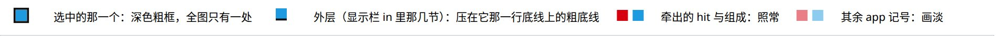
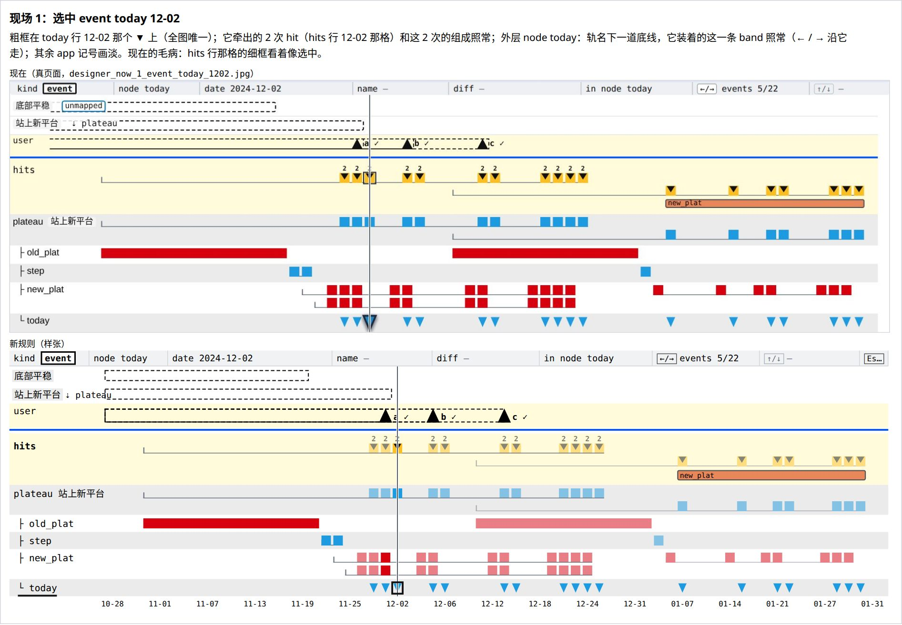
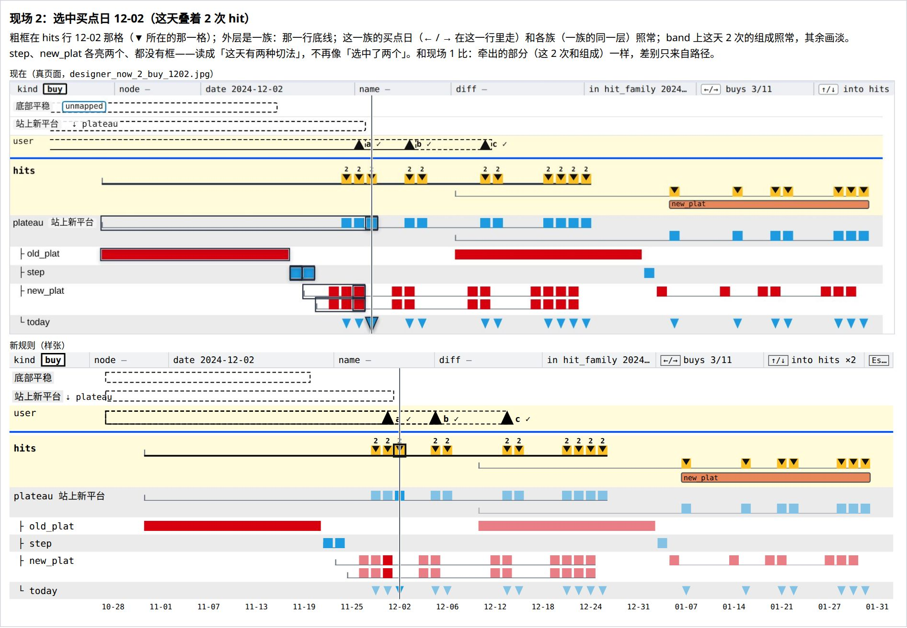
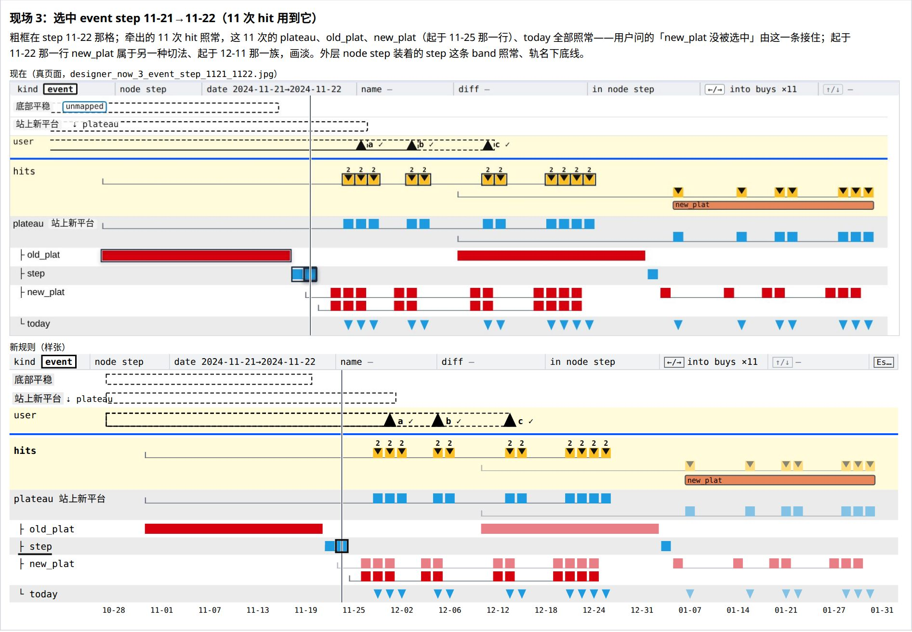
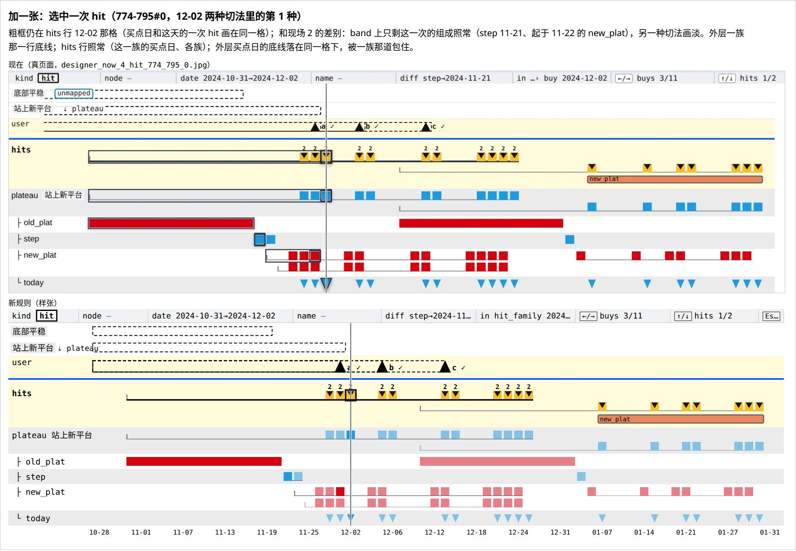
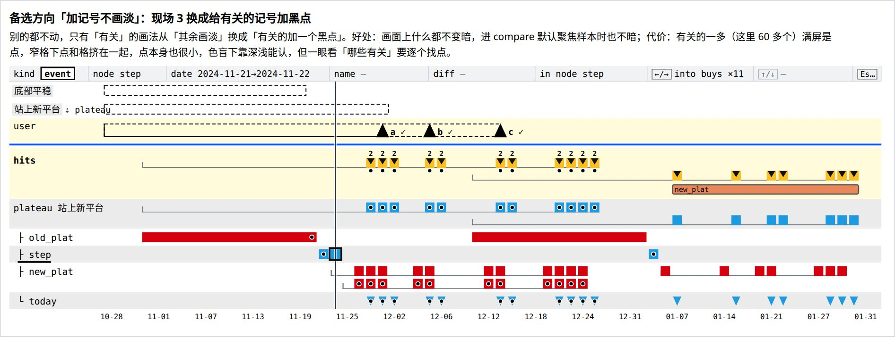
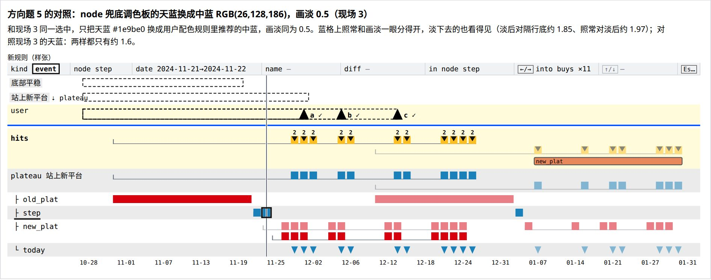

# 选中后图上怎么画：白话版

> 来源：同目录 `final_report.md`（2026-11-12），它汇总了 `design.md` 第 9 稿、`inventory.md`、`challenge.md`。这次只出设计，正式代码一行没改。图都在 `repro/screenshots/`：每张上半是现在的真页面，下半是新规则的样张（按 CRNC 的真数据手画，不是真页面）。

## 一句话版本

以后图上只用三样东西说话：**粗框**只框你选中的那一个；**底线**标你是从哪几层走进来的；**跟它有关的照常，其余变淡**。「有关」不再加任何框，所以竖线上永远只有一个框，那就是你选中的。

## 词表

| 词 | 意思 | 出处 |
|---|---|---|
| hit | app 认出的一次完整走势，一次 hit 由几个 event 组成 | `path2/GLOSSARY.md:95` |
| event | 图上 band 里的一格、一条或一个点 | `path2/GLOSSARY.md:44` |
| 复合事件 | 由几个子段拼成的 event，如 plateau 由 old_plat、step、new_plat、today 拼成 | `path2/GLOSSARY.md:62` |
| band | 副图里按 node 分的一条轨 | `path2_web/GLOSSARY.md:39` |
| 牵出的 hit | 选中卡 `hits` 那一行数到的那几次（选 event 时是用到它的那几次，选买点日时是那天叠着的那几次） | 规格 5.8 |
| 同一层 | ← / → 在它们之间换来换去的那一串（一族里的各个买点日、各个样本……） | 规格 5.8 |

## 现在为什么看不出选中了哪个

真页面上逐个核过，原因有四个：

1. **选中的和有关的画成同一种框。** 选中的是深色 2.5 像素框，有关的是同一个颜色的 1.5 像素框，连阴影都一样。默认视窗下一格只有两三个像素宽，这 1 像素的差别根本看不出来。当前日竖线和一族的粗底线也是这个深色。
2. **选中买点日时，▼ 本身一点标记都没有。** 画 ▼ 的代码只在选中「一次 hit」时才画框。
3. **选中一整天时，把这天几次 hit 的组成都框了出来。** 12-02 那两次 hit 用的 step 和 new_plat 不是同一个，于是每条 band 框了两个，看起来像选中了好几个。
4. **选中 event 时，有一条旧规则会顺手去框一个上层的 plateau 和它的整套子段。** 它默认一个子段只属于一个 plateau，取找到的第一个。可现在一个子段常被很多 plateau 共用：step 11-21→11-22 被 39 个 plateau 共用，只有 11 个进了 hit。挑中的那个往往不在任何 hit 里，在 `in_hit` 档下根本画不出来。你看到「new_plat 没被选中」，就是这个原因。

## 新规则：三样东西各答一个问题

```
  你想知道的                 图上看什么                  显示栏 / 选中卡里对应的
 ─────────────────────────────────────────────────────────────────────────
  我选中的是哪一个？      →  粗框（全图只有它一个）  →  kind
  我是从哪几层走进来的？  →  它外面各层下面的底线    →  in
  跟它有关的是哪些？      →  照常；其余的变淡        →  hits、nodes、两个键槽
```



「有关」具体指什么，只有三种，都是数据里现成的关系：

- **它的组成**：一次 hit 由哪些 event 组成；一个复合事件由哪些子段组成。
- **它牵出的 hit**：就是选中卡 `hits` 那一行数到的那几次。
- **这些 hit 的组成。**

另外，你按 ← / → 能换到的那一串（同一层）也照常，只是不带它们的组成。这样你按键会去的地方，图上都没被淡掉。

**变淡按「边」算。** 图上分两边：app 那边（hits 行和各条 band）和你那边（特征轨的框、样本、反馈）。哪一边里有跟选中有关的东西，哪一边其余的才变淡；一边里一个都没有，这一边原样不动。所以选中 app 的东西时，你的框原样留着，正好拿来对照。

还有一个顺带的好处：选中了却整张图都没变淡，本身就是信息，说明 app 在这里什么都没认出来，或者这个东西没被任何 hit 用到。

## 你那三个现场，现在和以后

### 选中 event today 12-02



以后：只有 today 12-02 那个 ▼ 有粗框；用到它的 2 次 hit 和这 2 次的组成照常，其余淡掉。hits 行 12-02 那格是照常，不再带框，所以不会被看成「选中」。

### 选中买点日 12-02（这天叠着 2 次 hit）



以后：12-02 那格有粗框，补上了现在缺的标记。band 上 step、new_plat 各亮两个但都不带框，读成「这天有两种切法」，而不是「选中了两个」。按 ↓ 进到其中一次后，就只剩这一次的组成照常。

### 选中 event step 11-21→11-22（被 11 次 hit 用到）



以后：step 那格有粗框；用到它的 11 次 hit 照常，这 11 次的 plateau、old_plat、new_plat、today 也全部照常。「new_plat 为什么没被选中」由此接住：new_plat 照常，因为它和 step 在同一次 hit 里。另一种切法的 new_plat 和不相干的那一族变淡。

### 加一张：选中一次 hit



粗框和选中买点日时在同一格。区别在照常的范围：这里只剩这一次的组成，另一种切法淡掉。显示栏 `kind` 写 `hit`，`↑/↓` 那格写着是第几次。

## 要你定的六件事

> **2026-11-13 已定**：方向 1、2、3、5、6 照推荐。方向 4 改成「同一天叠着几次 hit 时只亮一次」：有配对的亮配对那次，没有就亮侧栏排第一的那次（↓ 进去的第一个）；同一天别的几次的组成变淡，想看就按 ↓ 进去用 ↑/↓ 换，Esc 退回。这条对所有选中都一样：样本、框、买点日、event、一族、反馈。所以上面现场 1、2 里 step、new_plat「各亮两个」，以后变成只亮第一次的那一套。hits 行格子上方的个数成了「这天还有别的几次」的提示，它现在会被当前日竖线盖住，要一起修（默认让数字压在竖线上面、带白边，待验证）。下面保留的是当时的题面。

编号和 `final_report.md` 第 6 节一致。最要紧的是方向 1 和方向 5，它们是连在一起的，所以放在最前面。

**方向 1：「有关」用「其余变淡」来表达，还是给有关的加小黑点？**
- 推荐变淡：竖线上只剩一个框，有关的再多也不会满屏是框，窄格下照样分得开。annotate 里你已经见过「淡 = 这会儿跟你选的无关」。代价是一选中，图上就有一大片变浅；想看全貌得按 Esc。
- 备选是加小黑点（下图）：画面不会变浅，但有关的一多就满屏是点，格窄时点和格挤在一起。



**方向 5：把 node 默认颜色里的天蓝换成中蓝。**
- 推荐换。天蓝本身就离浅灰底很近，淡到「还看得见」时，它和没淡的天蓝也只是刚好勉强分得开，两头都卡在线上。换成你配色规则里推荐的那个中蓝 RGB(26,128,186)，两头都有富余（下图，对照上面现场 3 那张）。
- 代价有三个：没自己声明颜色的 app，蓝色 node 都会深一档；旧扫描文件要重扫才换色；这个中蓝和侧栏 hits 列表的蓝条是同一个颜色。



**方向 2：compare 一打开时自动聚焦的那个样本，算不算选中？**
- 推荐算：一进来看到的就是这个样本日 app 认出了什么、哪几个框是它的成员，和 compare 在样本之间走的用法一致。
- 代价：一打开两边就各淡一片，你那边不是成员的框也会淡（现在自动聚焦时不淡），每换一个样本重淡一遍。
- 备选是「自动聚焦不算」：一打开就是全貌，但这是规律的一个例外，要多记一条。
**方向 3：去掉那条「顺手框一个上层 plateau」的旧规则。**
- 推荐去掉。它挑中的 plateau 多半是错的（上面第 4 个原因）；进了 hit 的子段，它在 hit 里跟谁一起，由「牵出的 hit 的组成照常」给出，不缺。
- 代价：选中一个没进任何 hit 的子段时，不再顺带亮出它属于哪个 plateau，要看就去点那个 plateau。这是去掉一项查看能力，所以要你点头。
**方向 4：选中样本或框时，亮那天在场的全部几次 hit，还是只亮配对的那一次？**
- 推荐全部：和选中卡 `hits` 一行写的、和选中买点日时一个口径。
- 代价：想看配对那次的组成，要多按一下 ↓。配对的是哪一次，卡上 `paired` 一行写着。
**方向 6：app 侧栏 hits 列表怎么标？**
- 推荐：你选中的东西由哪几次 hit 组成，那几行描黑粗边；它牵出的 hit 挂左侧蓝条。
- 理由：按规格现在那句话，app 模式下点一个 ▼ 时，整族每一行都挂蓝条，认不出这一天是哪两行。新标法下这天的两行描黑边，一眼认出。
- 这改了规格里已定的一句。

## 我们先定、标「待验证」的数值

这些不用你定，实施后在真页面上看着调：

- 变淡的程度（默认半透明）、粗框和底线的粗细。
- 选中的东西不在视窗里时，图自动平移过去。
- 选中的东西在当前档位下画不出来时，在它那条轨名旁挂一个 `hidden` 小标签，并框住这个标签。
- 选中样本时成员框不再加粗。

## 还没把握的地方

- **最大的风险是「变淡」到底分不分得清。** 整套设计里「有关 / 无关」全靠这一个深浅差别，可它只在手画的样张和公式估算上看过，没在真页面上看过。负责挑毛病的那个队友建议：实施时先把变淡做成一个能调的开关，你在 CRNC 这三个现场上看一眼，再定方向 1 和方向 5。
- **灰色的 qualified、detected 格一变淡，几乎就看不见了。** 只在你切到那两档、而且是别的 band 上无关的灰格时才会这样，点一下空白就全回来。
- **有一类 app 里 hit 的格上没有 ▼，那种格照常和变淡几乎分不开。** 就是 hit 的最后一天不是买点日的那类 app，得到那类 app 上实测。
- **只在 new_step 一个 app 上画过。** 别的情形是照规律在纸上推的：一次 hit 买好几天、两族同一天都买、画在主图上的 node。
- **手感没试过。** 一选中整张图明暗跟着变，比现在只挪几个框动静大，用起来烦不烦不知道。
