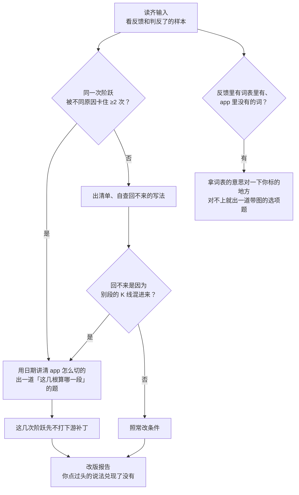

# 标注一轮的反思：skill 要不要改（白话版）

> 来源：同目录 `final_report.md`（2026-11-16 05:06 版，critic 已签字，签字与保留意见见 `critic_signoff.md`）。
> 回答的是你的两个问题，原话见同目录 `原始问题.md`：
> 1. 第 1 轮之所以要你亲自重定义「阶跃」「派发」，skill 能不能改得更聪明，至少自己起疑？还是本来就注定要多轮？
> 2. （追加）skill 该不该先理解你的意图、再推荐和完善，由你点头，而不只是翻译？

## 一句话

**小改四条规则，不重新设计。** 具体的新认法确实注定要多轮，要由你看图来定：最高价判断阶跃结束、派发看阶跃涨幅被吃掉多少。但「阶跃可能切错了」「你说的派发不是词表里那个意思」这两个**怀疑**，第 1 轮手上就有证据。缺的不是证据，是一条规则，让会话把这两个怀疑**作为一道题**摆到你面前。

追加问题的回答：**要，但不是加一种新功能**。现在的清单本来就是「会话推荐、你可以反对」，第 1 轮摆出来的翻译你当场截住了大半。缺的是覆盖面：app 怎么切你的阶跃，从来没作为一个问题问过你。

## 会反复出现的词

| 词 | 意思 | 出处 |
|---|---|---|
| 阶跃、新平台、旧平台 | 你在 pattern 定义里用的词：几根大阳线把价位抬上去，前面是旧平台，后面是新平台 | 你的 pattern 定义 |
| 正样本 | 你标的「这天该买」 | `path2/GLOSSARY.md:157` |
| 反馈 | 你在 `compare` 里对 app 买错的地方写的那句话 | `path2_web/GLOSSARY.md:78` |
| 派发 | 高位出货。本轮你刚把它从「单根放量收阴带长上影」放宽成多种痕迹 | `path2/GLOSSARY.md:33` |
| detector | 从 K 线里认出某种结构（如阶跃）的那部分代码 | `path2/GLOSSARY.md:50` |
| setback | 只在当天不买，好转了同一次照样买 | `path2/GLOSSARY.md:197` |
| invalidation | 这一次从此作废，之后再好也不买；只能用在你明说的地方 | `path2/GLOSSARY.md:192` |
| 切法 | app 把一张图上哪几天算阶跃、哪几天算新平台 | 本文用语 |

## 第 1 轮为什么没发现

先说事实。你后来指出的定义问题共 7 个，研究员把改之前的 app 重跑了一遍，逐条查第 1 轮各步屏幕上有没有证据。

**阶跃切错，屏幕上有硬证据的 3 处，会话都看见了，但每处都就地修了症状，没往切法上想：**

- **KULR 2024-12-16（正样本没买到）**：11-29 那根 +61%、12-02 冲到 14.0（阶跃顶的两倍），都被 app 算在新平台里。会话把它读成「波动小这条从新平台第一天累计、回不来」，于是改成只看最近 10 天。
- **IXHL 2025-07-25（反馈）**：07-24 那根 +61% 被划进新平台。
- **IZM 2024-04-16（反馈）**：app 算的新平台 04-11～04-15 天天收涨、最高价一天比一天高，其实阶跃还没完。

另有两张 KULR 2024-03 的正样本，卡在阶跃起点认晚了：03-20（+31%）、03-25（+57%）两根大阳线被留在旧平台里。会话只修了「波动算成 0」这个特例。

**skill 里有四处规则，合起来把切法挡在了视野外：**

1. 检查你画的框，只看框的终点那天有没有事件，起点不看。你也没画阶跃框，所以这项检查永远对得上。
2. 读输入时，只要求看反馈和 app 判反了的样本。判对的样本不看，QBTS 2024-11 就这样漏过。
3. 每轮自查「回不来的写法」时，明文不管切段。而这项自查里的一句现成示例，恰好把 KULR 12-16 预先归成了「回不来」，会话就照着去改了窗口。
4. 新条件撞上正样本时，规则只给了「这是门槛问题」一个出口，没有一条说「同一张正样本反复挡路时，先怀疑这张图切得对不对」。

**补丁带来的连锁代价是实打实的。** 「波动小」改窗口后，在 13 只股票上多放出约 75 天买点，IXHL 8～9 月那几天就是这样放出来的。这个数是 lead 第 1 轮实测的，本次没有复算。为了挡这几天，会话又试了「新平台冲高算前高」，结果误杀了正样本 QBTS，只好撤回。

**派发同理。** 你有 5 处反馈写着「机构已经派发获利」，词表里有「派发」，还有一个现成的派发 detector，app 里却完全没有这个概念。会话只翻了「涨幅过大」那半句，「派发」那半句没有去处。其实拿词表的意思去对一下就会发现：现成 detector在你标派发的 6 处只认出 1 根，在 10 张正样本附近反倒频繁报出。对不上，本身就说明你说的派发不是词表里那种。

## 是不是注定要多轮

分两半：

- **怎么改，确实要多轮。** 用最高价判断阶跃结束、同一起点只留一个阶跃、停顿后续上的两个限定、派发看「阶跃涨幅被几天内吃掉多少」，这些都是你看了第 1 轮的错误买点才说得出的取舍，会话替你定不了。
- **该怀疑，第 1 轮就够得着。** 证据在屏幕上，缺的是让会话起疑并问你的规则。

所以收益**不是「早一整轮」**：改切法牵动几乎所有条件，照样要单独一轮做。真正的收益有三样：

- 第 1 轮少打几个建在错切法上的补丁；
- 你不用自己从 `compare` 里诊断出「是切法的问题」；
- 新认法变成你回答会话摆出的一道题，而不是你自己从图里挖出来。

## 推荐的四条改动

**改动一：先怀疑切法（主改动）。** 两种情况任一出现就触发：同一次阶跃反复被**不同的**原因卡住两次以上；或者某处「回不来」，是因为按你的定义本该属于相邻一段的 K 线混了进来。触发后，会话用具体日期讲清 app 在这几张图上怎么切的，出一道方向题：「这几根按你的意思算阶跃还是新平台？」选项固定三个：改切法、现在的切法对、先放着。同时，这一轮先不在这几次阶跃上打补丁。

- **拿第 1 轮回放**：出清单之前会触发 4 次。3 次正是你后来点名的 KULR 2024-03、KULR 2024-11、QBTS 2024-11，1 次是误报（SMX，建在数据错误上，看图时就能撤掉）。漏掉 IXHL 和 LUMN。不过切法题问的正是「冲高那几根算哪段」，你的回答同样会作用到 IXHL 上。
- **题数不变**：这道题替掉原来那道 KULR 11-29「没追涨」，第 1 轮仍是 4 道题。
- **为什么非得出题**：第 1 轮清单其实已经把 11-29 +61%、03-25 +57% 这些日子写给你了，但讲的是「累计振幅回不来」「波动算成 0」，你没有异议。同样的日子，换成「这几根算哪一段」来问，你一听就给出了重定义。光给信息不够，得作为问题问。

**改动二：反馈里每层理由都要有去处。** 一句反馈里有几层理由，就要给几层找去处：翻成条件、记为「当天看不出」、或出题问你，不能只翻能落到现成字段的那一层。反馈里出现词表里有、app 里没有的词时，先拿词表的意思去对你标的那几处。对不上，就出一道挂在图上的选项题，会话的读法排第一，固定留「都不是，我来描述」，并顺带提醒一句这个词要不要改词表。第 1 轮只在「派发」上触发，没有误报。

**改动三：改一个固定选项的措辞。** 「写进定义，这种以后不买」读起来像作废，和 skill 自己「默认是 setback」的规矩矛盾。第 1 轮 CAPR 那题你正是因此反问。改成「出现这种情况的那几天不买，好转了同一次照样买」。零成本。

**改动四：你点过头的说法，报告要交代兑现了没有。** 下一轮待办文件开头写着「用户已同意，不再出题」，这是会话被一次点头锁死的现成例子。改成：报告单独交代点过头的那几条在推出它的几处兑现了没有。没兑现的分两种：

- 方向本身在你的图上被证明不对，下一轮重新问你；
- 实施没到位、被别的改动放出了日子、或数据有问题，会话照实交代、自己接着改，不推回给你。

第 1 轮两个没兑现的例子（IXHL 前高之后还剩 6 天在买、SMX 被误伤）按这个分法都不该重问。

**明确不动的**：「方向归用户，翻译归会话」；不问拓扑、detector 选型和门槛；每轮 3～5 道题的上限。

## 追加问题：要不要「理解后推荐、你点头」

**要，做法是把已有的「推荐 + 点头」接到切法上，由证据触发，不做成每轮固定的复述。**

- **和「方向归用户」不冲突。** 代码怎么切（用收盘还是对数收益、参数放哪）仍归会话；**哪几根 K 线算你说的阶跃**，是你那个词本身的意思，本来就是方向。skill 现在把它误归进了「detector 的事、不问你」。
- **摆出来就有用，这有数据。** 第 1 轮有 6 处翻译只照了字面、没翻出背后的道理：
  - 用白话摆进清单的 3 处，你当场截住 2 处：「涨幅比较」改成比价格，「这种以后不买」改成 setback；
  - 没摆出来的 2 处，即「派发」那半句和阶跃切法，一处也截不住，只能等你看 `compare`；
  - 剩下 1 处是交报告后讨论里用了绝对跌幅，你当场纠正了。
- **推荐本身不是瓶颈。** 话题一摆上桌，会话就补了四条完善（只往后覆盖、续上要两个限定、阶跃顶用最高价而抬高多少用收盘、起点往前找），你全都同意了。缺的是「什么时候把话题摆上桌」。
- **为什么不每轮固定复述一遍切法**：每轮读一段没变的说明，几轮后就成了点头仪式。
- **锚定风险两个方向都有**：
  - 你可能顺手选排第一的推荐。对策是讲具体日期、固定留「现在的切法对」、只在触发时问。
  - 会话可能被你的点头锁死。由改动四管。
- **点头之后照样要看 `compare`。** 点头只能省掉「会话理解错了你的意思」那类返工，发现不了「这个说法本身不对」。

## 等你定的两件事

1. **要不要在第 2 轮出清单之前，把这四条落进 skill。**
   - **背景**：第 2 轮今天 04:00 已经开了头，我先把当时 app 的买点记了一份，还没出清单。规则要在第 2 轮生效，就得在出清单之前改好。
   - **推荐：四条都在出清单前落进去。** 四条都只是改 skill 的文字，几处改动而已。改动四和第 2 轮关系最直接：第 2 轮要实施的正是一整套你点过头的新阶跃认法，正好检验「点过头的说法兑现了没有」这一条。
   - **不落进去**：第 2 轮照旧流程走，这四条留到以后的 pattern 再试，第 2 轮就检验不到它们。

2. **起疑之后，这一轮还打不打补丁。**
   - **推荐：先不打**，团队就是按这个写的。理由是第 1 轮的补丁连锁代价实打实：「波动小」改窗口放出约 75 天，为挡其中几天又误杀 QBTS。而且切法一改，这些补丁多半要重做。
   - **先不打的代价**，有四件事要摆在明面上：
     - 那几次阶跃上的正样本这一版仍买不到。按第 1 轮算，是 KULR 03-27、04-01、12-16 三张。
     - 累计算的「波动小」这一轮原样留着。它是一条你没明说过的「回不来」写法，和 invalidation 只能用在你明说之处的规矩（`path2/GLOSSARY.md:192`）有冲突。处理办法是在报告里写明「会话暂时保留，等切法定了再改」，你可以当场反对；你选「先放着」时，下一轮还要再问，不能一直留着。
     - 会连带押后一个和切法无关的冲突：「企稳」那条的窗口，原本被 KULR 04-01 卡到只能看当天。切法改完后它还会撞上，到时候再作为正常的题问你。
     - 有一句护栏：起疑的那几次阶跃不参与定门槛，门槛可能因此收紧。规定原本买得到的正样本不能因此变成买不到；会变的，就保留原门槛，并在报告里点名。
   - **另一条路**：补丁照加，标明「切法待定」。这一版看得见的改进多，但可能重演第 1 轮的补丁连锁。
   - **眼下影响不大**：第 2 轮本来就要改切法，这条主要影响以后的 pattern。

## 局限

- **只有 1 轮、1 个 pattern、13 只股票、16 张正样本、10 处反馈。** 触发条件是知道答案之后设计的，回放也在同一份数据上做，要换一个 pattern 或下一轮才能知道是不是贴着第 1 轮量身定做了。
- **「你点名的」当真值有循环。** 你后来点名的那几次阶跃，本来就是从会话摆到你面前的冲突里挑出来的，所以「触发恰好落在点名的阶跃上」不全是信号准。QBTS 这一次最弱。
- **测不了会话会不会真照做。** 回放默认会话按规则做对了。可规则要求的那个判断（这几根按你的定义该归相邻一段），正是第 1 轮会话没做出来的。规则写上之后会话会不会真照做，要到第 2 轮才看得出。
- **有两种计数要盯住。** 「门槛只能靠这张正样本定」「拟加的条件和它分不开」这两种，不需要正样本真被挡掉就会计数。如果下一个 pattern 上主要靠它们触发，就降级不算。
- **没量任何后续涨跌**；「约 75 天」「11 天」是 lead 第 1 轮实测的，本次没复算。

## 附表

**改动一的回放（第 1 轮，出清单之前）**

| 在哪一步 | 哪次阶跃 | 被哪几种原因卡住 | 结果 |
|---|---|---|---|
| 读输入 | KULR 2024-03 | 03-27 连阶跃都没认出、04-01 涨幅不够 | 你后来点名 |
| 读输入 | KULR 2024-11 | 11-29 卡「没追涨」、12-16 卡「波动小」 | 你后来点名 |
| 出清单 | QBTS 2024-11 | 「新平台缩量」门槛只能按它定（0.62，正是冲高根被划进新平台造成的，划回阶跃约 0.45）；「连续放量太久」和它分不开 | 你后来点名 |
| 出清单 | SMX 2025-12 | 两条拟加条件都会挡它 | 误报（数据错误） |
| — | IXHL 2025-07、LUMN 2024-07 | 没触发 | 漏 |

**被砍掉的做法（量过、不好用）**

| 做法 | 为什么砍 |
|---|---|
| 拿你的框对 app 的切段 | 你没画阶跃框，新平台框终点恒对得上，报不出东西 |
| 「新平台里有比阶跃还猛的 K 线」 | 样本和反馈上 0 次 |
| 「新平台最高价超过阶跃顶」 | 192 个买点里报 90 个，太吵；抬到超 20% 又漏 KULR 11-29 |
| 「阶跃前一根最高价抬高」（找起点） | 16 张样本里报 10 张，太吵 |
| 判对的样本也逐张看图 | 判反了的 IXHL、KULR 当时就在屏幕上，会话也没起疑：看见不等于怀疑 |
| 每轮固定复述一遍切法 | 会变成点头仪式 |

另外有三项被删减：把「相对尺子优先」写成规则（没有证据能抓到流程内的错）、同一条规则在多个文件里重复写、改写 detector 的 skill 的提问条件（第 1 轮找不到只有它能抓到的例子）。

**派发的对照**

| | 现成派发 detector报出 |
|---|---|
| 你标派发的 6 处反馈 | 1 处（CAPR 阶跃当天本身） |
| 16 张正样本（样本日前 25 天内） | 10 张，分属 7 次阶跃 |
